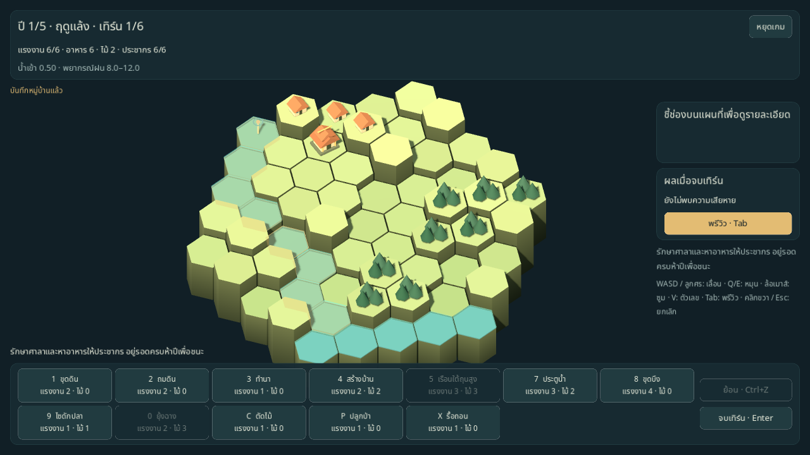

# หน้าจอเล่นเกม M4

F5 เข้าเมนูหลักแล้วเริ่มรอบใหม่หรือ Continue ได้ เกมที่ราบลุ่มใช้กฎ M3 ครบ 5 ปี พร้อมแรงงาน/ไม้ คำสั่ง พรีวิว undo สรุปปี และผลแพ้/ชนะ นี่เป็นเวอร์ชันสำหรับทดลองเล่นจริง ยังไม่ปิดเกณฑ์สมดุล M3 หรือการตรวจโดยผู้เล่นของ ROADMAP



[ภาพเมนูหลักภาษาไทย](images/m4-menu-th.png)

## การเล่น

- เกมใหม่เลือกผู้นำ 4 คนและ seed ได้ ใช้แผนที่ plains และ difficulty 0 ระหว่างรอระบบโปรไฟล์/ปลดล็อก M5 ถ้ามีเซฟอยู่จะยืนยันก่อนเริ่มรอบทับ
- HUD แสดงปี ฤดู เทิร์น แรงงาน อาหาร ไม้ ประชากร/ความจุบ้าน น้ำเข้าเทิร์นปัจจุบัน และช่วงพยากรณ์ ไม่เปิดเผยฝนล่วงหน้าที่ซ่อนอยู่
- คำสั่งแสดงชื่อ ปุ่มลัดและต้นทุนตามฤดู ปุ่มที่ไม่มีเป้าหมายจะปิดพร้อม tooltip; คำสั่งยังไม่ปลดล็อกถูกซ่อน ไฮไลต์เป้าหมายและชี้ช่องดูเหตุผลที่ทำไม่ได้
- คลิกแล้วใช้คำสั่งเดิมซ้ำได้ Esc/คลิกขวายกเลิก; Esc เมื่อไม่ได้เลือกคำสั่งเปิดเมนูหยุดเกม คลิกประตูน้ำขณะไม่มีคำสั่งเพื่อเปิด–ปิด ระหัดเลือกตำแหน่งแล้วเลือกเพื่อนบ้านเป็นทิศรับน้ำ
- Tab สลับพรีวิว: ผิวน้ำหลังเทิร์น ป้าย `!` สิ่งก่อสร้างพัง, `x` นาตาย, `+1` นาได้ผล และ `+n` อาหารจากปลา แผงขวารายงานข้อความประกอบสี
- พรีวิวเทิร์นสุดท้ายของปีแสดงผลเก็บเกี่ยว กิน ขาดอาหาร ขาดที่อยู่ เกิด เน่า และอาหาร/ประชากรคงเหลือ โดยจำลองบนสำเนาเกมหลังน้ำและความเสียหาย ไม่แก้เกมหรือเซฟจริง หากศาลาพังก่อนเก็บเกี่ยวจะไม่แสดงสรุปเก็บเกี่ยว
- ก่อนจบเทิร์นที่จะแพ้ให้ยืนยัน รวมการอดอาหารตอนเก็บเกี่ยวแม้ปิดพรีวิวอยู่ ฤดูฝนที่เหลือแรงงานอย่างน้อย 2 ให้ยืนยันอีกแบบและจำตัวเลือกไม่ถามซ้ำใน settings
- หน้าสรุปปีแสดงผลเก็บเกี่ยว กิน ย้ายออก เกิด เน่า และยอดคงเหลือ ก่อนเริ่มปีถัดไปหรือดูผลจบ รอบแพ้ศาลาจบได้ทันทีตามกฎ
- กล้องใช้ WASD/ลูกศร, Q/E หมุน, ล้อเมาส์ซูม, ลากเมาส์กลางเลื่อน และ V แสดงระดับ ขณะมีหน้าต่างซ้อน กล้องและคำสั่งกระดานหยุดรับ input

## บันทึกและโหลด

`GameSession` เชื่อม GameFlow กับ [SaveIO](SAVE_IO.md) หลังเริ่มเกม คำสั่งสำเร็จ undo จบเทิร์น และผ่านสรุปปี รวมทั้งบันทึกซ้ำก่อนกลับเมนู/ปิดหน้าต่าง คำสั่งที่ไม่ผ่านไม่เขียนไฟล์ เมื่อเข้า GAME_OVER จะลบเซฟตามสเปก

Continue แสดงเมื่ออ่านและตรวจเซฟสำเร็จ โหลดแล้วอยู่บนกระดาน/สรุปปีเดิม ไม่เก็บเกี่ยวซ้ำ และไม่คืนแรงงานที่ใช้ไป ประวัติ undo เริ่มใหม่ตาม S-05 เมื่อเซฟล้มเหลวมีข้อความคงอยู่ ให้ลองบันทึกใหม่ หรือเลือกออกโดยไม่บันทึกอย่างชัดเจน

ห้องทดลองน้ำและบอทเรียก GameFlow โดยไม่มี GameSession จึงไม่เขียนทับเซฟรอบปกติ กลับเมนูจาก sandbox ด้วย Esc หรือปุ่มเมนูหลัก

```sh
godot --path . -- --scene=menu --lang=th
godot --path . -- --scene=game --seed=1 --lang=th --save-path=user://test-run.json
godot --path . -- --scene=sandbox --seed=42 --lang=en
```

`--scene=game` เริ่มเกมใหม่และเขียนเซฟ จึงควรระบุ `--save-path` แยกเมื่อทดลองอัตโนมัติ ภาษาที่เลือกจากเมนูเก็บใน `user://settings.json`; `--lang` ใช้กำหนดภาษาตอนเปิดโดยไม่เขียนทับค่าตั้งไว้

## ภาษาและภาพ

ข้อความเกมหลักมาจาก `translations/strings.csv` ทั้งไทยและอังกฤษ พร้อมตรวจ key/placeholder ฟอนต์ใช้ Noto Sans Thai ที่แนบ OFL มี line spacing +4 แทน Kanit ที่ยังไม่ได้รับไฟล์ เมนูและเกมใช้ container/anchor บนฐาน 1920×1080 และรองรับหน้าต่างขั้นต่ำ 1280×720

ลงทะเบียนไฟล์ `.translation` ใน project settings และเก็บ resource ที่ import แล้วใน Git เพื่อให้การเริ่มจาก checkout ใหม่ไม่ขาด resource ส่วน Localization อ่าน CSV เป็นหลักใน source tree และใช้ imported resources เมื่อ export ไม่รวม CSV การตรวจ parity เทียบข้อความครบทั้งสองภาษา นี่ยังไม่ใช่การยืนยัน export ทุก platform; presets อยู่ใน M9

เพิ่มโมเดลจากโค้ดสำหรับนา ประตูเปิด/ปิด ยุ้ง ไซดักปลา บึงและระหัด เพื่อแยกสิ่งที่สร้างได้บนกระดาน ยังไม่มี animation เทิร์น/เสียง/เอฟเฟกต์ตาม M6–M7

## การตรวจ

```sh
scripts/test.sh
scripts/test.sh --filter=game_screen
scripts/test.sh --filter=session
scripts/test.sh --filter=i18n
```

การตรวจสำคัญรวม autosave/undo/save failure, Continue และยืนยันเขียนทับ, modal หยุดคำสั่ง/กล้อง, waterwheel สองคลิก, gate และคำเตือนแพ้จาก harvest เทสต์ GameScreen เล่น farmer seed 1 ครบ 30 เทิร์น ผ่านสรุปปีทั้ง 5 และชนะ โดยโหลดกลับจากสรุปปีแรกแล้วได้สถานะ/คะแนนตรงเดิม ส่วน seed 42 อาจแพ้ศาลาในปีสุดท้ายตามกฎ ไม่รับประกันว่าทุก seed ชนะด้วยกลยุทธ์เดียว

ชุดรวมผ่าน **167 รายการ** บน Godot 4.6.3 และ smoke ของ menu/game/sandbox ไม่มี script error ต้นฉบับนำเข้าทั้ง 54 ไฟล์ยังตรง SHA-256 ใน manifest

ทดลองหน้าต่างจริงด้วย OpenGL Compatibility บน Xvfb/Mesa และ XTest ส่งเมาส์/คีย์บอร์ดจริง โดยแยก XDG directory ออกจากเซฟปกติ:

| กรณี | ผลตรวจ |
|---|---|
| ไทย 1280×720: เมนู → เกมใหม่ seed 42 | ข้อความ HUD และปุ่มจบเทิร์นอยู่ในหน้าต่าง |
| ขุดแล้ว Ctrl+Z | state ทุกฟิลด์กลับตรงเดิม รวมแรงงาน ช่อง และ RNG |
| Pause และยืนยันแรงงานฤดูฝน | ปุ่มคำสั่ง คลิกกระดาน เลื่อน/หมุน/ซูมกล้องไม่เปลี่ยนเกม |
| สร้างนา 3 ช่องและผ่านปีแรก | สรุปอาหารนา 2, กิน 6, เน่า 1, อาหารเหลือ 1, ประชากร 6 |
| HARVEST → เมนู → Continue | state ทั้งก้อนตรงเดิม, undo ว่าง, ไม่เก็บเกี่ยวซ้ำ |
| ปีถัดไปหนึ่งครั้ง | ปี 2 เทิร์น 1 อาหาร 1 ประชากร 6 |
| เปลี่ยนอังกฤษแล้ว Continue ที่ 1600×900 | เซฟเดิมและ HUD ถูกต้อง แผงขวามี scroll เมื่อข้อความยาว |
| เริ่มเกมใหม่ขณะมีเซฟแล้วกด Esc ยกเลิก | bytes ของเซฟเดิมไม่เปลี่ยน Continue กลับปี 2 ได้ |


native pass นี้ครอบคลุมหนึ่งปีและการโหลดผ่านเมนู ส่วนรอบครบ 5 ปีและ storage failure ตรวจผ่านชุดอัตโนมัติ การแก้ hover refresh และ quit/save-error ช่วงท้ายตรวจด้วย regression tests ไม่ได้นับเป็น native pass เพิ่ม ไม่มีการอ้างว่าการตรวจบน virtual display แทนการตรวจการ์ดจอหรือ export ทุก platform

ยังต้องให้คนเล่นจริงหนึ่งรอบและตรวจว่าการสื่อสารน้ำ/ผลเก็บเกี่ยวเข้าใจง่าย รวมถึงตรวจการบังคับทางน้ำตาม ROADMAP M2 ไม่มีการนับเทสต์อัตโนมัติแทนความสนุกหรือการทดลองโดยผู้เล่น
