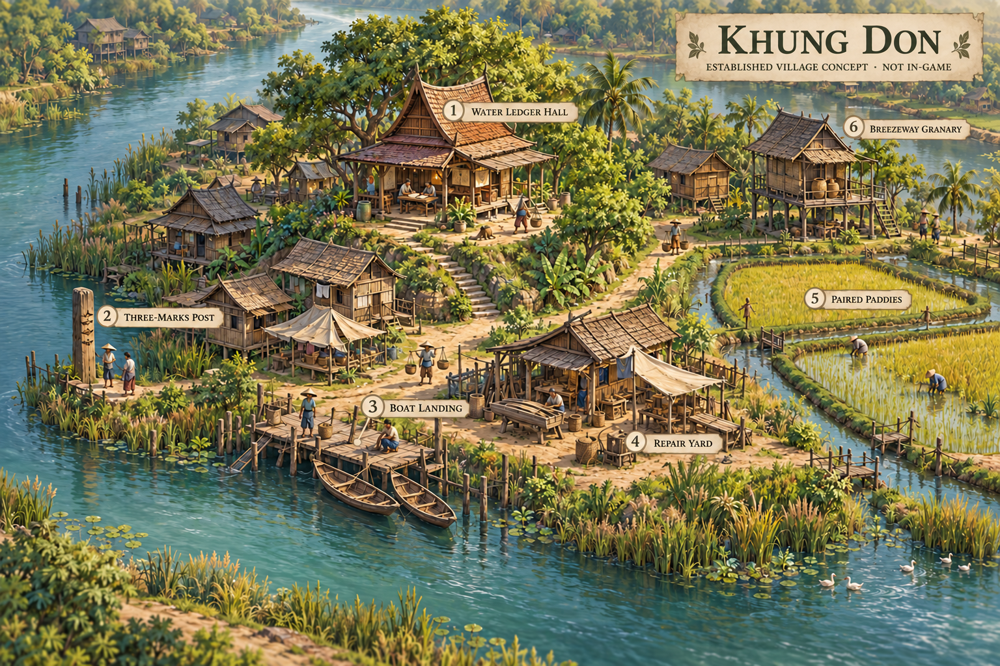

# ชุดเรื่องเล่าบ้านคุ้งดอน: สมุดที่ยังมีหน้าว่าง

สถานะ: **เนื้อหาที่เสนอ ยังไม่มีใน runtime** · 2026-10-24 · ต่อจาก [โลกของลุ่มน้ำสายหวน](WORLD_OF_SAI_HUAN.md)

ชุดนี้ทำให้บ้านคุ้งดอนมีสถานที่คุ้นตา เสียงของคน และจังหวะชีวิตที่ผูกกับสิ่งที่ผู้เล่นทำจริง ใช้แผนที่ `plains` และกฎเดิม ไม่เพิ่มคำสั่ง รางวัล ภารกิจบังคับ หรือค่าความสัมพันธ์

ภาพแนวคิดสร้างด้วย AI ใช้สื่อวัสดุ มุมมอง และพื้นที่ชีวิตของ **หมู่บ้านที่พัฒนาแล้ว** ไม่ใช่ภาพจากเกมหรือผังเริ่มต้นของ seed ใด นา ยุ้ง อาคาร และของตกแต่งที่เห็นเป็นตัวอย่างงานออกแบบ ไม่มีการเพิ่มสิ่งเหล่านี้ลง state จากการเปิดอ่านภาพ

## 1. หกจุดที่คนในบ้านคุ้งดอนเรียกชื่อ

ชื่อสถานที่เป็นกรอบงานภาพ ตำแหน่งจริงปรับตาม seed ไม่ใช่ผังบังคับให้ generator วางนา ยุ้ง หรือทางน้ำเพิ่มเพื่อให้ตรงภาพ วัตถุตกแต่งใช้ขอบเขตศิลป์ของพื้นที่เดิม ไม่ยึดช่องสร้างอาคารเพิ่มและไม่บังขอบ hex

| ชื่อ | ผูกกับอะไรที่มีจริง | ร่องรอยชีวิต | ภาพ/เสียงและมุมกล้องที่ใช้ได้ |
|---|---|---|---|
| **1 ศาลาสมุดน้ำ / Water Ledger Hall** | ศาลา `HALL` ที่มีอยู่แล้ว | สมุดเย็บซ่อมด้วยเชือกสามสี ม้านั่งมีรอยมือจับตรงเดิม | ไม้เก่ากับแผ่นซ่อมใหม่ เสียงเปิดกระดาษ; มุมเฉียงเห็นประตูศาลาและหลักน้ำ แต่ไม่บดบังไอคอนอันตราย |
| **2 หลักสามรอย / Three-Marks Post** | ของตกแต่งริมตลิ่งแห้งที่มีตำแหน่งเหมาะ | รอยบากเก่าจากปีรอยสูงและป้ายที่มีลายมือแก้ | ไม้หม่น รอยบากด้านหนึ่ง; กล้องเห็นหลักกับผิวน้ำปัจจุบันแยกกัน ไม่ตีความรอยเก่าเป็นระดับน้ำเทิร์นหน้า |
| **3 ท่าคืนเรือ / Boat Landing** | มุมตกแต่งขอบฝั่งใกล้น้ำ ไม่สร้างอาคารท่าใหม่ | ตะกร้าวางคว่ำให้แห้ง เชือกขดและรอยเสียดสีบนไม้ | เสียงตะกร้าครูดไม้กับน้ำเบา ๆ; หากไม่มีจุดฝั่งเหมาะให้เว้น ไม่สร้างเรือหรือทางเดินผ่านน้ำแทน |
| **4 ลานสางเชือก / Repair Yard** | พื้นที่ตกแต่งข้างศาลา/ลานแห้งเดิม | เชือกหลายขนาด ไม้ทดลองรอยต่อ และเครื่องมือที่จัดไม่เหมือนกัน | เสียงเคาะไม้เป็นช่วงสั้น; มุมกว้างอ่านคนและเครื่องมือได้โดยไม่ทำให้ดูเป็นปุ่มซ่อมบ้าน |
| **5 นาคันคู่ / Paired Paddies** | กลุ่ม `PADDY` ที่ผู้เล่นสร้างแล้ว; ใช้ชื่อคู่เมื่อมีสองแปลงติดกันจริง | ตะกร้าสานตั้งริมแปลงและทางยืนดูต้นข้าว | มุมต่ำเฉียงเฉพาะเมื่ออ่านนา; ถ้ามีแปลงเดียวใช้ชื่อ “ริมแปลงนา” ไม่เพิ่มนาให้ครบคู่ |
| **6 ยุ้งลมลอด / Breezeway Granary** | อาคาร `GRANARY` ที่ยังอยู่จริงเท่านั้น | ชายคาไม้เก่ากับไม้เปลี่ยนใหม่ จุดพักกระบุงหน้าอาคาร | เสียงวางภาชนะและฝีเท้า; ปริมาณของประกอบภาพอิง state ไม่ใช่รางวัลหรืออาหารอีกก้อน |

ศาลา หลักน้ำ ท่า และลานซ่อมเป็นชื่อพื้นที่/ของตกแต่ง ไม่มี stat หรือคำสั่งใหม่ ส่วนคันนาและยุ้งต้องรอให้ feature/building นั้นมีจริง เมื่อยังไม่มีนา/ยุ้ง ให้เล่าเรื่องจากศาลาหรือรายงานตามปกติ ไม่สร้างสิ่งปลูกสร้างให้บทพูดโดยอัตโนมัติ

คนเดินและทางเดินใช้ข้อจำกัดของ [หมู่บ้านมีชีวิต](../features/LIVING_VILLAGE.md) ไม่มีทางแห้งก็ใช้ข้อความหรือภาพนิ่ง ไม่เพิ่มเส้นทางลัดและไม่บังคับว่าข้าวต้องขนถึงยุ้งด้วยภาพจึงได้อาหาร

## 2. บทเปิดที่อ่านและปิดได้

**ชื่อบท: “หน้าที่ว่างในสมุดน้ำ” / “A Blank Page in the Water Ledger”**

บทนี้เป็นคำฝากของตัวละครในโลก ใช้เป็นหน้าสมุดสำหรับรอบใหม่ ไม่อ้างว่าคนทั้งหกกำลังยืนอยู่พร้อมกันหรือเพิ่มประชากรหกคน ไม่มีตัวเลขทรัพยากรตายตัว เพราะ seed/ความยาก/กฎที่เริ่มอาจต่างกัน

1. **ยายแสง:** “สมุดเล่มนี้อยู่ที่ศาลามานาน แต่หน้าปีนี้ยังว่างอยู่”
2. **ต้น:** “ข้าจะคัดรอยจากหน้าเก่ามาก่อนไหม?”
3. **ชื่น:** “เก็บรอยเก่าไว้ดู แล้วค่อยดูว่าที่ตรงหน้าเหมือนเดิมหรือเปล่า”
4. **นวล:** “แปลงที่เราเลือกปีนี้ ยังต้องพาข้าวไปให้ถึงวันเก็บเกี่ยว”
5. **เมฆ:** “ระหว่างรอข้าว ก็ยังมีเรื่องของน้ำให้เฝ้ามอง”
6. **พิม:** “รอยเก่าเล่าเรื่องก่อน วันนี้ต้องดูน้ำตรงหน้าให้ดี”
7. **ต้น:** “แล้วถ้าสิ่งที่เลือกไม่เหมือนในสมุดล่ะ?”
8. **ยายแสง:** “ก็จดเหตุที่เลือก อย่าเพิ่งจดว่าใครถูกหรือผิด”
9. **ชื่น:** “ค่อยวางแผนให้เข้าที่ แล้วดูว่างานชิ้นต่อไปจะช่วยตรงไหน”
10. **นวล:** “ตอนเห็นข้าวขึ้น อย่าเผลอนับเป็นอาหารในคลังเสียก่อน”
11. **เมฆ:** “ข้าวกับปลามาถึงคลังคนละจังหวะ”
12. **ยายแสง:** “หน้าถัดจากนี้ ฝากไว้กับสิ่งที่เราเห็นและตัดสินใจ”

เสนอเพียงปุ่ม **อ่านต่อ / Read on** และ **ปิดกลับกระดาน / Close to board** ทั้งคู่ไม่มีผลต่อชื่อเสียง ทรัพยากร หรือสิทธิ์เล่น ผู้เล่นข้ามบทเปิดได้โดยได้รับข้อมูลกฎและคำเตือนครบเหมือนเดิม

คำอธิบายปุ่ม Undo/Redo และขั้นพรีวิวอยู่ในเสียง UI แยกจากบทพูด ไม่ตีความการย้อนคำสั่งเป็นพลังย้อนเวลาในโลกของเรื่อง

## 3. ขอบเขตการเรียกฉากสั้น

`fresh receipt` ในหน้านี้เป็น **เจตนาข้อมูลสำหรับ UI ที่จะพัฒนา** ไม่ใช่ class/API ที่มีอยู่แล้ว ใช้คำสั่งที่คืนผลสำเร็จหรือรายงานจากการ resolve ครั้งที่เพิ่งเกิด บันทึกปี/เทิร์น/phase ก่อนเรียก เพราะ state อาจเลื่อนไปเทิร์นถัดไปแล้ว

- คำสั่ง: จับ `command_id`, พิกัด, ปี, เทิร์น, phase ก่อนสั่ง และผลสำเร็จจาก [GameSession](../../core/game_session.gd) ไม่ใช้การเลือกเครื่องมือ การชี้ช่อง หรือคำสั่งที่ถูกปฏิเสธเป็นหลักฐาน
- ผลผลิต: อ่าน `TurnReport` ที่ commit แล้วของ receipt นั้น แยกจากสำเนาพรีวิว ไม่ใช้จำนวนถุงของตกแต่งหรือคนเดินมาสร้างผลผลิต
- เก็บเกี่ยว: ต้องมีรายงานเก็บเกี่ยว **ที่เกิดในการ resolve ครั้งเดียวกัน** พร้อมปีที่จบจริง ไม่หยิบ `state.harvest_report` เก่ามาเล่าซ้ำตอนวางแผนปีใหม่หรือหลังศาลาแพ้ก่อนเก็บเกี่ยว
- ป้องกันการเรียกซ้ำใน session ด้วยตัวระบุ receipt ที่ UI กำหนดเอง ไม่ใช้ RNG; Undo/Retry/โหลดต้องล้างฉากค้างที่ไม่ตรง state และไม่แต่งประวัติย้อนหลัง

เสนอแสดงไม่เกินหนึ่ง vignette ต่อ receipt โดยให้คำเตือนแพ้/อพยพมาก่อนเรื่องบรรยากาศ หากหลายเหตุเกิดพร้อมกัน เลือกตามลำดับที่กำหนดแน่นอน: ย้ายคน → เก็บเกี่ยวปลอดภัย → นาผลิต → ปลาผลิต → สร้างบ้าน → ขุด ฉากอ่านได้แต่ไม่ขวางการสั่งงาน

### V01 — ร่องที่เพิ่งเปิด / The Newly Opened Channel

**เรียกเมื่อ:** คำสั่ง `dig` สำเร็จใน `PLANNING`; ใช้ปี/เทิร์นและพิกัดก่อนคำสั่งนั้น ไม่รับผลจาก preview หรือการเปิดเครื่องมือขุด

- **ต้น:** “ตรงนี้ต่ำลงแล้ว น้ำจะไปถึงไหนต่อ?”
- **พิม:** “ดูพรีวิวของเทิร์นนี้ก่อน แล้วค่อยตัดสินใจงานชิ้นต่อไป”
- **English:** Ton: “The ground is lower here. Where will the water go next?” Phim: “Check this turn's preview before choosing the next job.”

ใช้มุมเฉียงเหนือช่องที่ขุดจริงให้ยังอ่านเพื่อนบ้านได้ ไม่วาดสายน้ำใหม่หรือสรุปว่าปลอดภัยก่อน resolver คำนวณ และไม่เลื่อนกล้องบังคับหากผู้เล่นกำลังอ่านช่องอื่น

### V02 — รอยต่อของเรือนใหม่ / A New House's Joints

**เรียกเมื่อ:** คำสั่ง `house` สำเร็จใน `PLANNING` เท่านั้น; บ้านธรรมดาที่สร้างจริง ไม่รวมการเลือกเครื่องมือหรืออาคารในภาพแนวคิด

- **นวล:** “เรือนใหม่อยู่ตรงนี้แล้ว เหลืองานเรื่องอาหารให้คิดต่อ”
- **ชื่น:** “มีที่อยู่เพิ่มแล้ว แต่รอยน้ำที่ต้องระวังยังต้องดูตามจริง”
- **English:** Nuan: “The new house is here. We still need to think about food.” Chuen: “There is more room now. We must still watch the actual water.”

ให้เห็นบ้านกับพื้นที่รอบข้างจากมุมเดิมเป็นหลัก ลานสางเชือกใช้เป็นภาพเชื่อมได้ แต่ไม่เปิดคำสั่งซ่อม ไม่เพิ่มคนทันที และไม่เพิ่มโบนัสความทนน้ำ

### V03 — ตะกร้าที่ส่งเข้าคลังได้ / A Basket Ready for the Stores

**เรียกเมื่อ:** report สดจากเทิร์นที่ resolve แล้วมี `fish_food > 0`; ใช้ปี/เทิร์นก่อน resolve และไม่แสดงเป็นรายได้ที่เกิดเพราะเรือหรือท่า

- **เมฆ:** “ปลาจากไซรอบนี้เข้าคลังแล้ว”
- **นวล:** “ปลารอบนี้นับในคลังได้เลย ส่วนข้าวจากนาให้นับตอนเก็บเกี่ยว”
- **English:** Mek: “This turn's catch is in the stores.” Nuan: “This catch counts in the stores now. Paddy yield counts at harvest.”

ใช้พิกัดไซจากข้อมูลสดเมื่อมี หากมีเพียงยอดรวมให้ใช้ข้อความที่ศาลา ไม่เดาว่าไซใดผลิต และไม่สร้างอาคารท่าคืนเรือเพื่ออธิบายอาหารก้อนนี้

### V04 — ข้าวที่ยังอยู่กับแปลง / Rice Still in the Field

**เรียกเมื่อ:** report สดมี `paddy_gains` อย่างน้อยหนึ่งแปลง ขั้นผลิตเกิดจริง และยังไม่มี harvest ใน receipt เดียวกัน; ใช้ปี/เทิร์นก่อน resolve ไม่รับนาที่ตายก่อนผลิตหรือเพียงพรีวิวว่าน่าจะโต

- **ต้น:** “ยอดข้าวในแปลงเพิ่มแล้ว นับเข้าคลังเลยหรือ?”
- **นวล:** “ยัง ข้าวก้อนนี้สะสมในนา อาหารจะนับเมื่อเก็บเกี่ยว”
- **English:** Ton: “The field has more rice. Does it count in the stores now?” Nuan: “Not yet. It stays in the field until harvest.”

กล้องอ่านขอบนาคันคู่หรือริมแปลงเดี่ยวที่ให้ผลจริงได้ หากปีนี้ยังไม่มีนาก็ไม่มีฉากนี้ ไม่เร่งปลูกหรือเพิ่มนาตั้งต้นให้เกิดบทพูด

### V05 — เหตุที่คนย้ายออก / Why People Left

**เรียกเมื่อ:** มี harvest สดของปีที่เพิ่งจบและ `left_hunger > 0` หรือ `left_housing > 0`; จับ receipt ของการเก็บเกี่ยวจริง ไม่ผูกกับการคลิกอ่านย้อนหลัง

- **ต้น:** “ในสมุดต้องจดเหตุที่คนย้ายออกด้วยไหม?”
- **ยายแสง:** “จดจากผลจริง เขาย้ายเพราะอาหารหรือที่อยู่ไม่พอ เราไม่ควรเขียนปนกัน”
- **English:** Ton: “Should the ledger say why people left?” Saeng: “Use the actual report. Food and housing are different reasons; keep them separate.”

ข้อความประกอบต้องแสดงเฉพาะเหตุที่ค่าจริงเป็นบวกและจำนวนจากรายงาน จำนวนคนเป็นยอดรวม ไม่เลือกว่านวล เมฆ หรือคนมีชื่อใดจากไป ไม่เขียนเป็นการเสียชีวิต และไม่เปิดภาพฉลองทับหน้าสรุปหรือการแพ้

### V06 — หน้าที่ปิดได้โดยไม่มีคนย้าย / A Page Without Departures

**เรียกเมื่อ:** มี harvest สด `left_hunger == 0`, `left_housing == 0`, `population_after > 0` และผลจริงยังไม่แพ้; ใช้ปี/receipt ของครั้งนั้น คำว่า “ปลอดภัย” ในฉากนี้หมายถึงเก็บเกี่ยวโดยไม่มีการย้ายจากสองสาเหตุนี้เท่านั้น

- **นวล:** “เก็บเกี่ยวครั้งนี้ไม่มีคนย้ายเพราะอาหารหรือบ้านไม่พอ”
- **ยายแสง:** “จดสิ่งที่เราเลือกไว้ด้วย คนรับช่วงต่อจะได้รู้เหตุผล”
- **English:** Nuan: “No one left for lack of food or housing at this harvest.” Saeng: “Record our choices too, so the next keeper understands why.”

หากมีบ้านเสียหายหรือศาลาเคยเปียก ต้องไม่ขยายบทนี้เป็น “ปีที่ไม่มีความเสียหาย” ถ้าไม่มียุ้งจริงให้ใช้ศาลาเป็นจุดอ่าน ไม่วางยุ้งลมลอดหรือเพิ่มการป้องกันอาหารเน่าแทนผู้เล่น

## 4. สามช่วงชีวิตที่ไม่ต้องมีวิกฤต

ฉากบรรยากาศต่อไปนี้ใช้เมื่อผู้เล่นเปิดอ่านหรือพักมองสถานที่ ไม่มีการจับเวลาบังคับ ไม่มีรางวัล และไม่ตีความว่าเทิร์นถัดไปจะปลอดภัย

| ช่วงย่อย | ภาพและเสียง | ความเกี่ยวข้องของคน | มุมกล้องที่ช่วยอ่าน |
|---|---|---|---|
| **เชือกที่มัดไม่เท่ากัน** | ขดเชือกบนลานซ่อมมีป้ายลายมือคนละแบบ เสียงเคาะไม้สั้นแล้วเงียบ | ชื่นเว้นปลายเชือกไว้ให้ต้นลองผูกใหม่ เป็นกิจกรรมตกแต่งที่ไม่หักไม้/แรงงาน | มุมเฉียงเห็นโต๊ะกับทางผ่านเดิม ไม่ขยายลานจนทับช่องสร้าง |
| **ตะกร้าที่หันรับลม** | ตะกร้าวางคว่ำต่างมุม ผ้าชิ้นเล็กขยับตามการตั้งค่า motion | เมฆอธิบายว่าผึ่งของให้แห้งช่วยใช้ต่อได้ เรื่องนี้ไม่เพิ่มอายุไซหรือผลปลาในกฎ | เห็นฝั่งและขอบน้ำจริง หากตำแหน่งไม่ปลอดภัยใช้ภาพนิ่งแทนคนเดิน |
| **คำที่ยังไม่ได้ขีดฆ่า** | หน้าสมุดมีด้ายซ่อมกับคำแก้ เสียงเปิดกระดาษเบา ๆ | ยายแสงเก็บข้อความเก่าไว้ให้พิมอ่านเงื่อนไขก่อนเห็นต่าง | ใกล้สมุดพออ่านพร็อพ แต่ข้อมูลทรัพยากรและคำเตือนยังอยู่ใน HUD |

เสียงใช้เฉพาะเสริมอารมณ์ ข้อมูลสำคัญต้องอ่านได้จากข้อความ ผู้เล่นปิดเสียงหรือเปิด Reduce motion แล้วยังเข้าใจฉากครบ ไม่ผูกเสียงสัญญาณใหม่กับการพยากรณ์ที่ไม่มีข้อมูลรองรับ

### หน้าบันทึกเก่า: เชือกสามสี

เรื่องสั้นนี้เป็นความทรงจำสมมติก่อนเริ่มรอบ ไม่อ้างว่าเกิดจากคำสั่งหรือผลเก็บเกี่ยวของผู้เล่น ใช้เปิดอ่านที่พร็อพสมุดได้:

> **ต้น:** “เชือกสามเส้นนี้สีไม่เหมือนกัน ทำไมไม่เปลี่ยนให้ใหม่ทั้งเล่ม?”
>
> **ยายแสง:** “เส้นแรกมาจากบ้านที่เคยเก็บสมุด เส้นที่สองยึดปกไว้ในปีรอยสูง เส้นที่สามเป็นของคนที่รับช่วงต่อมา”
>
> **ต้น:** “ถ้าเชือกของเราเป็นอีกสีหนึ่ง ผูกเพิ่มได้ไหม?”
>
> **ยายแสง:** “ได้ แต่เว้นที่ให้คนที่มาเปิดต่อจากเราด้วย”

เชือกทำให้เห็นว่าชุมชนดูแลของส่วนรวมต่อกันหลายรุ่น ไม่มีภารกิจเก็บเชือก ไอเทม หรือโบนัสจากการอ่านจบ ภาพสมุดใช้รายละเอียดเดิมนี้เป็นจุดจำได้ในฉากเปิด ลานศาลา และหน้าปิดปี

## 5. ชิ้นเนื้อหาแรกและการเขียนสองภาษา

ชิ้นเล็กสุดที่เสนอ: ชื่อบทเปิดไทย–อังกฤษ บทเปิดหนึ่งหน้า พร็อพสมุดที่ศาลา และ V04/V06 จากผลจริงก่อน ส่วนอีกสี่ vignette กับแลนด์มาร์กเพิ่มเติมทำเป็นรอบถัดไปได้ ไม่มีรายการใดจำเป็นต่อการชนะ

ใช้ชื่อสะกดจาก [world bible](WORLD_OF_SAI_HUAN.md) ให้คงที่ เสนอคีย์ `world.khung_don.*` สำหรับตอนพัฒนา ข้อความในงานนี้ยังไม่เพิ่มลง `translations/strings.csv`; เมื่อทำจริงต้องให้ Thai/English key และ placeholder ตรงกัน ตัวเลขที่แสดงต้องมาจาก receipt ไม่เขียนค่าเริ่มต้น 6 คน/3 บ้านลงทุก seed

เปิดฉากแล้วเลือกอ่าน/ปิดได้เท่านั้น ไม่มี “คำตอบถูก” ค่าชื่อเสียง หรือการเลือกที่เปลี่ยน forecast เมาส์และคีย์บอร์ดต้องปิดกลับบริบทเดิมได้โดยไม่จบเทิร์น การอ่านซ้ำและการเลือกข้อความไม่ขยับ gameplay RNG ไม่เขียน checkpoint และไม่รับรางวัลซ้ำ

ก่อนนำเข้า runtime ให้ตรวจ fresh receipt, Preview/Undo/Redo/Retry/โหลด, การแพ้ก่อนเก็บเกี่ยว, สองเหตุย้ายคนพร้อมกัน, การไม่มีนา/ยุ้ง และภาษาไทย–อังกฤษที่ 1280×720 ตาม [คู่มือพัฒนา](../development/README.md) การทดสอบข้อความต้องไม่สร้างเหตุการณ์เกมเพื่อให้บทพูดดูตรง

อ้างอิงพฤติกรรมปัจจุบันจาก [หน้าจอเกม](../features/M4_PLAYABLE.md), [หมู่บ้านมีชีวิต](../features/LIVING_VILLAGE.md), [โรงเรียนสายน้ำ](../features/RIVER_SCHOOL.md) และ [สัญญาเซฟ](../development/SAVE_IO.md) ชุดนี้ยังเป็นงานออกแบบเนื้อหา ไม่ใช่หลักฐานว่า NPC/บทสนทนาหรือฉากทั้งหมดทำงานแล้ว
