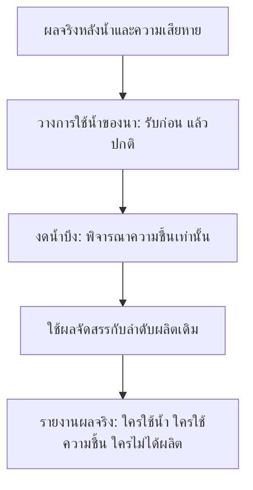

# ข้อเสนอ: อยู่กับน้ำ — แบ่งน้ำ กู้ข้าว ฟื้นนา

สถานะ: **แบบออกแบบเพิ่มเติม ยังไม่มีในเกม** · 2026-10-24 · ฐานกฎ `e3b0725` / Godot 4.6.3

ผู้เล่นเป็นคนตัดสินว่า **น้ำที่มีจะช่วยแปลงไหน ข้าวส่วนใดควรเก็บให้ทัน และพื้นที่ใดควรเตรียมสำหรับปีหน้า** ทั้งสามกลไกใช้แรงงาน น้ำ ข้าว และพื้นที่เดิมของหมู่บ้าน ตัวเลขและความรู้สึกที่คาดหวังในหน้านี้เป็นสมมติฐานสำหรับทดลอง ไม่ใช่ผลสมดุลหรือผลเล่นโดยคน

## ประสบการณ์และลำดับที่เสนอ

| กลไก | คำถามที่ผู้เล่นตอบ | สิ่งที่ต้องยอมเสีย | ระดับความพร้อมของแบบ |
|---|---|---|---|
| **แบ่งน้ำบึง** | ให้นาแปลงไหนใช้น้ำก่อน หรือเก็บน้ำไว้? | อีกแปลงอาจไม่ได้ผลิต; น้ำที่เก็บไว้ยังระเหย | กำหนดต้นแบบแรกด้านล่าง |
| **เกี่ยวหนีน้ำ** | เก็บข้าวบางส่วนให้ปลอดภัย หรือเสี่ยงรอเก็บเกี่ยวเต็ม? | ใช้แรงงาน ได้ข้าวลดลง และแปลงหยุดผลิตถึงขึ้นปีใหม่ | แนวคิดลำดับถัดไป ต้องกำหนดสูตรและทดสอบ |
| **นาหลังน้ำลด** | ยอมพักพื้นที่รับน้ำปีนี้เพื่อเตรียมนาปีหน้าหรือไม่? | เสียพื้นที่ผลิตปีปัจจุบัน ต้องรอน้ำลดและลงแรงฟื้นแปลง | แนวคิดระยะถัดไป ยังไม่กำหนดโบนัส |

เริ่มทดลอง **แบ่งน้ำบึง** เพียงระบบเดียว เพราะเปลี่ยนการจัดสรรน้ำที่มีอยู่แล้ว ใช้กระดานและ resolver เดิมได้ หลังตรวจว่าผู้เล่นได้ตัดสินใจจริง จึงพิจารณาเกี่ยวหนีน้ำและการพักแปลงแยกกัน ไม่ทดสอบสามระบบพร้อมกันจนแยกเหตุของผลไม่ได้

## ฐานจริงที่ใช้ต่อยอด

- [TurnResolver](../../core/turn_resolver.gd) ผลิตนาฤดูแล้งตามลำดับช่องใน state ปัจจุบัน `_best_reservoir()` เลือกบึงข้างแปลงที่มีน้ำมากที่สุดและถึงเกณฑ์ เสมอกันใช้ลำดับช่องเดิม บึงถูกหักน้ำทันที จึงอาจเหลือไม่พอสำหรับแปลงที่ประมวลผลทีหลัง
- ค่าปัจจุบันใน [balance](../../data/balance.json): บึงต้องมีน้ำอย่างน้อย **0.5** ก่อนจ่าย ใช้ **0.25** ต่อแปลงที่ได้ผลิต และน้ำระเหยเฉพาะแล้งก่อนขั้นผลิต ค่าตัวอย่างด้านล่างอ่านน้ำ **หลังขั้นน้ำ/ซับ/ระเหย/ความเสียหาย** ไม่ใช่จำนวนที่เห็นตอนเริ่ม planning
- เมื่อเปิด [ความชื้นในนา](../features/SOIL_MOISTURE.md) แปลงใช้บึงก่อน แล้วใช้ความชื้นเมื่อไม่มีบึงที่ใช้ได้ แต่ละแปลงผลิตได้ครั้งเดียวต่อเทิร์น และความชื้นลดตามกฎเดิม ไม่จ่ายทั้งสองทางซ้ำ
- [Harvest](../../core/harvest.gd) เปลี่ยนผลผลิตสะสมเป็นอาหารตอนเก็บเกี่ยว โบนัสชาวนาเพิ่มต่อแปลงที่มีผลผลิตจริง จึงไม่ควรแสดง `นา +1` เป็นอาหารเข้าคลังทันที
- [ค้ำบ้าน](../features/HOUSE_BRACING.md) ซื้อเวลาให้อาคาร ส่วน [โรงเรียนสายน้ำ](../features/RIVER_SCHOOL.md) ใช้ผลจริงตัดสินโจทย์อยู่แล้ว แบบนี้เพิ่มทางเลือกเกี่ยวกับแปลงนาโดยแยกจากทั้งสองระบบ

ยังไม่เปิดการ์ด เหตุการณ์ หรือข้อตกลงของ [M5](REPLAYABILITY_PROPOSAL.md) เพื่อทดลองแบบนี้ ค่าตัวปรับที่เตรียมไว้ในโค้ดไม่ใช่หลักฐานว่ากองการ์ดทำงานแล้ว

## ต้นแบบแรก: แบ่งน้ำบึง / Share Reservoir Water

### สิ่งที่ผู้เล่นสั่งได้

เลือกนาที่ยังไม่ตายในช่วงวางแผนฤดูแล้ง แล้วตั้งหนึ่งในสามนโยบาย:

| ไทย / อังกฤษ | การใช้น้ำบึง | การใช้ความชื้น |
|---|---|---|
| **รับก่อน / First** | จัดสรรก่อนแปลงปกติ ใช้แหล่งตามกฎเลือกบึงเดิม | ใช้เมื่อไม่มีบึงที่ใช้ได้ |
| **ปกติ / Normal** | จัดสรรหลังกลุ่มรับก่อน ตามลำดับช่องเดิม | ใช้เมื่อไม่มีบึงที่ใช้ได้ |
| **งดน้ำบึง / Skip reservoir** | ไม่เบิกน้ำบึงทุกเทิร์นแล้งจนเปลี่ยนนโยบาย | ยังใช้ได้ตามกฎความชื้นเดิม |

นโยบายคงอยู่จนผู้เล่นเปลี่ยน มีป้ายบนแปลงและใน inspector การเปลี่ยนไม่เสียแรงงานหรือไม้ เช่นเดียวกับการสั่งเปิด–ปิดประตู ค่าเสียโอกาสคือการจัดสรรน้ำและผลผลิต ไม่ใช่ค่าคลิกบำรุงรักษาที่ต้องจ่ายทุกเทิร์น

นาที่สร้างใหม่เริ่ม **ปกติ** รื้อหรือนาตายแล้วล้างนโยบายกลับปกติ ไม่สืบทอดเครื่องหมายจากแปลงเดิม ในฤดูฝนแสดงนโยบายที่จำไว้เป็นสถานะพัก พร้อมข้อความว่าใช้ตอนแล้ง; ต้นแบบปรับได้เฉพาะ planning ฤดูแล้ง ไม่เพิ่มปุ่มลัดที่ชนเครื่องมือเดิม

“งดน้ำบึง” ไม่ได้หยุดการไหลธรรมชาติ ไม่กักน้ำให้พ้นการระเหย ไม่ป้องกันนาตาย และไม่กันน้ำไว้เป็นสิทธิ์ของใครในเทิร์นอนาคต นโยบายของผู้รับยังเลือกได้เฉพาะบึงที่ติดแปลงจริง ไม่มีการส่งน้ำข้ามช่องฟรี

### ลำดับคำนวณที่เสนอ

1. จำลองน้ำ → ซับน้ำ → ระเหยแล้ง → ความเสียหาย ตามเดิม หากศาลาแพ้ ข้ามการผลิตตามเดิม
2. สร้างรายการ **นาที่มีชีวิตทั้งหมด** สำหรับการผลิตฤดูแล้ง: กลุ่มรับก่อน → กลุ่มปกติ → กลุ่มงดน้ำบึง แต่ละกลุ่มคงลำดับช่องเดิม กลุ่มท้ายเข้าขั้นความชื้นเท่านั้น ไม่สลับ `state.tiles` หรือเปลี่ยนลำดับระบบน้ำ/ความเสียหาย/ไซปลา
3. แต่ละแปลงเลือกบึงด้วย `_best_reservoir()` เดิม จากน้ำที่เหลือจริงในขณะนั้น ต้องผ่านเกณฑ์ขั้นต่ำก่อนเบิก แล้วหักปริมาณเดิม
4. ถ้าไม่มีบึงที่ใช้ได้ หรือเป็นแปลงงดน้ำบึง ให้ประเมินความชื้นของแปลงนั้นตามกฎเดิม ผลิตได้อย่างมากหนึ่งครั้ง ไม่มีความชื้นเมื่อเล่น legacy ก็ไม่มีผลผลิตจากช่องทางนี้
5. ใช้การลดความชื้นเดิมหนึ่งครั้งต่อแปลง การผลิตของไซปลาและการนับสถิติใช้กฎเดิม นโยบายอยู่ต่อ แต่รายงานบันทึกเฉพาะผลของเทิร์นที่เพิ่งเกิด

เพื่อรักษาพฤติกรรมเดิมเมื่อทุกแปลงเป็นปกติ ให้แยก **การวางแผนจัดสรรน้ำ/ความชื้นของนา** ออกจากการเดินรายการผลิตเดิม แล้วใช้ผลที่วางไว้กับแปลงนั้นในลำดับเดิม การจำลองย่อยต้องไม่หักน้ำหรือความชื้นจาก state จริงล่วงหน้าแล้วให้ resolver หักซ้ำ

กรณีทั้งหมดเป็นปกติต้องให้ state ผลผลิต น้ำ ความชื้น และ RNG ตรงกับกฎเดิมแบบตรงค่า ไม่ใช่เพียงอาหารรวมเท่ากัน หาก refactor ทำให้คลาดเคลื่อน ต้องแก้ก่อนให้ผู้เล่นทดลองนโยบาย



### ตัวอย่างที่ตรวจเหตุผลได้

นี่เป็น **ตัวอย่างเลขเฉพาะขั้นผลิต** ไม่ใช่แผนที่ seed จริงหรือ replay ที่ผ่าน engine แล้ว สมมติเปิดความชื้นและใช้ผู้นำชาวประมงเพื่อไม่รวมโบนัสชาวนา:

- บึงเดียวติดนา A, B และ C มีน้ำ **0.75 หลังขั้นน้ำ** นาทั้งสามยังไม่ตาย
- A มีความชื้น 1; B และ C มี 0 ลำดับช่องเดิมคือ A → B → C

| แผน | A | B | C | น้ำบึงหลังผลิต | ผลผลิตนาสะสมที่เพิ่ม |
|---|---|---|---|---|---|
| ทุกแปลงปกติ | บึง 0.25 | บึง 0.25 | ไม่ได้ผลิต เพราะบึงเหลือ 0.25 ต่ำกว่าเกณฑ์ | 0.25 | +1 สองแปลง |
| B/C รับก่อน; A งดน้ำบึง | ความชื้น | บึง 0.25 | บึง 0.25 | 0.25 | +1 สามแปลง |

ตัวอย่างนี้พิสูจน์เพียงว่าการจัดสรรมีผลต่างที่อธิบายได้ **ยังไม่ใช่ข้อแลกเปลี่ยนที่ลึก** เพราะแผนที่สองให้ผลมากกว่าในสถานการณ์นี้ ต้องมีสถานการณ์ต่อเนื่องที่การเก็บน้ำ แปลงที่กำลังสร้าง และความเสี่ยงน้ำท่วมในอนาคตทำให้ต้องเปลี่ยนแผน มิฉะนั้นควรปรับการแจกน้ำอัตโนมัติแทนเพิ่มงานคลิก

### ข้อมูลที่เห็นก่อนและหลังจบเทิร์น

ใน inspector ของนามีแถวเลือกนโยบายสามปุ่ม ใช้ชื่อและไอคอนร่วมกับสี ปุ่มที่เลือกมีกรอบชัด เข้าถึงด้วย Tab/Shift+Tab และ Enter/Space ได้ แสดงรายละเอียดเมื่อเลือกนา ไม่เพิ่มกล่องบังคับทุกเทิร์น

ตัวอย่างหน้าตาที่เสนอ ไม่ใช่ภาพจากเกม:

```text
นา (1, -2)  ·  ข้าวสะสม 2  ·  ความชื้น 1
การใช้น้ำแล้ง: [รับก่อน] [ปกติ] [งดน้ำบึง ✓]

คาดการณ์เทิร์นนี้
ใช้ความชื้น 1 → 0; ผลผลิตนา +1
ไม่เบิกน้ำบึง · ผลต่อแปลงอื่นดูในพรีวิว

บึงที่เกี่ยวข้อง (0, -2)
น้ำหลังขั้นน้ำ 0.75 → หลังผลิต 0.25
จ่ายให้ B, C · A ใช้ความชื้น
```

พรีวิวและรายงานจริงต้องระบุแหล่งน้ำ พิกัดผู้รับ ปริมาณก่อน–หลัง และเหตุที่แปลงไม่ได้ผลิต ตัวเลขนี้อยู่ในขั้นผลิตหลังความเสียหาย ไม่เอาน้ำที่คาดว่ารับมาแล้วถูกระเหยไปมาแจกอีก พรีวิวไม่แสดงเครื่องหมายผลจริงหรือรับประกันน้ำในเทิร์นที่ยังไม่เปิดเผย

Undo/Redo คืนการตั้งนโยบายและผลพรีวิว ไม่มีการจ่ายข้าวจากการสลับปุ่ม ป้ายผลจริงอ่านจากรายงานที่ commit แล้ว Reduce motion ใช้ลูกศร/กรอบนิ่งและข้อความแทนการไหลเคลื่อนไหว

### ชุดสถานการณ์ก่อนตัดสินใจพัฒนาเต็ม

| กรณีทดลอง | สิ่งที่ต้องตรวจ |
|---|---|
| น้ำพอทุกแปลง | ผู้เล่นไม่ต้องเปลี่ยนนโยบายเพื่อได้ผลเดิม; ทุกปกติตรง baseline |
| น้ำขาดและความชื้นต่างกัน | อธิบายตัวอย่าง A/B/C ได้ รวมเกณฑ์ 0.5 ก่อนเบิก ไม่อ้างว่า 0.75 หาร 0.25 เลี้ยงได้สามแปลงเสมอ |
| เก็บไว้เพื่อแปลงที่กำลังสร้าง | ต้องมี replay ต่อเนื่องที่ถูกกฎ เปรียบเทียบเบิกวันนี้กับพักไว้ โดยนับการไหล/ระเหยและต้นทุนสร้างนาในเทิร์นถัดไปจริง |
| แปลงยังไม่เคยให้ผลผลิต | เทียบผลเก็บเกี่ยวของชาวนากับชาวประมง โบนัสชาวนาต่อแปลงที่ให้ผลต้องไม่ถูกนับเป็นรางวัลจากปุ่มนโยบาย |
| สองบึงและผู้รับซ้อนกัน | เลือกบึงน้ำมากสุดและ tie เดิม ผลหักน้ำตรงพรีวิว ไม่มีการใช้สิทธิ์รับก่อนจ่ายน้ำซ้ำ |
| ศาลาแพ้หรือนาตายก่อนผลิต | ไม่มีข้าว/การเบิกที่ไม่เกิดขึ้นจริง ล้างนโยบายของนาตายและแสดงเหตุจาก resolver |

ให้ผู้เล่นอย่างน้อย 3 คนลองกระดานเดิมสลับลำดับแบบปกติกับแบบมีนโยบาย ถามก่อนกดจบเทิร์นว่า “แปลงไหนจะได้ผลผลิต และน้ำมาจากไหน” แล้วให้เล่าเหตุของการลองแผนใหม่ เก็บจำนวนครั้งที่ต้องตั้งซ้ำ ความเข้าใจ และคำอธิบายทางเลือกควบคู่กับผลผลิต

เกณฑ์ทดลองรอบแรก: อย่างน้อย 2 ใน 3 คนอธิบายการเบิกน้ำ/ความชื้นถูกและยกเหตุผลเปลี่ยนแผนระหว่างสองสถานการณ์ได้ โดยไม่สับสนผลผลิตสะสมกับอาหารในคลัง กลุ่มเล็กนี้ใช้หาปัญหาแบบ ไม่ใช้ประมาณอัตราชนะหรือรับรองความสนุก หากคำตอบที่คุ้มเสมอคือ “ไม่มีความชื้นให้ก่อน มีความชื้นให้งด” หรือผู้เล่นทำเครื่องหมายซ้ำอย่างเดียว ให้ลดเป็นการแจกน้ำอัตโนมัติที่อธิบายได้ก่อนขยายระบบ

## แนวคิดถัดไป: เกี่ยวหนีน้ำ / Rescue Harvest

ภาพการตัดสินใจ: พรีวิวเตือนว่านาที่สะสมข้าวไว้จะตายเทิร์นนี้ ผู้เล่นเลือกใช้แรงงานเกี่ยวออกบางส่วน หรือใช้แรงงานนั้นขุดทางระบายเพื่อรักษานาและผลเก็บเกี่ยวเต็ม

- สั่งกับนาที่มีชีวิตและมีผลผลิตสะสมใน planning; การเกี่ยวไม่เพิ่มความทนน้ำหรือย้ายระดับน้ำ
- ผลที่เสนอคือเปลี่ยนข้าวบางส่วนเป็นอาหารทันที ลดหรือสูญเสียส่วนที่เหลือ แล้วพักการผลิตของแปลงถึงขึ้นปีใหม่ การพักต้องกันการเกี่ยวซ้ำและการผลิตเพิ่มจากน้ำ/ความชื้นในปีเดียวกัน
- ชุดตัวเลขสำหรับทดลองแยก: แรงงาน **1 หรือ 2**; รับ **ครึ่งหนึ่งหรือสองในสาม** ของผลผลิตสะสม ปัดลง หากรับได้ 0 ให้ปิดคำสั่งพร้อมเหตุผล ไม่แจกขั้นต่ำฟรี ตัวเลขนี้เป็นช่วงทดลอง ไม่ใช่ค่าที่อนุมัติใช้จริง
- ต้องกำหนดโบนัสผู้นำ/การ์ด การคืนสภาพต้นปี การเสียหายของแปลงที่เกี่ยวแล้ว และผลต่อเป้าหมายข้าวก่อนทำ prototype อาหารจากการเกี่ยวก่อนกำหนดต้องไม่ถูกบวกในเก็บเกี่ยวอีกครั้ง และไม่ทำให้เหรียญข้าวผ่านก่อนกำหนดเดิมโดยไม่ได้ออกแบบไว้
- แสดงพรีวิว “อาหารเข้าคลังเท่าไร / ข้าวที่เสียไป / ผลิตหยุดถึงเมื่อไร” ก่อนยืนยัน และให้ Undo ได้ก่อนจบเทิร์นเหมือนคำสั่งอื่น

สมมติฐาน: เกิดทางเลือกช่วยให้ยอมรับความเสียหายบางส่วนได้ ต้องตรวจว่าผู้เล่นไม่ได้เกี่ยวทุกแปลงทันทีทุกปีเพื่อเลี่ยงความเสี่ยงโดยเสียผลน้อยเกินไป หรือไม่เคยคุ้มแรงงานเมื่อเทียบขุด/ถม/บึงเดิม

## แนวคิดระยะถัดไป: นาหลังน้ำลด / Flood-Recovery Fields

ผู้เล่นประกาศพักแปลงก่อนฤดูฝน ยอมเสียข้าวปีปัจจุบันให้พื้นที่นั้นรับน้ำ รอให้ระดับน้ำลดจริง แล้วลงแรงฟื้นแปลงเพื่อรับผลดีแบบมีเพดานในปีถัดไป

- ความก้าวหน้าต้องมาจากลำดับจริง **พักแปลง → รับน้ำ → น้ำลด → ฟื้นแปลง** ไม่ให้โบนัสจากการเปิด–ปิดโหมดในเทิร์นเดียวหรือจากพรีวิว
- พื้นที่พักไม่ผลิตข้าวในช่วงพัก; ยังอยู่ในระบบน้ำจริง ไม่ลบน้ำออกโดยอัตโนมัติและไม่เพิ่มความจุเก็บน้ำเหมือนสร้างบึง
- รางวัลที่ต้องเปรียบเทียบในแบบแยก: ผลผลิตเก็บเกี่ยวครั้งถัดไปเพิ่มแบบครั้งเดียว หรือประหยัดแรงงานฟื้นแปลง เลือกอย่างใดอย่างหนึ่งก่อนทดสอบ ยังไม่กำหนดจำนวนและไม่สะสมหลายปี
- ต่างจากความชื้นซึ่งช่วยผลิตเมื่อขาดน้ำ และต่างจากการ์ดเสนอ [`river_silt`](CARD_CATALOG.md) ที่เพิ่มโบนัสแปลงริมแม่น้ำ แบบนี้ต้องเสียฤดูผลิตและมีประวัติการฟื้นพื้นที่จริง ยังไม่เปิดใช้ร่วมการ์ดเพื่อให้โบนัสทบกัน

ต้องมีตัวอย่างที่พักแปลงคุ้มภายใต้เงื่อนไขหนึ่งและปลูกตามปกติคุ้มกว่าอีกเงื่อนไขหนึ่ง หากรอแล้วได้ของน้อยกว่าเดิมทุกกรณีให้ยกเลิกแบบ หากพักทุกแปลงคุ้มเสมอให้ปรับต้นทุน/ประโยชน์ก่อนพัฒนา

## ขอบเขตการพัฒนาและหลักฐานที่ต้องมี

1. **A — พิสูจน์การตัดสินใจ:** ทำตัวอย่างคำนวณและ fixture สำหรับแบ่งน้ำ พร้อม baseline ทุกแปลงปกติและ replay สถานการณ์ต่อเนื่อง ต้นแบบอยู่ในหน่วยความจำและใช้เส้นทางเซฟแยก ยังไม่เปิดใน Continue ปกติ
2. **B — ทดลองหน้าจอ:** inspector/พรีวิว/รายงานไทย–อังกฤษ 1280×720, เมาส์/คีย์บอร์ด, Undo/Redo, modal และ Reduce motion ให้ผู้เล่นกลุ่มเล็กลองก่อนขยายระบบอื่น
3. **C — พิจารณารอบจริง:** หากผลทดลองสนับสนุน ค่อยกำหนด ruleset สำหรับรอบใหม่และ envelope เซฟรุ่นใหม่ให้ครบ ตารางผสมกับค้ำบ้าน/ความชื้นต้องออกแบบและตรวจแยก ไม่เปลี่ยนรุ่น v1–v5 หรือกฎของรอบค้างโดยเงียบ ๆ

สำหรับแบ่งน้ำ ให้เก็บนโยบายเป็นข้อมูลเกมที่ snapshot/copy/Undo/Redo รักษาได้ หากรองรับเซฟจริงต้อง validate เฉพาะค่าที่อนุญาตและนโยบายปกติบนช่องที่ไม่ใช่นามีชีวิต พรีวิวคำนวณบนสำเนาและไม่แตะ RNG; [GameSession](../../core/game_session.gd) ยังคงเป็นผู้ checkpoint ส่วนรายงานการใช้น้ำเป็นข้อมูลรายเทิร์น ไม่ใช่บัญชีทรัพยากรถาวรซ้ำอีกชุด

ก่อนเปิดใช้ต้องตรวจ resolver/policy/preview กับผลจริง ค่า float64/RNG การหักน้ำครั้งเดียว ทุกปกติตรง baseline เซฟเก่าและการปฏิเสธรุ่นที่ไม่รองรับ รวม native input ตาม [คู่มือพัฒนา](../development/README.md) ไม่มีผลตรวจเหล่านี้ในงานเอกสารครั้งนี้ และยังไม่ปิดเกณฑ์สมดุล M3 หรือแผนทดลองความเข้าใจใน [เหตุผลการออกแบบ](FUN_DESIGN.md)
