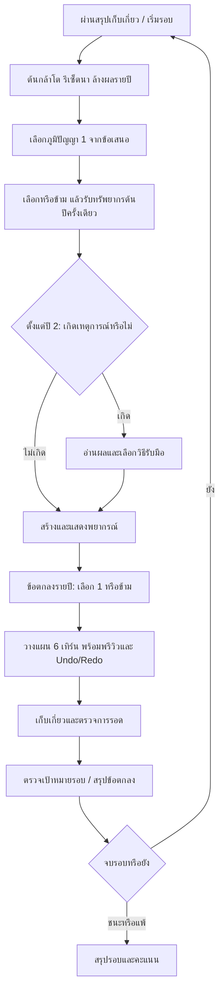

# ข้อเสนอ: หมู่บ้านที่เปลี่ยนไปทุกฤดู

สถานะ: **แบบเสนอเพื่อทบทวน ยังไม่มีระบบใหม่ในเกม** อ้างอิงฐาน `b794860` หลังรอบยาว ภาพหมู่บ้าน และผลตอบรับคำสั่ง ค่าตัวเลขในเอกสารนี้เป็นจุดเริ่มทดลอง ไม่ใช่ผลยืนยันสมดุล

เป้าหมายคือให้ผู้เล่นมีคำถามใหม่ทุกปี: **ปีนี้จะลงทุนกับอะไร และจะรับความเสี่ยงตรงไหนเพื่อให้หมู่บ้านอยู่ต่อ?** ใช้น้ำ แรงงาน ไม้ อาหาร และประชากรเดิม เพิ่มการเลือกแนวทางแทนการเพิ่มทรัพยากรอีกชนิด

## แบบที่ใช้ตรวจทาน

| ส่วน | สิ่งที่ออกแบบเพิ่ม | เอกสารกติกา |
|---|---|---|
| แนวเล่น | การ์ดเดิม 30 IDs แยกบทบาท มีคู่ส่งเสริม ข้อเสีย และตัวเลือกที่ไม่เสียเปล่า | [การ์ด 30 ใบ](CARD_CATALOG.md) |
| เรื่องเล่ารายปี | เหตุการณ์เดิม 15 IDs มีต้นทุน ทางรับมือ เป้าหมายที่มองเห็น และระยะเวลาชัดเจน | [เหตุการณ์ 15 แบบ](EVENT_CATALOG.md) |
| โจทย์ระหว่างทาง | ข้อตกลงหมู่บ้านใหม่ 6 แบบ เลือกทำหรือข้ามได้ รางวัลเล็กและไม่เปลี่ยนเงื่อนไขชนะ | [ข้อตกลงรายปี](ANNUAL_CONTRACTS.md) |
| เล่นซ้ำ | ความยากสะสม 10 ระดับ แผนที่ 3 บุคลิก โครงรอบ 5/10 ปี และท้าทายรายวัน | [ความท้าทายและแผนที่](CHALLENGES_AND_MAPS.md) |

สเปกที่นำเข้า [07](../specs/07_mods_cards_leaders.md) และ [08](../specs/08_events.md) มีรายการ 30/15 อยู่แล้ว ข้อเสนอนี้ต่อยอดรายการนั้น ไม่ได้นับซ้ำว่าเป็นเนื้อหาใหม่ทั้งหมด ข้อตกลงรายปีเป็นระบบที่เสนอเพิ่มใหม่โดยเฉพาะ เอกสารต้นฉบับคงเดิม

## จังหวะการเล่น

| ช่วง | การตัดสินใจที่อยากให้เกิด | สิ่งที่ทำให้ยังต้องคิด |
|---|---|---|
| ปี 1–2: ตั้งหลัก | เลือกอาหารหลักและเส้นระบายน้ำ; ทดลองการ์ดใบแรก | ทรัพยากรน้อย แต่ยังไม่มีเหตุการณ์ร้ายแบบตัดทรัพยากรในสองปีแรก |
| ปี 3–5: ตั้งตัว | ลงทุนกับนา ปลา ป่า หรือบ้าน; รับข้อตกลงที่เข้ากับพื้นที่ | เหตุการณ์ทำให้ต้องปรับแผน และปี 5 มีน้ำมากกว่าช่วงต้น |
| ปี 6–8 เฉพาะรอบยาว | ใช้ชุดการ์ดร่วมกัน ย้ายการลงทุนไปพื้นที่ที่รับน้ำได้ | ฝนเพิ่มตามกฎโหมดยาวเดิม ไม่มีการล้างหมู่บ้านเริ่มใหม่ |
| ปี 9–10 เฉพาะรอบยาว | รักษาระบบที่สร้างไว้ เลือกว่าจะขยายหรือประคองผลสำเร็จ | ไม่มีข้อตกลงใหม่ในปีสุดท้าย; ให้การตัดสินใจเรื่องน้ำเป็นจุดจบของรอบ |

แนวเล่นตัวอย่างใช้เครื่องมือเดิม:

- **ชาวนารับน้ำ:** Floating Rice + Jasmine Rice ยอมให้น้ำอยู่ในนา แต่ต้องแยกที่อยู่ออกจากพื้นที่รับน้ำ
- **ครัวจากแม่น้ำ:** Fisher + Dried Fish มีอาหารทุกเทิร์น แต่ต้องรักษาระดับน้ำและหาไม้ขยายบ้าน
- **ชุมชนป่าทาม:** Flooded Forest + Nursery รักษาพื้นที่ซับน้ำ แลกกับพื้นที่เพาะปลูกและไม้ที่ตัดได้
- **ช่างทางน้ำ:** Canal Network + Gatewright แก้เส้นทางน้ำได้คล่อง แต่เครื่องมือไม่ได้สร้างอาหารเอง
- **หมู่บ้านขยายตัว:** Extended Family + Midwife มีแรงงานมากขึ้นพร้อมภาระอาหารในปีถัดไป

แต่ละแนวเป็นสมมติฐานให้ทดลอง ไม่ใช่ชุดที่พิสูจน์ว่าชนะแล้ว การ์ดเพิ่มการตัดสินใจได้ก็ต่อเมื่อมีอย่างน้อยสองตัวเลือกที่เหมาะกับกระดานขณะนั้น

## การขึ้นปีใหม่และความชัดเจนของข้อมูล

M5 ชุดแรกยังข้ามกล่องข้อตกลง; เพิ่มใน M5.2 ภายหลัง การ์ดปีละครั้งไม่ซ้ำที่มีอยู่ เหตุการณ์ปีละไม่เกินหนึ่งและเริ่มปี 2; ปีแรกไม่มีเหตุการณ์ ทรัพยากรรายปีจ่าย **หลังเลือกการ์ด ก่อนเหตุการณ์** เพื่อให้การ์ดที่เพิ่งเลือกมีผลทันทีและใช้ชำระตัวเลือกได้ นี่เป็นการเปลี่ยนลำดับจาก T-03 ข้อ 4 ในสเปกเดิม ต้องใช้เฉพาะกติกาชุดใหม่

ลำดับ RNG: เสนอการ์ด → โอกาสเกิดเหตุการณ์ → เลือกเหตุการณ์ → กำหนดเป้าหมายเหตุการณ์ → พยากรณ์ เป้าหมายสุ่มถูกเก็บก่อนแสดงตัวเลือกตามข้อเสนอเหตุการณ์; การเลือกวิธีรับมือไม่สุ่มเป้าหมายซ้ำ พรีวิว คำสั่งปกติ Undo/Redo และการเปิดหน้าจอไม่สุ่มเพิ่ม ข้อตกลงใช้การจัดลำดับจาก hash แยกต่างหาก ไม่กิน RNG ฝน

ก่อนเลือกการ์ดยังไม่มีพยากรณ์ปีใหม่ ให้เห็นกระดาน ทรัพยากร และผลเดิม; ก่อนเลือกเหตุการณ์แสดงผลต่อฝนเป็นตัวเลข แต่ยังไม่เปิดค่าฝนที่ยังไม่ได้สุ่ม หลังเหตุการณ์จึงแสดงช่วงพยากรณ์และน้ำเข้าที่กฎอนุญาต พรีวิวเทิร์นปัจจุบันยังตรงผลจริงทั้งหมด ความยากไม่แอบทำให้พรีวิวผิด

## หน้าจอที่ควรทำ

หน้าวางแผนปีเป็นแผงเดียวเหนือกระดาน ใช้ขั้น **ภูมิปัญญา → เหตุการณ์ → แผนปีนี้** ไม่เปิดสามหน้าต่างซ้อนกัน ขณะที่รอเลือกให้ปิดคำสั่งบนกระดาน แต่ยังเลื่อนและซูมอ่านพื้นที่ได้

| บริเวณ | เนื้อหาและพฤติกรรม |
|---|---|
| หัวแผง | ปี/ระยะรอบ ทรัพยากรปัจจุบัน และขั้นที่กำลังทำ; ซ่อนค่าพยากรณ์เก่าที่อาจทำให้เข้าใจว่าเป็นปีใหม่ |
| การ์ด | ชื่อไทย/อังกฤษ ไอคอนหน้าที่ ผลตัวเลขก่อน→หลัง และผลเสีย; เช่น “ขุดแล้ง 2→1 แรงงาน” แทนการให้ผู้เล่นตีความ mod |
| เหตุการณ์ | ทุกทางเลือกเห็นราคา/ผล/ระยะเวลา; ทางเลือกที่จ่ายไม่ไหวแสดงเหตุผล; เหตุการณ์เปลี่ยนช่องทำเครื่องหมายพิกัดจริง |
| แผนปีนี้ | พยากรณ์ ข้อตกลงสองข้อหรือเท่าที่เข้าเงื่อนไข และปุ่มข้าม; การเลือกข้อตกลงไม่ให้ทรัพยากรทันที |
| ยืนยัน | เลือกแล้วอ่านรายละเอียดก่อนกดยืนยัน; Enter ที่กดค้างไม่เลือกการ์ดหรือผ่านขั้นถัดไปเอง |
| ระหว่างเล่น | แผงข้อตกลงพับได้ มีความคืบหน้าและกำหนดจบปี; การ์ดที่ถืออยู่ดูได้จาก Pause |
| สรุปปี | อาหาร/ประชากรตามลำดับเดิม แล้วผลข้อตกลงและรางวัลต้นปีหน้า; ไม่แทรกรางวัลเข้าในตัวเลขเก็บเกี่ยว |

ใช้โทนลากูน–ทองและงานไม้ของเกมปัจจุบัน แยกประเภทด้วยไอคอนและข้อความ ไม่ใช้สีอย่างเดียว รองรับ 1280×720 ด้วยแถวเลื่อนและปุ่มยืนยันที่เห็นเสมอ Tab/Shift+Tab อ่านทุกทางเลือกได้; Esc ปิดรายละเอียดหรือพักเกม ไม่เลือกสิ่งที่มีต้นทุนให้เอง Reduce motion ใช้ไฮไลต์นิ่งกับทุกขั้นใหม่

## ตัวอย่างหนึ่งปีที่ใช้ตรวจแบบ

นี่เป็นสถานการณ์สมมติสำหรับออกแบบหน้าจอ ไม่ใช่ replay หรือผลทดสอบสมดุล

1. เริ่มปี 3 ในรอบยาว: คน 8 อาหาร 6 ไม้ 3 มีนาสองช่อง ไซหนึ่งช่อง และบึงติดนา รับเรือนแพ/ระหัดจากโหมดยาวแล้ว จึงไม่เห็นสองการ์ดปลดล็อกซ้ำ
2. เลือก Driftwood จากข้อเสนอ ได้ไม้ต้นปี +2 ทันที รวม 5 UI แจ้งใบนี้จะให้ +2 ทุกปีต่อจากนี้
3. พบ Village Fair เลือกจ่ายอาหาร 2 แลกแรงงาน +2 ในเทิร์นแรกของแต่ละฤดูปีนี้ เหลืออาหาร 4 แต่ต้องชดเชยก่อนเก็บเกี่ยว
4. เห็นพยากรณ์แล้วเลือกรับ “นาปรังพอใช้” เพราะมีบึงอยู่แล้ว ส่วนข้อตกลงปลูกป่าข้ามได้โดยไม่เสียอะไร
5. ใช้พรีวิวตรวจว่านาปรังรับน้ำจากบึงสองเทิร์นจริง ก่อนเปลี่ยนไปกันน้ำช่วงฝน Undo คำสั่งที่ทำให้บ้านเสี่ยงได้ตามเดิม
6. เก็บเกี่ยวแล้วรอด ข้อตกลงสำเร็จขึ้นข้อความ “อาหาร +2 ต้นปี 4” อาหารนี้ยังไม่ช่วยการกินหรือเกิดของปี 3

ผู้เล่นเลือกทำเกษตรต่อเนื่องแทนขยายบ้านได้ และปีถัดไปมีตัวเลือกใหม่ โดยไม่ต้องทำภารกิจทุกข้อเพื่อชนะ

## กติกาความเข้ากันได้ที่ต้องยึดร่วมกัน

- คำนวณ modifier ตาม **ค่าเริ่มต้น → แผนที่ → โหมดรอบ → ผู้ใหญ่บ้าน → ความยากสะสม → การ์ดตามลำดับที่ได้ → ผลรายปี** ตามแกนโค้ดปัจจุบัน โดยเติมการ์ดในตำแหน่งที่เตรียมไว้
- การ์ดทั้ง 30 ใบเข้ากองตั้งแต่ต้นในต้นแบบ M5; โปรไฟล์ปลดล็อกตัวเลือกแผนที่/ความท้าทาย แต่ไม่เพิ่ม stat ถาวร ข้อเสนอไม่ดึงผู้ใหญ่บ้านสี่คนที่ UI ปัจจุบันเปิดแล้วกลับไปล็อก
- การ์ดที่ไม่เปลี่ยนผลสุทธิถูกตัดออกจากข้อเสนอ โดยเฉพาะเรือนแพ/ระหัดในโหมดยาว ถ้าเหลือน้อยกว่าจำนวนข้อเสนอ แสดงเท่าที่เหลือ ไม่ยัดซ้ำ ไม่มี reroll หรือรางวัลไม้แทนกองที่ว่าง
- ปัดจำนวนนับแบบเดียวกับ engine; ต้นทุนคำสั่งที่ใช้จริงไม่ต่ำกว่า 0 โดยขุด/ถม/รื้อใช้แรงงานอย่างน้อย 1, labor หลังรวมโบนัสไม่ต่ำกว่า 0, อัตราเน่า/คืนไม้จำกัด 0–1 และผลผลิตนาต่อช่องไม่ต่ำกว่า 0 ห้าม clamp โบนัสแรงงานหรือ harvest bonus รายตัวก่อนรวม เพราะมีค่าลบที่ตั้งใจใช้เป็นข้อแลกเปลี่ยน
- รื้อสิ่งก่อสร้างในกติกาใหม่คืนไม้ไม่เกินที่จ่ายจริง บันทึกต้นทุนรายอาคารเพื่อกันวงจรส่วนลดชั่วคราว+Salvage; อาคารตั้งต้นถือว่าจ่ายไม้ 0 ดูรายละเอียดในเอกสารการ์ด
- ค่า forecast_range เปลี่ยนช่วงน้ำที่สุ่มจริงใน engine ปัจจุบัน จึงต้องบอกว่า “ความผันผวนของฝน” ไม่อ้างว่าเปลี่ยนความแม่นของข้อความอย่างเดียว
- เป้าหมายหมู่บ้านทั้งสามแบบและเหรียญ +50 เดิมยังตรวจหลังเก็บเกี่ยว ไม่ได้กลายเป็นภารกิจบังคับรายปี คะแนนรอบ 5 ปี/10 ปี และแต่ละกติกาต้องแยกตาราง ไม่เทียบยอดดิบข้ามกัน

### เซฟและการกลับมาเล่นต่อ

หมายเลข **v3 ถูกใช้จริงแล้วสำหรับประวัติภาพอาคารใน [หมู่บ้านมีชีวิต](../features/LIVING_VILLAGE.md)** การ์ด/เหตุการณ์ในข้อเสนอนี้ยังไม่ถูกเปิดใช้ และต้องเลือกรุ่น envelope ใหม่ก่อนพัฒนา ห้ามตีความ v3 ปัจจุบันว่าเป็นรอบ M5

เสนอ envelope รุ่นใหม่สำหรับรอบ M5 พร้อม `ruleset_id` และ `catalog_version` ที่รองรับจริง แยกจาก v1/v2/v3 ที่เล่นด้วยกฎเดิม เก็บขั้นงานรายปี (`annual_stage`), ข้อเสนอการ์ด, เหตุการณ์พร้อมพิกัดเป้าหมาย, ใบเสร็จรับทรัพยากรต้นปี, ต้นทุนไม้รายอาคาร และสถานะข้อตกลง/รางวัลค้าง แบบฟิลด์จริงต้องออกแบบ validator ก่อนลงโค้ด

v1/v2 และ v3 ที่มีเพียงประวัติภาพอ่านเป็น legacy สำหรับข้อเสนอ M5 และเล่นจนจบด้วยกฎเดิม ไม่มีการฉีดการ์ด/เหตุการณ์กลางรอบหรือย้ายไปกติกาใหม่เงียบ ๆ จึงรักษาพฤติกรรมรื้อและลำดับ RNG เดิมไว้ การเริ่มรอบใหม่จึงเลือกใช้กติกา M5; โหลดกติกาที่ไม่รู้จักให้แจ้งเวอร์ชันไม่รองรับและรักษาไฟล์เดิม

ยืนยันการ์ด/เหตุการณ์/ข้อตกลงได้ครั้งเดียวต่อขั้น กดซ้ำต้องไม่หักราคา/จ่ายโบนัสซ้ำ GameSession เป็นผู้ checkpoint หลัง commit; GameFlow และ preview ไม่เขียนไฟล์ โหลดแล้วคืนหน้ารอเลือกตรงเดิม ไม่เรียก start_year ซ้ำ Undo/Redo ใช้เฉพาะคำสั่งในเทิร์น ไม่ย้อนผลสุ่มหรือการเลือกต้นปี

## ลำดับพัฒนาที่เสนอ

[ROADMAP M5](../ROADMAP.md) ระบุ “ก่อนเขียนโค้ด: เสนอการ์ด 30 ใบ เหตุการณ์ 15 แบบ และความยาก 10 ระดับ ให้ผู้ใช้อนุมัติ” เอกสารชุดนี้ทำให้ข้อเสนอนั้นตรวจได้ งานนี้ส่งแบบออกแบบเท่านั้น; การอนุมัติ M5 ยังไม่ได้ถือว่าเกิดขึ้นจากการจัดทำเอกสาร

| ชุดงาน | ผลที่เล่นตรวจได้ | เกณฑ์ก่อนทำชุดถัดไป |
|---|---|---|
| M5.0 ฐานตัวเลือก | 30 การ์ด + 15 เหตุการณ์บน plains, annual flow, เซฟรุ่น M5 ที่ต้องกำหนดใหม่, ทรัพยากรต้นปี และใบเสร็จไม้ | ทุก mod/effect มีกรณีตรวจ; พรีวิวตรงจริง; เซฟทุกขั้นแล้วกลับมาตรงเดิม; เล่นจริงหนึ่งรอบ 5 ปี |
| M5.1 เล่นซ้ำ | แผนที่ valley/estuary, ความยากที่แก้แล้ว, profile และ daily แบบมีเวอร์ชัน | ความคงที่ทุกแผนที่/ระดับ; ไม่มีแผนที่ตั้งต้นแพ้แน่นอน; ตรวจ paired-seed benchmark และเล่นจริง |
| M5.2 โจทย์รายปี | ข้อตกลง 6 แบบและความคืบหน้าใน HUD/สรุปปี | รางวัลไม่ช่วยข้ามปีที่ควรแพ้; Undo/preview ไม่สะสมงาน; คนเล่นแยกข้อตกลงกับเป้าหมายรอบได้ |

ไม่รวมระบบต่อสู้ สกุลเงินถาวร multiplayer อาคารชนิดใหม่ หรือฤดูกาลเพิ่มในชุดนี้ บอทที่ยังไม่รู้จักเลือกการ์ด/เหตุการณ์ใช้ยืนยันความคงที่ได้ แต่ใช้สรุปความสนุกหรือจัดอันดับแนวเล่นไม่ได้

## แผนตรวจความสนุกและสมดุล

ผลชุดอาหารทดลอง `h5_g3` ใน [M3 follow-up](../history/M3_BALANCE_FOLLOWUP.md) พบ greedy d0 ชนะ 28% แต่ d10 ชนะ 46.5%; ชุด override นี้ไม่ผ่านเกณฑ์และ **ไม่ได้ใช้เป็นค่าเกมปัจจุบัน** ใช้ชี้ปฏิสัมพันธ์ที่ควรตรวจ ไม่ใช่อัตราชนะของค่าเริ่มต้น ส่วนรอบยาวเดิมมีเพียง legal probes ไม่ใช่ playtest ผู้เล่น การ์ดและเหตุการณ์ทำให้ชุดผลเดิมใช้รับรอง M5 ไม่ได้

1. ตรวจแบบด้วยกรณีขอบ: บัตรหมด/ถูกปลดล็อกแล้ว, การ์ดใบสุดท้ายของรอบ, คนเหลือน้อย, ไม่มีเป้าหมายเหตุการณ์, ตัวเลือกจ่ายไม่ไหว, ปีสุดท้าย และ Continue ทุกขั้น
2. ตรวจ deterministic runs: seed/config/ruleset เดียวกันและการเลือกเดียวกันให้ผลเหมือนกัน; เปลี่ยน preview/Undo/เวลาเปิดหน้าต่างแล้วฝนต้องไม่เปลี่ยน
3. ให้ผู้เล่นอย่างน้อย 3 คนลอง 5 ปีหนึ่งรอบ และผู้เล่นที่ผ่านแล้วลอง 10 ปี บันทึกเวลาตัดสินใจ เหตุที่เลือก/ทิ้งการ์ด จุดอ่านพยากรณ์ผิด และช่วงที่รู้สึกว่าไม่มีงานให้ทำ
4. เป้าหมายทดลอง: ผู้เล่นอธิบายผลการ์ดที่เลือกได้, อย่างน้อย 2 แนวเล่นมีคนอยากลอง, ไม่มีคนเข้าใจว่าข้อตกลงเป็นเงื่อนไขแพ้ และปี 6–10 ยังมีเหตุให้ปรับพื้นที่ หากไม่ถึงให้แก้แบบก่อนเพิ่มเนื้อหา
5. หลังสอนบอทเลือกตัวเลือกแล้วจึงตรวจอย่างน้อย 200 paired seeds ต่อแผนที่/ระดับ/โหมดที่ใช้เทียบ พร้อมจำนวนการเลือกการ์ดและสาเหตุแพ้ การเพิ่มความยากไม่รับประกัน win rate ลดทุกขั้นจนกว่าจะมีหลักฐาน

ข้อแลกเปลี่ยนที่ต้องดูเป็นพิเศษคือการ์ด free paddy, การเติบโตประชากร, ป่าซับน้ำสองเท่า และรายได้ปลาแบบทบหลายโบนัส หากแนวเดียวชนะเกือบทุกกระดาน ให้ปรับค่า/ข้อแลกเปลี่ยนก่อนเพิ่มการ์ดใบที่ 31
