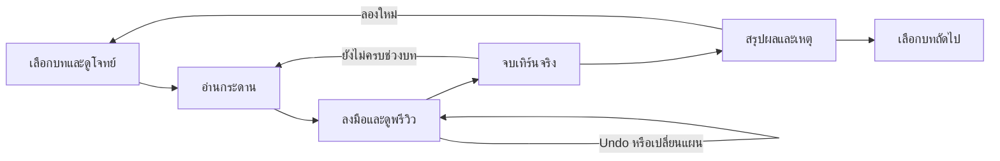

# ข้อเสนอ: โรงเรียนสายน้ำ

สถานะ: **ออกแบบเพิ่มเติม ยังไม่เปิดใช้ในเกม** · 2026-10-20 · ฐานโค้ด `9d8cfdf`

เอกสารนี้ต่อยอดบทสอนเล่น M8 ด้วยชุดภารกิจ 6 บท ใช้กฎน้ำและทรัพยากรที่มีจริง ค่าตั้งต้น เกณฑ์ และเวลาที่เสนอเป็นเป้าทดลอง ยังไม่มีกระดานฝึกหรือ replay ยืนยันว่าผ่านได้

## ประสบการณ์ที่อยากเพิ่ม

ให้ผู้เล่นรู้สึกว่า **“ฉันอ่านน้ำออก และเลือกอนาคตให้หมู่บ้านได้”** ก่อนเข้ารอบเต็ม เริ่มจากแก้ปัญหาเดียวที่เห็นผลในเทิร์นถัดไป แล้วเพิ่มโจทย์ที่ต้องแลกระหว่างอาหาร บ้าน และป่า ผู้เล่นควรเล่าทางเลือกของตนได้ ไม่ใช่จำลำดับคลิกตามเฉลย

เกมมีพรีวิว Undo/Redo ผลเก็บเกี่ยว และภาพหมู่บ้านอยู่แล้ว แต่ยังไม่มีเส้นทางเรียนรู้ที่เล่นได้ ดู [สถานะจริง](../STATUS.md) ส่วน [ข้อเสนอ M5](REPLAYABILITY_PROPOSAL.md) เน้นการ์ด เหตุการณ์และการเล่นซ้ำ ชุดนี้เพิ่มเหตุให้ใช้เครื่องมือเดิมอย่างมีเป้าหมาย โดยเริ่มพัฒนาแยกจาก M5 ได้

ใช้ชื่อไทย **โรงเรียนสายน้ำ** / อังกฤษ **River School** เรื่องเล่าคือผู้เล่นรับช่วงดูแลหมู่บ้านจากสภาชุมชน ผ่านสถานการณ์จากสมุดบันทึกของคนรุ่นก่อน แต่ละบทเริ่มหมู่บ้านใหม่ ไม่มีทรัพยากรสะสมข้ามบท เสียงของชาวบ้านมีหน้าที่อธิบายผล เช่น “ข้าวอยู่ในนา ยังไม่อยู่ในคลัง” ไม่เพิ่มระบบสนทนาหรือความสัมพันธ์

## เส้นทาง 6 บท

| บท | คำถามหลัก | ระยะในเกม | ทักษะใหม่ |
|---|---|---|---|
| 01 ฝนแรก | จะพาน้ำไปเลี้ยงนาได้อย่างไร? | ปี 1 รวม 6 เทิร์น | ขุด → นา → พรีวิว → ผลจริง |
| 02 แบ่งทางน้ำ | จะรับน้ำเข้าพื้นที่ผลิตพร้อมรักษาบ้านได้ไหม? | ปี 1 รวม 6 เทิร์น | ขุด/ถม ประตู และผลต่อพื้นที่ข้างเคียง |
| 03 ข้าวรอเก็บ ปลาเลี้ยงวันนี้ | อาหารมาจากไหน และเข้าคลังเมื่อไร? | ปี 1 รวม 6 เทิร์น | ปลา ข้าว และการกินหลังเก็บเกี่ยว |
| 04 บ้านก่อนฝน | จะเพิ่มคนโดยไม่เสียคนเดิมได้อย่างไร? | ปี 1–2 รวม 12 เทิร์น | ความจุบ้าน อาหารส่วนเกิน และที่ตั้ง |
| 05 ป่าของปีหน้า | ไม้ที่ใช้วันนี้จะแลกกับอะไรในปีหน้า? | ปี 1–2 รวม 12 เทิร์น | ตัด/ปลูกป่า เวลาเติบโต และการซับน้ำ |
| 06 ผู้ใหญ่บ้านคนใหม่ | แผนทั้งหมดอยู่รอดครบ 5 ปีหรือไม่? | รอบ classic 30 เทิร์น | วางแผนเองและปรับตามฝน |

รายละเอียดตั้งกระดาน เงื่อนไข และคำใบ้มีแหล่งเดียวใน [บัญชีภารกิจ](SCENARIO_CATALOG.md) ภารกิจคือสถานการณ์แยก ไม่ใช่ข้อตกลงรายปีของ M5 และไม่แทนเป้าหมายหมู่บ้าน `growth` / `forest` / `rice`

บททั้งหมดเข้าถึงได้ตั้งแต่แรก มีเส้นทางแนะนำ 01→06 และปุ่มข้ามไปเกมปกติ ผู้เล่นเก่าเลือกบทเฉพาะเรื่องได้ ผู้นำเดิมทั้งสี่ยังคงเลือกได้ในเกมปกติ การผ่านบทให้ตราในสมุดบันทึกเท่านั้น ไม่ให้ไม้ อาหาร ตัวคูณคะแนน หรือความสามารถถาวร

เวลาที่อยากทดลอง: บท 01–03 บทละ 8–15 นาที, 04–05 บทละ 15–25 นาที ส่วนบท 06 วัดจากการเล่นจริงก่อนตั้งเป้า ไม่ใช้เวลาหรือจำนวน Undo ตัดสินว่าผ่าน

## วงจรในแต่ละบท



ก่อนเริ่มมีข้อมูลเพียงชื่อบท ปัญหาของหมู่บ้าน เป้าหมายบังคับ ระยะ ผู้นำ และทรัพยากรเริ่มต้น ถ้ามีต้นไม้/อาคารหรือทรัพยากรจัดไว้ต่างจากเกมปกติ ให้เขียน “กระดานฝึกจัดไว้” และแจกแจง ไม่ให้ผู้เล่นเข้าใจว่าเป็นโบนัสติดตัวไปทุกเกม

ในกระดานใช้แผงเป้าหมายเดิมเป็นหลัก แสดงเป้าหมายบังคับไม่เกิน 2 บรรทัดและสถานะจริง เช่น “ปี 1: คนย้ายเพราะหิว 0 คน” แยกตัวอย่างผลพรีวิวด้วยคำว่า “คาดการณ์เทิร์นนี้” ห้ามติดตราผ่านจากภาพพรีวิว เป้าหมายเสริมยุบได้ ไม่แย่งคำเตือนศาลาหรือบ้านกำลังพัง

แบบร่างแผงด้านข้างด้านล่างเป็น **หน้าจอที่เสนอ** ไม่ใช่ภาพเกมปัจจุบัน:

```text
โรงเรียนสายน้ำ · 03/06
ข้าวรอเก็บ ปลาเลี้ยงวันนี้
จบบท: หลังเก็บเกี่ยวปี 1

เป้าหมาย
○ ไม่มีคนย้ายเพราะหิวหรือบ้านไม่พอ
○ ประชากรหลังเก็บเกี่ยวอย่างน้อย 6 คน

คลังตอนนี้: {food} อาหาร
คาดการณ์เก็บเกี่ยว: หิว {left_hunger} คน
คาดการณ์มีผลเฉพาะเมื่ออยู่เทิร์นเก็บเกี่ยว

[ดูจุดที่เกี่ยวข้อง] [ขอคำใบ้]
เป้าหมายเสริม ▸ ใช้ทั้งนาและไซ
```

ใช้สีร่วมกับข้อความ/ไอคอนเสมอ ปุ่มดูจุดเลื่อนกล้องไปยังเป้าหมาย แต่ไม่เลือกหรือใช้เครื่องมือให้ ปิดแผงแล้วเปิดกลับได้ ไม่บังคับเปิด modal ทุกเทิร์น ขณะ modal เปิด Space/Enter ต้องไม่หลุดไปจบเทิร์น

## ช่วยให้คิด แทนการทำให้ดูทุกครั้ง

คำใบ้มี 3 ระดับและผู้เล่นเป็นคนขอ: **ชี้สิ่งที่ควรสังเกต → อธิบายหลัก → แสดงแผนตัวอย่าง** ดูคำใบ้หรือใช้ Undo ได้โดยไม่เสียตรา บท 01 มีลำดับแนะนำตาม M8; ตั้งแต่บท 02 ใช้ผลลัพธ์ตัดสิน ไม่บังคับพิกัดหรือจำนวนครั้งที่กดเครื่องมือ

พรีวิวอธิบายเฉพาะผลเทิร์นปัจจุบัน ค่าเฉลี่ย/ช่วงพยากรณ์ไม่ใช่คำสัญญาฝนอนาคต บทต้นใช้ชุดฝนทำซ้ำได้หลังบ้าน แต่ไม่เปิดค่าฝนทุกเทิร์นเพิ่มใน UI บท 06 ใช้การเปิดเผยข้อมูลตามเกมปกติ

เมื่อไม่ผ่าน สรุปเหตุจากผลจริงและให้ปุ่มชี้จุด เช่น “ข้าวให้ 4 อาหาร แต่ก่อนกินมีอาหารรวม 4 สำหรับ 6 คน จึงย้ายเพราะหิว 2 คน” แสดงตัวเลขจากรายงาน ห้ามเดาว่าแพ้เพราะขุดช่องใดหากไม่มีหลักฐาน ผู้เล่นเริ่มบทใหม่ได้ด้วยกระดานและ RNG เดิม; การย้อนหลังจบเทิร์นไม่ใช่ Undo ในเทิร์นเดิม

หน้าสรุปแยก **ผ่านบท** กับ **ทำเป้าหมายเสริมได้** ชัดเจน แสดงสิ่งที่รักษาได้ สิ่งที่สูญเสีย และหลักที่ควรจำหนึ่งประโยค บท 04–05 แสดง H1/H2 แยกกันเพื่อบอกว่าคนย้ายปีใด การพลาดเป้าหมายเสริมไม่บล็อกบทถัดไป

## สัญญาของกฎและความคืบหน้า

กฎพื้นฐานอ้าง [GameFlow](../../core/game_flow.gd), [TurnResolver](../../core/turn_resolver.gd), [Harvest](../../core/harvest.gd), [CommandRules](../../core/command_rules.gd) และ [balance](../../data/balance.json) ข้อกำหนดต่อไปนี้เป็นงานพัฒนาใหม่:

| เรื่อง | ข้อกำหนดที่เสนอ |
|---|---|
| จบบทสั้น | ประเมินบท 01–05 หลังเก็บเกี่ยวปีที่ระบุและก่อน `continue_after_harvest`; ให้ผล `lesson_passed` / `lesson_retry` ใน controller ใหม่ ไม่บังคับ `GameState.outcome = WIN` เพราะกฎปกติยังไม่ครบ 5 ปี |
| ลำดับตัดสิน | อ่าน `state.outcome` หลัง resolver และ harvest ทำครบ ไม่อ่านเฉพาะ `TurnReport.outcome` ซึ่งยังไม่รวมผลเก็บเกี่ยว; การแพ้ศาลา/ประชากรมาก่อนผ่านบทเสมอ เมื่อแพ้ก่อนกำหนดให้ลองใหม่ทันที เมื่อครบกำหนดแต่ไม่ครบเป้าหมายให้จบบทว่าไม่ผ่าน |
| รอบสุดท้าย | บท 06 ต้องได้ `Outcome.WIN` ตามเกมจริงหลังเก็บเกี่ยวปี 5 เป้าหมายหมู่บ้านเดิมยังเป็นทางเลือกและให้โบนัสตามกฎเดิม |
| อ่านเป้าหมาย | evaluator เป็น pure read; รับ state และรายงานจริง ประเมินทุกเงื่อนไขปลายบทพร้อมกัน ไม่เก็บ “เคยมีครบ” แทนเงื่อนไขสุดท้าย |
| ตัวนับทั้งบท | รวมปลา คนย้าย และความเสียหายจากรายงานของเทิร์น/เก็บเกี่ยวที่ commit แล้วเท่านั้น; ใช้ `(attempt_id, year, turn, phase)` ของขั้นก่อน resolve ป้องกันนับซ้ำ ไม่ใช้เทิร์นถัดไปที่อยู่ใน state หลัง resolve |
| Undo/Redo | ความคืบหน้าที่อ่านจากสิ่งปลูกสร้างต้องคำนวณใหม่จาก state หลัง Undo/Redo; เช็กลิสต์แนะนำใน UI ไม่ใช่หลักฐานผ่านหรือแหล่งรางวัล |
| รื้อบ้านเป้าหมาย | controller เก็บ `pending_target_removals` หลังคำสั่งรื้อที่สำเร็จ และ snapshot ค่านี้คู่กับ Undo/Redo ของแต่ละคำสั่ง; รื้อแล้วสร้างคืนยังมีเครื่องหมาย แต่ Undo กลับก่อนรื้อต้องล้างได้ จบเทิร์นจึงรวมกับ `committed_target_losses` และรายงานบ้านพัง แล้วล้าง pending |
| การจำลอง | ใช้ resolver เดิม ไม่ทำระบบน้ำอีกชุด; preview คำนวณผลคาดการณ์แยกจากผลบทจริง ไม่ขยับ RNG ตัวนับ หรือตรา |
| ความหมายภาพ | ถนน/คนเดินเป็นภาพ ไม่ใช้ “เชื่อมถนน” เป็นเงื่อนไขผลิตอาหารหรือรับตรา; กลุ่มอาคารเป้าหมายใช้พิกัดใน fixture ไม่ใช้ความสำเร็จของการหาเส้นทางภาพ |
| บริบทคงที่ | ทุกบทตั้ง `is_tutorial = true` และผ่าน session สำหรับ scenario; บท 01–05 ล็อก difficulty 0, `village_goal = none`, ใช้ระยะและผู้นำตาม catalog; เปลี่ยนภาษา กล้อง หรือ Reduce motion ไม่เปลี่ยนกติกา |

การปลูกนา ปลูกป่า และสร้างบึงทำได้เฉพาะแล้ง; หลายคำสั่งต้องเริ่มบนช่องน้ำระดับ 0 ต้องสอนผ่านคำสั่งที่ถูกกฎจริง ต้นกล้าโตตอน `start_year()` ปีถัดไปและยังไม่ซับน้ำตามค่าเริ่มต้น จึงไม่จบบทป่าที่การปลูกหรือเก็บเกี่ยวปีแรก

## กระดานฝึกต้องพิสูจน์ได้

บท 01–05 ใช้กระดานจัดวางที่ระบุเวอร์ชันบน `plains` ขนาด 61 ช่อง บท 06 ใช้ seed ของ generator ปัจจุบันที่คัดเลือกจากการเล่นตรวจ ห้ามให้แผนที่ใหม่ `valley` / `estuary` เป็นเงื่อนไขเริ่มงานนี้

บัตรกำกับ fixture แต่ละบทต้องมี `scenario_id`, `revision`, รุ่นกติกาและ hash ของ balance, state ตั้งต้นรวม RNG แบบตรงค่า, พิกัดเป้าหมาย, เงื่อนไข, รายการคำสั่ง replay และผลที่คาด กระดานตัวอย่างที่อธิบายใน catalog ยังไม่ใช่ fixture ดังกล่าว ไม่ระบุ seed ที่รับประกันผ่านก่อนทดลอง

ก่อนเปิดใช้แต่ละบทต้องมีหลักฐานดังนี้:

1. ตรวจ state ตั้งต้น ไม่มีผลผลิตหรือประวัติผ่านที่แอบติดมา ทรัพยากร/อาคารที่จัดให้ตรงหน้าคำอธิบาย
2. replay ที่ผ่านอย่างน้อย 1 ทางในบท 01 และอย่างน้อย 2 ทางที่มีการตัดสินใจต่างกันในบท 02–05; ทุกคำสั่งผ่าน validator ตามต้นทุนจริง ห้ามแก้ state ระหว่างเล่นเพื่อให้ผ่าน
3. replay “ไม่ทำอะไรเลย” ต้องไม่ผ่านเป้าหมายบังคับบท 01–05; ประตูเปิด/ปิดซ้ำไม่เพิ่มความสำเร็จ; รื้อบ้านเป้าหมายแล้วสร้างคืนต้องไม่ผ่านการรักษาบ้าน แต่รื้อแล้ว Undo ต้องกลับมาไม่เสียเงื่อนไข และ Redo ต้องคืนเครื่องหมายถูกต้อง
4. replay ที่พลาดต้องสรุปเหตุได้ รวมศาลาแพ้ก่อนกำหนด อาหารไม่พอ และบ้านไม่พอ; เริ่มใหม่ได้ผลเดิมทุกครั้ง
5. เปรียบเทียบพรีวิวกับผลจริงเทิร์นนั้นและเก็บเกี่ยวเมื่อเกี่ยวข้อง; เปิดพรีวิวซ้ำ กด Undo/Redo และเปลี่ยนภาษาไม่เปลี่ยนฝน

ถ้าสองทางแก้ยังทำไม่ได้ ให้ปรับ fixture หรือลดเงื่อนไขก่อนเพิ่มคำใบ้ ห้ามเปลี่ยน balance กลางทั้งเกมเพื่อทำให้บทเดียวผ่าน

## เซฟและการออกกลางบท

**ปัจจุบันยังไม่มีเซฟบทเรียน:** [SaveIO](../../core/save_io.gd) ข้ามการบันทึกเมื่อ `is_tutorial` และ validator ไม่รับ tutorial payload แม้ส่ง path แยก จึงห้ามติดปุ่ม “เล่นต่อบทเรียน” ด้วย API เดิมแล้วอ้างว่าบันทึกได้

ส่งงานเป็นสองช่วง:

- **ต้นแบบบท 01–03 (ช่วง A/B):** เล่นในหน่วยความจำ ใช้สถานะฝึก ไม่มี checkpoint หรือตราถาวร ก่อนเข้าเขียน “ออกจากบทแล้วเริ่มบทนี้ใหม่” และตอนออกมีคำเตือนเฉพาะความคืบหน้าในบท เกมปกติและไฟล์ Continue เดิมต้องคงเดิม
- **ก่อนเปิดครบ 6 บท:** เพิ่มการเก็บบทปัจจุบันและสมุดตราแยก โดย `GameSession` เป็นเจ้าของ I/O เช่นเดิม ออกแบบรูปแบบชื่อ `monsoon_scenario` version 1 และไฟล์แยกจาก `monsoon_save`; นี่เป็นรูปแบบที่เสนอ ไม่ใช่ envelope v4 ของเกมปกติหรือ v3 ของ M5

payload ใหม่ต้องเก็บ scenario/revision/ruleset, snapshot/RNG แบบ float64 ที่ตรงค่า, สถานะ controller, ตัวนับ committed, `pending_target_removals` และรหัสผลที่บันทึกแล้ว ไม่เก็บ Undo/Redo ข้ามโหลดเช่นเดียวกับเกมปกติ แต่การโหลดต้องรักษา pending ที่ยังรอจบเทิร์นเพื่อไม่ให้รื้อแล้วสร้างคืนหลุดเงื่อนไข ต้องมี validator สำหรับ scenario โดยเฉพาะ ไม่ใช้ `SaveIO.save()` กับ tutorial state ตรง ๆ ตราถาวรบันทึกผลแบบ idempotent; โหลดหน้าจบซ้ำไม่ให้ตราหรือสถิติซ้ำ

หากไม่รองรับ revision หรือไฟล์เสีย ให้รักษาไฟล์เดิม แจ้งว่าเล่นต่อบทนี้ไม่ได้ และเสนอเริ่มบทใหม่ด้วยคำสั่งแยก ไม่เปลี่ยนไปใช้ seed/กติกาอื่นเงียบ ๆ การ retry สร้าง attempt ใหม่จาก fixture เดิม ไม่ใช้ทรัพยากรของรอบก่อน การกลับเมนูจากบทเรียนต้องยังเห็น Continue ของเกมปกติ และมี “เล่นต่อโรงเรียนสายน้ำ” แยกเมื่อรองรับแล้ว

## ขอบเขตส่งมอบและเกณฑ์ก่อนขยาย

| ช่วง | ผลที่ต้องทำให้ตรวจได้ | เกณฑ์ผ่าน |
|---|---|---|
| A — บท 01 | fixture + controller แยก + แผงแนะนำ + retry ในหน่วยความจำ | replay ผ่าน/ไม่ผ่าน, preview ตรงจริง, save ปกติไม่เปลี่ยน, มือใหม่อธิบายข้าวและระดับน้ำได้ |
| B — บท 02–03 | ประตู ทางเลือกหลายแบบ แผงเป้าหมายและสรุปเหตุ | replay สองแนวต่อบท, ผู้เล่นแยกอาหารปลา/ข้าว/การกินได้, ไทย–อังกฤษอ่านได้ที่ 1280×720 |
| C — บท 04–06 | บทข้ามปี + บท 5 ปี + checkpoint/สมุดตราเฉพาะ scenario | Continue ทุก phase, retry/โหลดไม่รับผลซ้ำ, เซฟ v1/v2/v3 ปกติยังผ่าน regression |

จุดเริ่มโค้ดเมื่อพัฒนา: เมนูที่ [MainMenu](../../ui/main_menu.gd), แผงที่ [GameScreen](../../ui/game_screen.gd) และ [VillageAdvisor](../../ui/village_advisor.gd), session ที่ [GameSession](../../core/game_session.gd) evaluator/controller แยกจาก UI และไม่เพิ่ม disk I/O ให้ GameFlow ข้อความใหม่ลง [strings.csv](../../translations/strings.csv) พร้อม Thai/English placeholder parity

เมื่อมี runtime ให้รันเทสต์ของ controller, คำสั่ง, preview, save/session และชุดเต็มตาม [คู่มือพัฒนา](../development/README.md) ตรวจ native mouse/keyboard, focus, modal, ไทย/อังกฤษและ Reduce motion งานออกแบบครั้งนี้ใช้การตรวจเอกสารเท่านั้น

ทดลองกับมือใหม่อย่างน้อย 3 คนโดยไม่อธิบายระหว่างเล่น บันทึกเวลาขอคำใบ้ จุดที่เข้าใจผิด และคำอธิบายหลังจบบท เป้าทดลองก่อนขยาย: อย่างน้อย 2 ใน 3 คนผ่านบท 01 ภายใน 15 นาทีโดยไม่ขอเฉลยระดับ 3 และทั้ง 3 คนบอกได้ว่าพรีวิวไม่ใช่การจบเทิร์น; หลังบท 03 อย่างน้อย 2 ใน 3 แยกข้าวสะสมกับอาหารในคลังได้ กลุ่มเล็กนี้ใช้หาปัญหาการสอน ไม่ใช้รับรองสมดุลหรืออัตราชนะ

เริ่มพัฒนาที่ช่วง A แล้วใช้ผลผู้เล่นเลือกว่าจะปรับคำสอนหรือ fixture ก่อนเพิ่มบทอื่น งานค้างสมดุล M3 และการอนุมัติชุด M5 ยังแยกตาม [STATUS](../STATUS.md) เอกสารนี้ไม่ถือเป็นผล playtest หรือการอนุมัติให้เปิด M5
