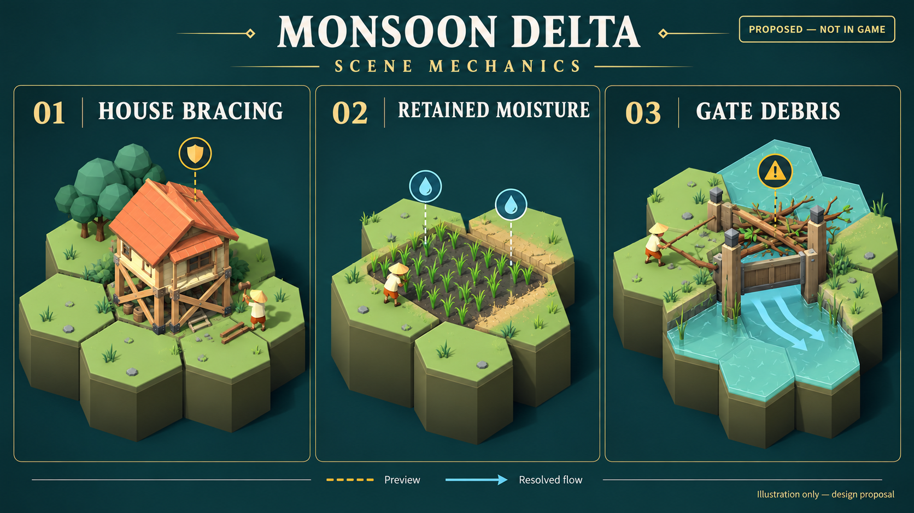

# ข้อเสนอ: เตรียมบ้าน เก็บความชื้น ดูแลทางน้ำ

สถานะ: **M01 ค้ำบ้านมีส่วนที่เล่นได้แล้ว; M02/M03 ยังเป็นข้อเสนอ** · แบบเดิม 2026-10-20 · อัปเดต 2026-10-21 · ฐานแบบ `9d8cfdf`

ส่วนแรกที่พัฒนาใช้กติกา `bracing_v1` และเซฟ v4 เฉพาะค้ำบ้าน ดูพฤติกรรมและภาพจาก engine ใน [คู่มือค้ำบ้านฉุกเฉิน](../features/HOUSE_BRACING.md) ชุดสามกลไก `seasonal_works_v1` ด้านล่างยังเป็นแบบเสนอ ไม่ได้เปิดความชื้นหรือประตูอุดตันพร้อมกัน

เพิ่มการตัดสินใจระหว่าง “แก้ปัญหาเทิร์นนี้” กับ “ลงทุนสำหรับฤดูหน้า” ด้วยกลไก 3 ระบบบนกระดานเดิม ทุกระบบมีสัญญาณในฉากและพรีวิวที่อ่านได้ก่อนจบเทิร์น ตัวเลขต่อไปนี้เป็นค่าตั้งต้นทดลอง ยังไม่ยืนยันสมดุลหรือความสนุก



ภาพแนวคิดสร้างด้วย AI โดยอ้างสไตล์จาก [ฉากหมู่บ้านที่จัดไว้ตรวจภาพ](../images/living-detail-fixture-en.png) ใช้สื่อรูปทรง สี และจุดสังเกต ไม่ใช่ภาพระบบใหม่ที่รันใน engine; กฎและจังหวะสัญญาณยึดรายละเอียดด้านล่างและแบบเอฟเฟกต์

## บทบาทและขอบเขต

| ระบบใหม่ | การตัดสินใจที่เพิ่ม | สิ่งที่ผู้เล่นเห็นในฉาก | ต้นทุนหรือข้อแลกเปลี่ยน |
|---|---|---|---|
| ค้ำบ้านฉุกเฉิน | ซื้อเวลาให้บ้านหนึ่งหลัง หรือใช้ไม้แก้ทางน้ำถาวร? | ค้ำไม้และตราป้องกัน “1 เทิร์น” | 2 แรงงาน + 1 ไม้ต่อหลัง ไม่ช่วยศาลา |
| ความชื้นค้างในนา | ปล่อยนารับน้ำช่วงท้ายฝน หรือระบายให้พื้นที่ข้างเคียงปลอดภัย? | ดินเข้มและหยดความชื้น 0–2 ช่อง | ความชื้นหมดตามเทิร์นแล้ง; น้ำมากเกินยังฆ่านา |
| เศษวัสดุค้างประตู | ล้างเพื่อระบายน้ำได้ดี หรือยอมให้น้ำผ่านช้าลง? | เศษกิ่งไม้และค่าการไหล “เทิร์นถัดไป” | ล้างใช้ 2 แรงงาน; น้ำที่ช้าลงอาจช่วยด้านหนึ่งและท่วมอีกด้าน |

แบบเต็มนี้เสนอ **ชุดกติกาเลือกใช้เมื่อเริ่มรอบใหม่** ชื่อทำงาน `seasonal_works_v1` ไม่เปลี่ยนรอบเดิมเมื่อโหลด และไม่ใช่การเปิดการ์ด/เหตุการณ์ M5 ปัจจุบันมีเฉพาะคำสั่งและฟิลด์ค้ำบ้านใน `bracing_v1` ดู [STATUS](../STATUS.md) ส่วนจังหวะภาพ เสียง ความสำคัญ และ Reduce motion ที่เสนออยู่ใน [แบบเอฟเฟกต์ฉาก](SCENE_EFFECTS.md)

คำสั่งค้ำบ้านต่างจากการ์ด `sandbags` ใน [แบบการ์ด M5](CARD_CATALOG.md): การ์ดลดต้นทุนถมฝน แต่คำสั่งนี้เพิ่มเกณฑ์ทนของบ้านชั่วคราว ไม่ถมดิน ไม่เปลี่ยนระดับน้ำ การเปิดใช้ร่วมกับ M5 เป็นงานตรวจชุดผสมภายหลัง

## M01 — ค้ำบ้านฉุกเฉิน / Brace House

**คำสั่งเสนอ:** `brace_house` · **ค่าที่เสนอ:** แรงงาน 2, ไม้ 1 · **state:** `brace_turns` เป็นจำนวนเต็ม 0 หรือ 1 บนช่อง

ผู้เล่นเลือกบ้านแล้วใช้คำสั่งได้ทั้งแล้งและฝน ไม่ต้องรอให้บ้านเปียก เพราะผลน้ำจะเกิดหลังจบเทิร์น ค้ำได้ครั้งเดียวต่อบ้านต่อเทิร์นและค้ำหลายหลังได้ตามทรัพยากร

| เงื่อนไข | กฎแน่นอน |
|---|---|
| เป้าหมาย | เฉพาะ `HOUSE` หรือ `STILT_HOUSE` ที่ยังอยู่จริงใน planning และ `brace_turns == 0`; ไม่รับศาลา เรือนแพ ยุ้ง หรือช่องว่าง |
| ผลทันทีของคำสั่ง | หักทรัพยากรและตั้ง `brace_turns = 1`; ยังไม่ลดน้ำ ยังไม่เพิ่มคนหรือความจุ |
| ผลเมื่อจำลอง | หลังน้ำ/ซับ/ระเหย ใช้เกณฑ์ทำลายบ้านชนิดนั้นจาก modifiers **+1 ระดับ** แทนเกณฑ์เดิม |
| อายุ | หมดหลัง resolve เทิร์นจริงถัดไปเสมอ แม้ไม่เปียก บ้านพัง หรือแพ้เกม; ไม่ใช่ “ใช้เมื่อช่วยบ้านได้เท่านั้น” |
| ใช้ซ้ำ | ขณะมีค้ำอยู่ ปฏิเสธก่อนหักทรัพยากร; หลังจบเทิร์นต้องจ่ายใหม่หากจะค้ำอีก |
| รื้อบ้าน | รื้อแล้วล้างค้ำ ไม่คืนไม้ที่จ่ายค้ำ; คืนไม้ตัวบ้านตามกฎรื้อเดิมเท่านั้น บ้านที่สร้างใหม่ไม่มีค้ำติดมา |
| Undo/Redo | ย้อนทั้งต้นทุนและ `brace_turns` ด้วย snapshot เดียวกับคำสั่ง; การรื้อแล้ว Undo คืนบ้านและค้ำเดิม |

ตัวอย่างด้วยเกณฑ์เริ่มต้น: บ้านธรรมดาพังเมื่อระดับน้ำ ≥1 ค้ำแล้วพังเมื่อ ≥2 หากพรีวิวเทิร์นนี้ระดับ 1 บ้านจึงรอด; บ้านยกพื้นจากเกณฑ์ ≥2 เป็น ≥3 จึงรอดระดับ 2 แต่ไม่รอดระดับ 3 ศาลายังแพ้ที่ระดับ 2 ตามกฎเดิม

หลังจบเทิร์นที่บ้านรอดระดับ 1 ค้ำหมดแล้วแต่บ้านยังอยู่ น้ำที่ค้างไม่ทำลายบ้านทันทีระหว่าง planning เทิร์นหน้า การตรวจความเสียหายครั้งต่อไปใช้เกณฑ์ปกติหากไม่ค้ำใหม่ UI ต้องแสดงภัยครั้งถัดไปตามพรีวิวใหม่ ไม่แสดงตราคุ้มครองค้าง

เอฟเฟกต์เสนอ: ตอกค้ำสั้น ๆ เมื่อคำสั่งสำเร็จ มีไม้ค้ำจริงบนฐานบ้านและตรา “1 เทิร์น”; เมื่อค้ำช่วยไม่ให้พังให้แสดงแรงน้ำกระทบฐานพร้อมเครื่องหมายรอดชั่วคราว ไม่แสดงบ้านอมตะหรือยกพื้นที่ทั้งช่อง หลังหมดผลให้หายเป็นการเปลี่ยนสถานะ ไม่ปล่อยเศษไม้ที่ผู้เล่นเข้าใจว่าเก็บคืนได้

ทางเลือกที่ต้องมีใน fixture: ค้ำหนึ่งหลังเพื่อเอาแรงงานไปช่วยศาลา, หรือใช้ต้นทุนกับขุด/ถมถาวร; ต้องมีกรณีน้ำแรงเกินค้ำช่วย และกรณีค้ำทั้งหมู่บ้านหลายเทิร์นแพงกว่าจัดทางน้ำ

## M02 — ความชื้นค้างในนา / Retained Soil Moisture

**ไม่มีคำสั่งใหม่** · **state:** `soil_moisture` เป็นจำนวนเต็ม 0–2 เฉพาะช่อง `PADDY`

ความชื้นเป็นค่าความพร้อมของดินเพื่อการเพาะปลูก ไม่ใช่ปริมาตรน้ำอีกถัง ไม่บวก/ลบ `tile.water` และไม่ส่งน้ำให้ช่องอื่น การนับมวลน้ำของ WaterSim จึงใช้ปริมาตรจริงและการชลประทานเดิมเท่านั้น

นาที่รับน้ำเหมาะสมปลายฤดูฝนเก็บความชื้นสำหรับต้นฤดูแล้งปีหน้า ผู้เล่นยังต้องรักษานาไม่ให้ตาย และยอมรับว่านาที่เปียกเหมาะอาจอยู่ใกล้บ้านเสี่ยง

### กฎอัปเดตหลังความเสียหาย

ใช้ระดับน้ำหลังจำลอง/ซับ/ระเหยชุดเดียวกับผลผลิตปัจจุบัน ถ้าศาลาแพ้ให้ข้ามผลผลิตและการอัปเดตความชื้นจากการผลิตเช่นเดียวกับ resolver เดิม แต่ค่าความชื้นของนาที่ตายต้องถูกล้างในขั้นความเสียหายแล้ว

| สถานการณ์ของนาที่ยังไม่ตาย | ผลผลิต | ความชื้นหลังเทิร์น |
|---|---|---|
| ฝน และระดับอยู่ใน `paddy_min_level..paddy_max_level` (ปัจจุบันคือ 1) | เพิ่ม `paddy_yield` 1 และ `paddy_rain_turns` 1 ตามเดิม | ตั้งเป็น 2 |
| ฝน แต่ระดับไม่เข้าเงื่อนไขผลิต | ไม่เพิ่มผลผลิต | `max(0, ก่อนเทิร์น − 1)` |
| แล้ง มีบึงที่ผ่าน `_best_reservoir` เดิม | ผลิต 1 และใช้น้ำบึงตามกฎเดิม; **ไม่ผลิตซ้ำจากความชื้น** | `max(0, ก่อนเทิร์น − 1)` |
| แล้ง ไม่มีบึงที่ใช้ได้ และความชื้นก่อนเทิร์น >0 | เพิ่ม `paddy_yield` 1; ไม่เพิ่ม `paddy_rain_turns` ไม่หักน้ำจากบึงใด | `ก่อนเทิร์น − 1` |
| แล้ง ไม่มีบึงที่ใช้ได้ และความชื้นก่อนเทิร์นเป็น 0 | ไม่เพิ่มผลผลิต | 0 |

ความชื้นลดใน **ทุกเทิร์นแล้ง** รวมเทิร์นที่บึงเลี้ยงนาแล้ว จึงเก็บค้างตลอดแล้งด้วยการใช้บึงไม่ได้ และไม่เติมความชื้นจากน้ำบึงในต้นแบบนี้ หนึ่งนาสะสมผลผลิตได้ไม่เกิน 1 ต่อเทิร์นจากสองทางนี้

### ข้ามปีและขอบเขตช่อง

- นาที่รอดเก็บเกี่ยวรักษาความชื้นไว้ เมื่อ `start_year()` รีเซ็ตผลผลิต/สถานะนาตามเดิม ต้องไม่รีเซ็ตความชื้น จึงใช้ความชื้นจากฝนปี 1 ในแล้งปี 2 ได้
- สร้างนาใหม่เริ่ม 0; นาตายเพราะน้ำหรือรื้อแปลงล้างเป็น 0; เมื่อขึ้นปีใหม่ทำให้นาที่เคยตายกลับมาปลูกได้ จะยังมีความชื้น 0 จนได้เติมตามกฎ
- ขุด/ถมบนช่องที่ยังเป็นนาไม่เพิ่มความชื้น ไม่ให้ผลผลิตฟรี และรักษาค่าที่มีไว้จน resolve; Undo/Redo คืนค่าตาม snapshot
- ช่องที่ไม่ใช่นาและนาที่ตายต้องมีค่า 0 ในเซฟ ไม่มีการส่งความชื้นอัตโนมัติให้นาข้างเคียง
- บึงใช้กฎคัดเลือก/ลำดับช่องเดิมทุกประการ หากบึงเหลือน้ำไม่พอสำหรับนาถัดไป นานั้นจึงค่อยพิจารณาความชื้นของตัวเอง

ตัวอย่าง: นารอดฝนเทิร์น 6 ปี 1 ที่ระดับ 1 มีความชื้น 2 เก็บเกี่ยวแล้วเริ่มปี 2 ผลผลิตสะสมกลับเป็น 0 แต่ความชื้นยัง 2 หากไม่มีบึง แล้งเทิร์น 1 ได้ผลผลิต 1 และเหลือความชื้น 1; เทิร์น 2 ได้เพิ่ม 1 และเหลือ 0; เทิร์น 3 ไม่ได้ผลผลิตอีก ทั้งหมดเป็นข้าวสะสมในนา ยังไม่เพิ่มอาหารในคลังจนเก็บเกี่ยว

ถ้าเทิร์นแล้งแรกมีบึงใช้ได้ จะผลิตจากบึงเพียง 1 ใช้น้ำตามกฎเดิม และความชื้นลด 2→1 เท่าเดิม ไม่มีโบนัสผลผลิต 2 ในเทิร์นเดียว บางปีจึงคุ้มใช้บึงช่วยช่วงท้ายแล้งมากกว่าคิดว่าความชื้นกับบึงทบผลเสมอ

เอฟเฟกต์เสนอ: ดินเข้มเฉพาะนาและหยดเล็กสองช่องบน inspector/ช่องที่เลือก เมื่อผลิตจากความชื้นแสดง “ข้าวสะสม +1” ข้างนา มีสัญลักษณ์ดินกำกับ ไม่แสดงอาหารไหลเข้าคลังหรือปล่อยผิวน้ำใหม่ การแห้งคือดินกลับสีเดิม ไม่สื่อว่านาตายหากไม่มีรายงานตายจริง

ข้อควรทดลองก่อนเลือกค่า: ความชื้น 2 อาจเพิ่มข้าวถึง 2 ต่อแปลงต่อปีและทำให้แผนนาแรงขึ้นมาก ค่า 1 เป็นตัวเทียบในไฟล์ balance ทดลอง; ห้ามเปลี่ยนค่า live เพื่อชดเชยก่อนมี paired replay และข้อมูลผู้เล่น

## M03 — เศษวัสดุค้างประตู / Gate Debris

**คำสั่งเสนอ:** `clear_gate` · **ค่าที่เสนอ:** แรงงาน 2, ไม้ 0 · **state:** `gate_debris` เป็นจำนวนเต็ม 0–2 เฉพาะช่อง `GATE`

ประตูเปิดที่รับน้ำผ่านมากช่วงฝนเริ่มมีเศษกิ่งไม้ค้าง น้ำยังผ่านได้แต่ช้าลง ผู้เล่นเห็นสถานะที่เพิ่มหลังเทิร์นและมีช่วง planning เพื่อเลือกว่าจะล้างหรือใช้การไหลช้าที่เกิดขึ้น ไม่ใช้เหตุการณ์สุ่มหรือแรงงานบำรุงรักษาหักอัตโนมัติ

### การเกิดและการล้าง

| กรณี | ผลแน่นอน |
|---|---|
| เปิดประตูและเป็นฤดูฝน | รวมปริมาตรที่ไหลเข้าช่องประตูจริงจากขอบข้างเคียงตลอดทุก iteration ถ้า ≥2.0 เพิ่ม debris 1 ขั้น สูงสุด 2 หลังเทิร์น |
| น้ำเข้าน้อยกว่า 2.0 / ฤดูแล้ง | ค่าคงเดิม ไม่สะสมเศษส่วนข้ามเทิร์น |
| ประตูปิด | ขอบน้ำเข้า–ออกทุกด้านถูกปิดตามกฎเดิม ไม่มีน้ำผ่านจึงไม่เกิด debris ใหม่; ไม่ล้างของเก่า |
| `clear_gate` | ใช้ได้ทั้งฤดู ทั้งประตูเปิด/ปิด ใน planning เมื่อ debris >0; จ่ายแรงงาน 2 แล้วตั้ง 0 ทันที ก่อนคำนวณพรีวิวใหม่ |
| กดล้างซ้ำที่ค่า 0 | ปฏิเสธโดยไม่คิดต้นทุน |
| toggle เปิด/ปิด | เปลี่ยนเพียงสถานะประตู ไม่ล้างหรือเพิ่ม debris |
| สร้าง/รื้อ | ประตูใหม่เริ่ม 0; รื้อล้างค่าบนช่อง คืนไม้ตามกฎตัวอาคารเดิม ไม่มีไม้จากเศษวัสดุ |

น้ำที่นับคือ **throughput** ที่ส่งเข้าจริงหลังใช้ตัวคูณ ไม่ใช่ระดับน้ำที่ค้างท้ายเทิร์นหรือปริมาตรฝนทั้งกระดาน น้ำที่ไหลกลับเข้าประตูหลายครั้งนับตามการส่งจริงแต่ละครั้ง จึงไม่ใช่จำนวน “น้ำคนละก้อน” และไม่ใช้ค่านี้เพิ่ม/ลบมวลน้ำ

### ผลต่อการไหลโดยไม่ทำให้น้ำหาย

เมื่อเริ่ม resolve หลังคำสั่ง planning ให้ตรึงตัวคูณประตู `c`: debris 0 → 1.00, 1 → 0.75, 2 → 0.50 ตลอดทุก iteration ในเทิร์นนั้น ช่องอื่นใช้ 1.00 ประตูปิดใช้การตัดขอบเดิมก่อนคำนวณ

สำหรับแต่ละการส่งตามธรรมชาติ `i → j`:

```text
base_share = ปริมาณแบ่งขอบจาก WaterSim เดิม
actual_share = base_share × min(c[i], c[j])
delta[i] -= actual_share
delta[j] += actual_share
```

คูณเพียงครั้งเดียวต่อการส่ง น้ำส่วนที่ไม่ได้ส่งยังอยู่ต้นทาง ไม่กระจายส่วนเหลือนั้นไปขอบอื่นใน iteration เดียวกัน ผลรวมไหลออกจึงไม่เกินของสูตรเดิมและไม่ทำลาย mass balance ถ้าประตูสองช่องติดกันใช้ตัวที่ต่ำกว่า ไม่คูณ 0.5×0.5

ตัวคูณนี้ใช้กับการไหลตามธรรมชาติเท่านั้น ระหัดยังสูบน้ำก่อน iteration ตามกฎเดิม รวมการดึงจากช่องประตูเปิดที่มี debris; การสูบไม่ล้างเศษวัสดุ ประตูปิดยังดึงไม่ได้ตามกฎเดิม นี่เป็นขอบเขตตั้งใจของต้นแบบ ไม่เพิ่มระบบท่ออุดตันให้ระหัด

เมื่อจบการจำลองจึงคำนวณ debris ใหม่ ผลใหม่เริ่มใช้ **เทิร์นถัดไป** ไม่เปลี่ยนตัวคูณกลาง animation หรือ iteration ให้ core รวม `gate_inbound` แบบ float64 โดยตรงแม้ `record_snapshots == false`; ห้ามใช้ `flow_edges` แบบ float32 ที่มีเฉพาะการบันทึกภาพมาตัดสินกติกา ไม่ต้องเก็บรายการทุก iteration ไว้ในเซฟ

ตัวอย่าง: เริ่มเทิร์นฝนด้วย debris 0 ใช้ c=1.00 ทั้งเทิร์น และมีน้ำเข้าจริง 2.4 จึงจบที่ debris 1 พรีวิวของเทิร์นถัดไปใช้ c=0.75 ถ้าผู้เล่นล้างก่อนจบเทิร์นนั้น จ่ายแรงงาน 2 และกลับใช้ c=1.00; หากมีน้ำเข้า ≥2.0 อีกก็อาจเกิด debris 1 ใหม่หลังจบ การล้างไม่ได้รับประกันสะอาดตลอดฝน

เอฟเฟกต์เสนอ: เริ่มเห็นกิ่งไม้ค้างหลังผลจริงกำหนดค่าแล้ว แสดง “ทางน้ำติดขัด 1/2 · มีผลเทิร์นหน้า” และให้พรีวิวแสดงผลกระทบจริง ไม่ชะลอภาพการไหลของเทิร์นที่เพิ่งคำนวณด้วยค่าเดิม ค่า c=0.75 เป็นตัวคูณต่อการส่งแต่ละขอบ ไม่รับประกันว่าน้ำผ่านรวมทั้งเทิร์นเหลือ 75% เพราะระดับน้ำและเส้นทางอื่นเปลี่ยนระหว่าง iteration; เมื่อล้างให้กวาดกิ่งไม้สั้น ๆ และคืนสถานะ ไม่เพิ่มไม้ในคลัง ไม่จำเป็นต้องมีอนุภาคเศษไม้ไหลทั้งแม่น้ำ

## ลำดับ resolve และข้อมูลสำหรับฉาก

ลำดับเสนอใน ruleset ใหม่นี้ต่อจาก [TurnResolver](../../core/turn_resolver.gd) และ [WaterSim](../../core/water_sim.gd) โดยยังใช้ตัวจำลองชุดเดียว:

1. รับ state หลังคำสั่ง; ตรึงตัวคูณ debris และอ่านความชื้น/ค้ำที่มีอยู่ก่อนเทิร์น
2. ระหัด → น้ำธรรมชาติพร้อมตัวคูณ debris → ซับ → ระเหยแล้ง; รวมปริมาตรประตูด้วย float64
3. ความเสียหาย: ใช้เกณฑ์ค้ำกับบ้านที่มีสิทธิ์ ศาลา/นาใช้เกณฑ์เดิม; นาตายล้างความชื้น
4. ถ้ายังไม่แพ้ ให้ผลผลิตเดิมรวมทางเลือกความชื้นและอัปเดตความชื้น; ปลา/ข้าวไม่เพิ่มซ้ำจากภาพ
5. คำนวณ debris สำหรับเทิร์นหน้าและหมดอายุค้ำทุกหลังเสมอ แม้ศาลาแพ้ในขั้น 3; สถานะสุดท้ายจึงตรงกันใน preview/ผลจริงโดยไม่มีค้ำค้าง ส่วนความชื้นที่ไม่ตายยังคงค่าก่อนเทิร์นเมื่อข้ามขั้นผลิตเพราะแพ้ จากนั้นส่งผลให้ GameFlow ตรวจเก็บเกี่ยว/ปี/ผลรอบตามเดิม ไม่มีเทิร์นใหม่ให้เล่นหลังแพ้

รายงานเชิงความหมายที่เสนอ ต้องมีเมื่อปิดภาพ/รันบอทด้วย:

| ข้อมูลเพิ่มในรายงาน | ผู้ใช้ข้อมูล |
|---|---|
| `brace_results`: coord, base_threshold, protected_threshold, level, prevented_loss, expired | พรีวิวภัยและภาพรอดชั่วคราว; `prevented_loss` จริงเมื่อถึงเกณฑ์เดิมแต่ต่ำกว่าเกณฑ์ค้ำเท่านั้น |
| `moisture_changes`: coord, before, after, yield_from_moisture | สีดิน/หยดและบัญชีผลข้าว; yield_from_moisture เป็น 0 หรือ 1 ไม่ใช่อาหารที่รับแล้ว |
| `gate_debris_changes`: coord, before, after, inbound, conductance_used, conductance_next | แสดงสิ่งที่เกิดเทิร์นนี้แยกจากข้อจำกัดเทิร์นหน้า; เก็บแม้ค่าไม่เปลี่ยนเมื่อผู้เล่นตรวจประตู |

preview ต้องคำนวณรายงานเหมือนจริงบนสำเนา แต่ไม่ตั้ง flag หมดค้ำ ลดความชื้น หรือเพิ่ม debris ใน state จริง แผงดูช่อง/เสียง/อนุภาคอ่านรายงานเท่านั้น การกดข้ามภาพรับผลเดิมทันที

## เซฟ ความคงที่ และการเล่นร่วมกับของเดิม

ใช้ [GameSession](../../core/game_session.gd) เป็นเจ้าของ checkpoint เช่นเดิม; GameFlow และ view ไม่ทำ I/O ข้อมูลใหม่ต้องอยู่ใน `to_dict`/`from_dict`/deep copy/snapshot และ validator ของ ruleset ใหม่พร้อมกัน ก่อนเปิดให้เริ่มรอบที่มีคำสั่งใหม่

กฎเซฟต้องเก็บ ruleset/revision, ค่าฟิลด์ใหม่, float64/RNG เดิม และแหล่ง balance ที่ระบุรุ่น การจัด envelope version ใหม่ต้องทำตอนพัฒนาโดยเลือกเลขที่ยังไม่ถูกใช้ ไม่ใช้ v3 ปัจจุบันแอบเพิ่มข้อมูล และไม่ใช้เลขรุ่นแบบเสนอ M5 แทน

โหลด v1/v2/v3 ปัจจุบันด้วยกฎเดิม ไม่เติมความชื้นหรือ debris ย้อนหลัง ไม่เปิดค้ำบ้านในรอบค้าง เมื่อไม่รู้จัก ruleset/revision ให้ปฏิเสธอย่างรักษาไฟล์เดิม การ retry/Continue ไม่สุ่มตัวเลขใหม่และไม่ล้างสถานะที่ไม่สะดวก

validator ต้องปฏิเสธจำนวนที่มีเศษแทนค่าจำนวนเต็ม, ค่านอกช่วง, ค้ำบนอาคารผิดชนิด, ความชื้นบนช่องไม่ใช่นาหรือนาที่ตาย และ debris บนช่องไม่ใช่ประตู ช่องที่ไม่มีสถานะใช้ 0 ฟิลด์ใหม่ห้ามได้รับค่า default เงียบ ๆ เมื่อโหลด save ที่อ้าง ruleset ใหม่นี้แต่ขาดข้อมูล ตัวอ่าน JSON ของ Godot ไม่แยกชนิดตัวเลข `1` กับ `1.0` หลัง parse

การใช้กับบทเรียน [โรงเรียนสายน้ำ](SCENARIO_CAMPAIGN.md) เป็นชุด fixture/revision เพิ่มภายหลัง ไม่เปลี่ยนโจทย์เดิมอัตโนมัติ โดยเฉพาะเงื่อนไขพรีวิว บ้านรอด และจำนวนข้าวที่ใช้วัดผ่านบท

## แผนทดลองและเกณฑ์ก่อนเปิดใช้

| ชุดตรวจ | กรณีที่ต้องมี |
|---|---|
| ค้ำ | บ้านระดับ 0/1/2 และบ้านยกพื้น 1/2/3; ศาลาไม่รับคำสั่ง; มีค้ำแล้วกดซ้ำไม่เสียทรัพยากร; หมดผลแม้แล้ง; รื้อ/Undo/Redo; โหลดหลังค้ำแล้วจบเทิร์น |
| ความชื้น | ช่วง 0/1/2, น้ำฝนเหมาะ/มากเกิน/แห้ง, บึงพอ/ไม่พอ/ใช้ร่วม, ไม่ได้ผลผลิตซ้ำ, ปีใหม่รีเซ็ตข้าวแต่คงความชื้น, นาตาย/รื้อ/สร้างใหม่, แพ้ศาลาไม่ผลิต |
| ประตู | น้ำเข้า 0, ต่ำกว่า 2.0, เท่ากับ 2.0, สูงกว่า 2.0; ฝน/แล้ง; ประตูปิด/สองประตูติด; ใช้ค่าเก่าทั้งเทิร์น; ล้าง/Undo; ระหัดดึงจากประตู; เปิด/ปิดบันทึกภาพได้ state/RNG ตรงกัน |
| ภาพกับกฎ | เปิด/ปิดเอฟเฟกต์ ลดการเคลื่อนไหว ข้ามภาพ เปลี่ยนภาษาและกล้องแล้วผลจริงเหมือนกัน; พรีวิวเทียบ state หลัง resolve/เก็บเกี่ยวเดียวกัน |
| น้ำและเซฟ | mass balance ตามเกณฑ์เดิม, ไม่มีน้ำติดลบ, float64 exact roundtrip, schema เก่าไม่เปลี่ยนผล, unknown ruleset ไม่แตะไฟล์เดิม |

เริ่มทดลอง **ค้ำบ้านระบบเดียว** บน fixture เทิร์นฝน จากนั้นเปิดความชื้นเป็นการทดลองแยก และเพิ่ม debris หลังผู้เล่นอ่านพรีวิวทางน้ำได้ การปล่อยทั้งสามพร้อมกันทำให้แยกสาเหตุอาหารมากขึ้นหรือบ้านรอดยากขึ้นไม่ได้

เก็บ paired seeds ด้วยกฎเดิม/ระบบใหม่ทีละระบบ บันทึกอาหารข้าว บ้านที่ค้ำช่วยได้ ไม้/แรงงานที่ใช้ จำนวนครั้งล้าง และสาเหตุแพ้ บอทต้องรู้จักคำสั่งใหม่ก่อนใช้เปรียบเทียบอัตราชนะ; ผลบอทเดิมไม่รับรองคุณค่าการค้ำหรือการเลือกไม่ล้างประตู

ให้ผู้เล่นอย่างน้อย 3 คนลองสถานการณ์สั้นและอธิบายผลก่อนกดจบเทิร์น เป้าทดลองคือบอกได้ว่าค้ำหมดเมื่อไร ความชื้นเพิ่มข้าวไม่ใช่อาหารทันที และ debris ใหม่มีผลเทิร์นหน้า หากผู้เล่นล้างประตูทุกครั้งโดยไม่คิดหรือใช้ค้ำแทนจัดน้ำได้ทุกสถานการณ์ ให้แก้ต้นทุน/fixture ก่อนเพิ่มเนื้อหา

งานออกแบบนี้ไม่มีการเปลี่ยน runtime, balance หรือ schema จริง และไม่ปิดเกณฑ์สมดุล M3 หรือการอนุมัติ M5 คำสั่งตรวจเมื่อมีการพัฒนาจริงให้ใช้ [คู่มือพัฒนา](../development/README.md) พร้อมเทสต์ core/save และหน้าต่าง native ไทย–อังกฤษ
