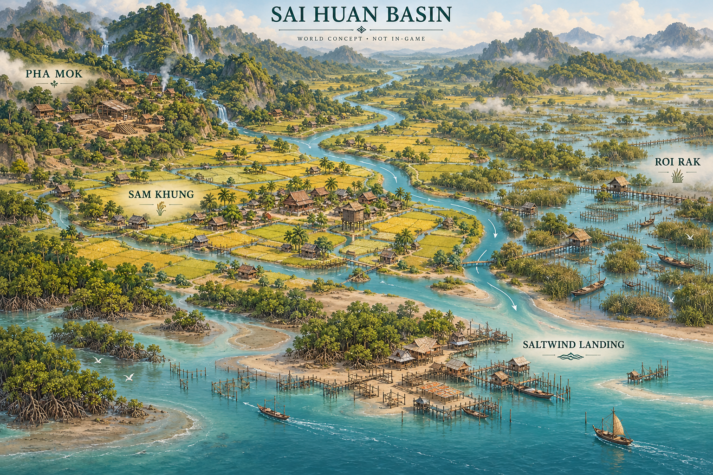
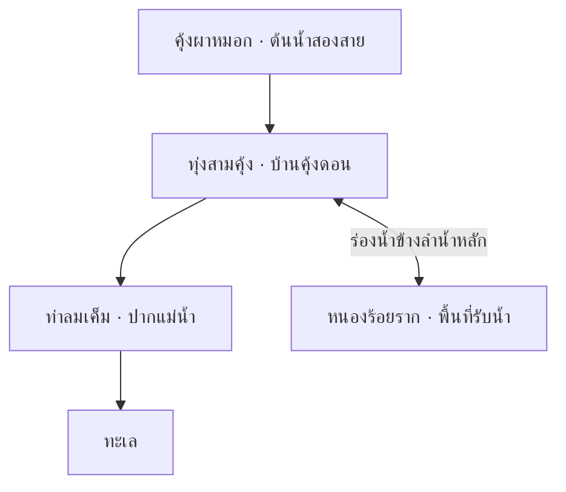

# ข้อเสนอโลกเกม: ลุ่มน้ำสายหวน

สถานะ: **โลกและเรื่องเล่าที่เสนอ ยังไม่ได้เปิดใช้ในเกม** · 2026-10-24 · ฐานกฎ `e3b0725`

เอกสารนี้กำหนดสถานที่ ผู้คน ความทรงจำ และภาษาภาพของ Monsoon Delta สำหรับนำไปเขียนฉากและข้อความภายหลัง พฤติกรรมที่เล่นได้จริงยังยึด [STATUS](../STATUS.md) โลกส่วนนี้ไม่เพิ่มแผนที่ playable หรือเปลี่ยนกฎน้ำ ทรัพยากร แพ้–ชนะ และเซฟด้วยตัวเอง

ภาพแนวคิดสร้างด้วย AI ใช้สื่อความสัมพันธ์ของถิ่นและบรรยากาศ ไม่ใช่ภาพหน้าจอเกมหรือผลจำลองน้ำ รายละเอียดภูมิประเทศและอาคารอาจต่างจากสิ่งที่ engine รองรับ ชื่อย่อ PHA MOK / SAM KHUNG / ROI RAK ในภาพหมายถึงคุ้งผาหมอก / ทุ่งสามคุ้ง / หนองร้อยราก ส่วน SALTWIND LANDING คือท่าลมเค็ม ใช้ชื่อเต็มตามตารางด้านล่างเมื่อเขียนข้อความเกม

กระดาน hex **61 ช่องเป็นพื้นที่รอบชุมชนหนึ่งแห่ง** ไม่ใช่แผนที่ทั้งลุ่มน้ำ ภาพระดับลุ่มน้ำนี้ยังไม่สร้างเส้นทางเดินทางหรือการแลกเปลี่ยนระหว่างกระดาน

## 1. โลกที่คนอยากกลับมาอยู่

**ลุ่มน้ำสายหวน / Sai Huan Basin** เป็นถิ่นสมมติที่ชุมชนต่าง ๆ อยู่กับแม่น้ำสายเดียวกัน น้ำที่ช่วยหมู่บ้านหนึ่งอาจมาถึงอีกหมู่บ้านในเวลาที่เขารับไม่ไหว ผู้เล่นดูแล **บ้านคุ้งดอน / Khung Don** ในทุ่งสามคุ้ง รับช่วงสมุดบันทึกจากสภาชุมชน และค่อย ๆ เขียนว่าหมู่บ้านของตนอยู่รอดด้วยวิธีใด

โทนเรื่องอบอุ่น มีงานให้รับผิดชอบ และมีพื้นที่ให้ลองใหม่ ชีวิตประกอบด้วยการซ่อมของ แบ่งเครื่องมือ รอข้าว ขนปลา และสอนคนรุ่นต่อไป ช่วงที่ปลอดภัยมีเรื่องเล็กให้จดจำพอ ๆ กับฤดูน้ำหลาก ไม่มีสงครามหรือฝ่ายชั่วที่ต้องกำจัดเพื่อให้แม่น้ำกลับมาดี

ยุคของโลกใช้ไม้ เชือก เครื่องมือมือ เรือ และเครื่องกลอย่างระหัด เป็นยุคช่างฝีมือสมมติ ไม่ระบุประเทศหรือปีประวัติศาสตร์จริง งานศิลป์รับแรงบันดาลใจจากชุมชนลุ่มน้ำเขตร้อน โดยใช้รายละเอียดของแต่ละถิ่นสร้างความแตกต่าง แทนการรวมวัฒนธรรมทั้งหมดเป็นหมู่บ้านแบบเดียว

เรื่องเล่าสำคัญคือ **“ใครจะรับน้ำไว้ ใครจำเป็นต้องปล่อยก่อน และปีหน้าใครจะเป็นคนรับช่วงต่อ?”** ทุกกลุ่มมีเหตุผลที่ผู้เล่นเข้าใจได้ คำตอบเกิดจากสภาพกระดานและการตัดสินใจของผู้เล่น ไม่ใช่คะแนนศีลธรรมลับ

ตัวอย่างฉากเปิดที่เสนอ:

> เช้าวันรับสมุด ยายแสงวางปกที่ซ่อมด้วยเชือกสามสีลงบนโต๊ะศาลา หน้าปีรอยสูงมีคำว่า “น้ำมาเร็ว” เขียนอยู่ข้างคำแก้ว่า “คูตรงท่าตื้นกว่าปีก่อน”
>
> ยายแสงเปิดหน้าว่างให้เรา “ปีนี้ถ้าต้องเปลี่ยนทางน้ำ จดเหตุไว้ด้วย คนที่มาทีหลังจะได้รู้ว่าเราคิดอะไรตอนลงมือ”
>
> นอกศาลามีเสียงเตรียมเครื่องมือและลมผ่านคันนา หน้ากระดาษยังว่าง แต่หมู่บ้านเริ่มวันของมันแล้ว

## 2. ภูมิศาสตร์ของลุ่มน้ำ

แผนภาพนี้เป็นแผนที่ความสัมพันธ์ทางภูมิศาสตร์ที่เสนอ ไม่ใช่กราฟการไหลของตัวจำลองหรือหน้าจอเลือกแผนที่ในเกม ลูกศรข้างหนองหมายถึงร่องน้ำที่เชื่อมกับลำน้ำหลัก ปริมาณและทิศที่เกิดจริงต้องใช้กฎของแผนที่เมื่อพัฒนา

หนองร้อยรากเป็นพื้นที่ข้างลำน้ำ ไม่ใช่ด่านที่น้ำทุกหยดต้องผ่านก่อนลงทะเล ที่ต้นน้ำเห็นฝนบนไหล่เขา ส่วนคนปากน้ำเห็นการมาถึงของน้ำจืดและลมทะเล ความต่างของมุมมองทำให้เรื่องเล่าของชุมชนหนึ่งไม่อธิบายโลกได้ครบทั้งหมด

| ถิ่น | ชีวิตประจำวัน | ภาพและวัสดุ | เสียงที่ใช้เสนออารมณ์ | ความทรงจำร่วม | เรื่องที่ยังตกลงกันไม่ได้ |
|---|---|---|---|---|---|
| **คุ้งผาหมอก / Mistcliff Bend** | ซ่อมบ้านบนไหล่เขา ทำเครื่องมือ รักษาทางผ่านของลำน้ำสองสาย | หินชื้น ไม้เข้ม เชือกป่าน เสาค้ำเฉียง ลานงานบนที่ดอน | น้ำกระทบหิน เครื่องมือเคาะไม้ ลมผ่านช่องเขา | ปีที่ร่องน้ำเก่าเปลี่ยนจนสะพานใช้ไม่ได้ | ระบายให้บ้านต้นน้ำปลอดภัยเร็วเพียงใด โดยยังคิดถึงคนที่รออยู่ข้างล่าง |
| **ทุ่งสามคุ้ง / Three-Bend Plain** | ดูแลนา จดแรงงาน ขนข้าวเข้ายุ้ง และพบกันที่ศาลาบ้านคุ้งดอน | ดินสีอุ่น คลองตื้น คันนา งานสาน หลังคาที่ซ่อมต่างรุ่น | เสียงฝีเท้าบนไม้ ครก ตะกร้า และน้ำในคลอง | หลักน้ำเก่าสามต้นซึ่งเคยอยู่ริมแม่น้ำคนละยุค | จะแบ่งพื้นที่ผลิตกับทางรับน้ำอย่างไร เมื่อที่ดอนใกล้บ้านมีจำกัด |
| **หนองร้อยราก / Hundred-Root Wetland** | ทำไซ ซ่อมตะกร้า เฝ้าริมบึง และใช้ทางเดินตามสภาพน้ำ | รากไม้ สีน้ำเขียวหม่น ตอไม้ ริมตลิ่งเว้า ชานงานริมหนอง | แมลง ลมในกก เสียงไม้ไผ่และน้ำเบา ๆ | ชาวบ้านจำบริเวณที่เคยเป็นทางเดินก่อนกลายเป็นหนอง | จะรักษาพื้นที่รับน้ำและแหล่งปลา พร้อมหาอาหารจากนาได้อย่างไร |
| **ท่าลมเค็ม / Saltwind Landing** | ซ่อมเรือนแพ ผูกเรือ ตากปลา และดูทางออกสู่ทะเล | เสาผูกเรือ ผ้าใบซีด ไม้สีอ่อน รอยลมและคราบน้ำ | เชือกตึงกับเสา ผ้าใบ ลม และคลื่นไกล | รอยผูกเรือหลายระดับบนเสาท่าเดียวกัน | จะรักษาพื้นที่อยู่อาศัยและรอให้น้ำจืดจากต้นน้ำมาถึงได้อย่างไร |

ความสัมพันธ์กับแผนที่ปัจจุบันและแบบเดิม:

- **ทุ่งสามคุ้ง** เป็นกรอบเรื่องที่เริ่มใช้กับ `plains` ซึ่งเล่นได้แล้ว โดยรักษา seed และ generator เดิม
- **หนองร้อยราก** เริ่มเป็นชุดภาพ/สถานการณ์บนที่ราบได้ ไม่ได้เพิ่ม generator ลำดับที่สี่
- **คุ้งผาหมอก** เชื่อมกับแบบ `valley` และ **ท่าลมเค็ม** เชื่อมกับแบบ `estuary` ใน [ข้อเสนอแผนที่](CHALLENGES_AND_MAPS.md) ทั้งสองยังไม่ใช่แผนที่ที่เปิดเล่น
- น้ำเค็ม น้ำทะเลหนุน การกัดเซาะ และการเดินเรือในเรื่องไม่เพิ่มระบบผลิต/ขนส่งหรือความเสียหายใหม่ หากจะให้มีผลต่อเกม ต้องออกแบบกฎและทดสอบต่างหาก

ชื่อท่าลมเค็มใช้บอกวิถีชีวิตริมทะเล แบบ `estuary` ที่อ้างถึงยังไม่เสนอค่าความเค็มหรือวงจรน้ำขึ้น–ลงภายในเทิร์น ระดับน้ำที่ขอบทะเลของแบบนั้นต้องอ่านตามสเปกแผนที่ ไม่ตีความเป็นการยกน้ำทั้งกระดานตามบรรยากาศในเรื่อง

## 3. สมุดน้ำ หลักน้ำ และปีรอยสูง

**สมุดน้ำ** เป็นของส่วนรวมที่เก็บไว้ในศาลา หน้าเก่าเล่าว่าผู้ดูแลรุ่นก่อนคิดอย่างไร พร้อมคำแก้และบันทึกที่เห็นไม่ตรงกัน หน้าปัจจุบันควรเล่าสิ่งที่ผู้เล่นทำและผลจริงของรอบนั้น ไม่แสดงเฉลยหรือทำนายฝนที่ยังไม่เปิดเผย

**หลักน้ำ** คือเสาหรือแผ่นไม้ที่มีรอยบากระดับเก่า ทำให้เห็นว่าผู้คนเก็บความรู้ไว้ในสถานที่อย่างไร รอยเก่าที่วาดไว้ในฉากเป็นประวัติของโลกสมมติ ต้องแยกจากมาตรวัดน้ำปัจจุบันและคำเตือนจาก resolver ไม่ใช้รอยตกแต่งแทนเกณฑ์พังของอาคาร

**ปีรอยสูง** เป็นชื่อที่คนเรียกปีน้ำมากในความทรงจำก่อนเริ่มเกม แต่ละถิ่นจำเรื่องต่างกัน บางคนจำบ้านที่ต้องซ่อม บางคนจำปลาที่เลี้ยงชุมชน บางคนจำผู้ย้ายไปเริ่มบ้านที่อื่น ความทรงจำนี้ไม่กำหนดว่าน้ำต้องท่วมซ้ำในปีใดของรอบเล่น

สิ่งที่ค้างจากปีรอยสูงคือคำถามว่าบันทึกของใครขาดไป ผู้เล่นมีหน้าที่เขียนให้คนรุ่นถัดไปเห็นทั้งประโยชน์และสิ่งที่ต้องยอมเสีย การพบหน้าบันทึกหรืออ่านหลักน้ำไม่แจกโบนัส ไม่เปลี่ยน forecast และไม่เพิ่ม RNG draw

## 4. ผู้คนที่มีเหตุผลของตน

ชื่อเหล่านี้เป็นตัวละครที่เสนอ ไม่ใช่ NPC ที่มีระบบสนทนา ความสัมพันธ์ หรือการซื้อขายแล้ว สี่คนแรกใช้เล่ามุมมองของ archetype ผู้นำเดิม ไม่เพิ่มผู้นำ เปลี่ยนโบนัส หรือนำตัวเลือกที่มีอยู่กลับไปล็อก

รายชื่อเป็นคลังตัวละครจากโลกเดียวกันสำหรับเลือกใช้ในฉาก ไม่ใช่การกำหนดว่าประชากรเริ่มต้นต้องเป็นทั้งหกคนนี้ หรือว่าทุกคนอยู่บนกระดานพร้อมกัน

| คน | ผูกกับบทบาทเดิม | สิ่งที่อยากรักษา | จุดที่ทำให้มีข้อขัดแย้ง | ประโยคตัวอย่าง |
|---|---|---|---|---|
| **นวล / Nuan** | ชาวนา `farmer` | เมล็ดพันธุ์และนาที่คนรุ่นต่อไปยังใช้ได้ | บางครั้งยอมเปลี่ยนพื้นที่นาเป็นบ้านช้าเกินไป เพราะผูกพันกับแปลงเดิม | “ข้าวอยู่ในนา ยังไม่อยู่ในคลัง” |
| **ชื่น / Chuen** | ช่างไม้ `carpenter` | บ้านและความรู้เรื่องการซ่อม | อยากรักษาของที่ซ่อมมาหลายครั้ง จนอาจชะลอการปรับแผน | “เรือนนี้สอนให้เรารู้แล้วว่าต้องค้ำตรงไหน” |
| **เมฆ / Mek** | ชาวประมง `fisher` | ทางน้ำและอาหารที่หาได้ระหว่างรอข้าว | เห็นคุณค่าของพื้นที่เปียก จึงต้องฟังคนที่จำเป็นต้องรักษานาแห้งด้วย | “เว้นทางให้น้ำ แล้วค่อยดูว่าไซควรอยู่ไหน” |
| **พิม / Phim** | หมอดิน `soil_doctor` | ดินและงานที่ประหยัดแรงในปีถัดไป | ชอบเก็บข้อมูลให้ครบ จนคนที่ต้องแก้ปัญหาเดี๋ยวนี้อาจรอไม่ไหว | “ขุดช่องนี้แล้ว ลองดูปลายทางด้วย” |
| **ยายแสง / Saeng** | ผู้รักษาสมุดน้ำ | เหตุผลของคนที่เคยตัดสินใจก่อนหน้า | ไม่อยากขีดฆ่าความรู้เก่า แม้สภาพบางอย่างเปลี่ยนไปแล้ว | “จดด้วยว่าเหตุใดจึงเลือก ไม่ใช่แค่ว่าทำอะไร” |
| **ต้น / Ton** | เด็กฝึกอ่านหลักน้ำ | ความรู้ที่จะใช้ดูแลบ้านเมื่อโตขึ้น | รีบคัดลอกรอยและคำตอบ ก่อนเข้าใจว่าคนจดเห็นอะไร | “ถ้าปล่อยตรงนี้ น้ำจะไปถึงบ้านใครต่อ?” |

ความเห็นต่างเกิดจากเป้าหมายและประสบการณ์ ตัวละครไม่โกหกค่าพรีวิวหรือสั่งใช้ทรัพยากรแทนผู้เล่น ประโยคหลังผลเทิร์นต้องอ้างเหตุที่มีรายงานจริง ส่วนความทรงจำและข้อคิดเห็นระบุว่าเป็นมุมมอง ไม่ปลอมเป็นคำแนะนำที่ผ่านการคำนวณแล้ว

นวลกับเมฆอาจถกกันเรื่องร่องน้ำเดียวกัน แต่ยังช่วยกันขนของเมื่อถึงงานส่วนรวม ชื่นอยากรักษาเรือนเก่า ส่วนพิมชวนมองตลิ่งที่เรือนตั้งอยู่ ยายแสงเก็บคำอธิบายทั้งสองไว้ และต้นเป็นคนถามว่าถ้าสภาพปีหน้าเปลี่ยน พวกเขาจะเลือกเหมือนเดิมหรือไม่ ความผูกพันเหล่านี้ใช้เป็นเนื้อหาฉากและน้ำเสียงของบท ไม่มีค่าความสัมพันธ์ที่ซ่อนอยู่หลังบทสนทนา

## 5. หกช่วงที่คนเรียกในหนึ่งปี

ชื่อเหล่านี้เป็นภาษาท้องถิ่นสมมติที่ครอบฤดูเดิม **แล้ง 3 เทิร์น แล้วฝน 3 เทิร์น** ไม่มีเดือนตายตัวหรือเทิร์นเพิ่ม ชื่อบอกจังหวะงานที่คนคุ้น ไม่รับประกันระดับน้ำหรือฝนล่วงหน้า

| เทิร์น | ชื่อเรียก | กิจกรรมและบรรยากาศที่เขียนได้ |
|---|---|---|
| แล้ง 1 | **อ่านรอยน้ำ / Read the Marks** | ทบทวนปีเก่า สำรวจเสาและพื้นที่ที่จะเริ่มงาน |
| แล้ง 2 | **ซ่อมทางน้ำ / Mend the Waterways** | จัดเครื่องมือ ซ่อมงานไม้ และลงมือเตรียมแผน |
| แล้ง 3 | **รอฝน / Await the Rains** | ตรวจสิ่งที่ยังค้าง มัดของ และมองพรีวิวของเทิร์นที่กำลังเล่น |
| ฝน 1 | **รับฝน / Receive the Rains** | เปลี่ยนจังหวะงานตามน้ำจริงที่มาถึง |
| ฝน 2 | **แบ่งน้ำ / Share the Flow** | มองว่าทางน้ำเดียวกันช่วยและเสี่ยงต่อพื้นที่ใดบ้าง |
| ฝน 3 | **ส่งน้ำ / Send the Water On** | จัดการสิ่งที่ยังต้องรับมือและเตรียมอ่านผลเก็บเกี่ยว |

“ส่งน้ำ” ไม่ได้แปลว่าน้ำจะลดในเทิร์น 6 น้ำอาจยังท่วมและศาลาอาจแพ้ก่อนเก็บเกี่ยว ชื่อช่วงต้องแสดงคู่กับฤดู/เทิร์นมาตรฐานและข้อมูลจริง ไม่แทนที่คำเตือนสำคัญ

## 6. ประเพณีจากงานที่ทำร่วมกัน

ทั้งสามอย่างเป็นประเพณีสมมติของโลกนี้ ใช้สร้างภาพชีวิตและบทสนทนา ไม่เสนอให้การกดเข้าร่วมเพิ่มแรงงาน อาหาร ไม้ หรือความทนน้ำ

| ประเพณี | สิ่งที่ชุมชนทำ | รายละเอียดที่ใช้ในฉาก | ความหมาย |
|---|---|---|---|
| **สางเชือก** | รวมเครื่องมือ เชือก และงานซ่อมก่อนเริ่มงานแล้ง | ขดเชือกต่างขนาด ป้ายชื่อผู้ฝาก แผ่นไม้สำหรับทดลองผูก | ความรู้มีเจ้าของหลายคนและต้องดูแลให้ใช้ต่อได้ |
| **คืนเรือ** | ส่งคืนและตรวจเรือที่เคยยืมก่อนช่วงฝน | รอยผูกเรือที่ท่า ผ้าที่ผึ่งให้แห้ง และไม้พายวางเป็นคู่ | การยืมของมีความทรงจำและความรับผิดชอบ |
| **ปักหลักใหม่** | หลังอ่านผลปีนั้น จดสิ่งที่เรียนรู้และเก็บรอยเก่าไว้ | แผ่นบันทึกใหม่อยู่ข้างแผ่นเก่า แทนการลบทุกอย่างให้สะอาด | ปีที่ยากก็มีความรู้ที่ส่งต่อได้ |

เรือและเครื่องมือในประเพณีเป็นองค์ประกอบเรื่องเล่า ยังไม่มีคำสั่งยืม ระบบหนี้ ตลาด เงินตรา หรือเส้นทางเรือที่ผลิตทรัพยากร หากรอบจบก่อนเก็บเกี่ยว ต้องไม่แสดงพิธีปิดปีราวกับหมู่บ้านผ่านปีนั้นแล้ว

## 7. เส้นเรื่องห้าปีที่เปิดอ่านได้ตามสมัครใจ

เส้นเรื่องเป็นกรอบเลือกข้อความ ไม่ใช่สคริปต์สร้างภัย ผู้เล่นปิดส่วนเล่าเรื่องได้โดยยังอ่านกฎ เป้าหมาย และรายงานครบ ไม่มีการโหวต การรับภารกิจบังคับ หรือค่าความสัมพันธ์ที่ทำให้แพ้

| ช่วง | คำถามของเรื่อง | สิ่งที่ใช้ตอบจากการเล่น |
|---|---|---|
| ปี 1 — **หน้าที่ว่างในสมุด** | เรารับช่วงหมู่บ้านแบบใดมา? | บทนำบ้านคุ้งดอนและผลเทิร์น/เก็บเกี่ยวแรกที่เกิดจริง |
| ปี 2 — **อ่านจากคนละฝั่ง** | ทำไมแต่ละคนจึงห่วงคนละเรื่อง? | เลือกบทสะท้อนจากอาหาร บ้าน หรือพื้นที่ผลิตที่มีรายงานจริง ไม่จำลองหมู่บ้านนอกกระดาน |
| ปี 3 — **สิ่งที่ยังอยู่** | เรารักษาอะไรไว้ และยอมเปลี่ยนอะไร? | สภาพหมู่บ้านและเป้าหมายที่ผู้เล่นเลือกตามกฎเดิม ไม่มีเป้าหมายลับเพิ่ม |
| ปี 4 — **เขียนให้คนต่อไป** | คนที่มารับช่วงควรรู้อะไรจากแผนนี้? | ทบทวนผลจริงและอ่านข้อคิดเห็นหลายมุม โดยไม่สั่งเปลี่ยนกระดานแทนผู้เล่น |
| ปี 5 — **ปิดสมุดเล่มนี้** | เราผ่านช่วงที่รับผิดชอบมาด้วยวิธีใด? | ใช้ผลรอบจริง `WIN`/การแพ้และรายงานที่มี ไม่กำหนดให้น้ำท่วมใหญ่หรือรอดตามบท |

หากแพ้ก่อนกำหนด ให้ปิดตอนที่ผลจริงนั้น ไม่เดินเรื่องต่อถึงปี 5 ส่วนรอบยาวยังเล่นครบ **10 ปี** ตามกฎเดิม ปี 5 ใช้เป็นบททบทวนระหว่างทางและเลื่อนข้อความปิดรอบไปเมื่อจบรอบจริง ไม่บังคับผู้เล่นเริ่มใหม่

อาจต่อยอดเป็นการเลือกข้อความ “ข้อฝากถึงผู้ดูแลคนต่อไป” เช่น รักษาทางน้ำหรือเตรียมอาหารก่อนขยายบ้าน แต่ยังเป็นแนวคิดข้อความเท่านั้น การตีความข้อตกลงร่วมนี้ต้องไม่เปลี่ยนฝน RNG ต้นทุน คะแนน หรือกฎชนะ และไม่เพิ่มข้อมูลลงเซฟปัจจุบันโดยอัตโนมัติ หากต้องจำข้ามการโหลดต้องออกแบบ metadata และความเข้ากันได้แยกก่อน

ตัวอย่างข้อฝากที่สะท้อนมุมมองต่างกัน โดยแต่ละข้อความไม่มอบสิทธิ์หรือโบนัส:

| ข้อฝากที่เสนอ | สิ่งที่ตัวละครอยากให้คนรุ่นต่อไปคิด |
|---|---|
| “เว้นที่ให้น้ำผ่าน” | ความปลอดภัยของพื้นที่หนึ่งเกี่ยวข้องกับปลายทางเสมอ |
| “ให้อิ่มก่อนขยายบ้าน” | แรงงานและคนที่เพิ่มมาพร้อมความต้องการอาหาร |
| “จดสิ่งที่ดินบอกไว้” | ปีที่สำเร็จกับปีที่ยากต่างมีข้อมูลให้เรียนรู้ |

ข้อฝากเป็นน้ำเสียงของเรื่อง ผู้เล่นยังเลือกแผนอื่นตามกฎจริงได้ ไม่แทรกการเลือกหรือการโหวตเพิ่มในชิ้นงานแรก

## 8. วัตถุที่เล่าเรื่องโดยไม่เพิ่มกฎ

| วัตถุ | สิ่งที่คนเล่นอ่านออก | ขอบเขตที่ต้องรักษา |
|---|---|---|
| หลักน้ำเก่าใกล้ศาลา | คนเคยวัดและถกเถียงเรื่องน้ำมาหลายรุ่น | รอยตกแต่งเก่าไม่ใช่พยากรณ์ และยังไม่มีระบบบันทึกความสูงสูงสุดของรอบนี้ |
| ม้านั่งรูปทรงท้องเรือกับไม้ซ่อมต่างสี | ของที่เปลี่ยนหน้าที่และงานซ่อมมีคุณค่าในชีวิตชุมชน | ไม่คืนไม้หรือสร้างเรือจากการคลิกอ่าน |
| ลานซ่อม ตะกร้า และแผ่นจดงาน | ฤดูเปลี่ยนสิ่งที่คนเตรียมทำ แม้ยังไม่เกิดภัย | แอนิเมชันไม่หักแรงงาน ไม่ผลิตของเพิ่ม และไม่บังคับให้รอ |
| หน้าสมุดที่มีคำแก้ | ความรู้ของชุมชนพัฒนาและมีมุมมองต่างกันได้ | ข้อความเก่าต้องแยกจากข้อมูลพรีวิว/ผลจริงปัจจุบัน |
| เสาผูกเรือหลายระดับที่ท่า | น้ำทำให้คนใช้สถานที่เดิมต่างกันในแต่ละช่วง | ใช้กับฉากอนาคต ไม่อ้างว่ามีเรือเดินทางระหว่างหมู่บ้านแล้ว |

ใช้พื้นผิว เสียง และตำแหน่งวัตถุเล่าเรื่องโดยไม่บังขอบ hex ระดับน้ำ เป้าหมายคำสั่ง หรือไอคอนภัย สีและเอฟเฟกต์ที่หมายถึงพรีวิว/ผลจริงต้องคงความหมายตาม [ฉากหมู่บ้านปัจจุบัน](../features/LIVING_VILLAGE.md)

จำนวนประชากร **6 หมายถึงคน 6 คน ไม่ใช่ 6 ครัวเรือน** จำนวนเริ่มต้นต้องอ่านจาก state เพราะความยากอาจเปลี่ยนได้ คนที่ย้ายออกตามรายงานหิว/บ้านไม่พอคือการย้ายออก ไม่เขียนเป็นผู้เสียชีวิต คนเดินและถนนยังเป็นภาพประกอบ ไม่ใช่ระบบครัวเรือน การเดินทาง หรือข้อบังคับผลิตอาหาร

## 9. ชิ้นแรกที่นำไปเขียนจริงได้

เริ่มที่ **บทนำบ้านคุ้งดอนบน plains + ข้อความสั้นหลังผลจริงสองแบบ** ใช้เมนู กระดาน และรายงานเดิม ไม่ต้องรอโลกทั้งลุ่มน้ำ ระบบ NPC หรือแผนที่อนาคต ผู้เล่นอ่านบทนำโดยสมัครใจและปิดกลับกระดานได้ทันที

| จุดใช้ที่เสนอ | ไทย | English | ข้อมูลที่ต้องมี |
|---|---|---|---|
| บทนำ | “บ้านคุ้งดอนอยู่ตรงคุ้งที่คนหลายรุ่นฝากรอยน้ำไว้ ปีนี้ถึงหน้าที่เราจะเติมบันทึก” | “Generations have left water marks at Khung Don. This year, we add our own account.” | รอบใหม่จริง ไม่เปลี่ยน seed หรือทรัพยากรเพื่อให้ตรงเรื่อง |
| นาเริ่มมีผลผลิตจริง | “ข้าวเริ่มสะสมในนา อาหารจะนับเมื่อเก็บเกี่ยว” | “Rice is growing in the fields. It enters the stores at harvest.” | `paddy_gains` จากเทิร์นที่ commit แล้วมีรายการ ไม่อ่านเพียงพรีวิว |
| เก็บเกี่ยวโดยไม่มีคนย้ายเพราะหิว | “ปีนี้ไม่มีคนย้ายออกเพราะขาดอาหาร” | “No one left because of hunger this year.” | เรียกจากการ commit เก็บเกี่ยวครั้งใหม่ของปีนั้นเท่านั้น โดยผูกปี/phase กับผลที่เกิดจริง; `left_hunger == 0` และยังมีคนหลังเก็บเกี่ยว; ไม่อ้างว่าไม่มีคนย้ายเพราะบ้านไม่พอ |

ถ้าศาลาแพ้ก่อนเก็บเกี่ยว ไม่สร้างข้อความเก็บเกี่ยวที่ไม่ได้เกิด หากไม่มีเงื่อนไขตรง ให้เว้นข้อความได้ ไม่เดาเหตุจากภาพคนเดินหรืออารมณ์ตัวละคร การเปิดอ่านซ้ำไม่จ่ายรางวัลและไม่เปลี่ยน state

`state.harvest_report` อาจยังเป็นรายงานปีก่อนในช่วง planning จึงใช้เพียงเงื่อนไขว่าไม่ว่างไม่ได้ เมื่ออ่านบันทึกเก่าต้องระบุปีของรายงานแทนคำว่า “ปีนี้”; การเปิด UI หรือโหลดรอบไม่ถือเป็นเหตุเก็บเกี่ยวครั้งใหม่ ข้อความผลนาก็ผูกกับผล commit ครั้งนั้น ไม่ยิงซ้ำทุกครั้งที่ refresh หน้าจอ

เมื่อพัฒนา ข้อความลง `translations/strings.csv` พร้อม Thai/English key และ placeholder parity เสนอ namespace `world.sai_huan.*` แต่ยังไม่เพิ่ม keys ในงานออกแบบนี้ ชื่อสถานที่ไทยและอังกฤษใช้รูปสะกดเดียวกันทั้งบทนำ แผนที่ และสมุดน้ำ

ข้อความผลจริงใช้ประโยคสั้นหนึ่งถึงสองประโยคอยู่ใต้รายงานหรือแผงพับได้ ให้คำเตือนแพ้/หิว/บ้านมาก่อน ไม่เปิด modal ทุกเทิร์น ไม่แทรกมุกในข้อความสูญเสีย และไม่ทำให้ผู้เล่นรู้สึกถูกตำหนิที่ลองแผน การเลือกข้อความใช้เงื่อนไขที่แน่นอน ไม่ดึง gameplay RNG

อ่าน UI/เรื่องเล่าไม่เขียน checkpoint หรือเพิ่มประวัติการเล่นที่ไม่เคยมี การแสดงหน้าปัจจุบันของสมุดต้องจำกัดอยู่กับข้อมูลที่มีใน session/เซฟจริงตาม [สัญญาเซฟ](../development/SAVE_IO.md); โหลดรอบเก่าแล้วไม่แต่งประวัติย้อนหลังจากอายุอาคารหรือรอยตกแต่ง

## 10. การต่อยอดและขอบเขตตรวจรับ

- [โรงเรียนสายน้ำ](../features/RIVER_SCHOOL.md) ใช้เสียงของคนในสมุดมาช่วยอธิบายผลได้ โดยไม่เปลี่ยนโจทย์จริงหรือเปิดบทที่ยังเป็นข้อเสนอ ดู [แบบแคมเปญ](SCENARIO_CAMPAIGN.md)
- [ข้อเสนอแผนที่ M5](CHALLENGES_AND_MAPS.md) เป็นแหล่งกฎสำหรับภูมิประเทศอนาคต โลกนี้ไม่เปิด generator, events, cards หรือการจำลองการปล่อยน้ำของชุมชนอื่นเอง
- [แบบแบ่งน้ำ กู้ข้าว ฟื้นนาใน PR #23](https://github.com/Warissakorn/Monsoon-Delta/pull/23) เป็นงานออกแบบกฎแยกกัน เรื่องของเมฆหรือนวลไม่ทำให้กลไกนั้นใช้งานแล้ว
- ก่อนใส่บทนำและข้อความสองแบบ ตรวจไทย–อังกฤษ 1280×720, การปิด/โฟกัส/เมาส์/คีย์บอร์ด, Reduce motion, ลำดับคำเตือน และการไม่ขยับ state/RNG/เซฟ ตาม [คู่มือพัฒนา](../development/README.md)
- ทดลองให้ผู้เล่นเล่าว่าบ้านคุ้งดอนอยู่ส่วนใดของลุ่มน้ำ เหตุใดคนแต่ละคนจึงเห็นต่าง และข้อความใดเป็นข้อมูลจริงหรือความทรงจำ หากสับสน ให้แก้การเล่าและภาพก่อนเพิ่มระบบใหม่

งานนี้เป็นข้อเสนอเนื้อหาและทิศทางศิลป์ ยังไม่ได้เพิ่มข้อความใน runtime ทดสอบการแสดงผล หรือเก็บผลเล่นโดยคน ความน่าเชื่อของโลกต้องตรวจจากสิ่งที่ผู้เล่นอ่านและเห็นจริง ไม่ใช้จำนวนเอกสารแทนหลักฐานความเข้าใจ
