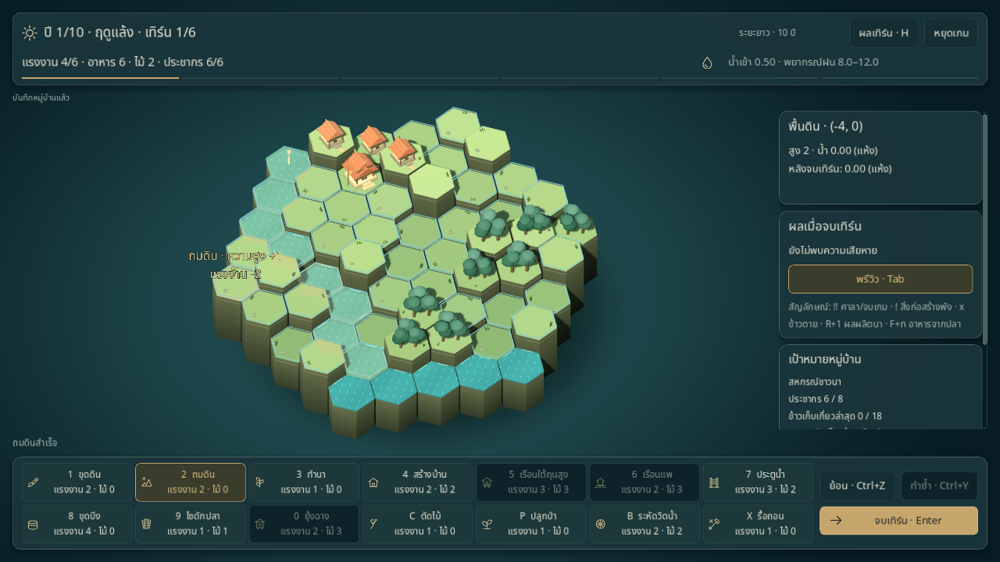
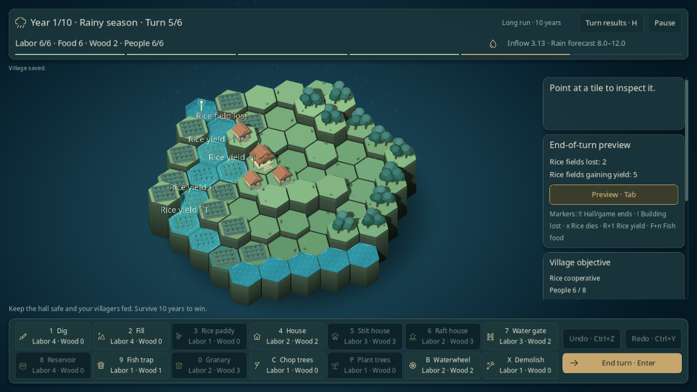
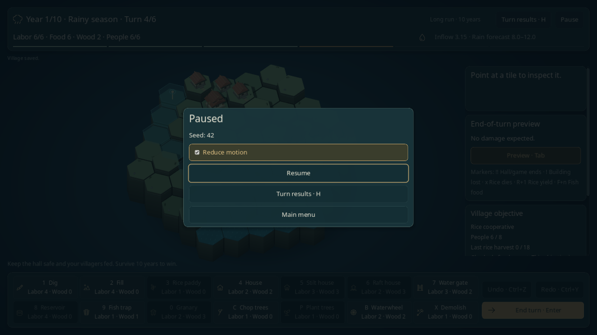

# สัญญาณตอบรับระหว่างเล่น

คู่มือฟีเจอร์ที่ใช้งานอยู่ ผลตรวจท้ายหน้าเป็นหลักฐาน ณ วันที่เพิ่มฟีเจอร์; ดู [STATUS](../STATUS.md) สำหรับขอบเขตและหลักฐานรวมล่าสุด

คำสั่งที่สำเร็จมีวงบนช่องและป้ายสั้น ๆ แสดงชื่อคำสั่ง ความสูงที่เปลี่ยน และแรงงาน/ไม้ที่ใช้หรือได้รับจริง ป้ายลอยขึ้นเล็กน้อยแล้วหายภายในประมาณ 1.2 วินาที ผู้เล่นออกคำสั่งต่อได้ทันที

หลังจบเทิร์นที่เกมยังดำเนินต่อ แสดงผลผลิตข้าว อาหารจากไซ และความเสียหายจากรายงานของเทิร์นที่เพิ่งเกิดขึ้น พักภาพพรีวิวบนกระดานชั่วครู่ขณะอ่านผลจริง แล้วคืนพรีวิวปัจจุบันอัตโนมัติ การสลับพรีวิวจะจบป้ายผลจริงทันที

แสดงพร้อมกันสูงสุด 12 ช่อง โดยให้ความเสียหายมาก่อนผลผลิต รายการทั้งหมดอ่านได้จากประวัติผลเทิร์น ส่วนปีที่จบหรือเกมที่จบแสดงสรุปตามปกติ

## ลดการเคลื่อนไหว

เปิดเมนูหยุดเกมแล้วเลือก **ลดการเคลื่อนไหว / Reduce motion**:

- ป้ายและวงตอบรับอยู่นิ่งตลอดอายุ ไม่มี burst
- หยุดริ้วน้ำ ซ่อนฝน และเปลี่ยนแสงตามฤดูทันที
- หมุนและซูมกล้องไปยังเป้าหมายทันที

ค่าตั้งจำไว้เมื่อเปิดเกมใหม่และใช้กับห้องทดลองน้ำด้วย บันทึกในไฟล์ตั้งค่าแยกจาก checkpoint การเขียนตั้งค่าที่ล้มเหลวมีข้อความแจ้ง และการบันทึกครั้งถัดไปจะเก็บตัวเลือกปัจจุบันทั้งเรื่องการเคลื่อนไหวและคำเตือนแรงงาน

## ผลตรวจ

ตรวจ native mouse/keyboard ไทย–อังกฤษที่ 1280×720: ถมดิน ตัดไม้ ป้ายแสดง delta ตรงกับทรัพยากรจริง เอฟเฟกต์หมดอายุแล้ว checkpoint คง bytes เดิม Undo/Redo คืน checkpoint ตรงเดิม เปิด/ปิดลดการเคลื่อนไหวระหว่างฤดูฝน และ Continue คืนค่าตั้งที่บันทึกไว้

ภาพผลเทิร์นใช้ farmer บน seed 1 ที่ออกคำสั่งผ่าน GameFlow ครบสามเทิร์นแล้ง แล้วจบเทิร์นฝนแรกผ่าน GameScreen ได้ผลผลิตข้าว 4 ช่องและนาที่เสียหาย 1 ช่อง

ชุดทดสอบครอบคลุมวงจรชีวิต/เพดานป้าย ผลจริงที่ต่างจากพรีวิว การคืนพรีวิวหลังเอฟเฟกต์ การล้างป้ายเมื่อ Undo/Redo/เปิดหน้าต่าง ความเสียหายก่อนผลผลิต การอ่านค่าตั้งเดิม และการกู้ค่าตั้งหลังเขียนล้มเหลว เอกสารต้นฉบับทั้ง 54 ไฟล์ตรวจเทียบ SHA-256 ตาม manifest

Godot 4.6.3 ผ่าน **270 รายการ** รวม 20 รายการใหม่สำหรับผลตอบรับ ค่าตั้ง และการลดการเคลื่อนไหว Python balance report checker 21 รายการและ balance CLI ผ่าน
