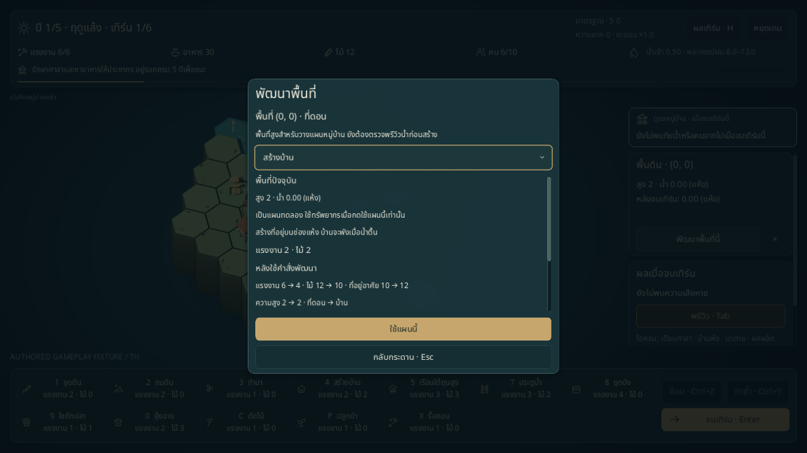
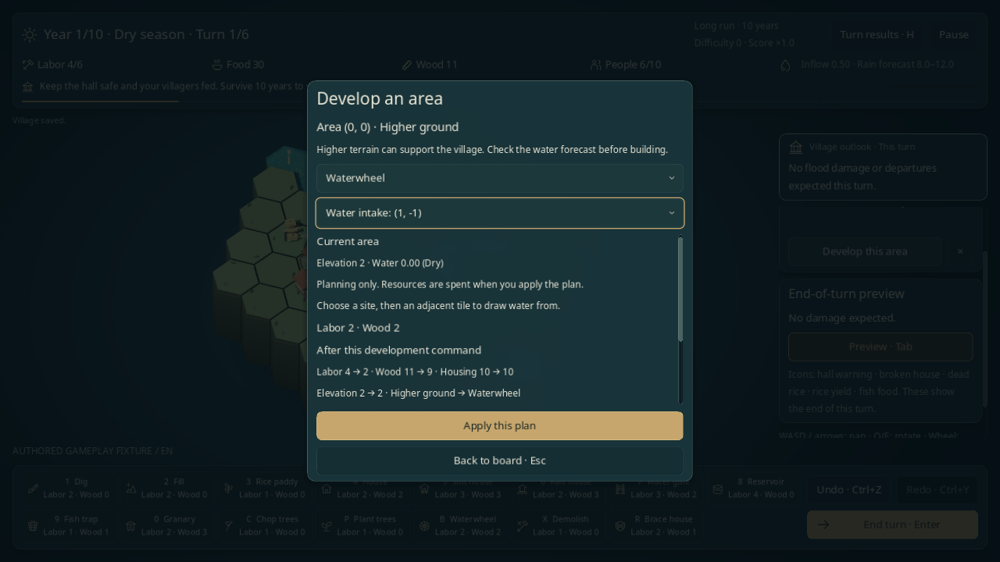
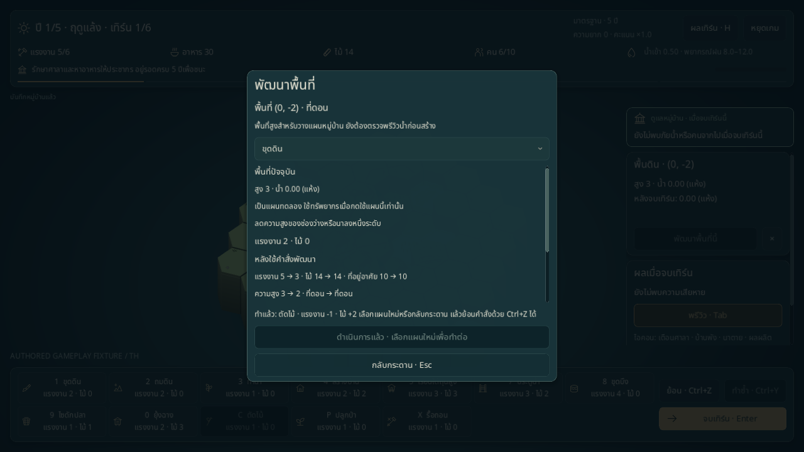

# พัฒนาพื้นที่แต่ละช่อง

หน้าพัฒนาพื้นที่บนกระดานเกมหลักและโรงเรียนสายน้ำ อัปเดต 2026-11-01 ใช้คำสั่ง ต้นทุน กฎน้ำ และ Undo/Redo ชุดเดียวกับแถบเครื่องมือ ดูขอบเขตเกมปัจจุบันใน [STATUS](../STATUS.md)

## เลือกพื้นที่และทดลองแผน

1. หากเลือกเครื่องมืออยู่ ให้กด Esc เพื่อยกเลิก แล้วคลิกช่องบนแผนที่
2. ข้อมูลช่องจะค้างไว้เมื่อเลื่อนเมาส์ไปแผงด้านข้าง กด **พัฒนาพื้นที่นี้** เพื่อเปิดแผนของพิกัดนั้น ใช้ **×** ข้างปุ่มเพื่อล้างการเลือก
3. อ่านบทบาทพื้นที่ เลือกคำสั่ง และเลือกทิศรับน้ำของระหัดหรือนโยบายน้ำบึงเมื่อมีตัวเลือก
4. ตรวจต้นทุนและผลคาดการณ์ก่อนกด **ใช้แผนนี้** ปุ่ม **กลับกระดาน · Esc** รับโฟกัสเริ่มต้น การเปิด เปลี่ยนแผน หรือยกเลิกยังไม่ใช้ทรัพยากร

คลิกประตูน้ำโดยไม่เลือกเครื่องมือยังเปิด/ปิดประตูทันทีตามการควบคุมเดิม หลังจากนั้นใช้หน้าพัฒนาพื้นที่เพื่อทดลองการสลับครั้งถัดไปก่อนลงมือได้



## แต่ละพื้นที่ทำอะไรได้

| กลุ่มพื้นที่ | บทบาทและการพัฒนา |
|---|---|
| ที่ดอน ที่ลุ่ม พื้นที่มีน้ำ และร่องแม่น้ำ | ตรวจความสูง/น้ำ แล้วเปรียบเทียบขุด ถม นา บ้าน ป่า บึง ประตู ไซ ยุ้ง หรือระหัดตามเงื่อนไขจริงของช่อง |
| ป่า / ป่าอ่อน | ป่าซับน้ำ ตัดเพื่อรับไม้และถางพื้นที่; ป่าอ่อนโตเป็นป่าเมื่อขึ้นปีใหม่ และรื้อได้ |
| นาข้าว / นาที่ต้นข้าวตาย | ปรับระดับดินหรือรื้อ; นามีชีวิตจัดสรรน้ำบึงได้เมื่อเปิด ruleset นั้น ผลผลิตสะสมรอเป็นอาหารตอนเก็บเกี่ยว นาตายเริ่มใหม่เมื่อขึ้นปีถัดไป |
| บ้าน / เรือนใต้ถุนสูง / เรือนแพ | เพิ่มที่อยู่อาศัยและมีเงื่อนไขน้ำต่างกัน รื้อได้ บ้านธรรมดา/บ้านยกพื้นค้ำฉุกเฉินได้เมื่อเปิดใช้ |
| ประตู / บึง / ระหัด / ไซ / ยุ้ง | แสดงบทบาททางน้ำหรืออาหาร สลับประตูฟรีหรือรื้อสิ่งปลูกสร้างได้ตามกฎ การสร้างระหัดให้เลือกช่องรับน้ำข้างเคียง |
| ต้นน้ำ / ขอบทะเล / ศาลา | อ่านบทบาทและข้อมูลได้ หน้าพื้นที่ไม่มีคำสั่งพัฒนาจุดเหล่านี้ |

แยกชื่อและบทบาทครบ **19 ประเภท** ชื่อที่ดอน/ที่ลุ่มใช้บรรยายระดับพื้นในปัจจุบัน: ช่องว่างที่แห้งสูงอย่างน้อย 2 เป็นที่ดอน ช่องแห้งที่ต่ำกว่านั้นเป็นที่ลุ่ม และน้ำอย่างน้อย 0.05 แสดงเป็นพื้นที่มีน้ำ ประเภทนี้ไม่เพิ่มตัวคูณผลผลิตหรือความทนน้ำ

รายการแสดงเฉพาะคำสั่งที่ตรงลักษณะช่อง เครื่องมือที่ยังไม่ปลดล็อกหรือกลไกที่ไม่ได้เปิดยังซ่อนไว้ คำสั่งที่ตรงพื้นที่แต่ติดฤดู น้ำ แรงงาน หรือไม้ ยังเลือกอ่านสาเหตุได้และใช้แผนไม่ได้ ต้นทุนคิดจากผู้นำ ฤดู และกฎของรอบที่กำลังเล่น

## อ่านพรีวิวให้ตรงกับผลจริง

หน้าพื้นที่แยกข้อมูลเป็นสภาพปัจจุบัน ผลทันทีหลังใช้คำสั่ง และผลเมื่อจบเทิร์น:

- แรงงาน ไม้ ความจุที่อยู่อาศัย ความสูง และประเภทพื้นที่ แสดงก่อน → หลังคำสั่ง รวมไม้ที่ได้จากตัดต้นไม้/รื้อ
- น้ำหลังจบเทิร์นเป็นของช่องที่เลือก จำนวนอาคารพัง นาตาย ผลผลิตนาและอาหารปลาเป็น **ยอดทั้งกระดาน** เปรียบเทียบแผนปัจจุบัน → แผนที่เสนอ
- เทิร์นเก็บเกี่ยวแนบอาหาร/ประชากรคงเหลือและผลแพ้ชนะที่คาด โดยใช้สภาพหลังจำลองน้ำ ถ้าศาลาจมจะไม่คำนวณเก็บเกี่ยวที่ไม่ได้เกิดขึ้น

ผลผลิตนาไม่เพิ่มอาหารเข้าคลังทันที ส่วนอาหารปลาได้หลังจบเทิร์น พรีวิวใช้ฝนที่รู้แล้วของเทิร์นปัจจุบันและไม่สัญญาผลของฝนในเทิร์นอนาคต การทดลองไม่เปลี่ยน state/RNG, Undo/Redo, ประวัติเทิร์น หรือ checkpoint



## ใช้แผนแล้วทำต่อ

**ใช้แผนนี้** ส่งคำสั่งจริงเพียงหนึ่งครั้งผ่าน GameSession และแสดงชื่อคำสั่งกับแรงงาน/ไม้ที่เปลี่ยนจริง หน้าพื้นที่ยังเปิดอยู่ ปุ่มใช้แผนจะปิดจนกว่าจะเลือกแผนใหม่อย่างชัดเจน จึงไม่ใช้คำสั่งซ้ำหรือจบเทิร์นจากการคลิก/กดคีย์รัว

กลับกระดานแล้วใช้ **Ctrl+Z / Ctrl+Y** ย้อนและทำซ้ำได้ การเลือกพื้นที่คงพิกัดเดิมหลัง Undo/Redo แต่การเลือกนี้ไม่ลงเซฟ โหลดเกมเริ่มโดยยังไม่เลือกพื้นที่ หากทรัพยากรหรือ state เปลี่ยนระหว่างเปิดแผน เกมอัปเดตข้อมูลให้ตรวจใหม่ก่อนใช้คำสั่ง



โรงเรียนใช้ session ของบทเรียนตามเดิม รวมการรื้อบ้านเป้าหมายคู่กับ Undo/Redo ยกเลิกออกกลางบทคืนหน้าพื้นที่และแผนเดิม Retry ล้างแผนและการเลือก พรีวิวส่วนนี้อธิบายกฎน้ำ/ทรัพยากร ส่วนเป้าหมายผ่านบทอ่านจากแผงโรงเรียน

## จุดเข้าโค้ดและตรวจซ้ำ

[AreaDevelopment](../../core/area_development.gd) จัดประเภท/รายการคำสั่งและจำลองบนสำเนา [CommandRules](../../core/command_rules.gd) ให้ `supports_target()` สำหรับลักษณะช่อง ส่วน `check()` ยังตัดสินเงื่อนไขทั้งหมด [AreaDevelopmentPanel](../../ui/area_development_panel.gd) แสดงแผนและรับคำยืนยัน [GameScreen](../../ui/game_screen.gd) ผูกพิกัดและส่งคำสั่งผ่าน [GameSession](../../core/game_session.gd) ไม่มี fields หรือรุ่นเซฟใหม่

```sh
scripts/test.sh --filter=area_development
scripts/test.sh
python3 scripts/check_docs.py
git diff --check
```

[Core tests](../../tests/test_area_development.gd) เทียบแผนกับคำสั่ง/resolve จริง รวมเก็บเกี่ยวและพารามิเตอร์ [UI tests](../../tests/test_area_development_ui.gd) ตรวจการเลือก/ยกเลิก การ commit ครั้งเดียว คีย์บอร์ด แผนที่ล้าสมัย Undo/Redo/โหลด กฎเลือกเปิด และโรงเรียน

[Native probe](../../tools/area_development_probe.gd) ใช้ mouse/keyboard จริงบน [กระดานเริ่มต้นที่จัดไว้](../../tools/area_development_fixtures.gd) แยกกรณีแล้ง ฝน/ไม้ไม่พอ และชุดกฎร่วม ตั้ง state ก่อนแต่ละกรณีเริ่ม ใช้เซฟ/ค่าตั้งแยก ไม่มีการฉีด state ระหว่างเล่น ตัว probe จัดกล้องและเลื่อนแผงเพื่อเข้าถึง controls เลือก dropdown ผ่านคีย์บอร์ดจริง และส่งหลาย activation ใน frame เดียว การยกเลิกออกโรงเรียนและการเปลี่ยน state โดย controller ตรวจใน headless tests แยกจาก native

รันบนเครื่องที่มี display จาก root เปลี่ยน `th` เป็น `en` ทั้ง path และ flag เพื่อตรวจอีกภาษา:

```sh
XDG_DATA_HOME="$PWD/work/area-development-qa/th/data" XDG_CONFIG_HOME="$PWD/work/area-development-qa/th/config" XDG_CACHE_HOME="$PWD/work/area-development-qa/th/cache" godot --path . --audio-driver Dummy --resolution 1280x720 --script res://tools/area_development_probe.gd -- --out-dir="$PWD/work/area-development-qa/th" --lang=th
```

ผลจากกระดานตรวจนี้ไม่ใช่การเล่นแผนที่สุ่ม การทดลองกับผู้เล่น หรือการยืนยันสมดุล/ประสิทธิภาพ

## ผลตรวจ 2026-11-01

Godot **4.6.3 ผ่าน 529/529 tests** รวมส่วนใหม่ **22/22 tests** (core 11 และ UI 11) ตรวจคำสั่ง 17 แบบ/พารามิเตอร์เทียบกับการใช้และ resolve จริง การคำนวณเก็บเกี่ยวจากสำเนา กฎเลือกเปิด แผนที่ล้าสมัย การใช้ครั้งเดียว การรักษา Undo/Redo/ประวัติ/เซฟ และการคืนหน้าพื้นที่ระหว่างออกโรงเรียน ต้นฉบับเอกสารนำเข้าทั้ง 54 ไฟล์คงเดิม

Native X11/Mesa llvmpipe **1280×720 ผ่าน 103/103 ทั้งไทยและอังกฤษ** ดู [รายงานไทย](../reports/area-development-qa-th.json) / [อังกฤษ](../reports/area-development-qa-en.json) ตรวจเลือกช่อง/ตรึงข้อมูล เปิดหน้าพื้นที่ เลือก dropdown ผ่าน keyboard จริง การยกเลิกไม่เปลี่ยน checkpoint ตัดไม้ด้วย mouse/key burst ครั้งเดียว Undo/Redo/load ต้นน้ำ/ทะเล/ศาลา ประตูฟรี คำเตือนฤดู/งบ นโยบายบึง ค้ำบ้าน และทิศระหัด พร้อมเทียบเซฟรวมกฎ v6 ตรงค่า

ภาพข้างต้นจับจาก viewport โดยมีป้าย authored gameplay fixture รายงานบันทึก hash ของ probe/fixture/balance และโฟกัสหลัง burst ใน native การกดเมาส์ซ้ำอาจคืนโฟกัสไปยังปุ่มใช้แผนที่ปิดแล้ว จึงตรวจว่าไม่มีปุ่มที่รับคีย์แล้วทำคำสั่งต่อได้ รวมกับการยืนยัน state/จำนวน Undo/ประวัติเทิร์นคงตามคำสั่งเดียว
