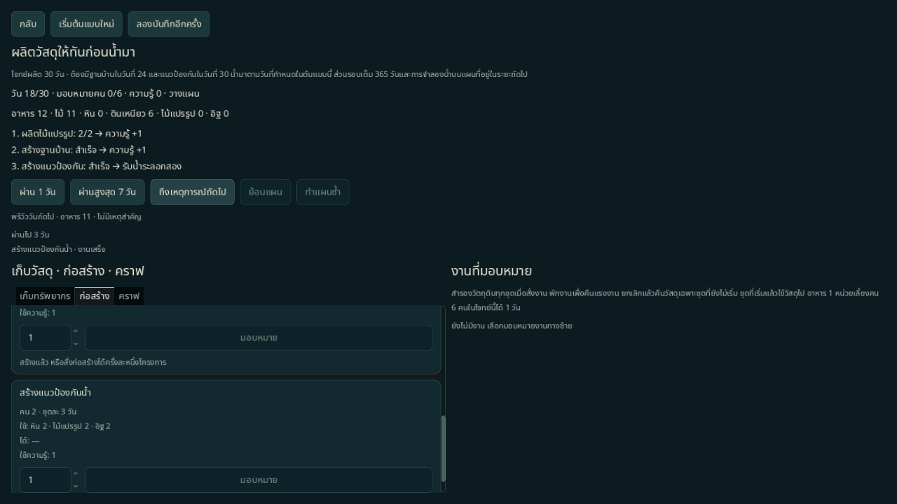
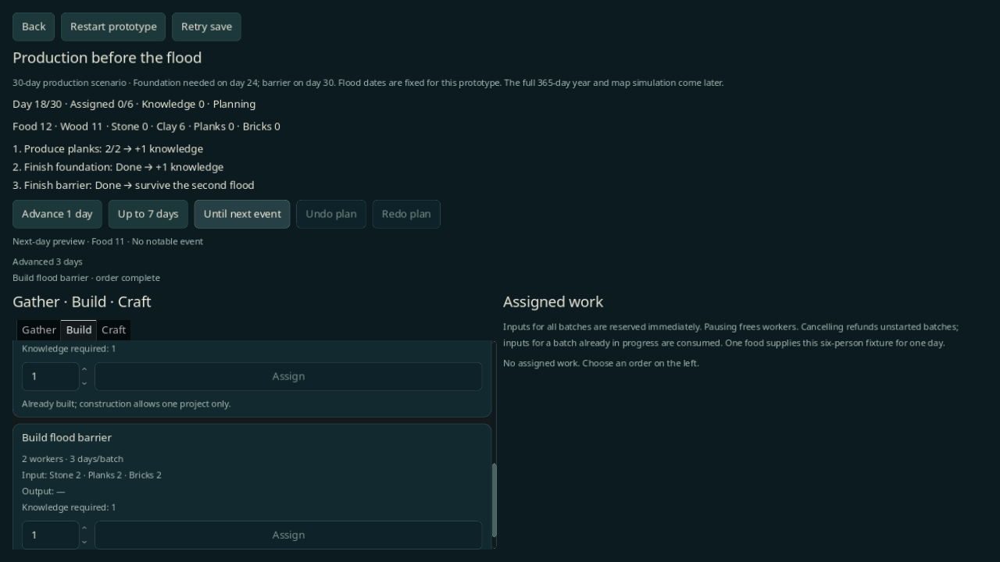

# ผลิตวัสดุให้ทันก่อนน้ำมา — ต้นแบบรายวัน

ต้นแบบสำหรับทดสอบวงจร **จัดคน → คราฟ → ผ่านโจทย์ → ได้ความรู้ → สร้างระบบรับน้ำที่ยากขึ้น** ตาม [แผนหนึ่งปีแห่งสายน้ำ](../design/DAILY_YEAR.md) เป็นโจทย์ 30 วันแยกจากเกมปกติ ยังไม่ใช่รอบเต็ม 365 วัน

## เปิดเล่น

เลือก **ผลิตก่อนน้ำมา · ต้นแบบ** ในเมนู หรือรัน:

```sh
godot --path . -- --scene=daily --lang=th
```

สลับ `th` เป็น `en` ได้ ตัวเลือก seed/ผู้นำ/ความยากของเกมปกติไม่เปลี่ยนโจทย์นี้ และ `--save-path` ยังคงใช้เฉพาะเกมปกติ ต้นแบบใช้ `user://daily-production-prototype.json` โดยเฉพาะ กลับมาเปิดต้นแบบแล้วเล่นต่ออัตโนมัติ ปุ่มเริ่มใหม่ถามยืนยันก่อนแทนที่รอบต้นแบบ

## สิ่งที่เล่นได้

- คน 6 คนแบ่งระหว่างเก็บอาหาร ไม้ หิน ดินเหนียว ก่อสร้าง และคราฟ
- สร้างโรงเลื่อยเพื่อผลิตไม้แปรรูป และเตาเผาเพื่อผลิตอิฐ สูตร/ราคา/ระยะเวลาอยู่ใน `daily_prototype` ของ [balance.json](../../data/balance.json)
- เลือกงานและจำนวน 1–20 ชุดจากแท็บเก็บทรัพยากร/ก่อสร้าง/คราฟ โครงการก่อสร้างเลือกได้หนึ่งชุด
- วัตถุดิบทุกชุดถูกสำรองเมื่อสั่งงาน คนถูกมอบหมายตลอดคิวจนเสร็จหรือพักงาน ไม่มีการใช้คนหรือวัสดุซ้ำ
- พักงานคืนคน แต่เก็บวัสดุและความคืบหน้าไว้; ยกเลิกคืนวัสดุเฉพาะชุดที่ยังไม่เริ่ม ชุดที่เริ่มแล้วใช้วัสดุไป ความรู้ของโครงการคืนเสมอเพื่อไม่ให้ความก้าวหน้าติดขัด
- ผลิตไม้แปรรูปสะสม 2 หน่วยได้ความรู้ 1 แต้ม ใช้กับฐานบ้าน; สร้างฐานบ้านเสร็จได้ความรู้ 1 แต้ม ใช้กับแนวป้องกันน้ำ รางวัลให้ครั้งเดียวต่อรอบ
- น้ำวันที่ 24 ต้องมีฐานบ้าน น้ำวันที่ 30 ต้องมีแนวป้องกัน แจ้งเตือนวันที่ 21 และ 27 ผ่านน้ำครั้งแรกได้ความรู้เพิ่ม 1 แต้มเป็นผลสรุป แต่ยังไม่มีอัปเกรดถัดไปสำหรับแต้มนี้
- อาหารเริ่ม 30 หน่วย ใช้วันละ 1 หน่วยสำหรับชุมชนต้นแบบทั้ง 6 คน หาอาหารเพิ่มได้ ไม่มีการเกิด/ย้ายคน/นา/เน่าเสียในต้นแบบนี้
- เดิน 1 วัน สูงสุด 7 วัน หรือถึงเหตุการณ์ถัดไป หยุดเมื่อคิวเสร็จ ได้รางวัล มีคำเตือนอาหาร/น้ำ หรือจบรอบ และกันกดซ้ำ 400 ms
- พรีวิววันถัดไปใช้ตัวคำนวณเดียวกับวันจริงบนสำเนา ย้อน/ทำแผนซ้ำได้สูงสุด 200 คำสั่งภายในวัน เมื่อเดินวันล้างประวัติ

ลำดับรายวัน: ทำงานที่มอบหมาย → รับผลผลิต/อาคาร/รางวัล → กินอาหาร → คำเตือนและตรวจน้ำ → ตรวจจบรอบ งานที่เสร็จในวันน้ำมายังช่วยป้องกันได้ การสั่งงานเพิ่มเติมต้องรอช่วงวางแผนถัดไป

## แผนอ้างอิงที่ผ่านได้

นี่เป็นตัวอย่างจาก fixture/replay ไม่ใช่หลักฐาน human playtest หรือสมดุล:

1. วัน 0 สั่งโรงเลื่อย เตาเผา และเก็บไม้ 6 ชุด ใช้คนรวม 5 คน
2. หลังวัน 3 สั่งไม้แปรรูป 4 ชุดและอิฐ 3 ชุด รอจนวัน 12
3. สั่งฐานบ้าน ให้เสร็จวัน 15 แล้วใช้ความรู้ที่ได้รับสั่งแนวป้องกันให้เสร็จวัน 18
4. เดินผ่านคำเตือนและน้ำสองระลอกถึงวัน 30

## เซฟและความถูกต้อง

`DailySession` สืบทอดจาก `GameSession` เพื่อเป็นเจ้าของ I/O ของต้นแบบ ส่วน `DailyProduction` และ `DailyCheckpoint` ไม่มี disk I/O ใช้ format `monsoon_delta_daily_prototype`, version 1, ruleset `daily_production_v1` ซึ่งคนละ namespace กับเซฟเกมปกติ v1–v6

เซฟเก็บวัน ทรัพยากร อาคาร งานค้าง/วัสดุที่สำรอง ความรู้ รางวัล และผลโจทย์ ไม่มี RNG ในต้นแบบนี้ โหลดไม่ resolve วันหรือให้รางวัลซ้ำ; ประวัติ Undo/Redo และข้อความหน้าจอไม่ลงเซฟ ไฟล์เสีย/รุ่นอนาคตเก็บไว้ไม่ลบหรือเขียนทับ หากบันทึกล้มเหลว แผนที่รับแล้วคงอยู่ในหน่วยความจำและกดลองบันทึกใหม่ได้

## ขอบเขตที่ยังไม่มี

น้ำเป็น **fixture ตามวัน** ไม่เรียก WaterSim และไม่มีการวางโรงคราฟบน hex ทรัพยากรเก็บจากคำสั่งแบบนามธรรม ไม่ใช่แหล่งบนแผนที่ ตัวช่วยคำนวณฤดูรู้ช่วงวัน 1–365 แล้ว แต่ยังไม่มีเศรษฐกิจ/สภาพอากาศ/ความก้าวหน้า 365 วัน แผนที่ 127 ช่อง สามสายพัฒนา ชุดกลไก และรอบหลายปียังเป็นงานถัดไป ไม่ได้เปิดการ์ดหรือเหตุการณ์ M5

## ตรวจซ้ำ

```sh
scripts/test.sh --filter=daily
scripts/test.sh
python3 scripts/check_docs.py
git diff --check
```

ใช้ XDG/เซฟแยกเสมอ ตรวจ native ที่เรนเดอร์ได้ด้วย:

```sh
XDG_DATA_HOME=/tmp/daily-qa/data XDG_CONFIG_HOME=/tmp/daily-qa/config XDG_CACHE_HOME=/tmp/daily-qa/cache godot --path . --audio-driver Dummy --script res://tools/daily_production_probe.gd -- --lang=th --out-dir=/tmp/daily-qa/th
```

เปลี่ยนเป็น `--lang=en` และ `--out-dir=/tmp/daily-qa/en` สำหรับอังกฤษ Probe ส่ง mouse events จริงผ่าน GUI เพื่อสั่งงาน/เดินเวลา ตรวจรางวัล เซฟ คำเตือน และการกดรัว ภาพเริ่มต้น/เตรียมพร้อม/จบรอบกับรายงาน JSON อยู่ใน out-dir ตัวเลขจำนวนชุดใน SpinBox ตั้งโดย fixture ก่อนส่ง input ไม่มีการฉีด gameplay state ระหว่างเล่น

## ภาพและผลตรวจ native

ภาพจาก fixture แผนอ้างอิงวันที่ 18 ผ่านคำสั่งจริง ไม่ฉีด state ระหว่างเล่น:





Native Godot 4.6.3 / X11 / Mesa llvmpipe ที่ 1280×720 ผ่าน 48/48 จุดทั้งไทยและอังกฤษ ดู [รายงานไทย](../reports/daily-production-qa-th.json) และ [อังกฤษ](../reports/daily-production-qa-en.json) ตรวจ input จริง คิว รางวัล การเปิดผ่านเมนูและเซฟแยก ผลนี้ไม่ใช่ human playtest หรือการยืนยันสมดุล
