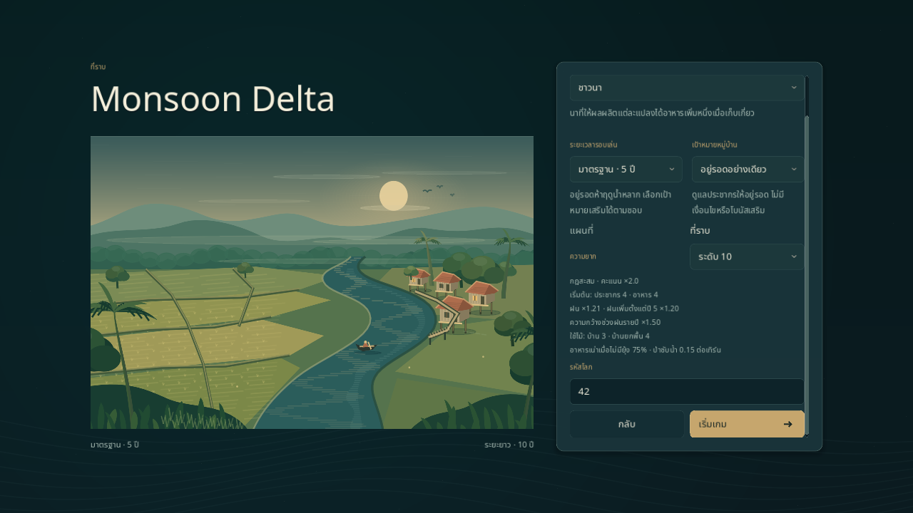

# เลือกความยากของหมู่บ้าน

เมนูเกมใหม่เลือกระดับ **0–10** ได้ทั้งรอบ 5 ปีและ 10 ปี เริ่มต้นที่ 0 และเลือกเป้าหมายเสริมร่วมกันได้ คำอธิบายไทย/อังกฤษแสดงกฎสะสมของระดับนั้นจาก `data/balance.json` รวมต้นทุนบ้านหลังใช้ความสามารถผู้นำแล้ว เลื่อนแผงตั้งค่าหรือใช้ Tab ไปยัง seed และปุ่มเล่น

HUD, Pause และผลจบรอบแสดงระดับกับตัวคูณคะแนนของรอบที่กำลังเล่น Continue ใช้ค่าที่อยู่ในเซฟ ส่วนเล่นอีกครั้งคงระดับ ผู้นำ โหมดและเป้าหมาย โดยเพิ่ม seed หนึ่ง



[หน้าตั้งค่าภาษาอังกฤษและคำอธิบายระดับ 6](../images/difficulty-setup-en.png) · [HUD หลังเริ่มด้วย Enter ยังเป็นเทิร์น 1](../images/difficulty-game-en.png) · [Continue ภาษาไทยจากรอบยาวระดับ 6 ที่บันทึกไว้](../images/difficulty-continue-th.png)

## กฎที่ใช้งานจริง

แต่ละระดับรวมผลจากระดับก่อนหน้า ตัวคูณคะแนนเท่ากับ `1 + ระดับ × 0.1` ก่อนปัดคะแนนเป็นจำนวนเต็ม ตารางนี้อธิบายค่าปัจจุบัน ไม่ใช่ [ความยากฉบับเสนอ M5](../design/CHALLENGES_AND_MAPS.md)

| ระดับ | ผลที่เพิ่มจากระดับก่อน |
|---|---|
| 0 | กฎปกติ; ประชากรเริ่ม 6 อาหาร 6 |
| 1 | น้ำฝน ×1.1 |
| 2 | อาหารเริ่มลด 2 เหลือ 4 |
| 3 | ความกว้างช่วงฝนรายปี ×1.5; มีผลทั้งพยากรณ์และช่วงที่สุ่มฝนจริง |
| 4 | บ้านและบ้านยกพื้นใช้ไม้เพิ่ม 1; เรือนแพใช้ค่าเดิม |
| 5 | น้ำฝน ×1.1 อีกครั้ง รวมเป็น ×1.21 |
| 6 | กฎการเล่นเท่าระดับ 5; ตัวคูณคะแนนเพิ่มจาก ×1.5 เป็น ×1.6 |
| 7 | ประชากรเริ่มลด 2 เหลือ 4; แรงงานเริ่มจึงลดตามประชากร |
| 8 | อัตราอาหารเน่าหลังเก็บเกี่ยวเพิ่มจาก 50% เป็น 75% เมื่อไม่มียุ้ง |
| 9 | ป่าโตเต็มที่ซับน้ำลดครึ่งจาก 0.30 เป็น 0.15 ต่อช่องต่อเทิร์น |
| 10 | ตั้งแต่ปี 5 น้ำฝนคูณเพิ่ม ×1.2 รวมเป็น ×1.452 ก่อนปรับความกว้างช่วงฝน |

ระดับ 6 ในข้อมูลเดิมลดจำนวนข้อเสนอการ์ด แต่ระบบการ์ดยังไม่เปิดใช้ จึงมีเพียงคะแนนที่ต่างจากระดับ 5 การเลือกความยากครั้งนี้ไม่ได้เปิดใช้การ์ด เหตุการณ์ แผนที่ใหม่ หรือเปลี่ยนข้อเสนอ M5 เป็นกฎจริง ยังไม่มีหลักฐานว่าระดับสูงกว่าจะยากขึ้นตามลำดับ; ดู [งานสมดุลที่ยังค้าง](../STATUS.md)

## เปิดจากคำสั่ง

รันจาก root ด้วย Godot 4.6.3 Standard และใช้ไฟล์เซฟแยกเมื่อตรวจงาน:

```sh
# ตั้งค่าเริ่มต้นของตัวเลือกในเมนู โดยยังไม่เริ่มรอบหรือเขียนเซฟ
godot --path . -- --scene=menu --difficulty=5 --lang=th --save-path=user://dev-difficulty.json
# เริ่มรอบใหม่ระดับ 10 พร้อมเป้าหมายป่า (เขียน checkpoint ที่ระบุ)
godot --path . -- --scene=game --difficulty=10 --run-mode=long --goal=forest --seed=42 --lang=en --save-path=user://dev-difficulty.json
```

`--difficulty=N` รับเลขจำนวนเต็มฐานสิบ 0–10; ไม่ระบุใช้ 0 รับเลขศูนย์นำหน้าได้ ปฏิเสธค่าติดลบ เครื่องหมายบวก ทศนิยม ข้อความ ค่านอกช่วง และ flag ที่ไม่มีค่า โดยออกด้วย status 2 ก่อนอ่าน/เขียน checkpoint หรือเริ่มหน้าจอ Continue ไม่ใช้ flag นี้เปลี่ยนความยากของรอบที่บันทึกอยู่

แก้การแปลง seed เริ่มต้นจากข้อมูล JSON ให้เป็นจำนวนเต็มก่อนอ่านเป็นข้อความ จึงเปิดโดยไม่ระบุ `--seed` แล้วได้ 42 ตามที่ตั้งใจ แทนการ hash ข้อความ `42.0` เกมที่บันทึกไว้ยังใช้ seed เดิม การกด Enter จากช่อง seed ถูกใช้เพื่อเริ่มรอบเพียงครั้งเดียว จึงไม่ไหลต่อไปเป็นคำสั่งจบเทิร์นในหน้าจอใหม่

## เซฟและการตรวจ

การเลือกความยากใช้กฎเดิมใน core และไม่เปลี่ยน `balance.json` ต่อมางาน [หมู่บ้านมีชีวิต](LIVING_VILLAGE.md) เพิ่มประวัติภาพอาคารในเซฟ v3 สำหรับเกมใหม่จากเมนู/boot ส่วนรอบ legacy classic ที่ไม่มีเป้าหมายยังเป็น v1 และ long หรือมีเป้าหมายเป็น v2 เลือกความยาก/อ่านคำอธิบายไม่สร้างแผนที่ ไม่สุ่มฝน และไม่เขียนเซฟ การยืนยันเริ่มรอบใหม่ใช้ชุดค่าที่กดเล่นไว้; ยกเลิกยังเก็บเซฟเดิม

```sh
scripts/test.sh --filter=difficulty
python3 scripts/test_boot_cli.py
scripts/test.sh
python3 scripts/check_docs.py
```

ดูผลตรวจตามวันที่ใน [ประวัติพัฒนา](../history/PROGRESS.md) การตรวจหน้าจอและ fixture เป็นหลักฐานการทำงานของ UI ไม่ใช่การยืนยันสมดุลหรือการเล่นครบทุกระดับโดยคน
