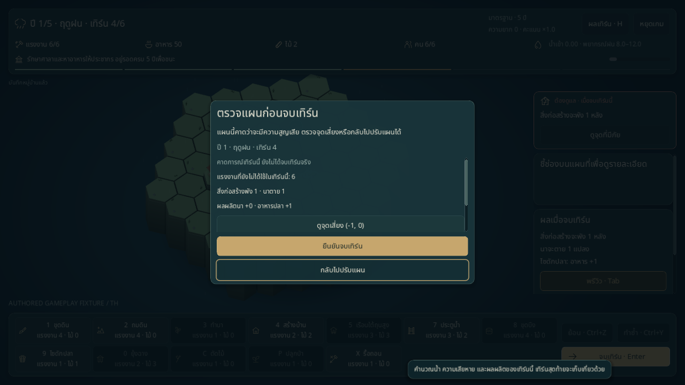
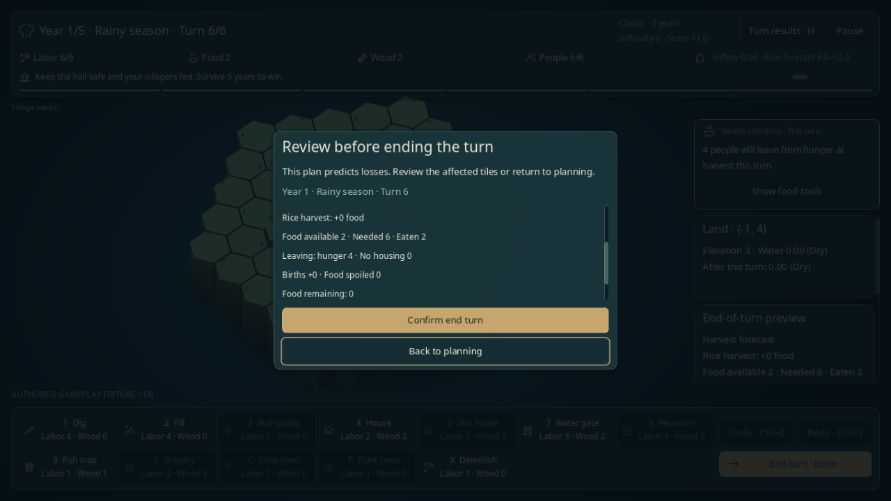
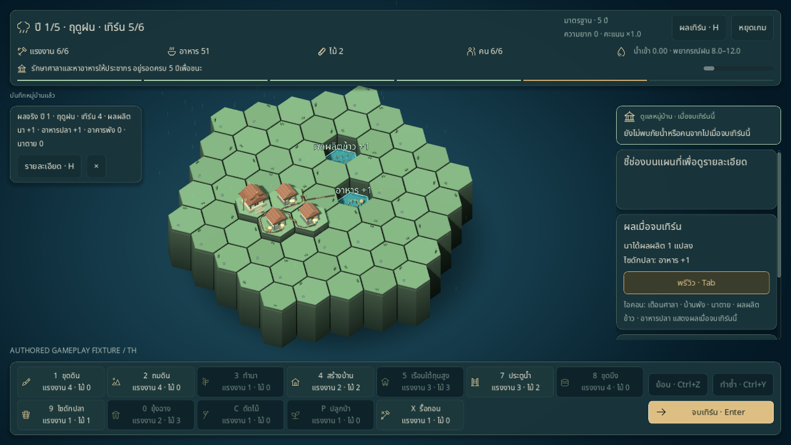
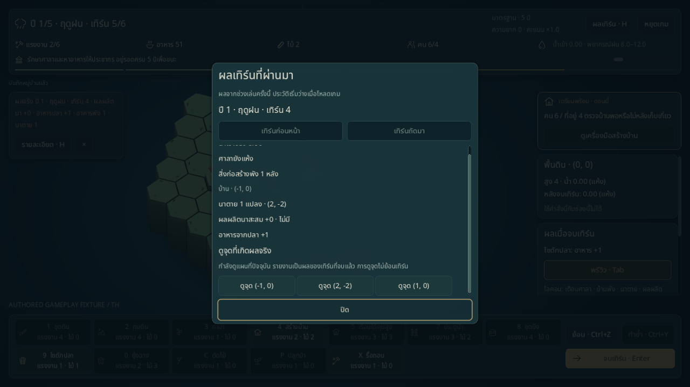
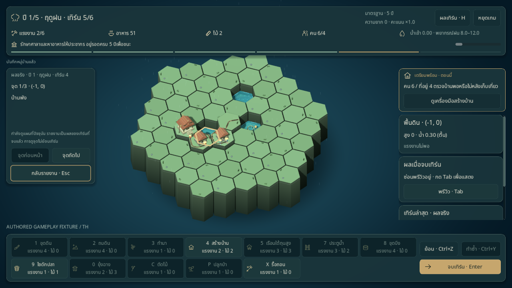
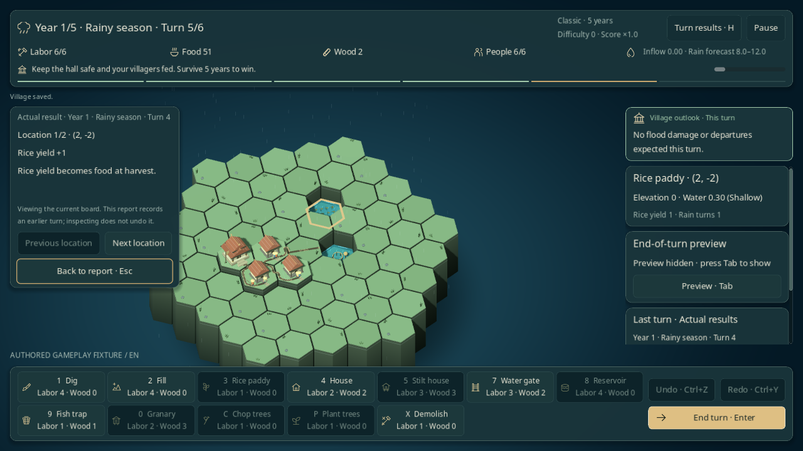

# จบเทิร์น: ตรวจแผน ยืนยัน และอ่านผลจริง

พฤติกรรมปัจจุบันของเกมหลักและโรงเรียนสายน้ำ อัปเดต 2026-11-02 การจบเทิร์นใช้กฎน้ำ ผลผลิต และเก็บเกี่ยวเดิม ดูสถานะระบบอื่นใน [STATUS](../STATUS.md)

## กดจบเทิร์น

คลิก **จบเทิร์น** หรือกด **Enter / Space** ขณะอยู่บนกระดาน หากมีปุ่มรับโฟกัสอยู่ Enter/Space จะกดปุ่มนั้น เทิร์นที่ไม่มีความเสี่ยงและไม่เข้าคำเตือนแรงงานจะดำเนินทันที

เมื่อมีความเสี่ยง เกมเลือกคำเตือนตามลำดับต่อไปนี้ และเปิดหน้าตรวจแผนเพียงหน้าต่างเดียว:

1. **กำลังจะแพ้:** ศาลาจมน้ำ หรือประชากรเหลือศูนย์หลังเก็บเกี่ยว
2. **กำลังจะสูญเสีย:** อาคารพัง นาตาย หรือมีคนย้ายออกเพราะหิว/บ้านไม่พอในการเก็บเกี่ยว แม้ประชากรยังเหลือและรอบยังเล่นต่อได้
3. **แรงงานยังเหลือ:** ฤดูฝนมีแรงงานอย่างน้อย 2 และยังเปิดคำเตือนนี้ไว้

การปิดพรีวิวบนกระดานไม่ปิดคำเตือน หน้าตรวจแสดงปี ฤดู เทิร์น แรงงานที่ยังไม่ใช้ ผลผลิต/ความเสียหายที่คาด และพรีวิวเก็บเกี่ยวเมื่อถึงเทิร์น 6 ส่วนข้อมูลยาวเลื่อนอ่านได้ ป้ายระบุว่าเป็นผลคาดการณ์และยังไม่ได้จบเทิร์น



ปุ่ม **กลับไปปรับแผน** รับโฟกัสเริ่มต้น กด Esc เพื่อกลับได้เช่นกัน ปุ่ม **ดูจุดเสี่ยง (พิกัด)** ปิดหน้าตรวจ ยกเลิกเครื่องมือ เปิดพรีวิวถ้าซ่อนอยู่ แล้วเลื่อนกล้องและเลือกช่องนั้นเพื่ออ่าน inspector การกลับหรือดูจุดเสี่ยงไม่ใช้แรงงาน ไม่เปลี่ยน state/RNG และไม่เขียน checkpoint

**ยืนยันจบเทิร์น** จึงค่อยดำเนินกฎจริงและล้าง Undo/Redo ของเทิร์นนั้น ช่อง **ไม่ถามซ้ำ** มีเฉพาะคำเตือนแรงงาน การเลือกช่องแล้วกลับไปปรับแผนยังไม่บันทึกค่าตั้ง และการปิดคำเตือนแรงงานยังคงเตือนเรื่องแพ้/ความสูญเสีย



## อ่านผลหลังจบเทิร์น

แผงผลจริงด้านซ้ายกระดานแสดง **ปี/ฤดู/เทิร์นที่เพิ่งจบ** ผลผลิตนา อาหารจากไซ จำนวนอาคารพังและนาตาย อ่านคู่กับ HUD ซึ่งเลื่อนไปเป็นเทิร์นวางแผนถัดไปแล้ว ตัวเลขมาจากรายงานที่เกิดขึ้นจริงใน session

ผลผลิตนา `+1` หมายถึงเพิ่มผลผลิตสะสมของแปลง ยังไม่ใช่อาหารเข้าคลัง ต้องรอเก็บเกี่ยว ส่วนอาหารจากปลาเข้าคลังในเทิร์นนั้นทันที อ่านรายการและพิกัดทั้งหมดด้วย **รายละเอียด · H** หรือปุ่มประวัติด้านบน ปุ่ม **×** ซ่อนแผงผลนี้โดยไม่ลบประวัติ และผลใหม่จะแสดงอีกเมื่อจบเทิร์นถัดไป

ตัวนับด้านบนมี [เอฟเฟกต์ทรัพยากรเพิ่ม/ลด](RESOURCE_FEEDBACK.md) เทียบยอดจริงก่อนและหลังดำเนินเทิร์น แยกจากจำนวนผลผลิตที่แสดงบนกระดาน มีป้ายสุทธิ สีและไอคอนเคลื่อน พร้อมโหมดนิ่งเมื่อเปิด Reduce motion

รายละเอียด · H มี [บัญชีทรัพยากร](RESOURCE_FEEDBACK.md#ดูบัญชีทรัพยากรของแต่ละเทิร์น) ก่อน/หลังและที่มาของแต่ละยอด แสดงอาหารที่ผลิต กิน ใช้กับคนเกิดใหม่ และเน่าเสีย แม้ยอดสุทธิเป็นศูนย์ ข้อมูลคงตามเทิร์นที่เลือกเมื่อวางแผนต่อหรือขึ้นปีแล้ว



แผงผลและประวัติอยู่เฉพาะ session การโหลดเริ่มประวัติใหม่และไม่สร้างผลของเทิร์นก่อนย้อนหลัง หากโหลดเซฟที่อยู่หน้าเก็บเกี่ยว เกมยังแสดงรายงานเก็บเกี่ยวที่บันทึกไว้ตามเดิม โรงเรียนใช้แผงผลและคำเตือนชุดเดียวกัน การเริ่มบทใหม่ล้างผลของครั้งก่อน

## ดูตำแหน่งผลจริงจากประวัติ

เปิด **รายละเอียด · H** เลือกเทิร์น แล้วเลื่อนไปที่ **ดูจุดที่เกิดผลจริง** ปุ่ม **ดูจุด (พิกัด)** พาไปยังอาคารที่พัง นาที่ตาย นาที่ได้ผลผลิต หรือไซที่ให้อาหาร เรียงความเสียหายก่อนผลผลิต และรวมผลที่พิกัดเดียวกันไว้ในจุดเดียว มี tooltip บอกเหตุการณ์ของแต่ละจุด



แผงข้างกระดานระบุปี/ฤดู/เทิร์นของผลที่เลือกและหมายเลขจุด ใช้ **จุดก่อนหน้า / จุดถัดไป** เพื่อดูต่อ วงชี้จุดมองเห็นได้แม้ช่องอยู่ต่ำหรือมีอาคารบัง ข้อมูลช่องด้านขวาเป็นสภาพปัจจุบัน ส่วนข้อความในแผงผลมาจากรายงานที่เกิดขึ้นจริง เช่น บ้านที่พังยังถูกบันทึกว่าพัง แม้ผู้เล่นแก้พื้นที่ภายหลัง



การดูจุดใช้ **กระดานปัจจุบัน** ไม่มีการย้อนน้ำ อาคาร หรือเทิร์นเพื่อสร้างฉากเก่า เกมซ่อนพรีวิวเทิร์นถัดไปและพักคำสั่งกระดานระหว่างดู รวมเครื่องมือ Undo/Redo และจบเทิร์น ไม่มีการใช้ทรัพยากร เปลี่ยน RNG หรือเขียน checkpoint

ปุ่ม **กลับรายงาน · Esc** รับโฟกัสเริ่มต้น Enter/Space จึงกลับรายงานได้โดยไม่จบเทิร์นเพิ่ม รายงานเดิมยังอยู่ที่เทิร์น ตำแหน่งเลื่อน และปุ่มเดิม พร้อมคืนกล้อง พรีวิว เครื่องมือและการซ่อนแผงผลตามก่อนเข้า กด Esc อีกครั้งจึงออกจากประวัติไปหน้าก่อนหน้า เช่น Pause หรือสรุปเก็บเกี่ยว โรงเรียนใช้ร่วมกัน ยกเลิกออกกลางบทคืนหน้าดูจุดเดิม และ Retry ล้างผลของครั้งก่อน

ตำแหน่งไซและจำนวนอาหารเก็บในรายงาน session ตอน resolve เท่านั้น ไม่ลงเซฟหรือสร้างย้อนหลังจากกระดาน รายงานที่ไม่มีพิกัดไซยังอ่านผลรวมอาหารปลาได้ตามเดิม ผลผลิตนาแสดงข้อความว่าต้องรอเป็นอาหารตอนเก็บเกี่ยว แยกจากอาหารปลาอย่างชัดเจน



## ป้องกันการกดซ้ำ

หลังคำนวณและวาดหน้าจอใหม่เสร็จ เกมพักการรับคำสั่งจบเทิร์นจากผู้เล่น **400 มิลลิวินาที** ปุ่มแสดงว่าจบแล้วระหว่างรอ การคลิกรัวหรือกด Enter/Space ซ้ำในช่วงนี้ถูกละทิ้ง ไม่มีคำสั่งค้างรอไปทำในเทิร์นถัดไป คลิกซ้ายที่หลุดจากหน้าต่างยืนยันลงกระดานในช่วงเดียวกันไม่ใช้เครื่องมือก่อสร้าง

เมื่อถึงเก็บเกี่ยว ปุ่มเล่นต่อจะเปิดใช้หลังช่วงพัก แล้วคืนโฟกัสให้คีย์บอร์ดหากไม่มีปุ่มอื่นรับโฟกัสอยู่ การกดซ้ำตอนจบเทิร์นไม่ข้ามสรุป และการกดซ้ำตอนเริ่มปีใหม่ไม่จบเทิร์นแรกของปีนั้นทันที การกด Enter ค้างยังถูกกันด้วยการตรวจ key echo ตามเดิม

## จุดเข้าโค้ดและการตรวจ

[GameScreen](../../ui/game_screen.gd) รับ input ตรวจแผน และแสดงรายงาน ส่วน [RiverSchoolScreen](../../ui/river_school_screen.gd) ใช้พฤติกรรมร่วมและรีเซ็ตช่วงพักเมื่อ Retry ตัวห่อ `request_end_turn_from_input()` / `continue_harvest_from_input()` เป็นผู้กัน input ซ้ำ เมธอด controller ที่เทสต์และเครื่องมือเรียกโดยตรงยังทำงานแบบ synchronous

[TurnResultLocations](../../ui/turn_result_locations.gd) รวมตำแหน่งจากรายงานที่ commit แล้ว แยกจากพรีวิวและข้อมูลช่องปัจจุบัน [BoardView](../../view/board_view.gd) วาดวงชี้ผลด้วย material แยก ไม่เปลี่ยนการบังวัตถุของวงเลือกปกติ

กฎใน [GameFlow](../../core/game_flow.gd) และ checkpoint ใน [GameSession](../../core/game_session.gd) ใช้ตามเดิม งานนี้ไม่เปลี่ยน balance รุ่นเซฟ หรือค่าตั้งใหม่ การเปิด/ปิดหน้าตรวจ อ่านประวัติ และซ่อนแผงผลไม่เปลี่ยน RNG หรือเซฟ

```sh
scripts/test.sh --filter=end_turn_flow
scripts/test.sh --filter=turn_result_inspection
scripts/test.sh
python3 scripts/check_docs.py
git diff --check
```

### ภาพและผลตรวจ 2026-11-01

ผลตรวจเมื่อเพิ่มหน้าตรวจแผนและกันกดซ้ำ: Godot **4.6.3 ผ่าน 495/495 tests** รวม [end-turn flow ใหม่ 13 tests](../../tests/test_end_turn_flow.gd) ครอบคลุมลำดับคำเตือน พรีวิวที่ซ่อนอยู่ การดูจุดเสี่ยงแบบ read-only การยืนยันครั้งเดียว ผลจริง/ประวัติ/Undo/Redo การโหลด เก็บเกี่ยว คีย์บอร์ดบนปุ่มรายละเอียด/ซ่อน และ Retry โรงเรียน เทสต์ UI-clock จำลองการหมดช่วงพักอย่างชัดเจน ส่วน native probe รอเวลาจริง

ตรวจ native X11/Mesa llvmpipe **1280×720 ผ่าน 40/40 ทั้งไทยและอังกฤษ** ดู [รายงานไทย](../reports/end-turn-qa-th.json) / [อังกฤษ](../reports/end-turn-qa-en.json) จาก [probe](../../tools/end_turn_probe.gd) ใช้ mouse/keyboard จริง รวมส่งหลาย activation ใน frame เดียว ตรวจว่า commit ครั้งเดียว ไม่ก่อสร้างจากคลิกที่หลุด ไม่ข้ามสรุปเก็บเกี่ยว คืนโฟกัส และ checkpoint/ผลจริงตรงกัน

ทั้งสามกรณีใช้ [กระดานเริ่มต้นที่จัดไว้](../../tools/end_turn_fixtures.gd): เทิร์นปลอดภัย ความเสียหาย และย้ายออกบางส่วน ไม่มีการแก้ state หลังแต่ละกรณีเริ่ม ใช้เซฟ/ค่าตั้งแยก ภาพข้างต้นจับจาก viewport โดยมีป้ายระบุ authored gameplay fixture ผลนี้ไม่ใช่การเล่นแผนที่สุ่ม การทดลองกับผู้เล่น หรือการยืนยันสมดุล/ประสิทธิภาพ

รันซ้ำบนเครื่องที่มี display จาก root เปลี่ยน `th` เป็น `en` ทั้ง path และ flag เพื่อตรวจอีกภาษา:

```sh
XDG_DATA_HOME="$PWD/work/end-turn-qa/th/data" XDG_CONFIG_HOME="$PWD/work/end-turn-qa/th/config" XDG_CACHE_HOME="$PWD/work/end-turn-qa/th/cache" godot --path . --audio-driver Dummy --resolution 1280x720 --script res://tools/end_turn_probe.gd -- --out-dir="$PWD/work/end-turn-qa/th" --lang=th
```

### ตรวจการดูจุดจากรายงาน

ผลตรวจ 2026-11-01: Godot **4.6.3 ชุดรวมผ่าน 507/507 tests** รวมชุดใหม่ **12/12 tests**; native X11/Mesa llvmpipe **1280×720 ผ่าน 57/57 ทั้งไทยและอังกฤษ** ดู [รายงานไทย](../reports/turn-result-inspection-qa-th.json) / [อังกฤษ](../reports/turn-result-inspection-qa-en.json) ภาพข้างต้นจับจาก viewport พร้อมป้าย authored gameplay fixture ข้อจำกัดเรื่อง human playtest สมดุล และประสิทธิภาพยังเป็นไปตามข้างต้น

[เทสต์การดูจุด](../../tests/test_turn_result_inspection.gd) ตรวจข้อมูลพิกัดอาหารปลาที่เป็นสำเนาและไม่ลงเซฟ การรวมหลายผลในช่องเดียว ผลผลิตนาที่รอเก็บเกี่ยว ความเสียหายหลังแก้พื้นที่ด้วยคำสั่งจริง การพักเครื่องมือ/Undo/Redo การคืนรายงานและโฟกัส การกลับสรุปปี/ผลจบเกม และการยกเลิกออก/Retry โรงเรียน

[Native probe](../../tools/turn_result_inspection_probe.gd) แยกกระดานตรวจความเสียหาย ผลผลิต เก็บเกี่ยว และ UI โรงเรียน ตั้ง state ก่อนเริ่มแต่ละกรณี จากนั้นใช้เมาส์/คีย์บอร์ดจริง มีการถมพื้นที่จริงก่อนเปิดรายงาน ตัว probe เลื่อนรายงานและวางโฟกัสเพื่อให้ controls เข้าถึงได้ ตรวจจุดที่ถูกอาคารบัง การอ่านรายงานเก่า การกลับด้วยปุ่ม/Esc/Enter และการคง checkpoint ใช้ fixture และเซฟ/ค่าตั้งแยกแบบเดียวกับข้างต้น การพักหน้าดูจุดระหว่างยืนยันออกจากโรงเรียนตรวจด้วย headless tests แยกจาก native probe

```sh
XDG_DATA_HOME="$PWD/work/turn-result-inspection-qa/th/data" XDG_CONFIG_HOME="$PWD/work/turn-result-inspection-qa/th/config" XDG_CACHE_HOME="$PWD/work/turn-result-inspection-qa/th/cache" godot --path . --audio-driver Dummy --resolution 1280x720 --script res://tools/turn_result_inspection_probe.gd -- --out-dir="$PWD/work/turn-result-inspection-qa/th" --lang=th
```
