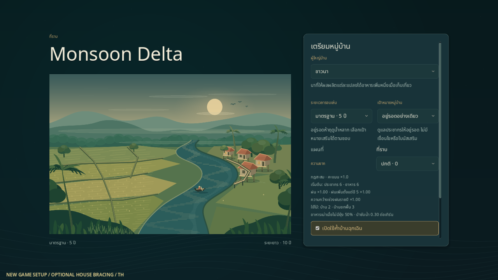
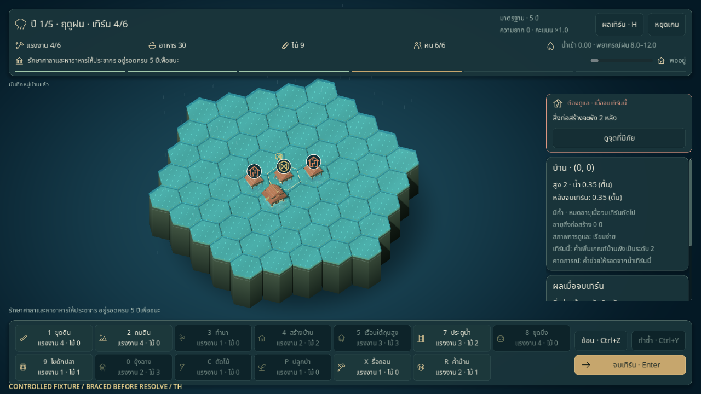
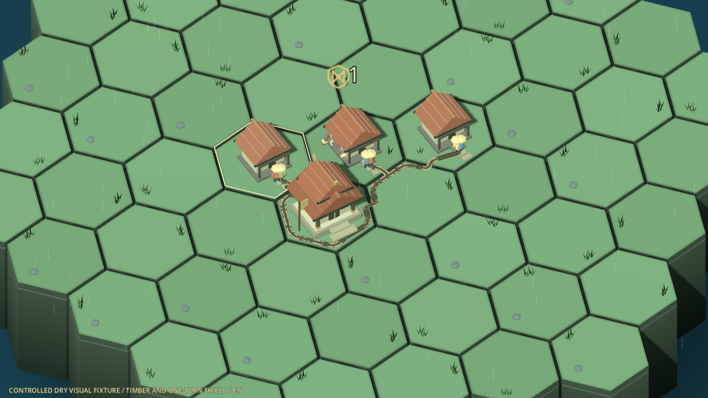

# ค้ำบ้านฉุกเฉิน

ค้ำบ้านเป็นตัวเลือกสำหรับรอบใหม่ ใช้ไม้และแรงงานช่วยบ้านรับน้ำได้อีกหนึ่งระดับในเทิร์นที่จะจบ เหมาะกับการซื้อเวลาเพื่อจัดทางน้ำต่อ ไม่เพิ่มความจุบ้านหรือเปลี่ยนระดับน้ำ

## เปิดใช้และควบคุม

ในหน้าเกมใหม่ เปิด **ค้ำบ้านฉุกเฉิน** ก่อนเริ่มรอบ จากนั้นเลือกเครื่องมือค้ำบ้านหรือกด **R** แล้วคลิกบ้านธรรมดาหรือบ้านยกพื้น เลือกได้ทั้งรอบ 5/10 ปีและผู้นำทั้งสี่ ค่าตั้งต้นยังใช้กฎเดิมโดยไม่เปิดค้ำบ้าน

```sh
godot --path . -- --scene=game --ruleset=bracing_v1 --seed=42 --lang=th --save-path=user://dev-bracing.json
```

`--ruleset=legacy` ใช้กฎเดิม ตัวเปิดเกมปฏิเสธค่าที่ไม่รู้จักก่อนแตะ checkpoint; Continue ใช้กฎที่บันทึกอยู่กับรอบ ไม่ใช้ค่าตั้งของเกมใหม่ ส่วน R ในห้องทดลองน้ำยังเป็นเปลี่ยน seed ตามเดิม

## ต้นทุนและอายุผล

| เรื่อง | กฎที่ใช้งาน |
|---|---|
| ต้นทุน | แรงงาน 2 + ไม้ 1 ต่อหลัง ทั้งฤดูแล้งและฝน ตามค่ากฎใน balance |
| เป้าหมาย | บ้านธรรมดาและบ้านยกพื้นเท่านั้น ไม่ใช้กับศาลา เรือนแพ ยุ้ง หรือช่องว่าง |
| ความทน | เพิ่มเกณฑ์น้ำที่ทำให้บ้านพัง 1 ระดับ สำหรับการจำลองเทิร์นถัดไป |
| อายุ | หมดหลังจบเทิร์นจริงหนึ่งครั้งเสมอ รวมเทิร์นที่แห้งหรือค้ำช่วยไม่สำเร็จ |
| ค้ำซ้ำ | บ้านที่มีค้ำอยู่แล้วไม่รับคำสั่งซ้ำและไม่หักทรัพยากร |
| รื้อ | ค้ำหายพร้อมบ้าน ไม่คืนไม้ค่าค้ำ; คืนไม้ตัวบ้านตามกฎเดิม |
| Undo/Redo | คืนบ้าน ค้ำ ต้นทุน และ RNG ตาม snapshot ภายในเทิร์น |

ด้วยกฎเริ่มต้น บ้านธรรมดาที่ค้ำรอดน้ำระดับ 1 แต่ยังพังที่ระดับ 2; บ้านยกพื้นที่ค้ำรอดระดับ 2 แต่ยังพังที่ระดับ 3 ศาลายังคงแพ้ที่ระดับ 2 และไม่รับผลค้ำ

ถ้าน้ำยังค้างหลังค้ำหมด บ้านไม่พังทันทีระหว่างวางแผน แต่จะตรวจความเสียหายอีกครั้งตอนจบเทิร์นถัดไป ต้องอ่านพรีวิวใหม่และเลือกว่าจะค้ำซ้ำหรือจัดทางน้ำ

## สิ่งที่เห็นในฉาก

- บ้านที่ค้ำมีไม้ค้ำเพิ่มและจุดผูกสีอำพัน พร้อมตราโล่เลข 1 แยกจากเสาและค้ำตกแต่งเดิม
- รายละเอียดช่องบอกอายุค้ำและผลพรีวิวเทิร์นนี้ พรีวิวคำนวณจากกฎเดียวกับผลจริง และไม่ทำให้ค้ำของ state จริงหมดอายุ
- หลังจบเทิร์น ป้ายบอกว่าค้ำช่วยไว้ หมดระยะ หรือบ้านยังพังตามรายงานจริง; ผลค้ำดูได้ในประวัติผลเทิร์น
- Undo/Redo โหลดรอบ หรือเปลี่ยน state ล้างภาพเก่าแล้วสร้างภาพตามสถานะล่าสุด การลดการเคลื่อนไหวยังคงสัญลักษณ์และข้อมูลไว้

ภาพและงานคนไม่หักต้นทุนหรือเปลี่ยนความทนซ้ำ ผู้เล่นออกคำสั่งต่อได้โดยไม่ต้องรอแอนิเมชัน

## ภาพจากเกมและผลตรวจ

ภาพต่อไปนี้จับตรงจาก Godot 4.6.3 ที่ขนาด 1280×720 ชุดที่มีคำว่า **CONTROLLED FIXTURE** เป็นกระดานจัดไว้ตรวจสถานการณ์ ไม่ใช่ผลเล่นตามปกติของ seed 42







กระดานตรวจน้ำกำหนดระดับตื้นคงที่ให้บ้านสามหลัง: บ้านที่ค้ำรอด ส่วนอีกสองหลังพังหลังใช้ resolver จริง รายงานและป้ายบอกว่าค้ำช่วยไว้แล้วหมดอายุ ดู [ผลหลังจบเทิร์นภาษาไทย](../images/bracing-held-fixture-th.png) ภาพรายละเอียดไม้ค้ำใช้สำเนาภาพที่ลดน้ำเป็นศูนย์และซูมกล้องเพื่อเห็นโครงไม้ โดยไม่แก้ state หรือ checkpoint ที่เล่นอยู่ ส่วน [ภาพเริ่มเกม seed 42](../images/bracing-start-th.png) เป็นรอบใหม่ตามกฎปกติที่เปิดค้ำบ้าน

ตรวจวันที่ 2026-10-21: ชุด Godot **365/365**, boot CLI **13/13** และตรวจชุดภาพอีก **6/6** หลังแยกตราโล่จากสัญญาณพรีวิว ผล native **64/64 ทั้งไทยและอังกฤษ** รวมเมนู เมาส์/คีย์บอร์ด Undo/Redo, Continue, พรีวิว หมดอายุ Pause และ Reduce motion พร้อมบริบทใน [รายงานไทย](../reports/bracing-qa-th.json) และ [รายงานอังกฤษ](../reports/bracing-qa-en.json)

## เซฟและขอบเขต

รอบที่เปิดค้ำบ้านใช้ `ruleset = bracing_v1` และ envelope **v4** เก็บสถานะค้ำครบทุกช่อง พร้อมโหมด เป้าหมาย float64/RNG และประวัติภาพหมู่บ้านเมื่อเปิดใช้ โหลดรอบที่ค้ำค้างไว้แล้วเล่นต่อได้โดยผลไม่หาย รายละเอียดอยู่ใน [สัญญาเซฟ](../development/SAVE_IO.md)

เซฟ v1/v2/v3 ยังคงกฎและรูปแบบเดิม ไม่เติมค้ำให้รอบเก่าอัตโนมัติ เซฟที่ระบุรุ่นหรือกฎอนาคตที่ไม่รองรับจะแจ้งข้อผิดพลาดและรักษาไฟล์ไว้

นี่เป็นส่วนแรกของ [แบบกลไกตามฤดู](../design/SEASONAL_MECHANICS.md) ความชื้นในนาและเศษวัสดุค้างประตูยังเป็นข้อเสนอ ส่วน [แบบเอฟเฟกต์ 12 รายการ](../design/SCENE_EFFECTS.md) ยังไม่ได้เปิดใช้ครบทั้งหมด

## ตรวจซ้ำ

```sh
scripts/test.sh --filter=bracing
scripts/test.sh
python3 scripts/test_boot_cli.py
python3 scripts/check_docs.py
```

ตรวจภาพและ input ซ้ำบนเครื่องที่มี display ได้ด้วยคำสั่งด้านล่าง เปลี่ยน `th` เป็น `en` ทั้งสองตำแหน่งเพื่อแยกหลักฐานภาษาอังกฤษ ตัว probe ใช้เซฟและค่าตั้งเฉพาะใต้ output directory และล้าง checkpoint ของการตรวจครั้งก่อนใน directory นั้น

```sh
XDG_DATA_HOME="$PWD/work/bracing-qa/th/userdata" godot --path . --audio-driver Dummy --resolution 1280x720 --script res://tools/bracing_probe.gd -- --out-dir="$PWD/work/bracing-qa/th" --lang=th
```

ผล fixture และเทสต์อัตโนมัติไม่แทนการยืนยันสมดุลหรือการเล่นโดยคน ดูหลักฐานล่าสุดใน [STATUS](../STATUS.md)
