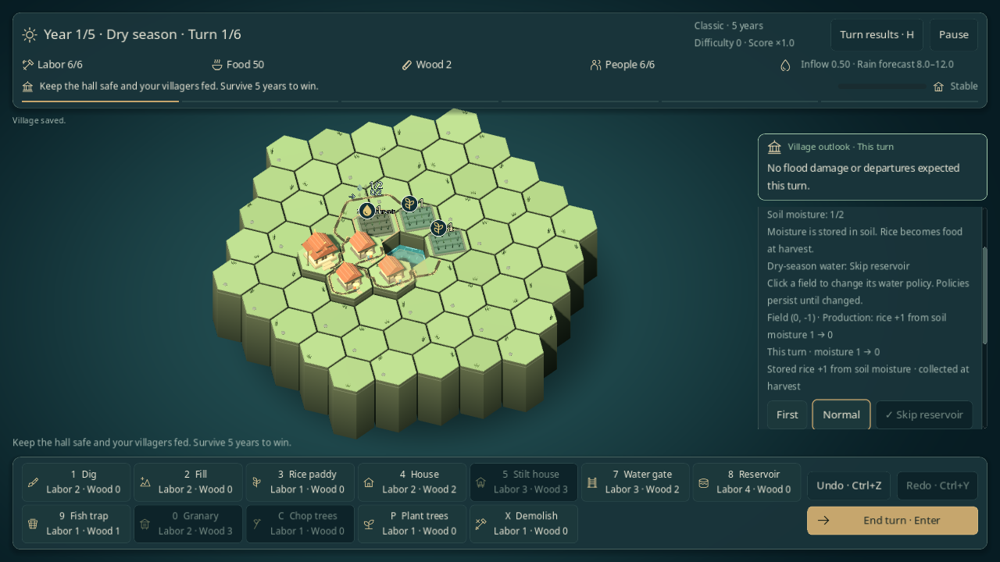
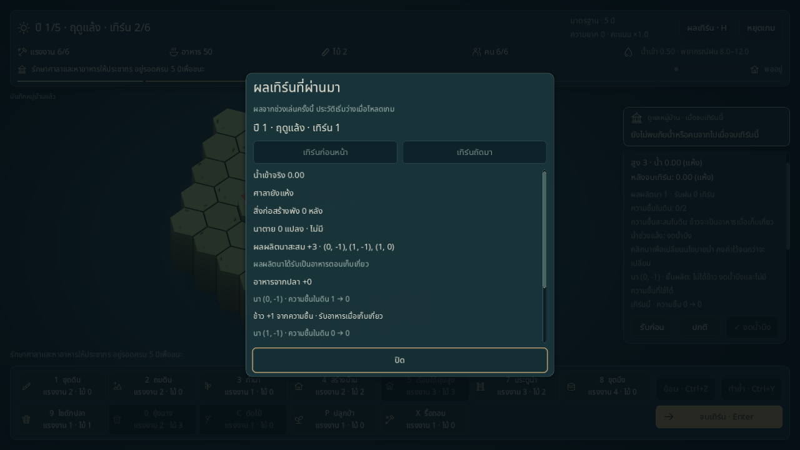

# จัดสรรน้ำให้นา

ระบบทดลองใน **เกมหลักทั้งรอบ 5 และ 10 ปี** ให้เลือกว่านาแปลงใดรับน้ำบึงก่อน หรือเก็บน้ำไว้โดยงดเบิก ใช้ได้เมื่อเปิดตอนเริ่มรอบใหม่ กฎเดิมยังเป็นค่าตั้งต้น และการโหลด Continue ไม่เปลี่ยนกติกาของรอบค้าง

## เปิดและเล่น

หน้าเกมใหม่เปิด **เลือกจัดสรรน้ำให้นา (ทดลอง)** จะใช้เดี่ยวหรือร่วมกับค้ำบ้าน/ความชื้นในนาก็ได้ หรือรันจาก root โดยแยกเซฟพัฒนา:

```sh
godot --path . -- --scene=game --seed=42 --lang=th --ruleset=irrigation_v1 --save-path=user://dev-irrigation.json
# จัดสรรน้ำร่วมกับความชื้นในนา
godot --path . -- --scene=game --seed=42 --ruleset=moisture_irrigation_v1 --save-path=user://dev-irrigation-moisture.json
```

1. สร้างบึงติดนาและจัดทางรับน้ำตามกฎเดิม น้ำในบึงต้องพอหลังขั้นน้ำและการระเหย จึงช่วยผลิตช่วงแล้งได้ การเปิดตัวเลือกนี้ไม่แจกน้ำ นา หรือทรัพยากรเพิ่มในแผนที่ปกติ
2. ในช่วงวางแผนฤดูแล้ง กด Esc ยกเลิกเครื่องมือ แล้วคลิกนาที่ยังไม่ตาย แผงรายละเอียดจะแสดงปุ่ม **รับก่อน / ปกติ / งดน้ำบึง** ใช้เมาส์หรือ Tab แล้ว Enter/Space ได้ ไม่จบเทิร์นพร้อมการเลือก
3. ดูพรีวิวผลต่อแปลงและบึงก่อนจบเทิร์น รายงานผลเทิร์นเก็บแหล่งน้ำและเหตุที่ไม่ได้ผลิตไว้ให้อ่านย้อนหลัง

| นโยบาย | ผล |
|---|---|
| **รับก่อน** | เบิกน้ำก่อนกลุ่มปกติ; ภายในกลุ่มใช้ลำดับช่องเดิม |
| **ปกติ** | ใช้ลำดับช่องเดิมหลังกลุ่มรับก่อน; ทุกแปลงปกติให้ผลตรงกฎเดิม |
| **งดน้ำบึง** | ไม่เบิกจากบึง แต่ยังใช้ความชื้นสะสมได้ถ้าเปิดระบบนั้นและมีความชื้นเหลือ |

เปลี่ยนนโยบายไม่เสียแรงงานหรือไม้ ไม่มีผลผลิตจากการกดสลับเอง ใช้ Undo/Redo คืนการเลือกได้ นโยบายคงอยู่ข้ามเทิร์น เก็บเกี่ยว และปีใหม่จนเปลี่ยน; นาสร้างใหม่เริ่มปกติ การตายหรือรื้อนาล้างนโยบายกลับปกติ ป้ายรับก่อน/งดน้ำบึงบนกระดานเป็นข้อความนิ่งและใช้ได้กับ Reduce motion

ฤดูฝนแสดงนโยบายที่จำไว้และปิดปุ่มแก้ไข น้ำฝน/นาตาย/ความชื้นทำงานตามเดิม งดน้ำบึงไม่ได้หยุดน้ำธรรมชาติ ป้องกันน้ำท่วม หรือหยุดการระเหย

## คิดน้ำและอ่านผล

คำนวณ **น้ำ → ซับน้ำ → ระเหยแล้ง → ความเสียหาย → จัดสรร/ผลิต** ตามเดิม หากศาลาท่วมแพ้จะข้ามการผลิต บึงที่ติดแปลงต้องมีน้ำอย่างน้อย **0.5 ก่อนเบิกแต่ละครั้ง** แล้วจ่าย **0.25 ต่อแปลง** ตามค่ากฎปัจจุบัน ถ้ามีหลายบึงเลือกแหล่งที่น้ำเหลือมากที่สุด เสมอกันใช้ลำดับช่องเดิม ไม่ส่งน้ำข้ามช่องฟรี

แปลงผลิตได้อย่างมากหนึ่งครั้งต่อเทิร์น ใช้บึงก่อน แล้วความชื้นเมื่อไม่มีบึงที่เบิกได้หรือตั้งงดน้ำบึง ความชื้นลดตามกฎเดิมแม้ได้ผลิตจากบึง ข้าวที่เพิ่มยังอยู่ในนา จะกลายเป็นอาหารตอนเก็บเกี่ยว

พรีวิวและประวัติรายงานพิกัดแปลง แหล่งบึง น้ำก่อน–หลังในขั้นผลิต หรือความชื้นก่อน–หลัง ถ้าไม่ได้ผลิตจะระบุงดเบิก ไม่มีบึงติดแปลง หรือน้ำที่เหลือต่ำกว่าเกณฑ์ ตัวเลขนี้ไม่ใช่ปริมาณน้ำตอนเริ่ม planning และไม่รับประกันน้ำในเทิร์นอนาคต

ตัวอย่างจาก [กระดานตรวจแกนเกม](../../tools/irrigation_fixtures.gd): บึงเริ่มน้ำ 1.0 เหลือ 0.75 หลังระเหย ติดนา A/B/C โดย A มีความชื้น 1 ส่วน B/C ไม่มี ลำดับเดิม A→B→C:

| แผน | ผล |
|---|---|
| ทุกแปลงปกติ | A/B เบิกบึง ผลิต 2 แปลง; C ไม่ได้ผลิต บึงเหลือ 0.25 |
| A งดน้ำบึง | A ใช้ความชื้น B/C ใช้บึง ผลิต 3 แปลง; บึงเหลือ 0.25 |
| ทุกแปลงงดน้ำบึง และไม่เปิดความชื้น | ไม่ผลิตเทิร์นนี้ บึงเหลือ 0.75 หลังระเหย เปลี่ยนให้แปลงหนึ่งรับก่อนในเทิร์นถัดไปได้ |

เป็น fixture ที่จัดไว้เพื่อพิสูจน์กลไก ไม่ใช่สถานะเริ่มต้นของ seed 42 และไม่ยืนยันว่าการตั้งค่าหนึ่งคุ้มที่สุดในทุกสถานการณ์ การรักษาน้ำมีค่าเสียโอกาสเป็นข้าวที่ไม่ได้ผลิต และน้ำยังระเหย/ไหลออกได้ การวัดความสนุกหรือภาระคลิกกับผู้เล่นยังเป็นงานค้างตาม [เหตุผลการออกแบบ](../design/LIVING_WITH_WATER.md)

## เซฟและขอบเขต

| Ruleset | ค้ำบ้าน | ความชื้น | จัดสรรน้ำ |
|---|---|---|---|
| `irrigation_v1` | — | — | ✓ |
| `bracing_irrigation_v1` | ✓ | — | ✓ |
| `moisture_irrigation_v1` | — | ✓ | ✓ |
| `bracing_moisture_irrigation_v1` | ✓ | ✓ | ✓ |

รอบเหล่านี้ใช้ **เซฟ v6** มี `irrigation_policy` ครบทุกช่องและฟิลด์ค้ำ/ความชื้นเฉพาะระบบที่เปิด ช่องที่ไม่ใช่นามีชีวิตต้องเป็น `normal` โหลดแล้วรักษานโยบาย float64 และ RNG ตามเดิม รุ่น v1–v5 ไม่รับฟิลด์นี้และไม่ถูกอัปเกรดเอง รุ่นอนาคต/ruleset ที่ไม่รู้จักรักษาไฟล์ไว้ ดู [สัญญาเซฟ](../development/SAVE_IO.md)

[ตัววางการใช้น้ำ](../../core/irrigation.gd) เป็น pure read ที่ขอบเขตขั้นผลิต แล้ว [resolver](../../core/turn_resolver.gd) ใช้ผลครั้งเดียว การเลือกนโยบายผ่าน [CommandRules](../../core/command_rules.gd) และ checkpoint ผ่าน GameSession รายงานน้ำอยู่เฉพาะ session ไม่ใช่บัญชีน้ำซ้ำในเซฟ บอทเห็นคำสั่งนโยบายเมื่อเปิดระบบนี้ แต่ยังไม่มีผล benchmark ใหม่ที่ยืนยันสมดุล

## ตรวจและทำซ้ำ

```sh
scripts/test.sh --filter=irrigation
scripts/test.sh
python3 scripts/test_boot_cli.py
python3 scripts/test_school_cli.py
python3 scripts/check_docs.py
git diff --check
```

[Native probe](../../tools/irrigation_probe.gd) ใช้กระดานตรวจแกนเกมที่จัดไว้ บนหน้าต่าง 1280×720 และเซฟ/ค่าตั้งแยก เปลี่ยน `th` เป็น `en` เพื่อตรวจอีกภาษา:

```sh
XDG_DATA_HOME="$PWD/work/irrigation-qa/th/data" XDG_CONFIG_HOME="$PWD/work/irrigation-qa/th/config" XDG_CACHE_HOME="$PWD/work/irrigation-qa/th/cache" godot --path . --audio-driver Dummy --resolution 1280x720 --script res://tools/irrigation_probe.gd -- --out-dir="$PWD/work/irrigation-qa/th" --lang=th
```

ดูผลตรวจล่าสุดใน [STATUS](../STATUS.md) แยกการตรวจคำสั่ง/เซฟ/ภาพอัตโนมัติจาก human playtest และสมดุล M3 ซึ่งยังไม่ปิดเกณฑ์

## ภาพและผลตรวจ 2026-11-01

Godot **4.6.3 ผ่าน 482/482 tests** รวมระบบจัดสรรน้ำใหม่ **24 tests** และตรวจ UI ซ้ำ **6/6** หลังเพิ่มเครื่องหมายเลือกบนปุ่ม Boot CLI **17/17**, School CLI **5/5**, documentation checker และ `git diff --check` ผ่าน ทุกนาเป็นปกติเทียบกับ resolver เดิมบน 48 state จาก 12 seeds × 4 ชุดค้ำ/ความชื้น แบบตรงค่า รวมการเลือกบึง การหักน้ำครั้งเดียว mass balance และ RNG

Native เมาส์/คีย์บอร์ด **34/34 ทั้งไทยและอังกฤษ** ที่ 1280×720 ผ่าน บนกระดานตรวจที่จัดไว้ ดู [รายงานไทย](../reports/irrigation-qa-th.json) / [อังกฤษ](../reports/irrigation-qa-en.json) ครอบคลุมเมนูเลือกกฎ/ยกเลิกแทนเซฟ คลิกแปลง Enter เลือกนโยบายโดยไม่จบเทิร์น Undo/Redo Reduce motion จบเทิร์น ประวัติ และโหลด checkpoint จริง ภาพจับจาก Godot โดยไม่แก้ไข ไม่ใช่ human playtest หรือหลักฐานยืนยันสมดุล





