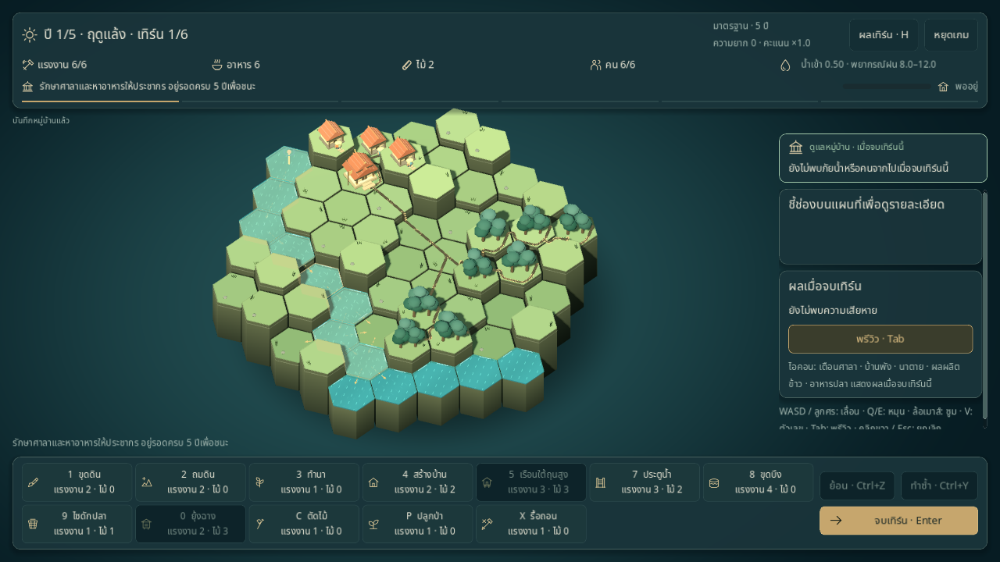
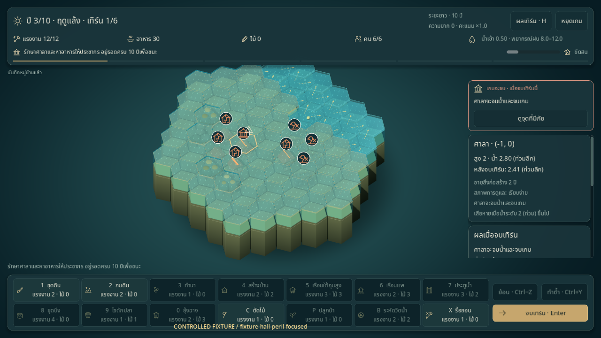

# หมู่บ้านมีชีวิตและอ่านสถานการณ์จากภาพ

เพิ่มทางเดินโค้ง คนทำงาน กระแสน้ำ ไอคอนทรัพยากร และภาพพัฒนาการอาคาร โดยรักษากฎน้ำ ผลผลิต แรงงาน ความจุบ้าน และคะแนนเดิม แอนิเมชันไม่ผลิตทรัพยากรซ้ำและไม่บังคับให้รอคนเดินจบก่อนออกคำสั่งต่อ



[ภาพถนนและคนทำงานจาก controlled fixture](../images/living-work-fixture-en.png) · [มุมใกล้ของทางเดินและคน](../images/living-detail-fixture-en.png)

## เป้าหมายและอันตราย

แถบบนแสดงเป้าหมายหลักให้อยู่รอดครบ 5/10 ปีและความคืบหน้าเสมอ ไอคอนแรงงาน อาหาร ไม้ และประชากร/ความจุบ้านแยกเป็นช่องอ่านง่าย เป้าหมายเสริมมีแถบจำนวนคน ป่า หรือข้าว พร้อมเงื่อนไขตรวจหลังเก็บเกี่ยว

แผงคำแนะนำตรึงอยู่เหนือแผงเลื่อนทางขวา ให้ความสำคัญกับศาลาจะแพ้ → คนหมดหลังเก็บเกี่ยว → คนย้ายเพราะอาหาร/บ้าน → อาคารพัง → นาตาย → เตรียมอาหาร/บ้าน → ปลอดภัยในเทิร์นนี้ กดปุ่มเพื่อดูจุดอันตราย เลือกเครื่องมือที่ใช้ได้ หรือเปิดรายละเอียดพรีวิวพร้อมทางเลือก Undo ที่ผู้เล่นต้องกดเอง

ใช้ `GameFlow.preview()` และผลเก็บเกี่ยวที่คำนวณไว้ ไม่สร้างการพยากรณ์ชุดใหม่ อาหารสำรองก่อนเทิร์นเก็บเกี่ยวแสดงเป็นการเตรียมตัว ไม่รับประกันผลปีที่ยังไม่รู้ ศาลาท่วมก่อนเก็บเกี่ยวจะไม่มีพรีวิวอาหารปลายปี การขาดอาหาร/บ้านไม่ใช่เงื่อนไขแพ้ทันที; คนย้ายตามกฎเก็บเกี่ยวเดิม



บนแผนที่ใช้ไอคอนศาลาเตือน บ้านร้าว ข้าวเฉา ข้าวเพิ่ม และปลาเพิ่ม พร้อมพื้นหลังเข้ม ตัวเลขผลผลิตและข้อความ ไม่พึ่งสีอย่างเดียว การปิดพรีวิวซ่อนภาพคาดการณ์บนกระดาน แต่คำเตือนสำคัญยังอยู่ในแผงคำแนะนำ

## กระแสน้ำ

ตัวจำลองบันทึกปริมาณที่ส่งจริงตามขอบ hex ทุก iteration และแยกการสูบน้ำของระหัด ข้อมูลนี้อยู่ใน `TurnReport.flow_edges` / `wheel_transfers` ชั่วคราว ไม่ลงเซฟหรือประวัติผลเทิร์นแบบย่อ การปิดการบันทึกไม่เปลี่ยนผล float64 หรือ RNG

- พรีวิว: ลูกศรและเส้นประสีทองตามทิศสุทธิจาก resolver บนสำเนาปัจจุบัน
- ผลจริง: ป้ายกระแสสีอ่อนเคลื่อนตามขอบที่เพิ่งส่งน้ำ และแยกสีการสูบของระหัด
- ผิวน้ำ: ริ้วเคลื่อนตามเวกเตอร์ของแต่ละช่อง ทั้งน้ำที่ไหลเข้าและออก น้ำนิ่งไม่แสดงลูกศรปลอม
- ขณะผลจริงแสดงอยู่ พักผิวน้ำ/ไอคอนคาดการณ์ของเทิร์นถัดไป แล้วคืนข้อมูลปัจจุบันเมื่อผลจริงจบหรือผู้เล่นสลับพรีวิว

แสดงขอบเด่นสูงสุด 48 ขอบ พรีวิวรวมเป็น mesh เดียว ผลจริงใช้ MultiMesh สูงสุดสองชุด ผิวน้ำใช้ shader ร่วมกับวัสดุอิสระต่อช่องเปียก จำกัดตามจำนวนช่อง เพราะ Compatibility renderer ไม่รองรับ instance shader uniforms ผลนี้แสดงทิศและการขนส่งที่บันทึกไว้ ไม่ใช่ตัวจำลองน้ำตามเวลาจริงอีกชุดหนึ่ง

[ภาพกระแสที่บันทึกจาก resolver ของ controlled fixture](../images/living-flow-fixture-en.png)

## ถนนและการเดินทาง

`RouteGraph` สร้างกราฟทางเดินบนขอบช่องและทางเข้าอาคาร โดยเริ่มทางหลักจากศาลาแล้วแตกไปบ้านและจุดงาน ใช้ A* พร้อมต้นทุนระยะทาง ความชัน การเลี้ยว และส่วนลดทางหลักที่มีอยู่ การตัดสินกรณีคะแนนเท่ากันเรียงพิกัดแน่นอน

ปัดมุมด้วย quadratic Bézier: `B(t) = (1-t)²A + 2(1-t)tB + t²C` จำกัดระยะปัดมุมและตรวจความกว้างถนนทั้งเส้น หากโค้งลัดเข้าตัวบ้าน/น้ำจะลดรัศมีหรือคงมุมเดิม ทางแยกมีปลายมนและพื้นต่อกัน คนใช้เส้นและระยะสะสมเดียวกับถนนจึงเดินด้วยความเร็วคงที่

- ทางบกใช้พื้นแห้งที่น้ำต่ำกว่า 0.05; ไม่ผ่านแม่น้ำ ทะเล ต้นน้ำ นา ประตูน้ำ บึง หรือเรือนแพ
- ทางเข้าไม่ทะลุตัวอาคาร จุดนาและไซอยู่ที่ริมแปลง/ฝั่งแห้งที่เข้าถึงได้
- ข้ามความสูงได้หนึ่งระดับพร้อมบันไดไม้จริง หน้าผาสูงกว่านั้นไม่มีทางเชื่อม บ้านบางหลังในแผนที่เดิมจึงอาจไม่มีทางเดินถึงศาลา
- เปลี่ยนภูมิประเทศ อาคาร ชนิดพืช หรือขอบเขตน้ำท่วมจึงคำนวณใหม่ การเปลี่ยนอาหาร/แรงงานไม่สร้างกราฟซ้ำ

ถนนเป็นภาพเชื่อมกิจกรรม ไม่เพิ่มต้นทุน ไม่เปลี่ยนการผลิต และไม่ใช่คำสั่งสร้างถนน สะพานหรือเวลาเดินทางที่มีผลต่อกฎยังไม่อยู่ในชุดนี้

## คนทำงาน

แสดงตัวแทนประชากรสูงสุด 12 คน คิวงานสูงสุด 24 รายการ ใช้รูปทรงและวัสดุร่วมกัน มีกิจกรรมออกจากบ้านไปศาลาแบบไม่ขนของ และกิจกรรมจากงานจริง:

- คำสั่งขุด ถม สร้าง ปลูกป่า ทำนา เปิดประตู และตัดไม้ที่สำเร็จ
- ดูแลนาจาก `paddy_gains` ของเทิร์นที่เกิดขึ้นจริง
- เก็บและขนปลาจาก `fish_food_by_tile` ที่เป็นบวก
- ขนข้าวจาก `GameSession.last_harvest_food_by_tile` ซึ่งใช้การคำนวณเดียวกับ Harvest

คนมีหมวก เครื่องมือ ตะกร้า ข้าว ปลา หรือท่อนไม้ตามกิจกรรม เดินบ้าน → จุดงาน → ยุ้งหรือศาลา → บ้าน โดยงดการเดินถ้าไม่มีทางแห้ง งานธรรมดายังใช้กฎเดิม ไม่มีการหักแรงงานหรือรับผลผลิตเพิ่มจากภาพคนเดิน

คนและถนนอยู่คนละ root กับพื้น/อาคารที่ bake เป็น mesh การ refresh ปกติรักษางานที่ยังถูกต้อง Undo/Redo โหลดรอบ และการเปลี่ยน state ล้างงานเก่า ทางที่ถูกน้ำตัดขาดยกเลิกการเดินที่ไม่ปลอดภัย

## เวลาและความเป็นอยู่ของอาคาร

เกมใหม่จากเมนู/boot มีข้อมูลภาพถาวรและใช้เซฟ envelope **v3** ส่วน Continue จาก v1/v2 รักษาเซฟและกฎเดิม ไม่เพิ่มอายุอาคารย้อนหลังหรือเขียนไฟล์เพียงเพราะโหลด ดู [สัญญาเซฟ](../development/SAVE_IO.md)

สภาพเริ่มที่ **พออยู่** และประเมินหลังเก็บเกี่ยวเท่านั้น:

| สภาพที่สังเกต | เงื่อนไข |
|---|---|
| ขัดสน | คนหมด อาหารหมด หรือมีคนย้ายเพราะหิว/บ้านไม่พอ |
| เหลือเก็บ | บ้านรองรับคนพอ อาหารหลังเก็บเกี่ยวพอกินหนึ่งปี และไม้พอสร้างบ้านธรรมดาสองหลังตามต้นทุนผู้นำ |
| พออยู่ | กรณีอื่น |

ต้องได้สภาพเป้าหมายเดิมสองเก็บเกี่ยวติดกันจึงเปลี่ยนหนึ่งระดับ ช่วยไม่ให้ภาพทั้งหมู่บ้านสลับเพราะการใช้ทรัพยากรครั้งเดียว อาคารจำปี/เทิร์นที่สร้างและระดับภาพ 0–2 เมื่อสภาพเหลือเก็บและอายุเต็มปีเพิ่มระดับปีละหนึ่ง ขัดสนลดปีละหนึ่ง; รื้อแล้วสร้างใหม่เริ่มอายุและระดับใหม่ Undo/Redo คืนประวัตินี้ตรงเดิม

บ้านที่พัฒนามีต้นไม้กระถาง ของใช้ หลังคาระเบียงและโคม บ้านช่วงขัดสนที่มีอายุมีแผ่นซ่อมบำรุง ศาลามีรายละเอียดเพิ่ม ส่วนถุงของที่ยุ้งสัมพันธ์กับอาหารจริง Inspector แสดงอายุและระดับภาพ การตกแต่งไม่เพิ่มความจุ ความทนน้ำ หรือรายได้ และไม่เปลี่ยนชนิดบ้านธรรมดา/ยกพื้น/เรือนแพ นี่คือสภาพส่วนรวมของหมู่บ้าน ยังไม่มีเงินหรือทรัพย์สินรายครัวเรือน

[ภาพอาคารอายุสองปี/ระดับภาพ 2 จาก controlled fixture](../images/living-growth-fixture-en.png)

## การควบคุมและการตรวจ

Pause หยุดคนและอายุเอฟเฟกต์ โหมด Reduce motion ใช้คนประจำจุดกับเครื่องมือและลูกศรน้ำคงที่ หยุดริ้วน้ำตามค่าตั้งเดิม การอ่าน UI/ภาพทั้งหมดไม่เขียน checkpoint

```sh
scripts/test.sh
python3 scripts/test_boot_cli.py
python3 scripts/check_docs.py

# เครื่องมือตรวจภาพ ต้องใช้ display จริง/virtual display และเซฟแยก
godot --path . --script res://tools/living_village_probe.gd -- --lang=th --out-dir=/tmp/living-village-th
```

Probe เป็น **controlled fixture** สำหรับตรวจหน้าจอ ทางเดิน งานและพัฒนาการ ไม่ใช่การเล่นผ่านเกมจริง ผล native ล่าสุดผ่านภาษาไทย 47/47 และอังกฤษ 47/47: [ข้อมูลตรวจไทย](../reports/living-village-qa-th.json) · [ข้อมูลตรวจอังกฤษ](../reports/living-village-qa-en.json) ผลตามวันที่และขอบเขตการวัดอยู่ใน [ประวัติพัฒนา](../history/PROGRESS.md#2026-10-18--หมู่บ้านมีชีวิตและอ่านสถานการณ์จากภาพ) เกณฑ์ให้คนมองภาพแล้วระบุภัย/การแก้ไขภายในประมาณห้าวินาทียังต้องตรวจโดยผู้เล่น; การทดสอบอัตโนมัติไม่ยืนยันสมดุลหรือความสนุกแทนได้
