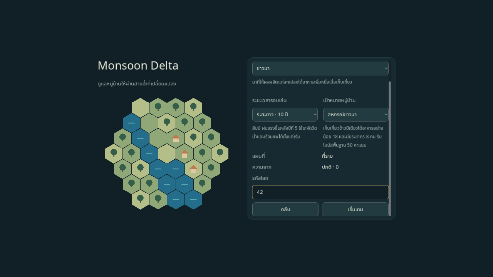
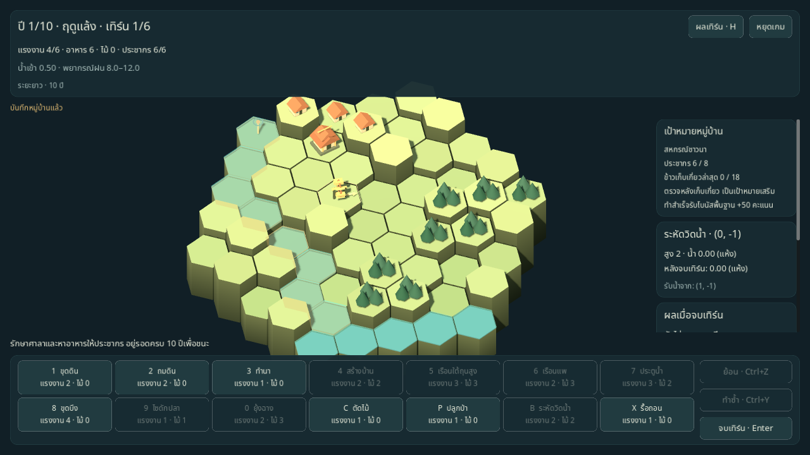

# รอบระยะยาวและเป้าหมายหมู่บ้าน

คู่มือกติกาที่ใช้งานอยู่ ผลตรวจและ probe ท้ายหน้าเป็นหลักฐาน ณ วันที่เพิ่มโหมด; ดู [STATUS](../STATUS.md) สำหรับขอบเขตและหลักฐานรวมล่าสุด

เมนูเกมใหม่เลือกระยะเวลาและเป้าหมายได้ โหมดระยะยาวเพิ่มเวลาจาก 30 เป็น 60 เทิร์น เปิดเครื่องมือที่ช่วยเปลี่ยนเส้นทางน้ำ และเพิ่มฝนหลังปี 5 ส่วนเป้าหมายเสริมชวนให้แบ่งพื้นที่และทรัพยากรต่างกันในแต่ละรอบ

| โหมด | ระยะเวลา | เครื่องมือและสภาพน้ำ |
|---|---|---|
| มาตรฐาน | 5 ปี / 30 เทิร์น | ใช้กฎและเครื่องมือเริ่มต้นเดิม |
| ระยะยาว | 10 ปี / 60 เทิร์น | ใช้ระหัดวิดน้ำและเรือนแพได้ตั้งแต่เริ่ม ปี 6–10 เพิ่มช่วงฝนจากปี 5 ปีละ +2 ถึง +3 |

ปี 6 มีช่วงฝนรวมพื้นฐาน 24–33 และปี 10 เป็น 32–45 ก่อนใช้ตัวคูณ ฝนแต่ละเทิร์นยังสุ่มจาก seed เดิมและดูพรีวิวได้ ระหัดเลือกตำแหน่งแล้วเลือกเพื่อนบ้านเป็นทิศรับน้ำ ส่วนเรือนแพต้องมีน้ำและไม้พอ จึงต้องเลือกระหว่างใช้ไม้แก้น้ำ สร้างที่อยู่ หรือเก็บสำรอง



| เป้าหมาย | เงื่อนไขหลังเก็บเกี่ยวครั้งเดียว | แนวทางลงทุน |
|---|---|---|
| ชุมชนเติบโต | ประชากรอย่างน้อย 12 | เพิ่มบ้านและอาหารให้พอสำหรับการเกิด |
| หมู่บ้านรักษ์ป่า | ประชากรอย่างน้อย 8 และป่าโตเต็มที่อย่างน้อย 8 ช่อง | รักษาป่า/ปลูกทดแทนขณะหาไม้สร้างบ้าน |
| สหกรณ์ชาวนา | อาหารจากข้าวอย่างน้อย 18 และประชากรอย่างน้อย 8 | ลงทุนนาและระบบน้ำเพื่อเพิ่มผลผลิตปีเดียว |
| อยู่รอดอย่างเดียว | ไม่มีเงื่อนไขเสริม | เน้นรับมือน้ำและเลี้ยงประชากร |

เป้าหมายเป็นทางเลือก ชนะได้โดยอยู่ครบจำนวนปีแม้ยังทำเป้าหมายไม่สำเร็จ เป้าหมายที่สำเร็จให้โบนัสพื้นฐาน 50 คะแนนก่อนคูณความยาก เก็บวันที่สำเร็จไว้ตลอดรอบ ไม่รับซ้ำทุกปี แผงขวาแสดงความคืบหน้า พรีวิวเก็บเกี่ยวบอกเมื่อจะสำเร็จ และหน้าสรุปปีแสดงเหรียญที่ได้รับ



เปิดผ่าน CLI หรือแยกเซฟเพื่อทดลอง:

```sh
godot --path . -- --scene=game --run-mode=long --goal=rice --seed=1 --lang=th --save-path=user://long-test.json
```

Continue รักษาโหมด เป้าหมาย เหรียญ ฝน และ RNG รวมถึงช่วงปี 5→6 และ 9→10 เล่นอีกครั้งที่หน้าผลจบใช้โหมด/เป้าหมายเดิมกับ seed ถัดไป ประวัติผลเทิร์นเก็บได้ 60 รายการในโหมดยาว ส่วนการโหลดเริ่มประวัติใหม่ตามเดิม

## ผลตรวจ

Godot 4.6.3: ชุดรวม **249 รายการผ่าน** เพิ่ม 32 รายการสำหรับกฎโหมด เป้าหมาย เซฟ เมนู และ HUD รวมการจำลองผ่าน GameScreen ครบ 60 เทิร์น โหลดจากสรุปปี 5 แล้วเล่นต่อได้ และชนะเมื่อเก็บเกี่ยวปี 10

ทดลองบอทบนแผนที่ปกติ 9 รอบที่ difficulty 0 โดยออกเฉพาะคำสั่งที่ถูกกฎ ไม่มีการปรับแผนที่ ทรัพยากร หรือ modifier:

| กลยุทธ์ | Seed | ผล |
|---|---|---|
| Farmer | 1 | รอดครบปี 10 |
| Farmer | 2, 42 | ศาลาท่วมปี 4, 5 |
| Greedy 8 candidates | 1 | รอดครบปี 10; เป้าประชากรสำเร็จปี 4 |
| Greedy 8 candidates | 2, 42 | ประชากรหมดปี 2 |
| Farmer + บ้านบนพื้นที่สูง / ป่า | 1 | รอดครบปี 10; เป้าหมายสำเร็จปี 1 |
| Farmer + บ้านบนพื้นที่สูง / ข้าว | 1 | รอดครบปี 10; เป้าหมายสำเร็จปี 2 |
| Farmer + บ้านบนพื้นที่สูง / ประชากร | 1 | รอดครบปี 10; เป้าหมายสำเร็จปี 2 |

กลยุทธ์เสริมสร้างบ้านบนช่องสูงสุดที่ทำได้ให้จุ 8 หรือ 12 คน ตัดไม้เฉพาะเมื่อจำเป็น แล้วทำนาตามบอทเดิม ทำซ้ำชุดนี้ได้ด้วย:

```sh
godot --headless --path . --script res://tools/long_run_probe.gd
```

นี่เป็นการตรวจว่าโหมดยาวและทุกเป้าหมายเล่นสำเร็จได้จริงใน seed ที่เหมาะสม ชุดเล็กนี้ยังไม่ใช่ benchmark สมดุล และเป้าหมายอาจสำเร็จเร็วใน seed ที่เอื้ออำนวย ยังต้องทดลองโดยผู้เล่นเพื่อประเมินความสนุกและความยากต่อเนื่อง

ตรวจ native mouse/keyboard ไทย–อังกฤษที่ 1280×720: เลือกโหมดและเป้าหมายผ่านเมนู สร้างระหัดสองคลิกแล้ว Undo/Redo คืน checkpoint ตรงเดิม พร้อมตรวจเหรียญและการไปปี 6 ผ่าน fixture แยกเซฟ [ภาพผลชนะและเหรียญจาก fixture ปี 10](../images/long-win-fixture-en.png) ใช้น้ำและทรัพยากรที่จัดไว้สำหรับตรวจหน้าจอ ไม่ใช่หลักฐานสมดุล
