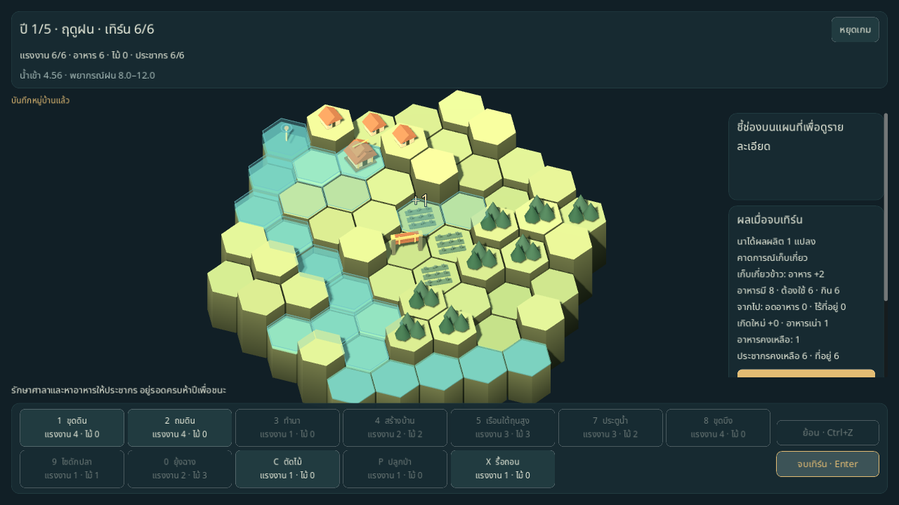
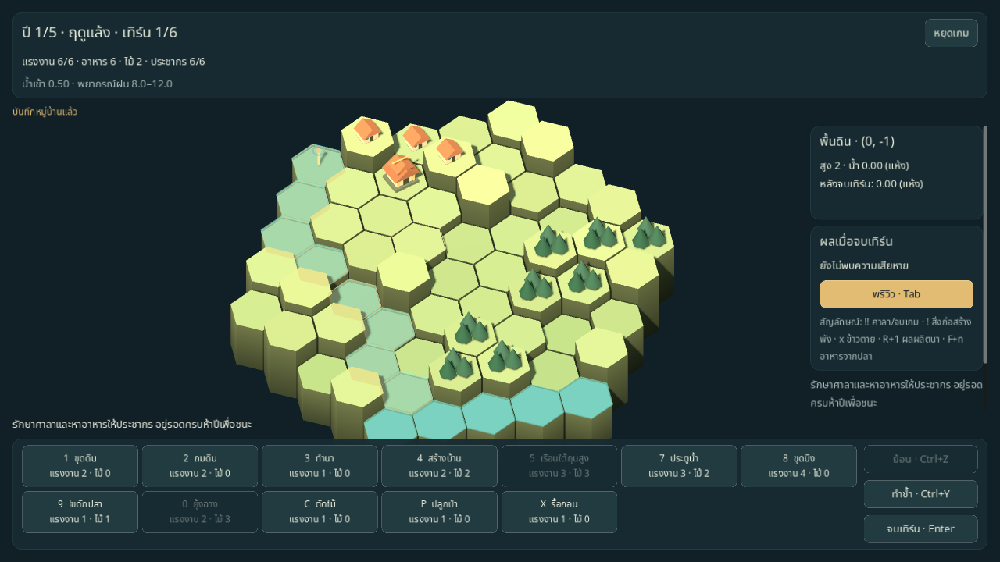
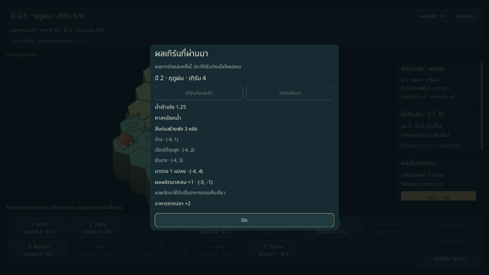
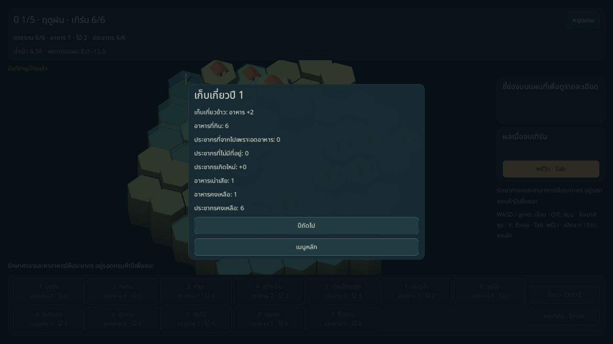
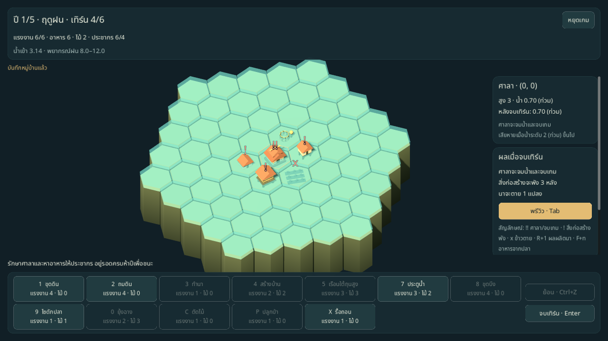
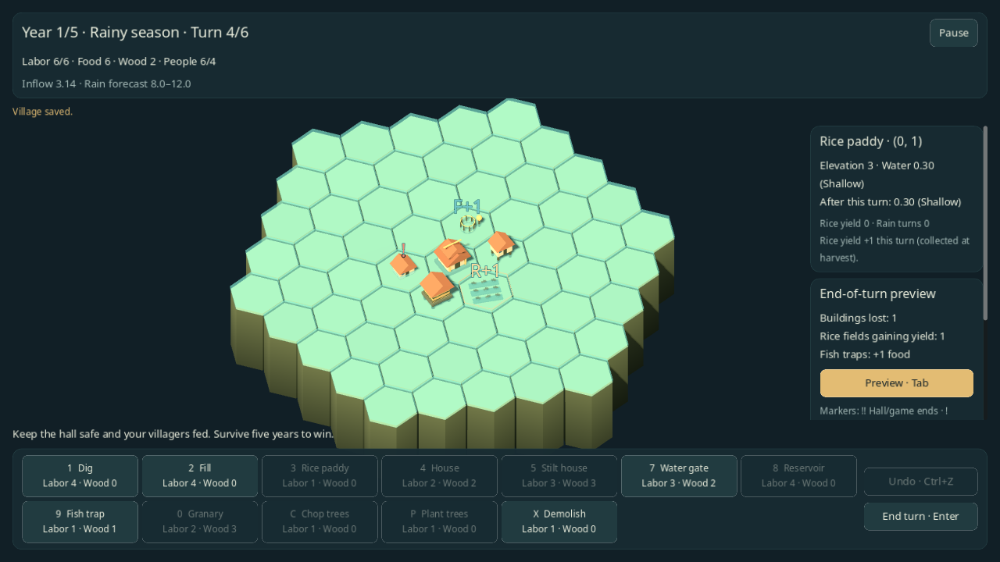

# หน้าจอเล่นเกม M4

ขอบเขตหน้าจอที่ใช้งานได้อยู่ด้านล่าง ส่วนภาพและจำนวนเทสต์ในแต่ละช่วงเป็นหลักฐาน ณ วันที่พัฒนาฟีเจอร์นั้น ดู [สถานะและผลตรวจล่าสุด](../STATUS.md) สำหรับภาพรวมปัจจุบัน

ภาพล่าสุด: [หมู่บ้านจำลอง แสงตามฤดู และ HUD ที่ปรับใหม่](VISUAL_REFRESH.md)

F5 เข้าเมนูหลักแล้วเริ่มรอบใหม่หรือ Continue ได้ เลือกรอบมาตรฐาน 5 ปีหรือ [ระยะยาว 10 ปีพร้อมเป้าหมายหมู่บ้าน](LONG_RUNS.md) บนแผนที่ราบลุ่ม มีแรงงาน/ไม้ คำสั่ง พรีวิว undo สรุปปี และผลแพ้/ชนะ นี่เป็นเวอร์ชันสำหรับทดลองเล่นจริง ยังไม่ปิดเกณฑ์สมดุล M3 หรือการตรวจโดยผู้เล่นของ ROADMAP



[ภาพเมนูหลักภาษาไทย](../images/m4-menu-th.png)

## การเล่น

- เกมใหม่เลือกผู้นำ 4 คนและ seed ได้ ใช้แผนที่ plains และ difficulty 0 ระหว่างรอระบบโปรไฟล์/ปลดล็อก M5 ถ้ามีเซฟอยู่จะยืนยันก่อนเริ่มรอบทับ
- เลือกโหมด 5/10 ปีและเป้าหมายเสริมก่อนเริ่มได้ โหมดยาวเปิดระหัด/เรือนแพ ฝนเพิ่มปี 6–10 และชนะเมื่อครบปี 10 เป้าหมายตรวจหลังเก็บเกี่ยว มีพรีวิวว่าจะสำเร็จและโบนัสพื้นฐาน 50 คะแนนครั้งเดียวเมื่อสำเร็จ ดู [รายละเอียด](LONG_RUNS.md)
- HUD แสดงปี ฤดู เทิร์น แรงงาน อาหาร ไม้ ประชากร/ความจุบ้าน น้ำเข้าเทิร์นปัจจุบัน และช่วงพยากรณ์ ไม่เปิดเผยฝนล่วงหน้าที่ซ่อนอยู่
- คำสั่งแสดงชื่อ ปุ่มลัดและต้นทุนตามฤดู ปุ่มที่ไม่มีเป้าหมายจะปิดพร้อม tooltip; คำสั่งยังไม่ปลดล็อกถูกซ่อน ไฮไลต์เป้าหมายและชี้ช่องดูเหตุผลที่ทำไม่ได้
- คลิกแล้วใช้คำสั่งเดิมซ้ำได้ Esc/คลิกขวายกเลิก; Esc เมื่อไม่ได้เลือกคำสั่งเปิดเมนูหยุดเกม คลิกประตูน้ำขณะไม่มีคำสั่งเพื่อเปิด–ปิด ระหัดเลือกตำแหน่งแล้วเลือกเพื่อนบ้านเป็นทิศรับน้ำ
- ปุ่มย้อน/Ctrl+Z และทำซ้ำ/Ctrl+Y หรือ Ctrl+Shift+Z ใช้เปรียบเทียบแผนภายในเทิร์นเดียวกันได้ ทั้งแผนที่ ทรัพยากร ทิศรับน้ำของระหัด และสถานะประตูจะกลับตรงเดิม พร้อมอัปเดตพรีวิวและบันทึกอัตโนมัติ ออกคำสั่งใหม่สำเร็จหรือจบเทิร์นจะล้างรายการทำซ้ำ; เลือกเครื่องมือ/ทิศรับน้ำหรือคำสั่งที่ทำไม่ได้ยังเก็บรายการไว้
- Tab สลับพรีวิว: ผิวน้ำหลังเทิร์น ป้าย `!!` ศาลาจมน้ำและจบเกม, `!` สิ่งก่อสร้างพัง, `x` นาตาย, `R+1` ผลผลิตนา และ `F+n` อาหารจากปลา พร้อมคำอธิบายสัญลักษณ์ในแผงขวา แผงขวารายงานข้อความประกอบสี
- เทิร์น 6 แสดงพรีวิวเก็บเกี่ยวจากสภาพหลังน้ำ: ผลผลิตนา อาหารที่มี/ต้องใช้/กินจริง คนย้ายออกเพราะหิวหรือบ้านไม่พอ เกิด อาหารเน่า และยอดอาหาร/ประชากรสุดท้าย เมื่อศาลาจมน้ำจนแพ้จะไม่แสดงเก็บเกี่ยวที่ไม่ได้เกิดขึ้น
- ชี้ช่องขณะเปิดพรีวิวเพื่ออ่านสิ่งก่อสร้างที่จะพัง/ศาลาที่จะจมน้ำพร้อมระดับน้ำที่ทำให้เสียหาย ข้าวตาย ผลผลิตนา +1 ที่รอรับอาหารตอนเก็บเกี่ยว และอาหารจากไซแต่ละอัน ใช้ผล resolve จริง ไม่คำนวณกฎน้ำซ้ำ เมื่อศาลาจมน้ำยังแสดงความเสียหายทั้งหมด แต่ไม่สัญญาผลผลิตที่ไม่ได้เกิดขึ้น
- ข้อมูลช่องบอกประตูเปิด–ปิด นาตายหรือกำลังจะตาย และพิกัดช่องรับน้ำของระหัด นาที่ตายไม่แสดงผลผลิตสะสมเป็นอาหารที่เก็บเกี่ยวได้
- ก่อนจบเทิร์นที่จะแพ้ให้ยืนยัน รวมการอดอาหารตอนเก็บเกี่ยวแม้ปิดพรีวิวอยู่ ฤดูฝนที่เหลือแรงงานอย่างน้อย 2 ให้ยืนยันอีกแบบและจำตัวเลือกไม่ถามซ้ำใน settings
- หน้าสรุปปีแสดงผลเก็บเกี่ยว กิน ย้ายออก เกิด เน่า และยอดคงเหลือ ก่อนเริ่มปีถัดไปหรือดูผลจบ รอบแพ้ศาลาจบได้ทันทีตามกฎ
- กล้องใช้ WASD/ลูกศร, Q/E หมุน, ล้อเมาส์ซูม, ลากเมาส์กลางเลื่อน และ V แสดงระดับ ขณะมีหน้าต่างซ้อน กล้องและคำสั่งกระดานหยุดรับ input
- หน้าต่างซ้อนใช้ Tab/Shift+Tab เลือกปุ่มและ Enter/Space กดปุ่มที่มีกรอบโฟกัสได้ หน้าต่างยืนยันเริ่มที่ยกเลิก เมนูหยุดเกมเริ่มที่เล่นต่อ และสรุปปีเริ่มที่ปีถัดไป การกด Enter ค้างไม่ข้ามสรุปปีไปอีกขั้นโดยอัตโนมัติ
- ปุ่มลัดไม่เลือกคำสั่งที่ถูกปิด เช่น ทำนาในฤดูฝน; คำสั่งที่เลือกไว้แล้วคงอยู่หลังสั่งซ้ำแต่บอกเหตุผลเมื่อทำต่อไม่ได้

## บันทึกและโหลด

`GameSession` เชื่อม GameFlow กับ [SaveIO](../development/SAVE_IO.md) หลังเริ่มเกม คำสั่งสำเร็จ undo/redo จบเทิร์น และผ่านสรุปปี รวมทั้งบันทึกซ้ำก่อนกลับเมนู/ปิดหน้าต่าง คำสั่งที่ไม่ผ่านไม่เขียนไฟล์ เมื่อเข้า GAME_OVER จะลบเซฟตามสเปก

Continue แสดงเมื่ออ่านและตรวจเซฟสำเร็จ โหลดแล้วอยู่บนกระดาน/สรุปปีเดิม ไม่เก็บเกี่ยวซ้ำ และไม่คืนแรงงานที่ใช้ไป ประวัติ undo/redo เริ่มใหม่ตาม S-05 เก็บเฉพาะระหว่างเล่นได้อย่างละไม่เกิน 200 รายการ เมื่อเซฟล้มเหลวมีข้อความคงอยู่ ให้ลองบันทึกใหม่ หรือเลือกออกโดยไม่บันทึกอย่างชัดเจน

ห้องทดลองน้ำและบอทเรียก GameFlow โดยไม่มี GameSession จึงไม่เขียนทับเซฟรอบปกติ กลับเมนูจาก sandbox ด้วย Esc หรือปุ่มเมนูหลัก

```sh
godot --path . -- --scene=menu --lang=th
godot --path . -- --scene=game --seed=1 --lang=th --save-path=user://test-run.json
godot --path . -- --scene=sandbox --seed=42 --lang=en
```

`--scene=game` เริ่มเกมใหม่และเขียนเซฟ จึงควรระบุ `--save-path` แยกเมื่อทดลองอัตโนมัติ ภาษาที่เลือกจากเมนูเก็บใน `user://settings.json`; `--lang` ใช้กำหนดภาษาตอนเปิดโดยไม่เขียนทับค่าตั้งไว้

## ทำซ้ำคำสั่ง (Redo)

หลังย้อนคำสั่ง ปุ่มทำซ้ำจะเปิดให้กด หรือใช้ Ctrl+Y / Ctrl+Shift+Z คืนคำสั่งทีละขั้นได้ ปุ่มจะปิดเมื่อไม่มีประวัติ การเลือกเครื่องมือ การเลือกทิศระหัดที่ยังไม่ยืนยัน และคำสั่งที่ทำไม่ได้ไม่ล้าง redo; คำสั่งใหม่ที่สำเร็จและการออกจากเทิร์นจะล้าง เมื่อโหลด Continue ทั้ง undo และ redo เริ่มว่าง โดยกระดานตรงกับเซฟล่าสุด



[ภาพภาษาอังกฤษที่ 1280×720](../images/m4-redo-en.png)

ตรวจด้วย mouse/keyboard จริงบน Xorg dummy display และ Mesa โดยแยก XDG directory จากเซฟปกติ: ถมดิน → Ctrl+Z → Ctrl+Shift+Z, Ctrl+Y และปุ่มทำซ้ำ ให้ checkpoint ตรงกับหลังถมเดิมทั้ง state และข้อมูล float64/RNG; Pause หยุดคีย์ลัด, กลับมาใช้ต่อได้, ขุดใหม่แล้วทำซ้ำไม่คืนแผนถมเดิม และจบเทิร์นแล้วเรียกแผนเก่าไม่ได้ สลับเป็นอังกฤษแล้ว Continue ตรวจถม → ย้อน → ทำซ้ำอีกครั้ง ทั้งสองภาษาแสดงแถบคำสั่งและปุ่มใหม่ครบในหน้าต่างขั้นต่ำ

ผลตรวจเมื่อ 2026-10-17: เทสต์ใหม่ 8 รายการและขยายกรณีเดิม ชุดรวม ณ เวลานั้น **201 รายการผ่าน** บน Godot 4.6.3 รวมการคืนกระดาน/inspector/พรีวิว/เซฟ การบล็อกเมื่อมี modal หรือโฟกัสช่องข้อความ การกดค้าง ประตูและทิศระหัด ประวัติหลายขั้น การเปลี่ยนแผน การล้างตาม phase การแยกจากสำเนา/เซฟ และการเขียนเซฟล้มเหลวแล้วลองใหม่

## ผลเทิร์นที่เกิดขึ้นจริง

แผงขวาแสดงผลเทิร์นล่าสุด แยกจากพรีวิวเทิร์นถัดไป กด H หรือปุ่มผลเทิร์นเพื่อเปิดประวัติ ใช้เทิร์นก่อนหน้า/เทิร์นถัดมา หรือ Tab/Shift+Tab แล้ว Enter/Space เพื่อดูแต่ละรายการ ปิดด้วย Esc หรือปุ่มปิด เปิดจากเมนูหยุดเกม สรุปปี หรือหน้าผลจบแล้วกลับหน้าเดิมได้ โดยไม่เปลี่ยนเทิร์นหรือเก็บเกี่ยวซ้ำ

แต่ละรายการระบุปี ฤดู และเทิร์นที่เพิ่งจบ น้ำเข้าจริง ศาลาเปียกหรือแห้ง สิ่งก่อสร้างที่พังพร้อมชื่อและพิกัด นาที่ตาย ผลผลิตนาที่เพิ่ม และอาหารจากปลา ผลผลิตนาสะสมยังรอรับเป็นอาหารตอนเก็บเกี่ยว เทิร์นสุดท้ายของปีแนบยอดเก็บเกี่ยวและผลจบหลังคำนวณประชากรด้วย หน้าต่างเลื่อนได้เมื่อรายการเสียหายหรือสรุปเก็บเกี่ยวยาว

ประวัติอยู่ใน GameSession ระหว่างเล่น เก็บครบได้ 30 เทิร์นในโหมดมาตรฐานหรือ 60 เทิร์นในโหมดยาว และยังอยู่หลัง undo/redo หรือขึ้นปีใหม่ การเริ่มหรือโหลดเกมสำเร็จเริ่มประวัติว่าง พร้อมข้อความแจ้งในหน้าต่าง ไม่สร้างรายงานย้อนหลังจากเซฟหรือจากพรีวิว



[ภาพภาษาอังกฤษจาก fixture เดียวกัน](../images/m4-turn-results-fixture-en.png)

ภาพใช้แผนที่จริงที่กำหนดน้ำ/สิ่งก่อสร้างเพื่อให้ตรวจรายงานบ้าน เรือนยกพื้นและยุ้งพัง นาตาย นาได้ผลผลิต และอาหารปลาในเทิร์นเดียว ตัวเลขมาจากการ resolve เทิร์นจริงของ fixture ไม่ใช่ผลทดสอบสมดุลหรือการเล่นปกติ ตรวจ mouse/keyboard บน Xorg/Mesa โดยแยก XDG directory และเซฟจากรอบปกติ

ตรวจ native เพิ่ม: H เปิดจากกระดานและ Pause ได้, Tab/Enter เลือกผลเทิร์นก่อนหน้า, Esc คืน Pause, ดูสรุปเก็บเกี่ยวแล้วกลับมาที่ state และ bytes ของเซฟเดิม, และเปิดจากผลจบแล้วกลับมาที่คะแนนเดิมโดยไม่สร้าง checkpoint เพิ่ม [ภาพสรุปเก็บเกี่ยวจาก fixture ภาษาอังกฤษ](../images/m4-turn-results-harvest-fixture-en.png)

ผลตรวจเมื่อ 2026-10-17: เทสต์ใหม่ 16 รายการ ชุดรวม ณ เวลานั้น **217 รายการผ่าน** บน Godot 4.6.3 ครอบคลุมผลตรงกับ TurnReport/Harvest, timestamp ก่อนเลื่อนเวลา, outcome หลังเก็บเกี่ยว, ประวัติครบ 30 เทิร์นของโหมดมาตรฐาน, การแยกสำเนาและเซฟ, autosave ล้มเหลว, หน้าต่างและคีย์ลัด, navigation และการคง state/RNG/undo/redo/เซฟเมื่อดูย้อนหลัง การตรวจประวัติ 60 เทิร์นเพิ่มภายหลังใน [โหมดระยะยาว](LONG_RUNS.md#ผลตรวจ)

## ภาษาและภาพ

ข้อความเกมหลักมาจาก `translations/strings.csv` ทั้งไทยและอังกฤษ พร้อมตรวจ key/placeholder ฟอนต์ใช้ Noto Sans Thai ที่แนบ OFL มี line spacing +4 แทน Kanit ที่ยังไม่ได้รับไฟล์ เมนูและเกมใช้ container/anchor บนฐาน 1920×1080 และรองรับหน้าต่างขั้นต่ำ 1280×720

ลงทะเบียนไฟล์ `.translation` ใน project settings และเก็บ resource ที่ import แล้วใน Git เพื่อให้การเริ่มจาก checkout ใหม่ไม่ขาด resource ส่วน Localization อ่าน CSV เป็นหลักใน source tree และใช้ imported resources เมื่อ export ไม่รวม CSV การตรวจ parity เทียบข้อความครบทั้งสองภาษา นี่ยังไม่ใช่การยืนยัน export ทุก platform; presets อยู่ใน M9

พรีวิวเก็บเกี่ยวเป็นข้อมูลของหน้าจอเท่านั้น: ใช้สำเนาผลหลังน้ำจาก `GameFlow.preview` แล้วคำนวณ Harvest บนสำเนาอีกครั้ง โดยไม่เลื่อนเทิร์นหรือแตะสถานะต้นฉบับ API preview ของ M3 ยังคงคืนผล resolve ก่อนเก็บเกี่ยวตามเดิม ปิดพรีวิวแล้วคำเตือนยืนยันแพ้ยังแสดงสาเหตุและยอดเก็บเกี่ยวที่เกี่ยวข้อง

โมเดลจากโค้ดแยกนา ประตูเปิด/ปิด ยุ้ง ไซดักปลา บึงและระหัดบนกระดาน ปัจจุบันมีริ้วน้ำ ฝน แสงตามฤดู และ [ป้ายผลคำสั่ง/ผลเทิร์นพร้อมตัวเลือกลดการเคลื่อนไหว](ACTION_FEEDBACK.md) ระบบเสียงยังไม่เปิดใช้ และยังไม่ถือว่า M6–M7 ผ่านครบทุกเกณฑ์

## การตรวจ

```sh
scripts/test.sh
scripts/test.sh --filter=game_screen
scripts/test.sh --filter=session
scripts/test.sh --filter=i18n
```

การตรวจสำคัญรวม autosave/undo/save failure, Continue และยืนยันเขียนทับ, modal หยุดคำสั่ง/กล้อง, waterwheel สองคลิก, gate และคำเตือนแพ้จาก harvest เทสต์ GameScreen เล่น farmer seed 1 ครบ 30 เทิร์น ผ่านสรุปปีทั้ง 5 และชนะ โดยโหลดกลับจากสรุปปีแรกแล้วได้สถานะ/คะแนนตรงเดิม ส่วน seed 42 อาจแพ้ศาลาในปีสุดท้ายตามกฎ ไม่รับประกันว่าทุก seed ชนะด้วยกลยุทธ์เดียว

ผลตรวจช่วงพรีวิวเก็บเกี่ยวและคีย์บอร์ดเมื่อ 2026-10-17: ชุดรวม ณ เวลานั้นผ่าน **176 รายการ** บน Godot 4.6.3 และ smoke ของ menu/game/sandbox ไม่มี script error ต้นฉบับนำเข้าทั้ง 54 ไฟล์ตรง SHA-256 ใน manifest จำนวนนี้เป็นหลักฐานของช่วงพัฒนา ไม่ใช่จำนวนเทสต์ปัจจุบัน

ทดลองหน้าต่างจริงด้วย OpenGL Compatibility บน Xvfb/Mesa และ XTest ส่งเมาส์/คีย์บอร์ดจริง โดยแยก XDG directory ออกจากเซฟปกติ:

| กรณี | ผลตรวจ |
|---|---|
| ไทย 1280×720: เมนู → เกมใหม่ seed 42 | ข้อความ HUD และปุ่มจบเทิร์นอยู่ในหน้าต่าง |
| ขุดแล้ว Ctrl+Z | state ทุกฟิลด์กลับตรงเดิม รวมแรงงาน ช่อง และ RNG |
| Pause และยืนยันแรงงานฤดูฝน | ปุ่มคำสั่ง คลิกกระดาน เลื่อน/หมุน/ซูมกล้องไม่เปลี่ยนเกม |
| สร้างนา 3 ช่องและผ่านปีแรก | สรุปอาหารนา 2, กิน 6, เน่า 1, อาหารเหลือ 1, ประชากร 6 |
| HARVEST → เมนู → Continue | state ทั้งก้อนตรงเดิม, undo ว่าง, ไม่เก็บเกี่ยวซ้ำ |
| ปีถัดไปหนึ่งครั้ง | ปี 2 เทิร์น 1 อาหาร 1 ประชากร 6 |
| เปลี่ยนอังกฤษแล้ว Continue ที่ 1600×900 | เซฟเดิมและ HUD ถูกต้อง แผงขวามี scroll เมื่อข้อความยาว |
| เริ่มเกมใหม่ขณะมีเซฟแล้วกด Esc ยกเลิก | bytes ของเซฟเดิมไม่เปลี่ยน Continue กลับปี 2 ได้ |



native pass นี้ครอบคลุมหนึ่งปีและการโหลดผ่านเมนู ส่วนรอบครบ 5 ปีและ storage failure ตรวจผ่านชุดอัตโนมัติ การแก้ hover refresh และ quit/save-error ช่วงท้ายตรวจด้วย regression tests ไม่ได้นับเป็น native pass เพิ่ม ไม่มีการอ้างว่าการตรวจบน virtual display แทนการตรวจการ์ดจอหรือ export ทุก platform

ตรวจ native เพิ่มสำหรับข้อมูลก่อนเก็บเกี่ยวและคีย์บอร์ด:

- farmer seed 42 สร้างนา 3 ช่องและประตูหนึ่งช่อง พรีวิวเก็บเกี่ยวได้อาหารนา 2, มีอาหาร 8/ต้องใช้ 6/กิน 6, คนย้ายออก 0, เกิด 0, เน่า 1, เหลืออาหาร 1 และประชากร 6 ตรงกับผลจริง
- ไทย 1280×720 แสดงตัวเลขทั้งหมดครบ อังกฤษ 1600×900 อ่านครบโดยเลื่อนแผงขวา การเลื่อนแผงไม่ซูมกระดาน
- Pause เริ่มที่เล่นต่อ; หน้าต่างยืนยันแรงงานเริ่มที่ยกเลิก Enter ยกเลิกแล้ว state ทั้งก้อนคงเดิม Tab/Shift+Tab ไม่ออกนอก modal และ Space ติ๊ก checkbox โดยไม่สั่งกระดาน
- กด Enter ค้างที่ยืนยันเดินเทิร์น 4→5 ครั้งเดียว กดค้างจากกระดานเทิร์น 6 เปิด HARVEST แล้วไม่ข้ามเอง กด Enter ใหม่ที่ปีถัดไปไปเพียงปี 2 เทิร์น 1
- ประตูใน inspector เปลี่ยนเปิด→ปิด→undo กลับเปิด สถานะนาตายและคำเตือนอดอาหารตรวจด้วย fixture ที่กำหนดอาหาร 0 และนาตายอย่างชัดเจน: พรีวิวแสดงคนย้ายออก 6/เหลือ 0 ปุ่มยกเลิกมีโฟกัสและไม่เปลี่ยน state ก่อนยืนยัน กรณี fixture นี้ไม่ใช่ผลการเล่นหรือผลสมดุล

[ภาพคำเตือนอดอาหารและโฟกัสยกเลิกจาก fixture ภาษาอังกฤษ](../images/m4-loss-confirm-fixture-en.png)

ยังต้องให้คนเล่นจริงหนึ่งรอบและตรวจว่าการสื่อสารน้ำ/ผลเก็บเกี่ยวเข้าใจง่าย รวมถึงตรวจการบังคับทางน้ำตาม ROADMAP M2 ไม่มีการนับเทสต์อัตโนมัติแทนความสนุกหรือการทดลองโดยผู้เล่น

## พรีวิวรายช่องเพิ่มเติม — 2026-10-17

สัญลักษณ์ `R+1` และ `F+1` แยกข้าวกับอาหารปลาได้โดยไม่อาศัยสี ศาลาที่เป็นเหตุแพ้มีป้าย `!!` แม้จะไม่ถูกนับเป็นสิ่งก่อสร้างพังในรายงาน ปิดพรีวิวแล้วทั้งป้าย คำอธิบายอนาคต และ legend หายไป

ผลตรวจเมื่อ 2026-10-17: ชุด Godot รวม ณ เวลานั้น **182 รายการผ่าน** พร้อมเทสต์ใหม่ 6 รายการ ตรวจบ้าน/เรือนยกพื้น/ยุ้งและเรือนแพ ศาลาเปียกที่ยังไม่แพ้ เทิร์นที่ศาลาจมน้ำ นารับฝน/ชลประทาน ไซเปียกสองอันกับไซแห้ง และคง state/RNG/undo/เซฟเดิม การแปล resource สำหรับ export ตรวจตรง CSV ทั้งไทยและอังกฤษ

ภาพด้านล่างเป็น **fixture สำหรับตรวจหน้าจอ** ที่กำหนดน้ำและสิ่งก่อสร้าง ไม่ใช่ผลการเล่นหรือหลักฐานสมดุล ถ่ายจริงด้วย Godot Compatibility/Xvfb/Mesa ที่ 1280×720 ตรวจว่าสระไทยและตัวเลขอ่านได้ สัญลักษณ์แยกกันได้ และแผงขวาเลื่อนได้ ชื่อคำสั่งยาวภาษาอังกฤษขึ้นบรรทัดเพื่อให้ปุ่มทั้งหมดอยู่ในหน้าต่าง




