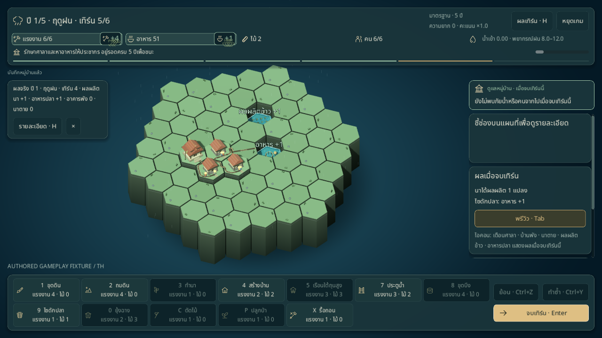
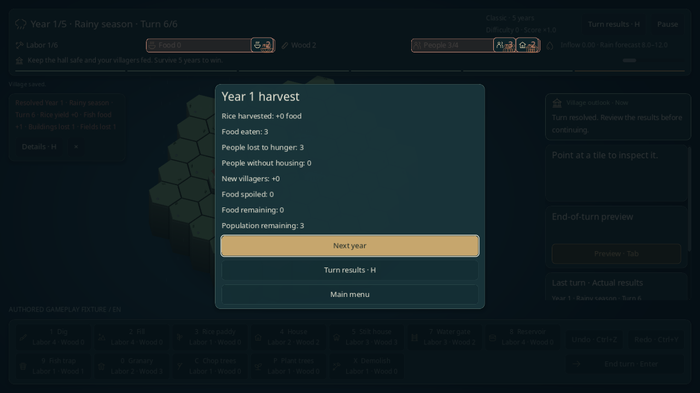
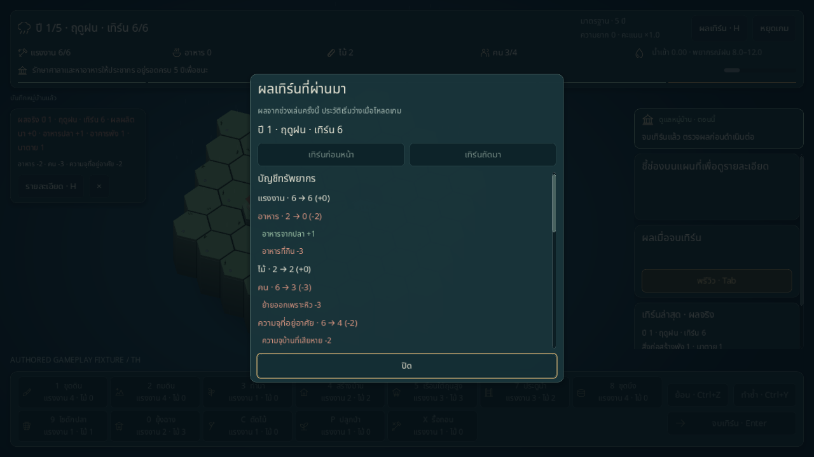
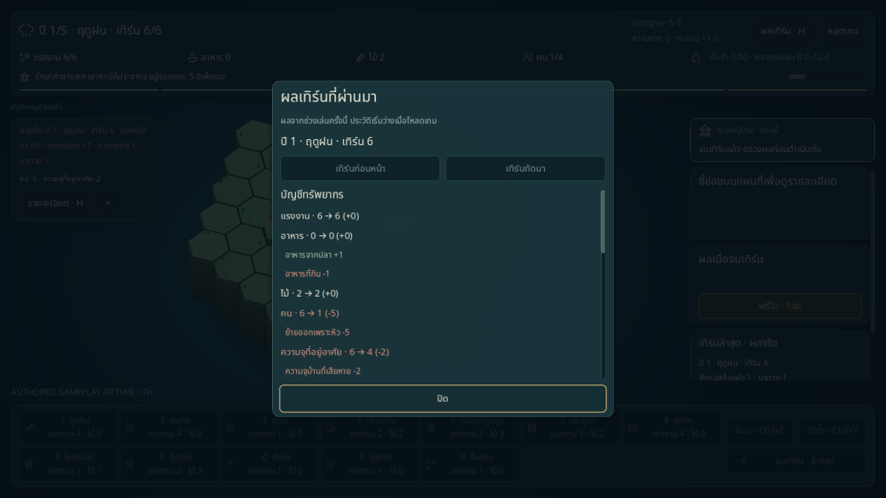
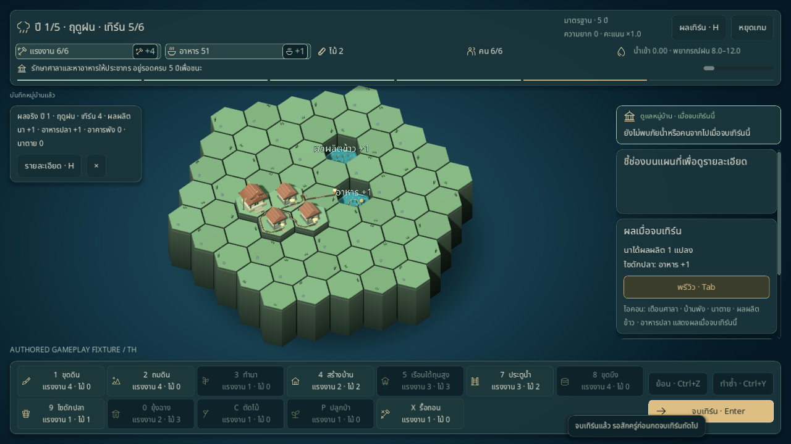
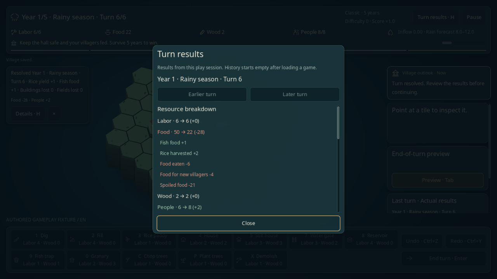

# เอฟเฟกต์และบัญชีทรัพยากรเมื่อจบเทิร์น

อัปเดต 2026-11-02 ใช้กับเกมหลักและโรงเรียนสายน้ำ ตัวนับทรัพยากรแสดงยอดจริงทันทีหลังจบเทิร์น พร้อมป้าย `+/-` และไอคอนเคลื่อนเข้า/ออกบริเวณทรัพยากรที่เปลี่ยน

## สิ่งที่เห็นเมื่อกดจบเทิร์น

- ยอดเพิ่มแสดงป้ายสีเขียว ยอดลดแสดงสีส้มแดง มีเครื่องหมายบวก/ลบประกอบสี
- ไอคอนเล็กเคลื่อนเข้าเมื่อเพิ่มและเคลื่อนออกเมื่อลด พร้อมกรอบเน้นและป้ายลอยเล็กน้อย ป้ายอยู่ประมาณ **2.4 วินาที**; อนุภาคอยู่ช่วง **0.65 วินาทีแรก**
- รองรับแรงงาน อาหาร ไม้ ประชากร และความจุที่อยู่อาศัย แสดงเฉพาะยอดที่เปลี่ยน ไม่มีป้าย `+0`
- ประชากรใช้ไอคอนคน ส่วนความจุบ้านใช้ไอคอนบ้าน จึงแยกจำนวนคนออกจากจำนวนที่อยู่อาศัยที่เสียไปได้

เอฟเฟกต์อยู่ข้างตัวนับใน HUD และยังเห็นเหนือหน้าสรุปเก็บเกี่ยว/จบรอบ/ผลโรงเรียน ไม่บังตัวเลขจริงหรือขวางเมาส์และคีย์บอร์ด เมื่อเริ่มปีใหม่จะเทียบยอดก่อน/หลังการขึ้นปีอีกครั้ง



## อ่านตัวเลขให้ตรงกับกฎเกม

ป้ายใช้ **ผลต่างสุทธิของยอดจริงก่อนกดและหลังดำเนินการ** เช่น:

| เหตุการณ์ | ป้ายที่แสดง |
|---|---|
| เหลือแรงงาน 2 แล้วพร้อมใช้เทิร์นใหม่ 6 | แรงงาน `+4` |
| มีอาหาร 2 ได้ปลา 1 กิน 3 แล้วเหลือ 0 | อาหาร `-2` |
| บ้านพังจนความจุ 6 → 4 แต่คนย้ายเพราะหิว 6 → 3 | บ้าน `-2` และคน `-3` แยกกัน |

ผลผลิตนา `+1` ยังรอเป็นอาหารตอนเก็บเกี่ยว จึงไม่ทำให้ HUD อาหารขึ้น `+1` โดยอัตโนมัติ รายงานผลเทิร์นและสรุปปีแสดงรายละเอียดการผลิต/กิน/ย้ายออกตามเดิม ไม้จะแสดงเอฟเฟกต์เมื่อยอดไม้เปลี่ยนจริงตามกฎที่ใช้



เอฟเฟกต์เกิดหลัง commit จริงเท่านั้น การยกเลิกคำเตือนจบเทิร์น เปิดประวัติ โหลด หรือรีเฟรชหน้าจอไม่สร้างเอฟเฟกต์ย้อนหลัง กดจบเทิร์นซ้ำในช่วงป้องกัน input ไม่สร้างผลหรือเอฟเฟกต์เพิ่ม การใช้คำสั่ง/Undo/Redo และการเปิด Pause/ประวัติจะล้างภาพทรัพยากรเก่าที่กำลังแสดง

## ดูบัญชีทรัพยากรของแต่ละเทิร์น

กด **รายละเอียด · H** หลังจบเทิร์น หรือเปิดประวัติด้วย H บัญชีอยู่ต้นรายการของเทิร์นที่เลือก แสดงทรัพยากรทั้งห้าแบบ **ก่อน → หลัง (สุทธิ)** และแยกสาเหตุด้วยเครื่องหมาย/สี:

- อาหารจากปลาและข้าวที่เก็บเกี่ยว อาหารที่กิน อาหารของคนเกิดใหม่ และอาหารเน่าเสีย
- คนย้ายเพราะหิว คนย้ายเพราะบ้านไม่พอ และคนเกิดใหม่
- ความจุบ้านที่เสียหาย และการปรับแรงงานสำหรับเทิร์นถัดไป

แม้ยอดอาหารสุทธิเป็นศูนย์ บัญชียังแสดงส่วนที่เพิ่มและส่วนที่ใช้ไป เช่น ปลา `+1` และกิน `-1` ส่วนป้ายเอฟเฟกต์ HUD ยังแสดงเฉพาะยอดที่เปลี่ยน ผลสรุปข้างกระดานเพิ่มยอดสุทธิให้อ่านได้หลังภาพเอฟเฟกต์หมดอายุ

แต่ละรายการเก็บตัวเลขตอนจบเทิร์นจริง อ่านเทิร์นเก่าหลังใช้ไม้สร้างบ้านหรือขึ้นปีแล้วก็ยังได้ยอดของเทิร์นเดิม พร้อมปี/ฤดู/เทิร์นกำกับ บัญชีเริ่มจากยอดก่อนจบเทิร์น ซึ่งรวมคำสั่งที่ทำในช่วงวางแผนไปแล้ว

บัญชีอยู่ใน session คู่กับประวัติผลเทิร์น เปิดอ่าน/เลื่อน/กลับสรุปไม่เปลี่ยน state/RNG, Undo/Redo หรือ checkpoint โหลดเกมเริ่มประวัติใหม่ และ Retry โรงเรียนล้างบัญชีของครั้งก่อน หากรายงานไม่มีบัญชีจะบอกว่าไม่มีข้อมูล โดยไม่สร้างยอดย้อนหลังจากกระดานปัจจุบัน





## ลดการเคลื่อนไหว

เปิด **Pause → ลดการเคลื่อนไหว / Reduce motion** แล้วป้ายยังแสดงสีและตัวเลขตามเดิม แต่หยุดอนุภาค การลอย การขยาย และการกระพริบ ใช้ป้ายคงที่จนหมดอายุ การเริ่มบทเรียนใหม่ล้างเอฟเฟกต์ของครั้งก่อน



## จุดเข้าโค้ดและตรวจซ้ำ

[ResourceFeedback](../../ui/resource_feedback.gd) อ่าน snapshot ตัวเลขก่อน/หลังและวาด Control แยกจากข้อมูลเกม กำหนดไม่รับ mouse/focus ไม่ใช้ gameplay RNG มีเพดาน 5 ป้าย/15 อนุภาค และล้างโหนดเมื่อหมดอายุหรือเปลี่ยนหน้า

[GameScreen](../../ui/game_screen.gd) ส่งผลหลัง `GameSession.advance_turn()` / `continue_year()` และหลังวาดสรุปเสร็จแล้ว [RiverSchoolScreen](../../ui/river_school_screen.gd) ใช้หลัง `lesson.advance_turn()` เช่นเดียวกัน จึงแสดงได้เหนือหน้าผลของบทเรียน งานนี้ไม่เปลี่ยนกฎน้ำ ต้นทุน balance หรือรุ่นเซฟ

[ResourceLedger](../../core/resource_ledger.gd) เก็บก่อน/หลังและสาเหตุจากรายงานจริงใน `GameSession.turn_history()` ภายนอก GameState/เซฟ [ResourceLedgerPanel](../../ui/resource_ledger_panel.gd) อ่านเฉพาะรายการที่เลือก เพื่อให้ประวัติเก่าคงค่าเดิม ทุกทรัพยากรต้องได้ `ก่อน + ผลรวมสาเหตุ = หลัง`; ถ้ามีกฎอื่นที่ยังแยกสาเหตุไม่ได้ จะแสดงผลต่างที่บันทึกได้เป็นรายการอื่นอย่างชัดเจน

```sh
scripts/test.sh --filter=resource_feedback
scripts/test.sh --filter=resource_ledger
scripts/test.sh
python3 scripts/check_docs.py
git diff --check
```

[เทสต์เอฟเฟกต์](../../tests/test_resource_feedback.gd) ตรวจเครื่องหมาย/สี ป้ายที่ยอดคงเดิม เพดาน/การหมดอายุและการล้าง การวางตาม HUD การลดการเคลื่อนไหว ผลจริง/เก็บเกี่ยว/เกิด/คนย้ายออก การใช้ครั้งเดียว การรักษา state/RNG/Undo/Redo/ประวัติ/checkpoint การโหลด ขึ้นปี และ Retry โรงเรียน

[เทสต์บัญชี](../../tests/test_resource_ledger.gd) ตรวจสมการก่อน/สาเหตุ/หลัง แยกผลผลิตนาจากอาหารจริง คนเกิด/ย้ายออก/บ้านเสียหาย ราคาอาหารคนเกิดใหม่และเน่าเสีย ยอดสุทธิศูนย์ รายงานปีเก่าหลังขึ้นปี ข้อมูลสำเนา การใช้คำสั่งต่อแล้วอ่านผลเก่า checkpoint ล้มเหลว/โหลด และโรงเรียน โดยไม่เพิ่มข้อมูลลงเซฟ

[Native probe](../../tools/resource_feedback_probe.gd) ใช้ mouse/keyboard จริงกับ [กระดานเริ่มต้นที่จัดไว้](../../tools/end_turn_fixtures.gd) แยก safe/loss/ยอดคงเดิมและ UI โรงเรียน ใช้เซฟ/ค่าตั้งแยก ไม่ฉีด gameplay state หลังแต่ละกรณีเริ่ม มีการพัก **นาฬิกาภาพของเอฟเฟกต์เท่านั้น** หลังสังเกตการเคลื่อนไหวเพื่อจับภาพ แล้วเปิดให้เดินต่อเพื่อตรวจการหมดอายุจริงและโหมดนิ่ง ผลนี้ไม่ใช่ generated-map playthrough, human playtest, benchmark หรือผลยืนยันสมดุล

รันบนเครื่องที่มี display จาก root เปลี่ยน `th` เป็น `en` ทั้ง path และ flag เพื่อตรวจอีกภาษา:

```sh
XDG_DATA_HOME="$PWD/work/resource-feedback-qa/th/data" XDG_CONFIG_HOME="$PWD/work/resource-feedback-qa/th/config" XDG_CACHE_HOME="$PWD/work/resource-feedback-qa/th/cache" godot --path . --audio-driver Dummy --resolution 1280x720 --script res://tools/resource_feedback_probe.gd -- --out-dir="$PWD/work/resource-feedback-qa/th" --lang=th
```

[Native probe บัญชีทรัพยากร](../../tools/resource_ledger_probe.gd) ตรวจการเปิดด้วยคีย์บอร์ดและอ่านบัญชีจาก mouse/keyboard จริง รวมใช้เครื่องมือสร้างบ้านหลังจบเทิร์นแล้วกลับดูยอดเก่า กระดานเก็บเกี่ยวที่มีคนเกิดติดตั้งตัวปรับราคาอาหารก่อนเริ่มกรณี ไม่มีการฉีด gameplay state ระหว่างกรณีหรือพักนาฬิกาเพื่อจับภาพ จัด focus และเลื่อนหนึ่งครั้งเพื่อเข้าถึง UI ใช้กระดานที่จัดไว้และ XDG/เซฟแยกเช่นเดียวกัน:

```sh
XDG_DATA_HOME="$PWD/work/resource-ledger-qa/th/data" XDG_CONFIG_HOME="$PWD/work/resource-ledger-qa/th/config" XDG_CACHE_HOME="$PWD/work/resource-ledger-qa/th/cache" godot --path . --audio-driver Dummy --resolution 1280x720 --script res://tools/resource_ledger_probe.gd -- --out-dir="$PWD/work/resource-ledger-qa/th" --lang=th
```

## ผลตรวจ 2026-11-02

ผลตรวจเมื่อเพิ่มบัญชีทรัพยากร: Godot **4.6.3 ผ่าน 558/558 tests** รวมบัญชีใหม่ **14/14 tests**; native X11/Mesa llvmpipe **1280×720 ผ่าน 75/75 ทั้งไทยและอังกฤษ** ดู [รายงานไทย](../reports/resource-ledger-qa-th.json) / [อังกฤษ](../reports/resource-ledger-qa-en.json)

Native ตรวจยอดก่อน/หลังตรงกับ commit จริงและสมการครบห้าทรัพยากร ผลสรุปสุทธิไม่ล้นกรอบ กดรัวได้บัญชีเดียว ยอดเก่าคงเดิมหลังใช้ไม้สร้างบ้านหรือขึ้นปี ไม่มี harvest ปีก่อนปน การกลับสรุปไม่ resolve ซ้ำ โหลดไม่สร้างบัญชีย้อนหลัง และ Retry ล้างประวัติโดยรักษาเซฟปกติ ภาพจับตรงจาก viewport พร้อมป้าย authored gameplay fixture ผลนี้ไม่ใช่ generated-map playthrough, human playtest หรือผลยืนยันสมดุล/ประสิทธิภาพ



ผลตรวจเมื่อเพิ่มเอฟเฟกต์ HUD: Godot **4.6.3 ผ่าน 544/544 tests** รวมเอฟเฟกต์ใหม่ **15/15 tests**; native X11/Mesa llvmpipe **1280×720 ผ่าน 72/72 ทั้งไทยและอังกฤษ** ดู [รายงานไทย](../reports/resource-feedback-qa-th.json) / [อังกฤษ](../reports/resource-feedback-qa-en.json)

Native ตรวจป้ายตรงค่าจริง/ไม่บังตัวเลขและไม่หลุดหน้าต่าง การกดรัวหนึ่ง commit/หนึ่ง event การเห็นเหนือสรุปเก็บเกี่ยว แยกคนกับความจุบ้าน การคลิกผ่าน overlay การหมดอายุจริง คง state/RNG/ประวัติ/checkpoint การไม่ replay เมื่อโหลด/กลับสรุป การขึ้นปีครั้งเดียว โหมดนิ่งผ่าน checkbox จริง และ Retry โรงเรียน ภาพจับตรงจาก viewport พร้อมป้าย authored gameplay fixture และพักเฉพาะนาฬิกาภาพตามที่อธิบายข้างต้น
