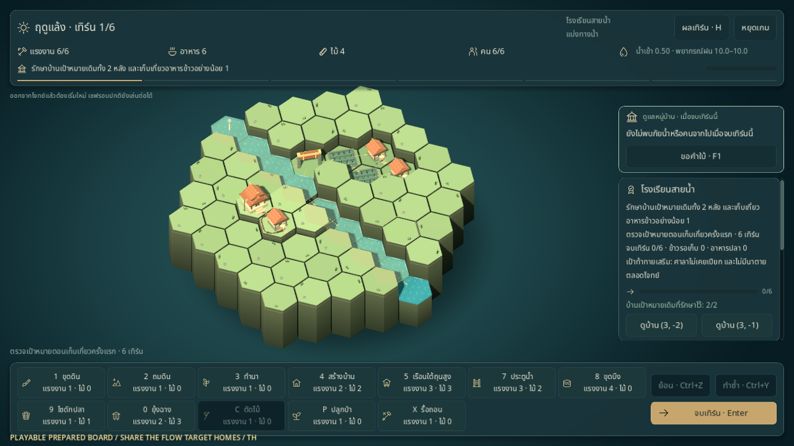
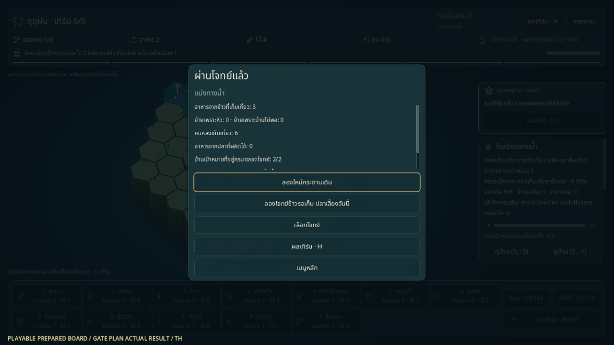
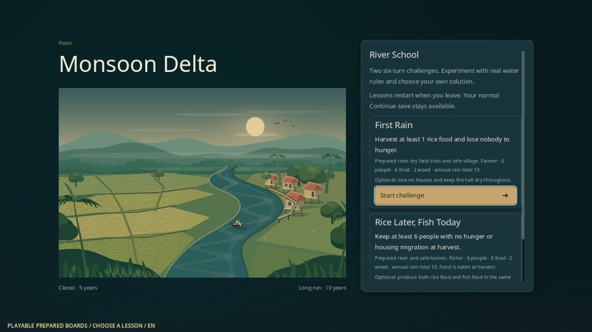
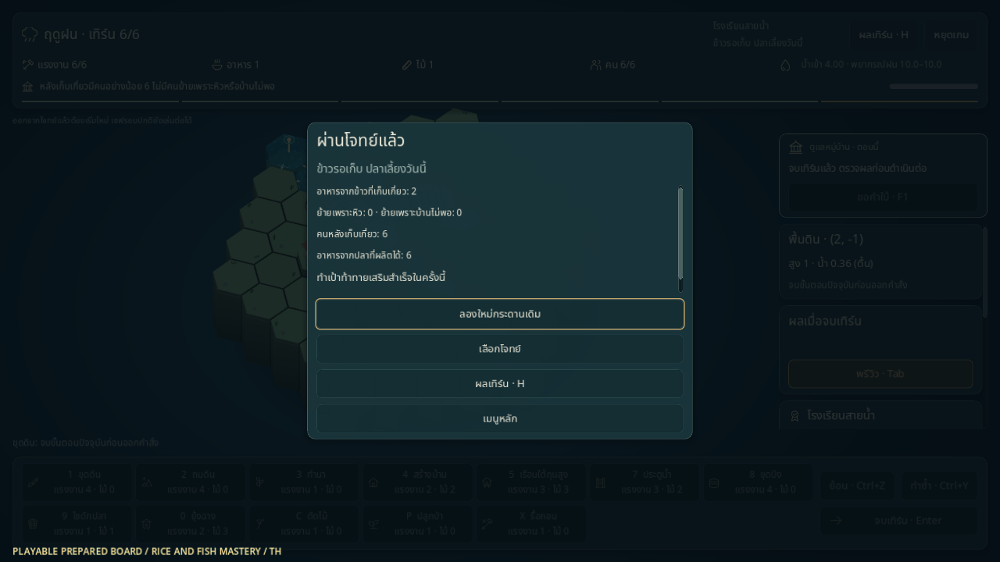

# โรงเรียนสายน้ำ

โหมดโจทย์สั้นให้ลองอ่านน้ำและเลือกวิธีเลี้ยงหมู่บ้าน จบใน **1 ปี / 6 เทิร์น** มีเป้าหมายที่ตรวจจากผลจริง คำใบ้ที่เลือกเปิดเอง และปุ่มเริ่มใหม่กระดานเดิม ขณะนี้เล่นได้ 3 โจทย์ คือบท 01–03 ของแบบเดิม; บท 04–06 ยังไม่เปิดใช้

## เข้าเล่น

เลือก **โรงเรียนสายน้ำ** จากเมนูหลัก แล้วเลือกโจทย์ หรือใช้คำสั่งจาก root:

```sh
godot --path . -- --scene=school --lang=th
godot --path . -- --scene=school --lesson=river_school_01 --lang=th
godot --path . -- --scene=school --lesson=river_school_02 --lang=th
godot --path . -- --scene=school --lesson=river_school_03 --lang=en
```

หน้าเลือกโจทย์แจ้งว่าเป็น **กระดานฝึกจัดไว้** พร้อมผู้นำ ทรัพยากร และเป้าหมาย ก่อนเริ่มแต่ละครั้ง ทั้งสามโจทย์ใช้ที่ราบ 61 ช่อง ความยาก 0 และกฎ `legacy` โดยคงต้นทุนคำสั่ง กฎน้ำ ความเสียหาย และเก็บเกี่ยวเดิม เครื่องมือใช้ได้ตามเงื่อนไขของกฎเดิม

| โจทย์ | เริ่มต้น | ต้องผ่านเมื่อเก็บเกี่ยวปี 1 | เป้าท้าทายเสริม |
|---|---|---|---|
| **ฝนแรก** `river_school_01` | ชาวนา; คน 6 อาหาร 6 ไม้ 2 | ได้อาหารข้าวอย่างน้อย 1 และไม่มีคนย้ายเพราะหิว | บ้านไม่ถูกน้ำทำลาย และศาลาไม่เคยเปียกตลอดโจทย์ |
| **แบ่งทางน้ำ** `river_school_02` | หมอดิน; คน 6 อาหาร 6 ไม้ 4 (เพิ่มจากปกติ 2) | บ้านเป้าหมายเดิม `(3, -2)` และ `(3, -1)` อยู่ครบตลอดโจทย์ และได้อาหารข้าวอย่างน้อย 1 | ศาลาไม่เคยเปียก และไม่มีนาตายตลอดโจทย์ |
| **ข้าวรอเก็บ ปลาเลี้ยงวันนี้** `river_school_03` | ชาวประมง; คน 6 อาหาร 0 ไม้ 2 | ไม่มีคนย้ายเพราะหิวหรือบ้านไม่พอ และคนหลังเก็บเกี่ยวอย่างน้อย 6 | ผลิตอาหารทั้งจากข้าวและปลาในครั้งนั้น |

ทุกกระดานมีศาลาและบ้าน 3 หลังที่จัดไว้ บท 01/03 ไม่มีนาหรือไซตั้งต้น ส่วนบท 02 มีนา 2 แปลงที่ `(2, -2)` / `(2, -1)` และประตูเปิดที่ `(1, -2)` บ้านเป้าหมาย 2 หลังอยู่บนที่ต่ำ อีกหลังอยู่บนที่ดอน ทุกบทไม่มีไซตั้งต้น มีแม่น้ำและพื้นที่ให้จัดทางรับน้ำ ฝนรวมทั้งปีจัดไว้ **10 หน่วย** และใช้ชุดเดิมเมื่อเริ่มใหม่; พรีวิวเปิดเผยตามเทิร์นที่กำลังเล่น ไม่สุ่มฝนใหม่จากการเปิดหน้าต่างหรือ Undo

## เล่น ลอง และอ่านผล

ใช้เครื่องมือ พรีวิว Undo/Redo และกล้องเหมือนรอบปกติ แถบด้านบนระบุเป้าหมายของโจทย์ แผงโรงเรียนแสดงจำนวนเทิร์นที่จบจริง ข้าวที่สะสมพร้อมเก็บเกี่ยว และอาหารปลาที่ผลิตแล้ว ตัวเลขเหล่านี้แยกจากพรีวิวเทิร์นที่ยังไม่จบ

ใช้ [หน้าตรวจแผน ผลจริง และการกันกดจบเทิร์นซ้ำ](END_TURN.md) ชุดเดียวกับเกมหลัก เมื่อเริ่มบทใหม่แผงผลและช่วงพักรับ input ของครั้งก่อนจะถูกล้าง จึงเริ่มวางแผนได้ทันที

ใช้ [หน้าพัฒนาพื้นที่แต่ละช่อง](AREA_DEVELOPMENT.md) ทดลองคำสั่งตามกฎเดียวกับแถบเครื่องมือได้ ผลพรีวิวเป็นเรื่องน้ำ/ทรัพยากร ส่วนเงื่อนไขผ่านบทอยู่ในแผงโรงเรียน การรื้อบ้านเป้าหมายยังเก็บประวัติของบทเรียนคู่กับ Undo/Redo ตามเดิม ยกเลิกออกจากบทคืนแผนเดิม และ Retry ล้างการเลือกพื้นที่

ปุ่ม **คำใบ้ / F1** เปิดคำใบ้ได้ 3 ระดับ: ชวนดูข้อมูล → อธิบายกฎที่เกี่ยวข้อง → แสดงแผนตัวอย่างที่มีรายการคำสั่ง ผู้เล่นยังลงมือเองและเลือกวิธีอื่นได้ การขอคำใบ้หรือใช้ Undo ไม่ลดคะแนน ไม่ตัดสิทธิ์เป้าท้าทาย และไม่หักทรัพยากร

เมื่อเก็บเกี่ยวครั้งแรก หน้าผลแสดงว่าผ่านหรือยังไม่ผ่าน เหตุที่ไม่ผ่าน อาหารข้าว/ปลา การย้ายคน และประชากรจริง เป้าท้าทายเสริมตรวจเมื่อผ่านโจทย์แล้วเท่านั้น การแพ้เพราะศาลาหรือประชากรยังเป็นการแพ้ตามกฎจริงและจบโจทย์ทันที

**เริ่มใหม่** คืนกระดาน ทรัพยากร ฝน และ RNG ตั้งต้นชุดเดียวกัน ไม่เพิ่ม seed และไม่เก็บผลผลิตจากครั้งก่อน การกดจบเทิร์นเฉย ๆ ไม่ผ่านทั้งสามโจทย์: ฝนแรกไม่มีนาที่ผลิตข้าว แบ่งทางน้ำปล่อยให้บ้านเป้าหมายถูกน้ำทำลาย ส่วนโจทย์คลังว่างต้องหาอาหารก่อนเก็บเกี่ยว

## บท 02: แบ่งทางน้ำ

แผงโรงเรียนอยู่ต้นรายการด้านข้าง แสดงบ้านเป้าหมายเดิมที่ยังรักษาไว้จากทั้งหมด 2 หลัง พร้อมปุ่ม **ดูบ้าน** ตามพิกัด ปุ่มนี้เลื่อนกล้องและเลือกช่องเพื่ออ่านข้อมูล โดยไม่ใช้คำสั่งหรือจบเทิร์น การรื้อบ้านแล้วสร้างคืนยังเสียเงื่อนไขรักษาบ้าน แต่ Undo กลับก่อนรื้อแล้วจบเทิร์นได้ตามปกติ; Redo คืนเครื่องหมายการรื้อด้วย หน้าผลระบุจำนวนบ้านที่รักษาได้และพิกัดที่สูญเสียจริง

มี replay ที่ผ่านพร้อมเป้าท้าทายทั้งสองแนว โดยไม่แก้ balance หรือเพิ่มทรัพยากรระหว่างเล่น:

- **เก็บน้ำแล้วปิดประตู:** เทิร์น 1 ขุดนา `(2, -2)` หนึ่งครั้ง ใช้แรงงาน 1 รับฝนแรกในเทิร์น 4 แล้วปิดประตู `(1, -2)` ก่อนจบเทิร์น 5 โดยไม่เลือกเครื่องมือ ใช้ไม้ 0 ได้อาหารข้าว 3 บ้านเป้าหมายทั้งสองอยู่ครบ
- **เปิดประตูพร้อมระบาย:** เทิร์น 1 ขุด `(1, -1)` สองครั้ง และ `(1, 0)` สามครั้ง รวมแรงงาน 5 เปิดประตูไว้ตลอด ได้อาหารข้าว 1 บ้านเป้าหมายทั้งสองอยู่ครบ

การปิดประตูอย่างเดียวโดยไม่จัดน้ำให้ข้าวไม่ผ่าน เพราะไม่มีผลผลิต การเปิด/ปิดซ้ำไม่เพิ่มความสำเร็จ ประตูปิดกั้นน้ำทุกด้านของช่องประตู แต่น้ำยังอ้อมผ่านพื้นที่อื่นได้ ต้องอ่านพรีวิวแต่ละเทิร์น

เมื่อผ่านแล้ว ปุ่มบทถัดไปพาไปตามลำดับ **01 → 02 → 03** ยังเลือกบทใดก็ได้จากเมนู ไม่มีการปลดล็อก

## ความคืบหน้าและ Continue

โรงเรียนเล่นในหน่วยความจำ **ออกจากโจทย์แล้วต้องเริ่มโจทย์นั้นใหม่** มีข้อความก่อนเข้าและคำยืนยันเมื่อออกกลางโจทย์ ไม่มี Continue บทเรียนหรือสมุดตราถาวร ตราชำนาญบนหน้าผลเป็นผลของครั้งที่กำลังเล่น ไม่เพิ่มอาหาร ไม้ คะแนน หรือสิทธิ์ในรอบปกติ

ยกเลิกการออกด้วย Esc หรือปุ่มเล่นต่อแล้วกลับหน้าต่างเดิมพร้อมโฟกัสเดิม หากกำลังอ่านประวัติจะเก็บเทิร์นและตำแหน่งเลื่อนที่เลือกไว้; หากกำลังยืนยันจบเทิร์นจะเก็บคำเตือนและช่อง “ไม่ถามซ้ำ” ที่ยังไม่ได้ยืนยัน การยกเลิกออกไม่จบเทิร์นและไม่บันทึกค่าช่องนั้น

ไฟล์ Continue ของรอบปกติใช้ตามเดิม โรงเรียนตั้ง `is_tutorial` และไม่เขียน checkpoint แม้จบโจทย์หรือแพ้ ส่วนภาษาและ Reduce motion ยังคงเป็นค่าตั้งการแสดงผลแยกจากรอบเล่น

## ทำซ้ำและตรวจ

กระดาน [RiverSchoolFixtures](../../core/river_school_fixtures.gd) ระบุ revision, hash ของ balance, state/RNG ตั้งต้น พิกัด และคำสั่ง replay ผ่าน `manifest()` / `solutions()` การรื้อที่รอจบเทิร์นและ snapshot คู่ Undo/Redo อยู่ใน [RiverSchoolSession](../../core/river_school_session.gd) แยกจาก state/เซฟปกติ การดำเนินโจทย์อยู่ใน [RiverSchoolRun](../../core/river_school_run.gd) และหน้าจอที่ [RiverSchoolScreen](../../ui/river_school_screen.gd) ใช้ resolver และคำสั่งชุดเดียวกับเกมปกติ ไม่แก้ state ระหว่าง replay เพื่อทำให้ผ่าน

```sh
scripts/test.sh --filter=river_school
scripts/test.sh
python3 scripts/test_school_cli.py
python3 scripts/test_boot_cli.py
python3 scripts/check_docs.py
git diff --check
```

## ภาพและหลักฐาน

งานบท 02 วันที่ 2026-11-01: Godot **4.6.3 ผ่าน 458/458 tests** รวมโรงเรียน **47/47**, school CLI **5/5** และ boot CLI **15/15** ตรวจทางแก้ทั้งสองแนว พรีวิวตรงผลจริง รื้อแล้วสร้างคืน/Undo/Redo รวมขอบเขตประวัติ 200 คำสั่ง ตราชำนาญแยกจากผ่านบท และ Continue ของรอบปกติคงเดิม ตรวจ native เมาส์/คีย์บอร์ด **263/263 ทั้งไทยและอังกฤษ** ที่ 1280×720 ด้วย probe ด้านล่าง ดู [รายงานไทย](../reports/share-flow-qa-th.json) / [อังกฤษ](../reports/share-flow-qa-en.json) และ [ภาพผลภาษาอังกฤษ](../images/school-share-success-en.png) ภาพบท 02 ด้านล่างมาจากกระดานฝึกที่เปิดเล่นได้และ replay คำสั่งจริง ไม่ใช่ผลทดสอบกับผู้เล่น





ตรวจเฉพาะการคืนหน้าต่างหลังยกเลิกออก 2026-10-24 ผ่าน native **64/64 ทั้งไทยและอังกฤษ** ที่ 1280×720 รวมประวัติ/โฟกัส/เลื่อนคำใบ้ ช่องไม่ถามซ้ำ การกด Enter และการรักษาเซฟปกติ ดู [รายงานไทย](../reports/ui-context-school-qa-th.json) / [อังกฤษ](../reports/ui-context-school-qa-en.json) ทำซ้ำด้วยคำสั่ง probe ด้านล่างโดยเพิ่ม `--modal-only` หลัง `--lang`; คำเตือนแพ้ในชุดนี้เป็น UI fixture ที่กำหนดเฉพาะค่าพรีวิวในหน้าจอ ไม่แก้ state/RNG/ผลบท

Godot 4.6.3 ชุดเต็มผ่าน **439/439** รวมโรงเรียนใหม่ 31 รายการ, boot CLI **15/15**, school CLI **5/5** และ native **119/119 ทั้งไทยและอังกฤษ** ที่ 1280×720 ดู [รายงานไทย](../reports/river-school-qa-th.json) และ [รายงานอังกฤษ](../reports/river-school-qa-en.json)

ภาพต่อไปนี้จับตรงจาก viewport ของกระดานฝึกที่ผู้เล่นเข้าเล่นได้ ใช้คำสั่งจริงตาม replay โดยไม่แก้ state ระหว่างเล่น กระดานนี้จัดไว้สำหรับโจทย์ จึงไม่ใช่ผลจาก generator ของรอบปกติ





ตรวจ native ซ้ำบนเครื่องที่มี display ได้ด้วยคำสั่งต่อไปนี้ เปลี่ยน `th` เป็น `en` เพื่อแยกหลักฐานอีกภาษา ตัว probe ใช้เซฟและค่าตั้งเฉพาะใน work:

```sh
XDG_DATA_HOME="$PWD/work/river-school-qa/th/data" XDG_CONFIG_HOME="$PWD/work/river-school-qa/th/config" XDG_CACHE_HOME="$PWD/work/river-school-qa/th/cache" godot --path . --audio-driver Dummy --resolution 1280x720 --script res://tools/river_school_probe.gd -- --out-dir="$PWD/work/river-school-qa/th" --lang=th
```

ดูผลตรวจล่าสุดใน [STATUS](../STATUS.md) เทสต์และภาพจากกระดานฝึกยืนยันการทำงานเฉพาะกรณี ไม่ยืนยันว่าผู้เล่นสนุกขึ้นหรือปิดเกณฑ์สมดุล อ่านเหตุผลการออกแบบและวิธีทดลองกับคนใน [เพิ่มความสนุกด้วยเป้าหมาย ทางเลือก และผลตอบรับ](../design/FUN_DESIGN.md)
