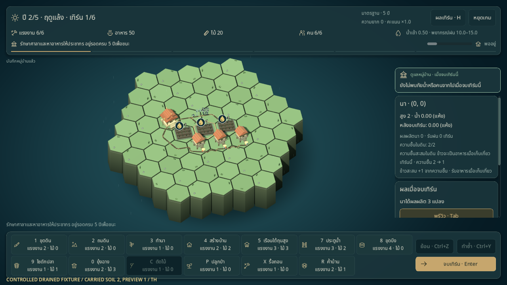
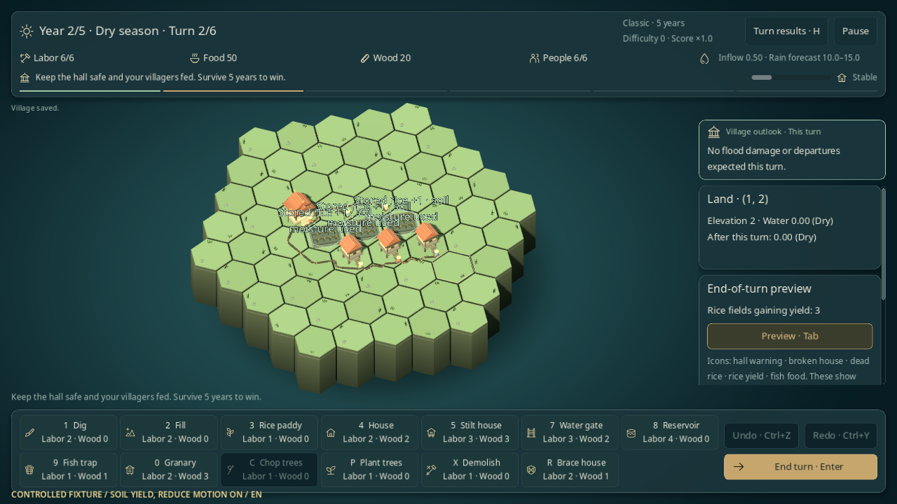

# ความชื้นสะสมในนา

นาที่รอดฝนในระดับเหมาะสมเก็บความชื้นไว้ช่วยเพาะปลูกช่วงแล้งปีหน้าได้ ความชื้นเป็นความพร้อมของดิน ไม่ใช่น้ำอีกถัง และข้าวที่ผลิตได้ยังสะสมในนาจนถึงเก็บเกี่ยว

## เปิดใช้สำหรับรอบใหม่

หน้าเกมใหม่มีตัวเลือก **ความชื้นสะสมในนา (ทดลอง)** แยกจาก **ค้ำบ้านฉุกเฉิน** เปิดเดี่ยวหรือร่วมกันได้ ค่าเริ่มต้นปิดทั้งสองอย่าง เลือกได้ทั้งรอบ 5/10 ปี ผู้นำและความยากเดิม

| ความชื้น | ค้ำบ้าน | กติกา | เซฟ |
|---|---|---|---|
| ปิด | ปิด | `legacy` | v1/v2 หรือ v3 เมื่อมีประวัติภาพ |
| ปิด | เปิด | `bracing_v1` | v4 |
| เปิด | ปิด | `moisture_v1` | v5 |
| เปิด | เปิด | `bracing_moisture_v1` | v5 |

```sh
# ทดลองความชื้นอย่างเดียวบนเซฟแยก
godot --path . -- --scene=game --ruleset=moisture_v1 --seed=42 --lang=th --save-path=user://dev-moisture.json
# ใช้ร่วมกับค้ำบ้าน
godot --path . -- --scene=game --ruleset=bracing_moisture_v1 --seed=42 --lang=th --save-path=user://dev-seasonal.json
```

Continue ใช้กติกาของรอบที่บันทึก ไม่ใช้ค่าตั้งหน้าเกมใหม่ การเล่นอีกครั้งรักษาตัวเลือกเดิม ไม่มีคำสั่งหรือปุ่มลัดใหม่สำหรับความชื้น; ผู้เล่นจัดน้ำและดูพรีวิวตามเดิม ดู [ค้ำบ้านฉุกเฉิน](HOUSE_BRACING.md) สำหรับเครื่องมือ R เมื่อเปิดใช้ร่วมกัน

## กฎที่ใช้งาน

แต่ละแปลงมี `soil_moisture` 0–2 ใช้ระดับน้ำหลังจำลอง ซับ และระเหยชุดเดียวกับผลผลิตเดิม ตรวจความเสียหายก่อนผลผลิตเสมอ

| สถานการณ์ของนาที่ยังมีชีวิต | ข้าวสะสมเพิ่ม | ความชื้นหลังเทิร์น |
|---|---|---|
| ฝน ระดับน้ำเหมาะกับการผลิต (ค่าเริ่มต้นระดับ 1) | 1 พร้อมเพิ่มจำนวนเทิร์นฝนที่นาได้ผล | 2 |
| ฝน ระดับน้ำไม่เหมาะและนายังไม่ตาย | 0 | ลด 1 ต่ำสุด 0 |
| แล้ง มีบึงที่เลี้ยงนาได้ตามกฎเดิม | 1 ใช้น้ำบึงตามเดิม | ลด 1 ต่ำสุด 0 |
| แล้ง ไม่มีบึงที่ใช้ได้ และมีความชื้น | 1 จากความชื้น ไม่เพิ่มจำนวนเทิร์นฝน | ลด 1 |
| แล้ง ไม่มีบึงที่ใช้ได้ และความชื้นเป็น 0 | 0 | 0 |

หนึ่งแปลงผลิตไม่เกิน 1 ต่อเทิร์น บึงมีลำดับก่อนความชื้นแต่ความชื้นยังลดทุกเทิร์นแล้ง จึงไม่เก็บความชื้นค้างได้ด้วยการเปิดบึง และไม่ผลิตสองครั้งจากสองแหล่ง การเลือกบึงกับลำดับใช้น้ำระหว่างแปลงยังเป็นกฎเดิม

ตัวอย่าง: ฝนเทิร์นสุดท้ายของปี 1 เติมความชื้นเป็น 2 เก็บเกี่ยวแล้วขึ้นปี 2 ผลผลิตสะสมกลับเป็น 0 แต่ความชื้นยัง 2 หากไม่มีบึง แล้งสองเทิร์นแรกได้ข้าวเพิ่มครั้งละ 1 และความชื้นลด 2→1→0 เทิร์นแล้งที่สามไม่ได้เพิ่มจากความชื้น อาหารในคลังไม่เพิ่มจนเก็บเกี่ยว

- เก็บเกี่ยวและขึ้นปีใหม่รักษาความชื้นของนาที่รอดไว้
- นาตายเพราะน้ำหรือรื้อแปลงล้างความชื้นเป็น 0; นาใหม่เริ่มที่ 0 การฟื้นนาต้นปีไม่คืนความชื้นเก่า
- ขุด/ถมบนช่องที่ยังเป็นนารักษาค่าปัจจุบัน ไม่เพิ่มความชื้นหรือข้าวทันที Undo/Redo คืนค่าทั้งหมดตาม snapshot
- ถ้าศาลาแพ้ เทิร์นนั้นข้ามผลผลิตและการอัปเดตความชื้นจากการผลิตตามกฎเดิม แต่นาที่ตายถูกล้างความชื้นในขั้นความเสียหายแล้ว

ความชื้นไม่เพิ่มหรือลด `tile.water` ไม่ส่งน้ำให้ข้างเคียง ไม่เพิ่ม RNG และไม่ช่วยให้นารอดน้ำเกินเกณฑ์

## อ่านผลในฉาก

ดินนาเข้มขึ้นตามความชื้นปัจจุบัน เมื่อเลือกหรือชี้แปลงจะเห็นหยดสองช่องและค่าความชื้น พร้อมค่าคาดการณ์แยกเมื่อเปิดพรีวิว พรีวิวไม่เปลี่ยนสีดินจริงหรือใช้ความชื้นของรอบจริง

Inspector แสดงค่าปัจจุบัน ค่าก่อน→หลังเทิร์น และบอกเมื่อข้าวมาจากความชื้น หลังจบเทิร์นป้าย **ข้าวสะสม +1 · ใช้ความชื้นในดิน** อ่านจากรายงานจริง ไม่เพิ่มอาหารจากแอนิเมชัน ดูค่าความชื้นและแหล่งผลิตย้อนหลังได้ในประวัติผลเทิร์นของ session ปัจจุบัน

Reduce motion รักษาสีดิน สัญลักษณ์ ตัวเลข และข้อมูลสำคัญไว้ Undo/Redo โหลดเกมหรือเปลี่ยน state สร้างภาพจากสถานะล่าสุด ไม่เล่นผลผลิตซ้ำ การเปลี่ยนหยดแบบเคลื่อนไหว 0.3 วินาทีและเสียงในแบบเอฟเฟกต์ยังไม่ได้เปิดใช้

## เซฟและการตรวจ

v5 เก็บความชื้นครบทุกช่องและเก็บค้ำด้วยเฉพาะ `bracing_moisture_v1` ค่าต้องเป็นจำนวนเต็ม 0–2 และเป็น 0 บนช่องที่ไม่ใช่นาหรือนาตาย เซฟ v1–v4 คงกฎ/รูปแบบเดิม ไม่เติมความชื้นให้เมื่อโหลด รายละเอียดอยู่ใน [สัญญาเซฟ](../development/SAVE_IO.md)

```sh
scripts/test.sh --filter=moisture
scripts/test.sh
python3 scripts/test_boot_cli.py
python3 scripts/check_docs.py
```

ตรวจหน้าต่าง native บนเครื่องที่มี display โดยแยกเซฟและค่าตั้งไว้ใน work (เปลี่ยน `th` เป็น `en` เพื่อแยกหลักฐานภาษาอังกฤษ):

```sh
XDG_DATA_HOME="$PWD/work/moisture-qa/th/data" XDG_CONFIG_HOME="$PWD/work/moisture-qa/th/config" XDG_CACHE_HOME="$PWD/work/moisture-qa/th/cache" godot --path . --audio-driver Dummy --resolution 1280x720 --script res://tools/moisture_probe.gd -- --out-dir="$PWD/work/moisture-qa/th" --lang=th
```

ชุดเต็ม Godot 4.6.3 ผ่าน **408/408**, boot CLI **15/15**, native **58/58 ทั้งสองภาษา** ดู [รายงานไทย](../reports/moisture-qa-th.json) และ [รายงานอังกฤษ](../reports/moisture-qa-en.json) ภาพต่อไปนี้จับตรงจาก viewport กระดาน **CONTROLLED FIXTURE** จัดนา/บ้านบนพื้นราบเพื่อทดสอบ และระบายน้ำผิวดินก่อนตรวจแล้ง ไม่ใช่ผลเล่นตามปกติของ seed 42





ผลชุดตรวจล่าสุดอ้างใน [STATUS](../STATUS.md) และ [บันทึกพัฒนา](../history/PROGRESS.md#2026-10-22--ความชื้นสะสมในนาและภาพตามฤดู) ภาพและเทสต์จาก controlled fixtures ตรวจการทำงานของกรณีที่จัดไว้ ไม่ใช่หลักฐานสมดุลหรือการเล่นโดยคน ความชื้น 2 หน่วยอาจเพิ่มข้าวได้มาก จึงยังต้องเก็บ paired replays และทดลองโดยผู้เล่นก่อนยืนยันความสนุกหรือปรับ balance

นี่เป็น M02 ของ [แบบกลไกตามฤดู](../design/SEASONAL_MECHANICS.md) พร้อมส่วนสถานะ/พรีวิวของ [FX04](../design/SCENE_EFFECTS.md#fx04--ดินเก็บฝน--retained-moisture) เศษวัสดุค้างประตูและเอฟเฟกต์ที่เหลือยังเป็นข้อเสนอ
