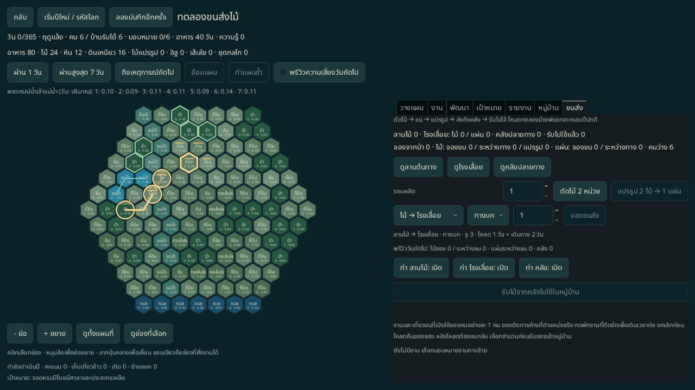
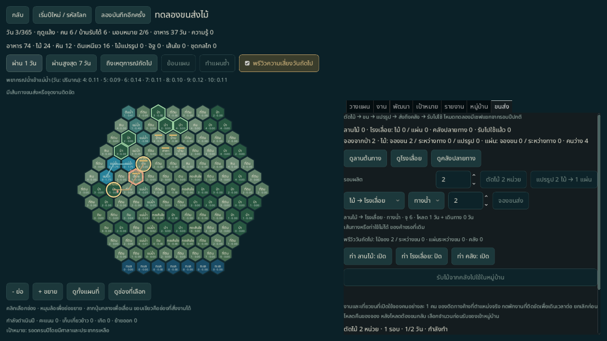
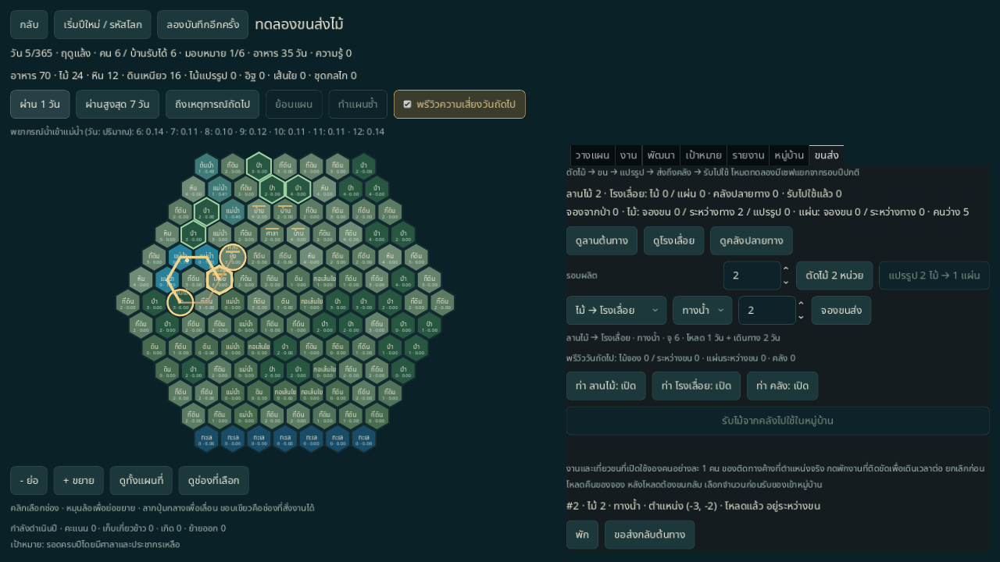

# ทดลองขนส่งไม้ในรอบ 365 วัน

ระยะ 5 ของ [แผนหมู่บ้านลุ่มน้ำ](../design/VILLAGE_WORLD_PLAN.md) เปิดจากเมนู **ทดลองขนส่งไม้ · รอบ 365 วัน** หรือ:

```sh
godot --path . -- --scene=transport --seed=42 --lang=th
```

รอบทดลองแยกบน YearBoard 2D จำนวน 127 ช่อง ใช้น้ำ อากาศ งานหมู่บ้าน ประชากร โครงการและ Challenge ของรอบปีขยาย มีเส้นทางนำร่องที่จัดไว้บนแผนที่จาก seed ไม่แปลงเซฟปีเดิมเป็นรอบขนส่ง ภาพบ้าน/ท่า/เรือ 3D ในเกมหลักยังเป็น [ชั้นฉากเดิม](VILLAGE_WORLD.md) การเชื่อมภาพสองกระดานยังเป็นงานต่อไป



## เล่นวงจรผลิตและขนส่ง

1. เปิดแท็บ **ขนส่ง** กดดูจุดตัดไม้ โรงเลื่อย หรือคลัง เพื่อเลือกช่อง วงกลมระบุสามสถานที่ เส้นสีน้ำตาลคือทางบก สีฟ้าคือคลอง และสีทองคือเส้นทางที่เลือกและยังผ่านได้
2. เลือกจำนวนรอบแล้วกด **ตัดไม้ 2 หน่วย** ใช้คนหนึ่งคน จองไม้จากป่า 2 หน่วยต่อรอบตั้งแต่สั่ง ใช้ 2 วันต่อรอบ ผลผลิตอยู่ที่ต้นทาง ไม่เพิ่มไม้ส่วนกลาง
3. เลือก **ไม้ → โรงเลื่อย** ทางบกหรือเรือ และจำนวนของ กด **จองขนส่ง** หักของจากสต็อกพร้อมใช้ทันที รอหนึ่งวันเพื่อบรรทุกแล้วจึงเดินทาง ใช้คนหนึ่งคนต่อเที่ยว
4. เมื่อไม้ถึงโรงเลื่อย กด **แปรรูป 2 ไม้ → 1 แผ่น** จองไม้ในโรงเลื่อย 2 หน่วยต่อรอบ ใช้คนหนึ่งคนและเวลา 2 วัน ได้ไม้แปรรูปเฉพาะที่โรงเลื่อย
5. เลือก **ไม้แปรรูป → คลัง** และพาหนะเพื่อส่งต่อ เมื่อถึงคลัง เลือกจำนวนแล้วกด **รับไม้จากคลังไปใช้ในหมู่บ้าน** จึงเพิ่มไม้แปรรูปส่วนกลางและสถิติการผลิต ใช้สร้าง/พัฒนางานปีเดิมได้ ไม่เพิ่มซ้ำระหว่างผลิตหรือขน

ต้นทางมีไม้จำกัด **30 หน่วย** ผลิตไม้แปรรูปได้สูงสุด 15 แผ่นจากสายทดลองนี้ งานเก็บไม้/คราฟเดิมในส่วนอื่นยังใช้กฎรอบปี สามช่องนำร่องสงวนงานที่เปลี่ยนบทบาทหรือแย่งวัสดุกับสายทดลอง ซ่อมโรงเลื่อย/คลังผ่านงานปีได้ แต่ต้องยกเลิกงานแปรรูปที่ยังค้างก่อนสั่งซ่อมโรงเลื่อย วัตถุดิบรอบที่ไม่เสร็จคืนเข้าโรงเลื่อยแล้วสั่งผลิตใหม่หลังซ่อมได้

| พาหนะ | ความจุต่อเที่ยว | ความเร็ว | เวลาเริ่มต้น: ต้นทาง→โรงเลื่อย / โรงเลื่อย→คลัง |
|---|---|---|---|
| ทางบก | 3 หน่วย | 1 ช่องต่อวัน | บรรทุก 1 + เดินทาง 2 วัน / 1 + 1 วัน |
| เรือ | 6 หน่วย | 2 ช่องต่อวัน | บรรทุก 1 + เดินทาง 2 วัน / 1 + 1 วัน |

แถวเส้นทางแสดงความจุและเวลาตามสภาพปัจจุบัน ไม่รวมวันที่พักหรือติดขัด พาหนะไม่จำกัดจำนวน เพิ่มเที่ยวได้เมื่อมีคนและของ รวมคิวทดลองได้สูงสุด 16 รายการ ตัดไม้และแปรรูปมีได้ชนิดละหนึ่งงาน ใช้หลายรอบผลิตแทนการสั่งซ้อน

## น้ำ ท่า และการคืนของ

- ทางบกผ่านทางที่กำหนด ช่องกลางต้องมีน้ำต่ำกว่า 0.05 ระดับพื้นช่องติดกันต่างกันไม่เกิน 1 และไม่มีแม่น้ำ/ประตู/บึง/ระหัดขวาง จุดรับส่งต้องมีน้ำต่ำกว่า 0.5 และอาคารยังใช้งานได้
- เรือผ่านคลองที่กำหนด ต้องมีน้ำลึกอย่างน้อย 0.2 ผิวน้ำระหว่างช่องคลองต่างกันไม่เกิน 0.5 ใช้ท่าเปิดที่ปลายทาง ก่อนออกต้องใช้ท่าต้นทางด้วย ไม่ข้ามจากตลิ่งแห้งไปตลิ่งแห้งโดยตรง
- ปุ่มท่า **เปิด/ปิด** เปลี่ยนการใช้งานท่าในต้นแบบ ไม่มีต้นทุนสร้าง/อัปเกรดท่าในระยะนี้ ปิดท่าไม่ปิดทางบก
- น้ำแห้ง น้ำท่วม อาคารเสีย หรือทางขาด ทำให้งานรออยู่ตำแหน่งจริง จุดบรรทุกบนแผนที่เป็นสีแดง ไม่มีของหายหรือส่งถึงปลายทางทันที เมื่อทางผ่านได้และไม่ได้พักงานจะเดินต่อเอง
- **ยกเลิกก่อนบรรทุก** คืนของจองไปต้นทางทันที **ส่งกลับหลังบรรทุก** ต้องเดินทางถึงต้นทางจริงจึงคืนของ ทางกลับขาดก็รออยู่ที่เดิม ถ้าพักอยู่ต้องกดทำต่อด้วย
- ยกเลิกงานผลิตคืนเฉพาะวัตถุดิบของรอบที่ยังไม่เสร็จ เวลาในรอบปัจจุบันไม่ถูกคืน ผลิตเสร็จแล้วยังคงอยู่

ใช้ประชากรร่วมกับงานหมู่บ้าน รวมงานที่ติดขัดแต่ยังไม่พักด้วย พักงานคืนคนโดยเก็บของจองและความคืบหน้า หากประชากรลดจะพักงานทดลองส่วนเกินหลังระบบปีจัดแรงงานเดิม ทำให้เซฟไม่มีแรงงานเกินคน วันที่ติดขัดจะหยุดการข้ามเวลาที่เหตุการณ์นั้น พักงานรอเพื่อข้ามหลายวันได้



## บัญชี พรีวิว และเซฟ

แผงแยกไม้ในป่าที่จอง ของว่างแต่ละสถานที่ ของจองเที่ยวที่ยังไม่บรรทุก ของระหว่างทาง ไม้ที่กำลังแปรรูป และของที่รับเข้าหมู่บ้านแล้ว ตรวจทุกวันด้วยสมการ:

```text
ไม้เริ่มต้น = ไม้ที่เหลือในป่า + ไม้ในป่าที่จอง + ไม้ที่เก็บแล้ว
ไม้ที่เก็บแล้ว = ไม้ว่าง + ไม้จองขน + ไม้ระหว่างทาง + ไม้จองแปรรูป + 2 × แผ่นที่ผลิตแล้ว
แผ่นที่ผลิตแล้ว = แผ่นว่าง + แผ่นจองขน + แผ่นระหว่างทาง + แผ่นที่รับเข้าหมู่บ้านแล้ว
```

แต่ละวันเดินงานผลิต/ขนส่งจากน้ำต้นวันก่อน จากนั้นใช้ YearGame เดิมเดินน้ำ งานปี ประชากร Challenge และคะแนน จึงตรวจทางขาดและจัดแรงงานอีกครั้ง น้ำที่เปลี่ยนระหว่างวันมีผลกับการเดินทางครั้งถัดไป พรีวิวใช้ resolver เดียวกับผลจริงบนสำเนารวม ไม่แก้ RNG หรือเขียนไฟล์ Undo/Redo ย้อนแผนในวันเดียวกันทั้งงานปี ของจอง ท่า และงานขนส่ง ผ่านวันแล้วล้างประวัติแผน

[TransportSession](../../core/transport_session.gd) เป็นเจ้าของ I/O ใช้ **`user://transport365.json`** รูปแบบ `monsoon_transport` version 1 / `transport365_v1` เก็บ envelope ปี v2 ภายในพร้อมสถานะขนส่ง ตรวจ float64 น้ำ RNG คิว สถานที่ และสมการทั้งหมดก่อนโหลด คิวเก็บระยะเวลาผลิต ความจุและความเร็วตอนสั่ง กฎแปรรูป 2 → 1 เป็นส่วนหนึ่งของ ruleset การเปลี่ยนกฎที่เข้ากันไม่ได้ต้องจัด version/ruleset ใหม่

เซฟปกติ ต้นแบบรายวัน และ `year365.json` แยกกันและเป็น path ที่ปฏิเสธการเขียนทับ เปิดเมนูทดลองอีกครั้งเพื่อเล่นต่อ ไฟล์เสีย รูปแบบอื่น และ version/ruleset อนาคตคงเดิมแม้เริ่มใหม่หรือบันทึกซ้ำ บันทึกไฟล์ชั่วคราวก่อน rename หากเขียนไม่ได้ แผนในหน่วยความจำยังอยู่ กด **ลองบันทึกอีกครั้ง** โดยไม่สั่งงานซ้ำ



## ตรวจซ้ำ

```sh
scripts/test.sh --filter=transport
scripts/test.sh
python3 scripts/test_boot_cli.py
python3 scripts/test_school_cli.py
python3 scripts/check_docs.py
```

ครอบคลุมวงจรผลิต/ขน การอนุรักษ์ของ จองเกิน/ความจุ คืนของกลางทาง น้ำขาดทาง พรีวิว เซฟขณะบรรทุก/ขอกลับ แรงงานร่วม ลดประชากร Undo/Redo ไฟล์เสีย/อนาคต และเขียนล้มเหลวแล้วลองใหม่

[Native probe](../../tools/transport_probe.gd) ใช้เมาส์กดเมนูและปุ่มงาน ใส่จำนวน/เลือกตัวเลือกฟอร์มโดยตรง เล่นรอบทดลองใหม่ seed 42 จนรับไม้แปรรูปเข้าหมู่บ้าน ไม่แก้ state/น้ำเป็น fixture ตรวจสองภาษาบนหน้าต่าง 1280×720 ด้วย XDG แยก:

```sh
mkdir -p work/transport-qa/th
XDG_DATA_HOME="$PWD/work/transport-qa/th/data" XDG_CONFIG_HOME="$PWD/work/transport-qa/th/config" XDG_CACHE_HOME="$PWD/work/transport-qa/th/cache" godot --path . --audio-driver Dummy --resolution 1280x720 --script res://tools/transport_probe.gd -- --out-dir="$PWD/work/transport-qa/th" --lang=th
```

เปลี่ยน `th` เป็น `en` เพื่อตรวจอีกภาษา บาง unit tests ใช้ flood/hunger fixtures โดยระบุในโค้ด ผล native เป็นวงจรนำร่อง 13 วัน ไม่ใช่ระบบขนส่งครบปีหรือ human playtest สมดุลระยะยาว ทางเลือกอัปเกรดระยะ 6 และภาพ 3D ของงานปีนี้ยังค้าง

[ผล native ไทย](../reports/transport-qa-th.json) · [อังกฤษ](../reports/transport-qa-en.json) · [รับของสำเร็จภาษาอังกฤษ](../images/transport-complete-en.png) · ผลชุดเต็มตามวันใน [ประวัติ](../history/PROGRESS.md)
