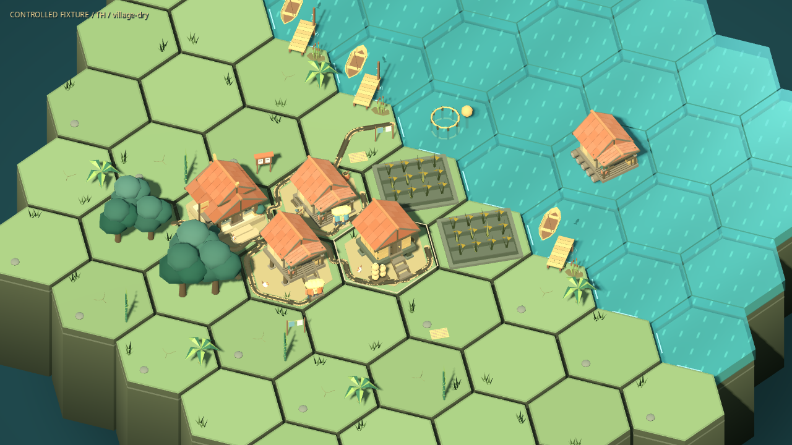

# ฉากหมู่บ้านลุ่มน้ำที่อิงสถานะจริง

ชุดแรกของ [แผนพัฒนาระยะ 1–4](../design/VILLAGE_WORLD_PLAN.md) ใช้กับกระดาน 3 มิติ BoardView ของเกมหลัก รอบยาว โรงเรียนและห้องทดลอง ต่อจาก [รายละเอียดอาคาร](VISUAL_REFRESH.md) ไม่มีเครื่องมือสร้างถนน ท่า หรือการขนส่งใหม่ รอบ 365 วันยังใช้ YearBoard 2 มิติตามเดิม

## สิ่งที่เห็นในฉาก

| องค์ประกอบ | พฤติกรรมและข้อมูลที่ใช้ |
|---|---|
| พื้นที่รอบบ้าน | ลานดิน รั้วไม้ไผ่ โอ่งและราวผ้า ขึ้นกับบทบาทช่อง ระดับพัฒนา และพื้นที่ที่ไม่ชนถนน/อาคาร |
| ท่าน้ำ | ชานไม้ คานและเสาลงถึงพื้นตลิ่ง วางเฉพาะตลิ่งแห้งติดน้ำที่ระดับเหมาะสม มีแบบทั่วไป ประมง และขนของตามบทบาทพื้นที่; เป็นฉากตกแต่ง ไม่มีทางเดินข้ามน้ำเพิ่ม |
| เรือ | เรือไม้กลวงพร้อมที่นั่งและไม้พาย จอดบนผิวน้ำจริง ตรวจหัว ท้าย และข้างเรือไม่ทับฝั่งแห้ง/อาคาร ไม่ทำงานเป็นระบบขนส่ง |
| พืช | กล้วย ไผ่ แปลงดอกไม้และกอพืชริมน้ำ เลือกพื้นที่ว่างใกล้หมู่บ้าน ไม่วางในนาและทางเข้า เป็นพืชประกอบฉาก ไม่เพิ่มอาหาร/วัสดุ |
| จุดงาน | โต๊ะซ่อม เสื่อตากข้าว และชั้นไม้ ชั้นไม้มี 0–3 กลุ่มตามไม้ส่วนกลางจริง เสื่อเริ่มว่างและแสดงข้าวชั่วครู่จากผลเก็บเกี่ยวที่เกิดขึ้นแล้ว |
| ส่วนกลาง | ป้ายบอกทาง กระดานข่าวใกล้ศาลา และเสาวัดน้ำริมท่า แถบฟ้าอยู่ที่ระดับน้ำปัจจุบัน ไม่มีการคาดการณ์ระดับอนาคตจากของตกแต่ง |
| ดิน/ตลิ่ง | รอยดินแห้งในฤดูแล้ง ดินเข้ม/หินริมตลิ่งและผิวชื้นในฤดูฝน ภาพความชื้นในนายังใช้ค่ากติกาความชื้นเดิม |
| น้ำสัมผัสวัตถุ | วงน้ำรอบเสาท่าเชื่อมกับเวกเตอร์น้ำที่แสดงอยู่ใน preview/ผลจริง จุดกำเนิดยังอยู่ที่ผิวน้ำจริง ไม่ยก geometry ที่ใช้คลิก |
| สัตว์เล็ก | ไก่บนพื้นแห้ง นกบนรั้ว/ป้าย และปลาเงาในน้ำ เป็นกิจกรรมภาพ ไม่มีการผลิต การเลี้ยงหรือความต้องการใหม่ |
| ฤดูและการเคลื่อนไหว | เรือขยับเบา ผ้าไหว ไก่/นก/ปลาเคลื่อนไหวสั้น ๆ หยดน้ำชายคาในฝนและฝุ่นเล็กน้อยในแล้ง ใช้บรรยากาศตามฤดูเดิมร่วมกัน |
| พัฒนาการ | จำนวนของรอบอาคารและราวผ้าเปลี่ยนตามระดับภาพเดิม บ้าน/ส่วนต่อเติม/แผ่นซ่อมตามอายุใช้ระบบอาคารเดิม ไม่มีประวัติน้ำลดถาวรเพิ่มเติม |

ของตกแต่งเปลี่ยนตามสภาพปัจจุบัน เช่น ตลิ่งถูกน้ำท่วมจะเอาท่าและกิจกรรมบนบกที่ใช้ไม่ได้ออก การโหลด checkpoint คืนฉากจากข้อมูลที่บันทึก ไม่สร้างการฟื้นฟูหรือแจกผลผลิตใหม่ ท่า/เรือไม่รับคำสั่งและไม่เพิ่มความสามารถเดินผ่านน้ำ

## สัญญาข้อมูลและการจัดวาง

[VillageScenePlan](../../view/village_scene_plan.gd) อ่าน GameState กับ RouteGraph แล้วคืนข้อมูลฉากแบบสำเนา ประกอบด้วย `sites`, `props`, `actors`, `ripples`, `clearance` และฤดู แต่ละรายการมีชนิด พิกัด ตำแหน่ง และมุม ไม่เก็บ Tile/เซฟ/RNG ลงในฉาก

- บทบาทที่อ่านได้: บ้าน ศาลา ยุ้ง นา ป่า ประมง ประตู ระหัด บึง พื้นดินและน้ำ
- เลือกตำแหน่งจากพิกัดและลำดับที่แน่นอน เรียงช่องก่อนคำนวณจึงไม่ขึ้นกับลำดับ array หลังโหลด
- จุดวางบนบกตรวจรัศมีจริงกับพื้นแห้ง อาคาร จุดเข้า และระยะห่างจากเส้นทางทั้งความกว้าง ไม่ย้ายทางเดินเพื่อเปิดที่ให้ของตกแต่ง
- ท่าใช้ความสูงฝั่งและพื้นใต้เสาจริง เรือใช้ผิวน้ำและตรวจขอบตัวเรือ สัตว์บนบกขยับในวงเล็กภายในจุดวางที่ตรวจแล้ว
- พรีวิวเปลี่ยนได้เฉพาะภาพน้ำคาดการณ์ ไม่สร้างข้าวหรือปลาบนเสื่อ/เรือ `show_harvest` และ `show_report` รับผลที่ commit แล้ว ผลภาพหมดอายุภายใน 2.4 วินาที รวม Reduce motion และหยุดเวลาระหว่าง Pause

[VillageScenery](../../view/village_scenery.gd) รวมชิ้นส่วนคงที่เป็นสอง mesh และใช้ MultiMesh แยกชนิดสำหรับสิ่งเคลื่อนไหว [ชิ้นส่วนงานภาพ](../../view/village_prop_meshes.gd) เป็นรูปทรงที่สร้างในโปรเจกต์ มี mesh และวัสดุร่วมกัน ไม่มี texture หรือบริการภายนอกเพิ่ม มี cache จากข้อมูลฉากเพื่อไม่สร้าง geometry ใหม่เมื่อ refresh ข้อมูลเดิม

จำกัดท่า 6 เรือ 4 สัตว์รวมไม่เกิน 10 พืชเพิ่มไม่เกิน 24 วงน้ำ 18 เสื่อตาก 4 ราวผ้า 3 และเสาวัดน้ำ 2 รายละเอียดเล็กซ่อนเมื่อ camera size เกิน 18 เรือยังเห็นจากมุมภาพรวม หยดน้ำ/ฝุ่นซ่อนใน Reduce motion สัตว์ ผ้าและน้ำอยู่ในท่านิ่ง Pause หยุดนาฬิกาภาพและอายุผลเก็บเกี่ยว

## ตรวจและดูภาพ



[ก่อนเปิดชั้นฉาก](../images/world-village-before.png) · [รายละเอียดท่าน้ำและเรือ](../images/world-riverbank-detail.png) · [ฤดูฝน](../images/world-village-rain.png) · [ฝั่งที่ถูกน้ำท่วม](../images/world-village-flood.png)

[ฉากตรวจ](../../tools/village_world_fixture.gd) จัดหมู่บ้านเดียวบน 61 ช่อง มีแม่น้ำ นา บ้าน ศาลา ยุ้งและจุดประมง ตัว [native probe](../../tools/village_world_probe.gd) ถ่ายภาพก่อน/หลังเปิดชั้นฉาก ฤดูแล้ง ฝน น้ำท่วม และโหลด checkpoint เดิมกลับมา โดยใช้เซฟ/ค่าตั้งแยก:

```sh
scripts/test.sh --filter=village_world
mkdir -p work/village-world-qa/th
XDG_DATA_HOME="$PWD/work/village-world-qa/th/data" XDG_CONFIG_HOME="$PWD/work/village-world-qa/th/config" XDG_CACHE_HOME="$PWD/work/village-world-qa/th/cache" godot --path . --audio-driver Dummy --resolution 1280x720 --script res://tools/village_world_probe.gd -- --out-dir="$PWD/work/village-world-qa/th" --lang=th
```

เปลี่ยน `th` เป็น `en` เพื่อตรวจอีกภาษา ภาพเป็น controlled fixtures ไม่ใช่รอบเล่นตามฤดูที่เล่นผ่านกฎ การคืนสภาพใน probe คือโหลด checkpoint ที่เตรียมไว้ ไม่ใช่กติกาฟื้นฟูหลังน้ำลด และตัวเลข software renderer ไม่ใช่ benchmark ฮาร์ดแวร์ผู้เล่น

ผลล่าสุดพร้อมภาพและรายงานอยู่ใน [บันทึกพัฒนา](../history/PROGRESS.md) งานทดสอบการอ่านฉากโดยผู้เล่นและทางเลือกอัปเกรดยังค้าง; ระยะ 5 มี [ต้นแบบขนส่งแยกในโหมดปี 2D](TRANSPORT.md) แล้ว

ผลวันที่ 2026-11-07: Godot 4.6.3 ผ่าน 632/632 tests (ชุดใหม่ 6/6), native world 28/28 และ living-village 47/47 ทั้งไทยและอังกฤษ ดู [world ไทย](../reports/village-world-qa-th.json) / [อังกฤษ](../reports/village-world-qa-en.json) และ [living ไทย](../reports/village-world-living-qa-th.json) / [อังกฤษ](../reports/village-world-living-qa-en.json)
