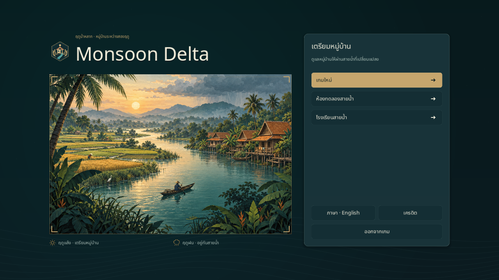
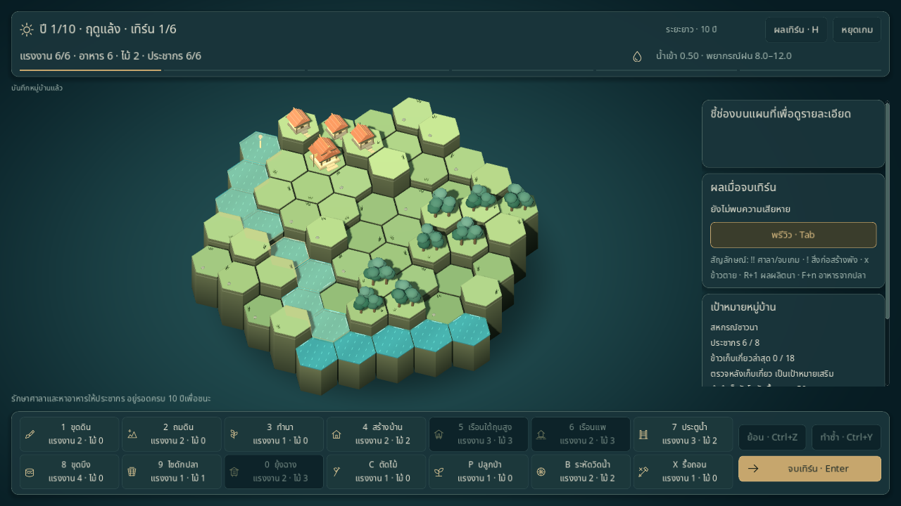
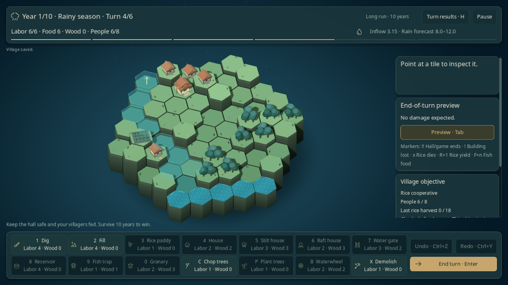

# ภาพหมู่บ้านลุ่มน้ำ

คู่มือภาพที่ใช้งานอยู่ ผลตรวจท้ายหน้าเป็นหลักฐาน ณ วันที่ปรับภาพ; ดู [STATUS](../STATUS.md) สำหรับขอบเขตและหลักฐานรวมล่าสุด

ปรับภาพเกมให้เป็นหมู่บ้านจำลองเขตร้อน ใช้ผิวน้ำสีฟ้าอมเขียว พื้นดินเขียวธรรมชาติ บ้านไม้ และรายละเอียดทองอุ่น เมนูมีภาพแม่น้ำ นาข้าว และหมู่บ้านยกพื้นยามเย็น

## ชุดกราฟิกหน้าเมนูและผู้นำ — 2026-10-24

- ภาพประกอบหมู่บ้านริมน้ำก่อนมรสุม โทนเขียวน้ำ–ทองข้าว พร้อมกรอบบางแบบสมุดบันทึก โหลดจากไฟล์ในเกมและรักษาสัดส่วนเมื่อขนาดพื้นที่เปลี่ยน โดยครอปจากกึ่งกลางแทนการยืดภาพ
- ตราหมู่บ้านรูปหกเหลี่ยม รวมบ้านยกพื้น สายน้ำ และรวงข้าว ใช้ข้างชื่อเกมและเป็นไอคอนแอป
- ตราอาชีพผู้นำทั้งสี่ใช้รูปเครื่องมือและผลผลิตต่างกัน แสดงข้างคำอธิบายและเปลี่ยนตามตัวเลือก รวมเมื่อสลับภาษาแล้วคืนแบบฟอร์มเดิม ชื่อและผลของผู้นำยังเป็นข้อความแปลที่อ่านได้
- ใต้ภาพมีสัญลักษณ์ฤดูแล้ง/ฤดูฝนพร้อมข้อความไทย–อังกฤษ ภาพทั้งหมดนิ่ง ไม่รับคลิกและไม่เพิ่มแอนิเมชันใน Reduce motion

ภาพประกอบหลักสร้างด้วย AI สำหรับโปรเจกต์นี้ ส่วนตราทั้งห้าเป็น SVG ที่วาดจากรูปทรงและแก้ไขต่อได้ ดู [ไฟล์และที่มาของงานภาพ](../../assets/art/README.md) ชุดนี้ใช้กับหน้าเมนู ไม่ใช่ภาพจำลองกระดาน seed จริง และไม่เปลี่ยนกฎหรือเซฟ

[หน้าตั้งค่าผู้นำภาษาอังกฤษที่ 1280×720](../images/graphic-setup-en.png)

## ภาพระหว่างเล่น

- ต้นไม้ทรงพุ่มมีขนาดและสีต่างกัน บ้านมีระเบียง หน้าต่าง บันไดและเสาค้ำ ศาลามีหลังคาซ้อน
- ขอบช่องเห็นชั้นดินและกอหญ้า นามีคันนา ร่องปลูกและรวงข้าวตามการเติบโต
- ผิวน้ำมีริ้วเคลื่อนไหวต่อเนื่องข้ามช่องและเส้นตลิ่ง ผิวที่ใช้คลิกยังอยู่ที่ระดับน้ำจริง
- ฤดูแล้งใช้แสงอุ่น ฤดูฝนเปลี่ยนเป็นแสงเย็นพร้อมฝนบาง ๆ และพื้นหลังแบบลากูน
- HUD ใช้แถบบนสองแถวกับตัวบอกเทิร์น 6 ช่วง ย้าย Undo/Redo มาอยู่คู่กัน ปุ่มจบเทิร์นใช้สีทอง และเพิ่มไอคอนเครื่องมือ
- จัดรายละเอียดช่องกับพรีวิวให้อยู่ก่อนเป้าหมายและประวัติในแผงขวา ปรับกล้องให้เห็นขอบกระดานครบในมุมเริ่มต้นที่ 1280×720

## การวาดและการตรวจ

รูปทรงทึบของกระดานรวมเป็น mesh สำหรับตัวอาคาร รายละเอียดเล็ก และเครื่องหมาย ส่วนน้ำโปร่งใสกับพรีวิวยังแยกตามวัสดุ ในฉาก seed 42 ที่ตรวจด้วย Godot 4.6.3 / Mesa software จำนวน draw calls ลดจากประมาณ 2,506 เป็น 145 ตัวเลขนี้วัดงานวาดฉากเดียว ไม่ใช่ benchmark เฟรมเรตบนเครื่องผู้เล่น

ภาพเมนูและไอคอน SVG สร้างสำหรับโปรเจกต์นี้ตามที่มาด้านบน ใช้ฟอนต์ Noto Sans Thai พร้อมสัญญาอนุญาตเดิม ไม่มีบริการเครือข่ายสำหรับโหลดภาพระหว่างเล่น

ผลตรวจชุดกราฟิกหน้าเมนู 2026-10-24 บันทึกใน [ประวัติพัฒนา](../history/PROGRESS.md#2026-10-24--ชุดกราฟิกหน้าเมนูและผู้นำ) ผลด้านล่างเป็นหลักฐานจากงานภาพกระดานเดิม

ตรวจ native mouse/keyboard ไทย–อังกฤษที่ 1280×720: สร้างสิ่งก่อสร้างบนช่องที่คลิกจริง Undo/Redo คืน bytes ของ checkpoint ตรงเดิม เล่นจากฤดูแล้งเข้าฤดูฝน เปิด/ปิดประวัติ และ Continue จากเซฟฤดูฝน ตรวจข้อความต้นทุนสองภาษาและขอบกระดานด้วยภาพจริง

เพิ่ม regression test ตรวจว่า vertex ที่สามเหลี่ยมอ้างอิงครอบคลุมผิวบนของทุกช่อง ทั้งก่อนและหลังเปลี่ยนความสูง เพื่อป้องกันพื้นหายเมื่อรวมรูปทรงที่มีและไม่มี index เข้าด้วยกัน ตรวจต้นฉบับเอกสารทั้ง 54 ไฟล์ตรงกับ SHA-256 ใน manifest

ชุดทดสอบ Godot ผ่าน **250 รายการ** รวมการเล่น 60 เทิร์น เป้าหมาย เซฟ พรีวิว คีย์ลัด และเมนู ตรวจ Python balance CLI และ balance report checker 21 รายการผ่าน
