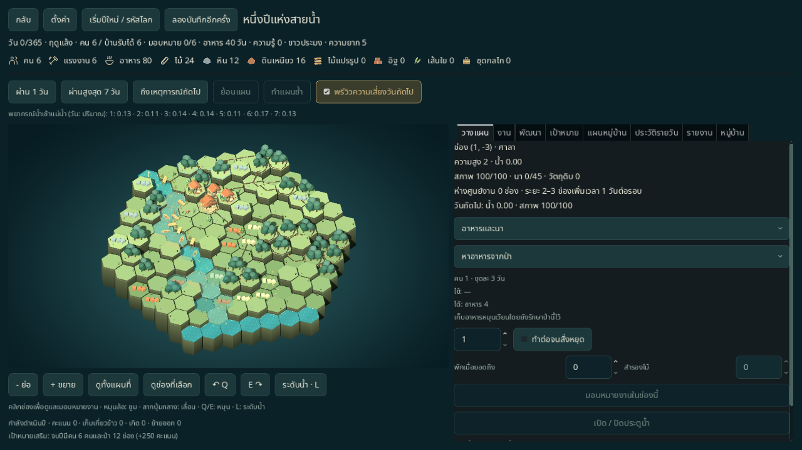
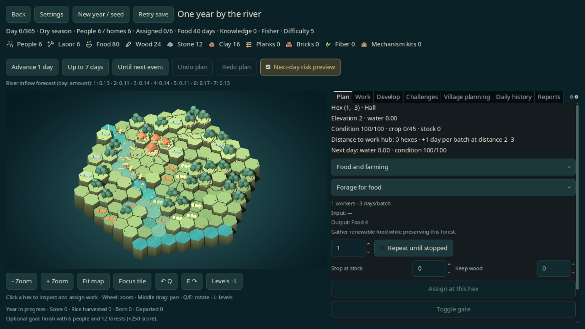
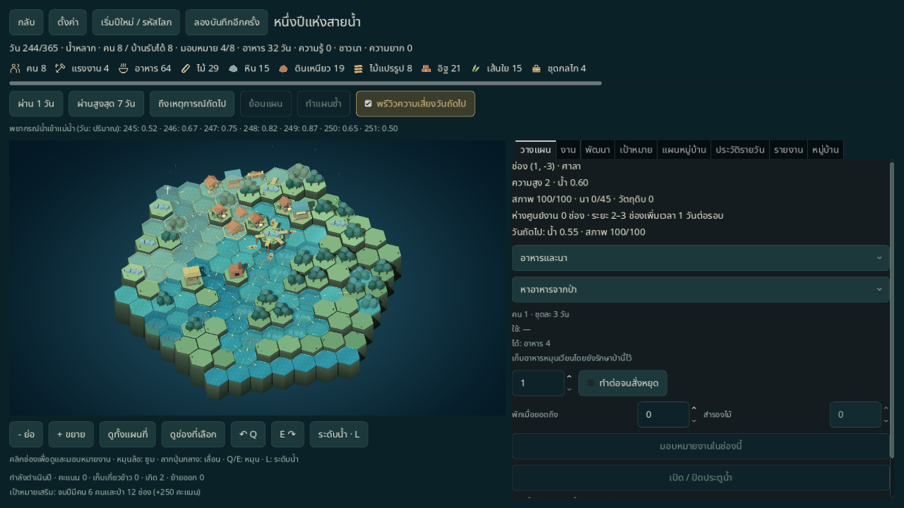
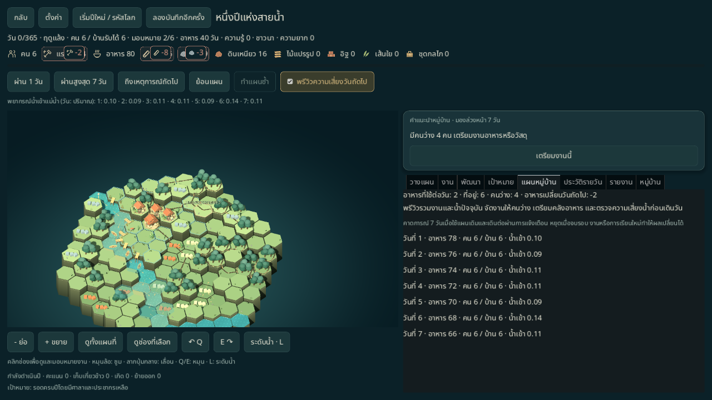
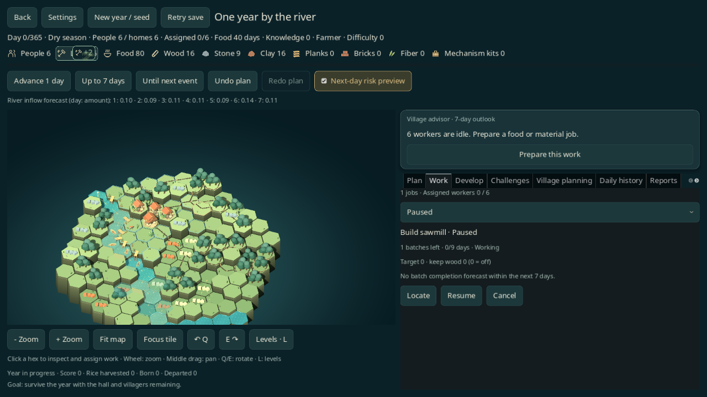
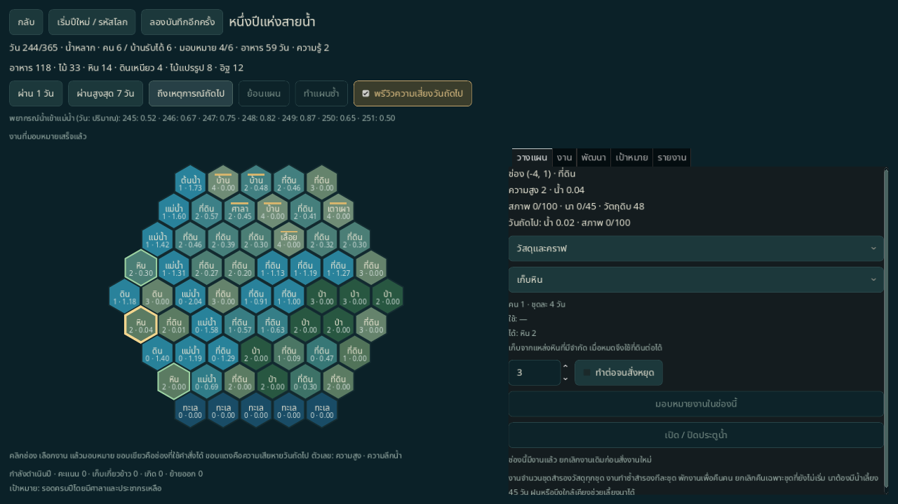
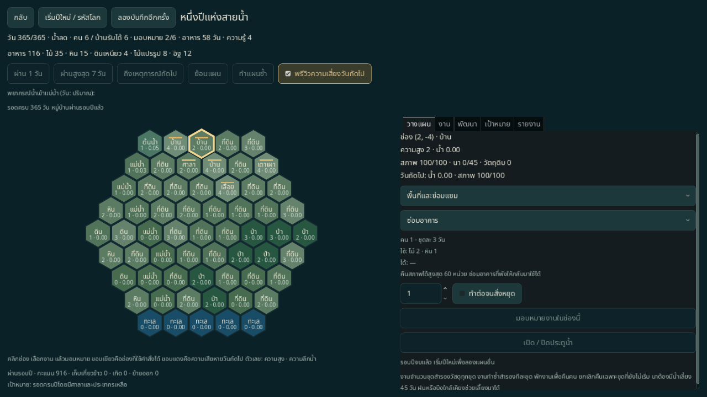
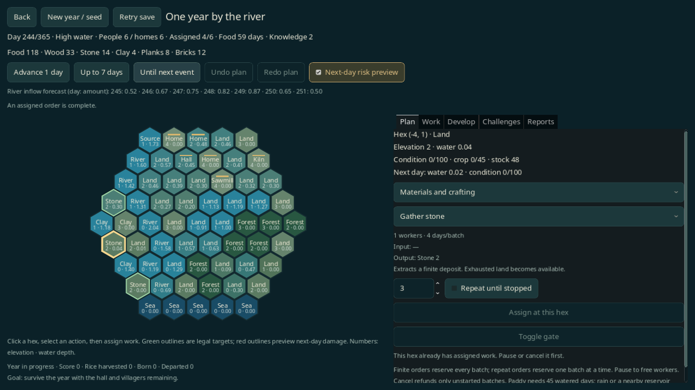
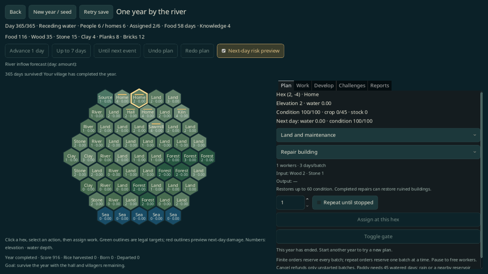

# หนึ่งปีแห่งสายน้ำ — เกมรอบเต็ม 365 วัน

โหมดเล่นครบหนึ่งปี รอบใหม่ใช้แผนที่ hex **127 ช่อง** พร้อม [โครงการหมู่บ้าน โรงช่าง ค่ายงาน และสายอัปเกรด](YEAR_PROJECTS.md); เซฟปีเดิม 61 ช่องเล่นต่อด้วยกฎเดิมได้: จัดคน เก็บทรัพยากร สร้างโรงผลิต คราฟ ปลูกนา ควบคุมน้ำ และใช้ความรู้จาก Challenge พัฒนาหมู่บ้าน น้ำใช้ [WaterSim](../../core/water_sim.gd) จริงทุกวัน ไม่ใช้เงื่อนไขว่าต้องสร้างอาคารตามวันเหมือนโจทย์ 30 วัน

เพิ่ม [รอบ 1/3/5 ปี คำเตือนผลผลิตนา ทดลองจนงานเสร็จ และหน้าพัฒนาพื้นที่](YEAR_CAMPAIGNS.md) แล้ว รอบหลายปีใช้เซฟ v6 แยกกฎจากรอบเดิม

## เปิดเล่นและเล่นต่อ

โหมดนี้เป็น **เกมหลัก · 365 วัน** ในเมนู ปุ่มเล่นครั้งแรกเปิดตั้งรอบใหม่ให้เลือกรหัสโลก เป้าหมาย โครงการ ผู้นำ และความยาก ก่อนยืนยันเริ่มปี หากมีเซฟจะแสดงปุ่มเล่นต่อพร้อมวันที่ ประชากร อาหาร และผลรอบ ปุ่มเริ่มปีใหม่แยกจากเล่นต่อ ยกเลิกแบบฟอร์มไม่สร้างหรือแทนที่เซฟ เกมแบบดั้งเดิมและโหมดฝึกยังอยู่ในเมนูส่วนถัดไป

เปิดโดยตรงได้ด้วย:

```sh
godot --path . -- --scene=year --seed=42 --goal=forest --lang=th
```

เปิดครั้งแรกสร้างปีใหม่; หากมีเซฟปีอยู่จะเล่นต่อรอบนั้น ไม่เปลี่ยน seed/เป้าหมายของรอบค้าง ปุ่ม **เริ่มปีใหม่ / รหัสโลก** ให้ตั้ง seed เป้าหมาย และโครงการ แล้วถามยืนยันก่อนแทนที่รอบปี ใช้ `--lang=en` สำหรับอังกฤษ

เซฟอยู่ที่ `user://year365.json` แยกจาก Continue ปกติและ [ต้นแบบ 30 วัน](DAILY_PRODUCTION.md) `--save-path`, โหมด classic/long และ ruleset ของเกมแบบดั้งเดิมไม่กำหนดกฎของปีใหม่ ส่วน `--difficulty=0` ถึง `10` ใช้กับรอบปีใหม่ที่เปิดโดยตรง โหมดนี้มีสมดุลชุดของตัวเอง รอบ 1 ปีจบใน 365 วัน ส่วนรอบ 3/5 ปีจบตามจำนวนปีที่เลือก

## การใช้งานในเกมหลัก

รอบใหม่จากหน้าจอใช้ `year365_v3` / envelope v3 เป็นค่าเริ่มต้น หรือเลือก [ระบบหมู่บ้านเพิ่มเติม](#ระบบหมู่บ้านเพิ่มเติมสำหรับปีใหม่) เพื่อใช้ `year365_v5` / envelope v5 บนแผนที่ 127 ช่อง พร้อมตัวเลือกผู้นำ 4 อาชีพและความยาก 0–10 เซฟ v1/v2 เล่นต่อด้วยกฎเดิม ไม่มีการเติมโบนัสย้อนหลัง ค่าใหม่อยู่ใน `year_campaign` ของ `data/balance.json`:

- ชาวนา: ข้าวเพิ่ม 1 ต่อเก็บเกี่ยว
- ช่างไม้: บ้านที่มีต้นทุนไม้ใช้ไม้ลด 1 ต่อชุด
- ชาวประมง: อาหารจากงานจับปลาเพิ่ม 1 ต่อชุด
- หมอดิน: งานขุด/ถมใช้เวลาพื้นฐานลด 1 วัน ขั้นต่ำ 1 วัน (ปรับให้เข้าระบบงานรายวัน)
- ความยาก: น้ำเข้าเพิ่มร้อยละ 5 และตัวคูณคะแนนเพิ่ม 0.1 ต่อระดับ พยากรณ์ พรีวิว และน้ำจริงใช้ค่าเดียวกัน กฎนี้เป็นของโหมดปี ไม่ใช้ตารางความยากของโหมดดั้งเดิม

หน้า **แผนหมู่บ้าน** แสดงอาหารที่ต้องกินต่อวัน ความจุบ้าน คนว่าง และผลต่างอาหารจากพรีวิววันถัดไป หน้า **ประวัติรายวัน** เก็บหนึ่งรายการต่อวันที่เดินจริง สูงสุดตามจำนวนวันของรอบ พร้อมยอดก่อน/หลัง ผลต่าง สาเหตุ และพิกัด อ่านจากผล resolver ในวันนั้นโดยตรง ไม่เปลี่ยนเมื่อจัดงานหรือ Undo และไม่ลงเซฟ โหลดหรือเริ่มปีใหม่จะล้างประวัติ

**Space** ขอเดินวันถัดไป, **Ctrl+Z** ย้อนแผน, **Ctrl+Y** หรือ **Ctrl+Shift+Z** ทำแผนซ้ำ, **Esc** เปิดตั้งค่า ไม่จับปุ่มลัดขณะพิมพ์หรือเปิดกล่องยืนยัน การตั้งค่าเปลี่ยนภาษาไทย/อังกฤษระหว่างเล่นได้โดยรักษารอบ แผนที่ ประวัติ และแบบฟอร์มที่กรอกไว้ และเลือกเปิด/ปิดคำเตือนคนว่างได้ คำสั่งเดินเวลายังกันกดซ้ำ 400 ms เมื่อบันทึกไม่สำเร็จจะถามก่อนกลับเมนูหรือปิดหน้าต่าง

กระดานหลักใช้ 3D ชุดเดียวกับเกมแบบดั้งเดิม และคงระบบงานรายวัน/โครงการของโหมดปี ไม่ย้ายการ์ด เหตุการณ์ M5 หรือ ruleset ค้ำบ้าน/ความชื้น/จัดสรรน้ำของเกมดั้งเดิมเข้ามาโดยอัตโนมัติ ความยากและโบนัสชุดใหม่นี้ยังต้องทดสอบสมดุลกับผู้เล่นจริง

## บันทึกผลจริงและทดลองคำสั่ง

ฟอร์มเริ่มปีใหม่เริ่มจาก seed เป้าหมาย โครงการ ผู้นำ ความยาก และตัวเลือกระบบของรอบที่โหลด การยกเลิกไม่เขียนไฟล์ ปุ่มเดินเวลาตรวจผลถึงวันที่หยุดจริง: เตือนแพ้ก่อน แล้วแสดงอาคารเสียหาย นาเสียหาย การย้ายออก และคนว่าง มีปุ่มดูช่องเสี่ยงโดยไม่เดินวัน รวมความเสียหายที่ถูกการซ่อมในวันเดียวกันกลบยอดสุทธิด้วย

ประวัติเลือกดูแต่ละวันได้ เก็บวัสดุทั้งแปด คน แรงงานว่าง ที่พัก และความรู้ พร้อมแยกผลผลิต วัสดุชุดถัดไป อาหารรายวัน การเกิด/ย้ายออก คลังล้น รางวัล และการคืนแรงงาน ยอด `ก่อน + ผลรวมสาเหตุ = หลัง` ตรวจจากการเปลี่ยนค่าจริง แถวพิกัดเก็บชนิดพื้นที่ ผลเดิม และผลใหม่ไว้ ณ วันนั้น กดพาไปดูบนกระดานได้และกลับคืนกล้อง/เครื่องมือเดิม การเก็บประวัติเริ่มใหม่เมื่อโหลดเซฟ

ปุ่ม **ทดลองแผนนี้** เลือกเปรียบเทียบ 7 วันหรือจนงานเสร็จตาม [คู่มือวางแผนพื้นที่](YEAR_CAMPAIGNS.md#ทดลองแผนจนงานเสร็จ) แล้วเปรียบเทียบแผนปัจจุบันกับแผนที่เพิ่มคำสั่ง แสดงวัสดุที่จะสำรอง อาหาร คน ที่พัก ความเสียหาย และผลรอบ พร้อมวันที่สิ้นสุดของแต่ละแผน เดินผ่านประกาศเหมือนแผน F2 แต่หยุดเมื่อจบรอบ ยังไม่ใช้วัสดุหรือสร้าง Undo จนกดมอบหมาย หากสถานะจริงเปลี่ยนแล้วต้องทดลองใหม่ก่อนยืนยัน ใช้ Undo/Redo กับคำสั่งที่ยืนยันได้ตามปกติ ต้นแบบขนส่งยังใช้การพรีวิวของตัวเองและไม่แสดงปุ่มทดลองนี้

ปุ่มเพิ่ม: **1–0 / C P B X R** เลือกเครื่องมือ, **WASD/ลูกศร** เลื่อนกล้อง, **Tab** เปิด/ปิดพรีวิว, **V/L** ป้ายระดับ, **Enter/Space** เดินวัน, **F3** ประวัติ คลิกขวาบนกระดานยกเลิกเครื่องมือ ปุ่ม **H** ยังคงเปิดคิวงานและ **F2** เปิดแผน 7 วันเหมือนรุ่นก่อน เครื่องมือที่ ruleset เดิมไม่มีจะไม่ถูกเปิดด้วยปุ่มลัด

## ระบบหมู่บ้านเพิ่มเติมสำหรับปีใหม่

เลือกช่อง **เปิดระบบหมู่บ้านเพิ่มเติมสำหรับปีใหม่นี้** ในฟอร์มเริ่มปีใหม่ ใช้แผนที่/งานรายวัน/ผู้นำ/ความยาก/โครงการเดิม ใช้กฎ `year365_v5` ที่รวมกลไก v4 พร้อมอายุอาคารสะสมและเหรียญเป้าหมาย โดยไม่แปลงรอบที่กำลังเล่น ค่าต้นทุนและค่ากลไกใหม่อยู่ใน `year_classic` ของ [balance](../../data/balance.json)

| ระบบ | กฎรายวัน |
| --- | --- |
| รื้อนา / กล้าไม้ | งานพื้นฐาน 1 คน 1 วัน รื้อนาหรือกล้าไม้พร้อมผลผลิต ความชื้น และลำดับรับน้ำ ไม่มีวัสดุคืน ป่ายังใช้เก็บไม้ เวลางานนอกพื้นที่ใกล้ยังบวกระยะตามเดิม |
| เรือนแพ | 2 คน 6 วัน ไม้แปรรูป 3 เส้นใย 2 สร้างบนช่องว่างที่มีน้ำอย่างน้อย 0.1 พักได้ 2 คน (3 เมื่อวิจัย housing3) ไม่เสียหายจากน้ำท่วม |
| ไซจับปลา | 1 คน 3 วัน ไม้ 3 สร้างบนช่องว่างที่มีน้ำอย่างน้อย 0.1 หลังสร้างไม่ใช้แรงงานประจำ ผลิตอาหาร 1 ต่อวันเมื่อสภาพมากกว่า 0 น้ำตั้งแต่ 0.05 แต่น้อยกว่า 1.0 และรอบยังไม่แพ้ศาลา |
| ค้ำบ้าน | บ้าน/เรือนยกใต้ถุน ใช้ 1 คน ไม้ 1 ใช้เวลา 1 วัน เพิ่มระดับทนน้ำ 0.5 เฉพาะวัน resolve นั้น ทำซ้ำใช้ไม้ใหม่ทุกวันและหยุดเมื่อวัสดุไม่พอ ไม่ทำให้การป้องกันถาวร |
| ความชื้น | นาได้รับฝน น้ำผิวดิน หรือน้ำจากอ่างจะสะสม 2 หน่วย วันแห้งใช้ 1 หน่วยเพื่อโตต่ออีกวัน เมื่อหมดหยุดโต น้ำท่วมลึกตั้งแต่ 1.0 ติดต่อกัน 5 วันทำให้ข้าวและความชื้นเป็น 0 |
| จัดสรรน้ำ | เลือก **รับก่อน / ปกติ / ข้าม** ที่ช่องนา แบ่งน้ำหลังจำลองน้ำ/ระเหย/ความเสียหาย เรียงกลุ่มแล้วตามลำดับช่อง อ่างแต่ละแห่งถูกหักน้ำจริงครั้งเดียวต่อผู้รับ ข้ามเฉพาะการเบิกอ่าง ยังใช้ฝน/น้ำผิวดิน/ความชื้นได้ แก้ลำดับแล้ว Undo/Redo และเซฟได้ |

ซ่อม รื้ออาคาร อาหาร และที่พักยังใช้โครงสร้างรายวันของปี ไม่เปลี่ยนเป็นกฎเก็บเกี่ยวประจำปีของโหมดดั้งเดิม รุ่น v5 เพิ่ม [อายุอาคารและเหรียญถาวร](#อายุอาคารและเหรียญเป้าหมาย) ที่ปรับเวลาให้เป็นวัน ไม่เปิดการ์ด/เหตุการณ์ M5 หรือ `balanced_v1` ผลอัตโนมัติไม่ใช่หลักฐานรับรองสมดุลกับผู้เล่น

| เซฟปี | กฎที่รักษาไว้ |
| --- | --- |
| v1 / year365_v1 | 61 ช่อง กฎปีเดิม |
| v2 / year365_v2 | 127 ช่อง โครงการและคราฟ |
| v3 / year365_v3 | เพิ่มผู้นำ/ความยาก |
| v4 / year365_v4 | เรือนแพ/ไซ/ค้ำ/ความชื้น/จัดสรรน้ำ/รื้อ พร้อม soil_moisture, brace_days, irrigation_policy ทุกช่อง คงกฎสำหรับรอบเดิม |
| v5 / year365_v5 | รวม v4 และเพิ่ม settlement_progress / goal_medal ที่บันทึกวันสร้างและหลักฐานรับเหรียญ |
| v6 / year365_v6 | รวม v5 และ campaign_years สำหรับ 3/5 ปี วันสะสมและอากาศครบทั้งรอบ |

ไฟล์ยังเป็น `user://year365.json` แยกจาก normal/daily/transport ประวัติรายวันและภาพน้ำยังไม่ลง schema; v5 เก็บเฉพาะประวัติอาคารและเหรียญตามฟิลด์ของตัวเอง รุ่นที่ไม่รองรับหรือไฟล์ผิดรูปจะถูกเก็บไว้ ไม่เขียนทับ การพรีวิว/บัญชี/ภาพไม่เปลี่ยน RNG หรือ float64 ของน้ำ เซฟ v1–v4 ไม่ได้รับฟิลด์หรือโบนัสกฎ v5 ย้อนหลัง

### ตรวจระบบเพิ่มเติม

รัน `scripts/test.sh --filter=year_parity` และชุดเต็ม [เทสต์](../../tests/test_year_parity.gd) ครอบคลุมการก่อสร้าง/ค่าใช้วัสดุจริง ระยะเวลาค้ำบ้าน น้ำอ่างขาดแคลน ความชื้น เซฟทุกเวอร์ชัน/ข้อมูลผิดรูป พรีวิวเทียบการเดินจริง ยอดสาเหตุทุกทรัพยากร การยกเลิก/ยืนยัน/Undo/คำสั่งล้าสมัย การดูพิกัด/คืนกล้อง และโหลดช่วงน้ำหลากแล้วเดินตรงกันจนวันที่ 365

ตรวจ native 1280×720 ไทยและอังกฤษด้วย [probe](../../tools/year_parity_probe.gd) ที่ใช้ mouse/physical key จริง บางกระดานเป็น fixture ที่จัดก่อนเปิดหน้าจอเพื่อให้ตรวจผลได้แน่นอน แยก XDG/เซฟจากผู้เล่น:

```sh
XDG_DATA_HOME="$PWD/work/year-extra-th/data" XDG_CONFIG_HOME="$PWD/work/year-extra-th/config" XDG_CACHE_HOME="$PWD/work/year-extra-th/cache" godot --path . --audio-driver Dummy --resolution 1280x720 --script res://tools/year_parity_probe.gd -- --out-dir="$PWD/work/year-extra-th" --lang=th
```

เปลี่ยนโฟลเดอร์และภาษาเป็น `en` สำหรับอังกฤษ ผลตรวจกฎ v4 รอบก่อนหน้า Godot 4.6.3 วันที่ 2026-11-10: ชุดเต็ม **709/709** และเฉพาะส่วน **16/16** ผ่าน รวมเล่นปี v4 seed 42 ครบ 365 วันและโหลดวันที่ 242 แล้วเดินต่อได้ state ตรงกันทุกขั้น

ผล native ล่าสุด 2026-11-10: **24/24 ต่อภาษา** ใช้หน้าต่างจริง 1280×720 มี fixture น้ำหลากและเก็บเกี่ยวที่เตรียมก่อนเปิด UI ไม่ใช่ human playtest

| ภาษา | รายงาน | ภาพ |
| --- | --- | --- |
| ไทย | [24 checks](../reports/year-parity-native-th.json) | [เริ่มปีใหม่](../images/year-extra-setup-th.png) · [ทดลอง](../images/year-extra-try-th.png) · [คำเตือน](../images/year-extra-warning-th.png) · [ประวัติ](../images/year-extra-history-th.png) |
| English | [24 checks](../reports/year-parity-native-en.json) | [New year](../images/year-extra-setup-en.png) · [Try order](../images/year-extra-try-en.png) · [Warning](../images/year-extra-warning-en.png) · [History](../images/year-extra-history-en.png) |

## อายุอาคารและเหรียญเป้าหมาย

รอบใหม่ที่เปิด **ระบบหมู่บ้านเพิ่มเติม** ใช้ `monsoon_year` v5 / `year365_v5` รวมกลไก v4 ทั้งหมด โค้ดสร้าง v3/v4 เดิมและการเล่นต่อทุกเซฟไม่ถูกย้ายรุ่นอัตโนมัติ ค่าใหม่อยู่ใน `year_heritage` ของ [balance](../../data/balance.json) และ [YearHeritage](../../core/year_heritage.gd)

อาคารเริ่มต้นนับวันสร้างเป็น 0 อาคารใหม่เริ่มนับวันที่งานก่อสร้างเสร็จจริง การยกบ้านเป็นเรือนใต้ถุนถือเป็นก่อสร้างชนิดใหม่เหมือนโหมดดั้งเดิม การอัปเกรดย่อยและซ่อมอาคารที่ยังใช้งานได้รักษาวันเดิม เมื่ออาคารพังเป็นซากจะล้างอายุ/ระดับภาพ; ซ่อมซากสำเร็จหรือรื้อแล้วสร้างใหม่เริ่มวันใหม่ เก็บอายุของโรงเลื่อย เตาเผา โรงช่าง และค่ายด้วย

ประเมินภาพหมู่บ้านทุก **30 วัน** ตามผลสะสมของช่วงนั้น ต้องได้ผลเป้าหมายเดียวกัน **สองครั้งติดกัน** จึงเลื่อนสภาพทีละขั้น ขัดสน ↔ พออยู่ ↔ เหลือเก็บ:

- เป้าหมายขัดสน: เคยมีวันหิว มีการย้ายออกเพราะบ้านไม่พอ อาหารเป็น 0 หรือไม่มีประชากร การซื้อ/ผลิตอาหารก่อนวันประเมินไม่ลบวันที่เคยหิว
- เป้าหมายเหลือเก็บ: ไม่มีเงื่อนไขขัดสน มีบ้านพอ อาหารอย่างน้อย 7 วัน และไม้สำรองอย่างน้อยสองเท่าราคาสร้างบ้านปัจจุบัน
- กรณีอื่นเป็นพออยู่ เมื่อเหลือเก็บและอาคารอายุอย่างน้อย 30 วัน จะเพิ่มระดับภาพทีละ 1 ต่อรอบประเมิน สูงสุด 2; เมื่อขัดสนลดทีละ 1 พออยู่รักษาระดับเดิม

วันที่/สภาพ/ระดับภาพอยู่ในเซฟ พรีวิว แผน 7 วัน Undo/Redo และโหลดรักษาค่าเดิม การอ่านไม่เพิ่มอายุ และการประเมินวันเดิมไม่ถูกนับซ้ำ กระดานใช้ mesh ปกติพร้อมอายุที่เทียบเป็นช่วง 30 วันสำหรับภาพ; หน้าตรวจช่องแสดงอายุจริงเป็นวัน สำเนานี้ไม่ถูกใช้ resolve หรือบันทึก อายุและการตกแต่ง **ไม่เพิ่มผลผลิต ความจุบ้าน หรือความทนน้ำ**

เหรียญประเมินหลังผลิต น้ำ อาหาร และประชากรของทุกวันที่เดินจริง หากรอบยังเล่นอยู่และผ่านเป้าหมายที่เลือก จะเก็บวัน/ประชากร/ป่า/ยอดข้าว ณ เวลารับเหรียญครั้งแรก และแจ้งเหตุการณ์เพื่อหยุดการเดินหลายวัน:

| เป้าหมาย | เงื่อนไขรับเหรียญ |
| --- | --- |
| growth | ประชากรอย่างน้อย 10 |
| forest | คนอย่างน้อย 6 และป่าโตอย่างน้อย 12 |
| rice | คนอย่างน้อย 6 และข้าวเก็บเกี่ยวสะสมอย่างน้อย 180 |
| none | ไม่มีเหรียญหรือโบนัส |

เหรียญไม่หายเมื่อคน/ป่าลดลงภายหลัง โบนัสพื้นฐาน **250** รวมครั้งเดียวก่อนคูณความยาก และยังอยู่เมื่อแพ้ภายหลัง วันที่ศาลาพังหรือประชากรหมดจะไม่ให้เหรียญใหม่ ความก้าวหน้าปัจจุบันแยกจากหลักฐานวันที่รับเหรียญ ไม่มีการให้รางวัลซ้ำจากการโหลดหรืออ่านพรีวิว เซฟ v1–v4 ยังคำนวณโบนัสจากเป้าหมายเมื่อชนะปลายปีเหมือนเดิม

ปุ่ม **พัฒนาการ / เหรียญ** เปิดหน้าหมู่บ้าน แสดงผลประเมิน วันประเมินถัดไป เป้าหมายปัจจุบัน หลักฐานรับเหรียญ และรายชื่ออาคารที่กดดูพิกัด/อายุได้ เมื่อจบรอบเปิดหน้าสรุปคะแนนจริง แยกคน อาหาร ภารกิจ โครงการ เหรียญ และตัวคูณความยาก เปิดดูซ้ำได้โดยไม่เดินวันหรือเขียนเซฟ

### ตรวจอายุอาคารและเหรียญ

ใช้ `scripts/test.sh --filter=year_heritage` และชุดเต็ม [เทสต์ 17 กรณี](../../tests/test_year_heritage.gd) ตรวจพฤติกรรม v1–v5 การสร้าง/รื้อ/ซ่อม/Undo/โหลด รอบประเมิน ความหิวในอดีต พรีวิว/จริง เหรียญทุกเป้าหมาย หลักฐานเสีย/วันอนาคต ไม่รับเหรียญหลังแพ้ โบนัสครั้งเดียว และ replay ถึง 365 หลังโหลดวันที่ 242

[Native probe](../../tools/year_heritage_probe.gd) ใช้การเดินจริงผ่าน public commands 90 วันสำหรับอายุ/ภาพ และ 364 วันก่อนกดวันสุดท้ายด้วยเมาส์ ตรวจสองภาษา 1280×720 รวมดูพิกัด โหลด สรุปคะแนน เปิดดูซ้ำ และยืนยันปีใหม่จาก v4 ไป v5 เฉพาะเมื่อผู้เล่นกดยืนยัน ไม่มีการฉีดอายุหรือเหรียญลงกระดานระหว่างกรณี ใช้ XDG/เซฟแยกจากผู้เล่น:

```sh
XDG_DATA_HOME="$PWD/work/year-age-th/data" XDG_CONFIG_HOME="$PWD/work/year-age-th/config" XDG_CACHE_HOME="$PWD/work/year-age-th/cache" godot --path . --audio-driver Dummy --resolution 1280x720 --script res://tools/year_heritage_probe.gd -- --out-dir="$PWD/work/year-age-th" --lang=th
```

เปลี่ยน `th` เป็น `en` ทั้งโฟลเดอร์และภาษาสำหรับอังกฤษ ผลล่าสุด 2026-11-10 Godot 4.6.3: ชุดเต็ม **726/726**, เฉพาะส่วน **17/17** และ native **27/27 ต่อภาษา** ผ่าน เอกสารต้นฉบับ 54/54 คงเดิมและ diff check ผ่าน ผลนี้เป็น automated/native verification ไม่ใช่ human playtest หรือการรับรองสมดุล

| ภาษา | รายงาน | ภาพ |
| --- | --- | --- |
| ไทย | [27 checks](../reports/year-heritage-native-th.json) | [หมู่บ้าน/เหรียญ](../images/year-heritage-village-th.png) · [อาคารอายุ 90 วัน](../images/year-heritage-building-th.png) · [ผลครบปี](../images/year-heritage-result-th.png) · [ตั้งปีใหม่](../images/year-heritage-setup-th.png) |
| English | [27 checks](../reports/year-heritage-native-en.json) | [Village/medals](../images/year-heritage-village-en.png) · [90-day building](../images/year-heritage-building-en.png) · [Year result](../images/year-heritage-result-en.png) · [New year](../images/year-heritage-setup-en.png) |

## กระดาน 3D และการตอบสนองแบบโหมดปกติ

ใช้ terrain/อาคาร/ต้นไม้/นา/ผิวน้ำ/ถนน/คนเดิน/บรรยากาศชุดเดียวกับโหมดดั้งเดิม ผ่าน [YearBoard3D](../../view/year_board_3d.gd) และ [YearVillageView](../../view/year_village_view.gd) เพิ่มโรงเลื่อย เตาเผา โรงช่าง ค่ายงาน แหล่งหิน ดินเหนียว และเส้นใยของรอบปี อาคารพังเป็นซาก สภาพอาคารและแหล่งวัตถุดิบแสดงร่วมกับป้ายระดับเมื่อเปิด L

- คลิกช่องเลือกเป้าหมาย แล้วมอบหมายงานด้วยปุ่มเดิม ช่องที่ใช้คำสั่งได้มีวงขอบ กล้องมองเฉียงยังเลือกที่พื้น/ผิวน้ำได้แม้มีอาคารบัง
- ล้อเมาส์ซูม ลากปุ่มกลางเลื่อน Q/E หมุนกล้องทีละ 60 องศา L เปิด/ปิดป้ายความสูง น้ำ และข้อมูลสถานที่ ปุ่มดูทั้งพื้นที่/โฟกัสช่องที่เลือกยังใช้ได้ สลับภาษารักษาซูม การเลื่อน มุมหมุน และป้ายที่เปิดไว้
- พรีวิววันถัดไปเปิดตั้งต้น แสดงผิวน้ำที่จะเปลี่ยน ทิศการไหล และวงเตือนสภาพอาคารลด การเดินวันแสดงทิศน้ำจากวันสุดท้ายที่ resolve จริง ไม่รวมเส้นทางจากหลายวันเข้าด้วยกัน และไม่อนุมานทิศจากระดับน้ำหลังจบวัน
- แถบทรัพยากรมีไอคอนคน แรงงาน อาหาร และวัสดุครบ 8 ชนิด แสดงผลต่างหลังมอบหมายงาน ย้อนแผน ทำซ้ำ และเดินวัน ส่วนแถบความคืบหน้าวัดวัน 0–365 การอ่านหรือหมุนกล้องไม่สร้างผลต่าง
- Reduce motion ในตั้งค่าหยุดริ้วน้ำ/ฝน คนใช้ท่านิ่ง กล้องหมุนทันที และผลทรัพยากรไม่ปล่อยไอคอนเคลื่อนที่ กล่องตั้งค่า/ยืนยันพักกิจกรรมภาพ

[YearPresentation](../../view/year_presentation.gd) สร้าง GameState สำเนาเพื่อแสดงภาพเท่านั้น ห้ามนำไป resolve หรือบันทึก โรงผลิตใช้จุดเข้าถึงแบบคลังสำหรับเส้นทางคนและมี mesh ของตัวเอง คนเดินเป็นภาพของงานที่มอบหมาย ไม่ใช่ระบบขนส่งหรือแรงงานเพิ่ม การเก็บ flow edges เปิดได้ตามคำขอ ไม่เพิ่มฟิลด์ใน year state/เซฟ และไม่เปลี่ยนผลลัพธ์ float64/RNG รวมประตูเปิดครึ่งบาน เซฟปี v1–v3 เปิดด้วยภาพ 3D ได้โดยไม่แปลงกฎ ส่วนต้นแบบขนส่งยังใช้กระดาน 2D เดิม





วันที่ 244 จาก reference policy ที่ใช้คำสั่งจริงก่อนเปิดหน้าจอ ไม่ฉีดสถานะระหว่างเล่น:



## คำแนะนำ แผน 7 วัน และคิวงาน

การ์ดคำแนะนำข้างกระดานอ่านจาก [YearPlanner](../../core/year_planner.gd) โดยจำลองวันจริงบนสำเนา เรียงศาลาที่กำลังจะพัง อาหารใกล้ขาด ความเสียหาย งานติดขัด งานซ่อม บ้านไม่พอ นาพร้อมเก็บ และการเริ่มสายผลิต ปุ่ม **เตรียมงานนี้** เลือกช่อง/เครื่องมือและตั้งหนึ่งชุดให้เท่านั้น ไม่สำรองวัสดุ ไม่ใช้แรงงาน ไม่สร้าง Undo และไม่เขียนเซฟ ต้องกดมอบหมายงานเองอีกครั้ง หากไม่มีงานที่มอบหมายได้ ปุ่มพาไปดูช่องหรือคิวแทน การเปลี่ยนกลุ่มงานผ่านคำแนะนำไม่แก้กฎเกม

**F2** เปิดแผนหมู่บ้านที่มีคาดการณ์ 7 วัน: อาหาร ประชากร ความจุบ้าน น้ำเข้า เหตุการณ์ และปุ่มดูตำแหน่งอาคารที่จะเสียสภาพ คาดการณ์สมมติว่าใช้แผนเดิมและกดเดินต่อผ่านการแจ้งเตือนทีละวัน จึงอาจแสดงหลายวันแม้ปุ่มผ่าน 7 วันจริงจะหยุดตั้งแต่เหตุการณ์แรก หยุดคาดการณ์เมื่อแพ้/ชนะ และไม่มีวันที่ 366 งานใหม่ การพักงานหรือเรียนความรู้ใหม่ทำให้คาดการณ์เปลี่ยน ไม่มีการใช้ผลคาดการณ์ย้อนกลับมาเป็น state จริง

**H** เปิดคิวงาน มีตัวกรองทั้งหมด/กำลังทำ/ติดขัด/พัก พร้อมสถานะจากกฎจริง วัตถุดิบสำรอง คนที่มอบหมาย และวันที่ชุดถัดไปคาดว่าจะเสร็จจากบันทึกสำเร็จจริงของ resolver ในสำเนาคาดการณ์ภายใน 7 วัน ไม่เดาวันเสร็จของงานที่ยังติดขัดหรือไกลเกินช่วงคาดการณ์ รวมงานที่ถูกพักเมื่อถึงยอดผลิต และงานซ่อมทำซ้ำที่เสร็จภายในหนึ่งวัน ปุ่มดูช่องคืนหน้าเครื่องมือและโฟกัสกล้อง ปุ่มพัก/ทำต่อ/ยกเลิกยังเป็นคำสั่งจริงที่ Undo/Redo ได้ ตัวกรองคงเดิมเมื่อสลับภาษา

ก่อนเดินเวลา ระบบพรีวิวคำขอจำนวนวันนั้นด้วย resolver เดียวกับปุ่มจริง หากผลทำให้ศาลาพังหรือคนหมด จะแสดงวันและเหตุแพ้ก่อนคำเตือนคนว่าง ยกเลิกไม่เดินวันและไม่แก้เซฟ การชนะวันที่ 365 ไม่ใช้ข้อความเตือนว่าแพ้ ต้นแบบขนส่งยังใช้พรีวิวรวมของตัวเองและไม่แสดงแผน 7 วันจากกฎปีอย่างเดียว





ตรวจเฉพาะส่วนและหน้าจอ (ต้องใช้จอเรนเดอร์และ XDG/เซฟแยก):

```sh
scripts/test.sh --filter=year_planner
godot --path . --audio-driver Dummy --script res://tools/year_planner_probe.gd -- --lang=th --out-dir=/tmp/year-planner-qa/th
```

เปลี่ยนเป็น `--lang=en` และ out-dir อีกแห่งเพื่อตรวจอังกฤษ รายงาน [ไทย](../reports/year-planner-th.json) / [อังกฤษ](../reports/year-planner-en.json) ใช้เมาส์และคีย์บอร์ดจริงเตรียมงาน สั่งงาน พัก/ทำต่อ เปิดแผนและคิว และยกเลิกคำเตือนจบรอบ ตัวเลือกตัวกรองตั้งเป็น form input ก่อนใช้เมาส์กดการทำงาน คำเตือนน้ำใช้ fixture ที่สร้างและตรวจเซฟก่อนเปิด UI ไม่ฉีดสถานะเข้าเกมที่กำลังเล่น ไม่ใช่ human playtest

## ปฏิทินและเวลา

| ช่วง | วัน | พฤติกรรม |
|---|---|---|
| แล้ง | 1–120 | น้ำเข้าน้อย มีการระเหย เตรียมวัสดุและทางน้ำ |
| ฝนเริ่มต้น | 121–180 | ฝนเลี้ยงนา น้ำเริ่มสะสม |
| น้ำหลาก | 181–300 | น้ำเพิ่มหลายระลอก ต้องป้องกันและซ่อม |
| น้ำลด | 301–365 | ระเหยอีกครั้ง เก็บเกี่ยวและเตรียมจบรอบ |

พยากรณ์เห็นน้ำเข้าแม่น้ำล่วงหน้า 7 วัน หรือ 14 วันเมื่อเรียนช่างน้ำขั้น 3 ตารางน้ำสุ่มจาก seed ครั้งเดียวแล้วเก็บกับรอบ การอ่าน UI/พรีวิวไม่สุ่มเพิ่ม ช่วงพายุอยู่ในข้อมูลสมดุล ส่วนความเสียหายเกิดจากระดับน้ำจริงบนแผนที่

เดิน 1 วัน สูงสุด 7 วัน หรือถึงเหตุการณ์ถัดไป หยุดเมื่อมีรางวัล งานเสร็จ งานติดขัด คำเตือนน้ำ/อาหาร ความเสียหาย เก็บเกี่ยวพร้อม เปลี่ยนฤดู หรือจบรอบ ปุ่มกันกดรัว 400 ms พรีวิววันถัดไปใช้ resolver เดียวกับผลจริงบนสำเนา เส้นขอบแดงแสดงอาคารที่จะเสียหาย

ลำดับวัน: งานและผลผลิต → น้ำไหล/ป่าซับ/ระเหย → ความเสียหาย/นา/ป่าโต → กินอาหาร/ประชากร/คลัง → Challenge/แพ้ชนะ การก่อสร้างที่เสร็จในวันนั้นมีผลก่อนน้ำ

## แผนที่และการสั่งงาน

คลิกช่องบนแผนที่ เลือกหมวดและงาน แล้วกดมอบหมายงาน ช่องขอบเขียวเป็นเป้าหมายที่ใช้คำสั่งได้ตามคน วัสดุและกฎปัจจุบัน ตัวเลขในช่องคือความสูงและความลึกน้ำ เลือกช่องเพื่อดูสภาพอาคาร นาสะสม และวัตถุดิบ

- มีอาหาร ไม้ หิน ดินเหนียว ไม้แปรรูป และอิฐ รอบใหม่เพิ่มเส้นใย/ชุดกลไก โรงช่าง และค่ายงาน คลังวัสดุร่วมทั้งหมู่บ้าน รอบขยายมีรัศมีทำงานและเพิ่มเวลาตามระยะ ดูรายละเอียดในคู่มือโครงการ
- ป่าให้ไม้จำกัด และหาอาหารหมุนเวียนได้ การเก็บไม้จนหมดทำให้ป่าหาย ต้องปลูกทดแทน ต้นอ่อนปกติโตใน 30 วัน
- หินและดินเหนียวเป็นแหล่งจำกัดบนแผนที่ เมื่อเก็บหมดใช้พื้นที่นั้นต่อได้
- โรงเลื่อยและเตาเผาต้องสร้างในช่องจริง แล้วจัดคนคราฟในโรงนั้น อาคารน้ำท่วมหรือพังหยุดผลิต
- สร้างบ้าน ยุ้ง บึง ประตู และระหัดได้ตามเงื่อนไข ระหัดเลือกช่องต้นทางข้างเคียงตามชื่อทิศได้
- ขุด/ถมเปลี่ยนระดับดิน ประตูปิดขวางน้ำจริง บึงลดดิน 2 ระดับและเก็บน้ำเลี้ยงนาข้างเคียง ระหัดย้ายน้ำจากต้นทางที่เลือก
- มีคนเริ่ม 6 คน งานระบุจำนวนคนและเวลาต่อชุด ใช้แรงงานรวมกองเดียวกัน
- งานจำนวนชุดสำรองวัสดุทั้งหมด งานทำซ้ำสำรองทีละชุด ถ้าวัสดุหมดจะรอ; พักงานคืนคนแต่คงวัสดุไว้
- ยกเลิกคืนวัสดุเฉพาะชุดที่ยังไม่เริ่ม ชุดที่เริ่มแล้วใช้วัสดุไป สั่งงานใหม่ในช่องเดิมต้องยกเลิกหรือทำงานเดิมให้เสร็จ
- Undo/Redo ย้อนทั้งแผน วัสดุ งานและการเรียนได้ภายในวัน สูงสุด 200 คำสั่ง เมื่อเดินวันล้างประวัติ

## อาหาร นา ประชากร และการฟื้นตัว

อาหาร 1 หน่วยเลี้ยง 3 คนต่อวัน ปัดความต้องการขึ้น เริ่ม 6 คนจึงกินวันละ 2 หน่วย HUD บอกจำนวนวันที่อาหารจะพอจากอัตรากินปัจจุบัน ไม่รวมผลผลิตอนาคต

นาโตเมื่อได้รับฝน น้ำในช่อง หรือบึงที่มีน้ำอยู่ในระยะ ช่วงแล้งต้องพึ่งน้ำจริง มีน้ำเลี้ยงสะสมครบ 45 วันจึงเก็บเกี่ยวได้ สะสมได้สูงสุด 90 หน่วย เก็บเกี่ยวเปลี่ยนเป็นอาหารแล้วเริ่มสะสมใหม่ หากน้ำลึกอย่างน้อย 1.0 ต่อเนื่อง 5 วัน ผลผลิตสะสมหาย แต่พื้นที่นายังใช้ต่อได้เมื่อน้ำเหมาะ

คลังพื้นฐานเก็บอาหารได้ 120 หน่วย ยุ้งที่ยังใช้งานเพิ่มแห่งละ 180 หน่วย อาหารส่วนเกินเก็บไม่อยู่ จึงต้องสร้างที่เก็บก่อนเก็บเกี่ยวใหญ่

- อาหารไม่พอครบ 3 วันติดต่อกัน คนย้ายออก 1 คน อาหารกลับมาพอจะล้างจำนวนวันหิว
- ทุก 14 วัน หากคนเกินความจุบ้านจะย้ายออก 1 คน
- ทุก 60 วัน หากมีบ้านว่างและอาหารอย่างน้อยประชากร ×10 จะเกิดเพิ่ม 1 คน ใช้อาหาร 8 หน่วย สูงสุด 12 คน
- คนลดจนงานเกินกำลังจะพักงานจากท้ายคิวก่อน ไม่ใช้คนเกินจำนวนที่เหลือ
- อาคารมีสภาพ 0–100 น้ำเกินเกณฑ์ลดวันละ 10 สภาพ ซ่อมคืนได้ครั้งละ 60 รวมอาคารที่พังแล้ว ศาลาพังทำให้จบรอบทันที

กฎพื้นฐานและสูตรเดิมอยู่ใน `year_game` ของ [balance.json](../../data/balance.json) รอบใหม่ 127 ช่องรวมค่าจาก `year_expansion` สำหรับโรงช่าง ค่าย เส้นใย ชุดกลไก อัปเกรด และโครงการ ตาม [คู่มือรอบขยาย](YEAR_PROJECTS.md)

## Challenge และรางวัลที่ใช้ต่อได้

| Challenge | เงื่อนไข | ความรู้ |
|---|---|---:|
| ตั้งสายผลิต | ไม้แปรรูปสะสม 8 | 2 |
| เสบียงมั่นคง | ตั้งแต่วัน 30 มีอาหาร 60 | 1 |
| บ้านพร้อมเติบโต | ความจุบ้าน 8 คน | 1 |
| ข้าวเลี้ยงหมู่บ้าน | เก็บเกี่ยวข้าวสะสม 60 | 2 |
| ผ่านฝนแรก | ถึงวัน 180 มีคนอย่างน้อย 6 | 2 |
| ผ่านน้ำหลาก | อยู่รอดถึงวัน 300 | 2 |
| รักษาป่ารับน้ำ | ตั้งแต่วัน 300 มีป่าโต 10 ช่อง | 1 |

รับรางวัลแต่ละอย่างครั้งเดียว แล้วเลือกพัฒนา 3 สาย สายละ 3 ขั้น ต้นทุนขั้น 1/2/3 เท่ากับ 1/2/3 ความรู้ และต้องผ่านขั้นก่อนหน้าในสายนั้น:

| สาย | ขั้น 1 | ขั้น 2 | ขั้น 3 |
|---|---|---|---|
| น้ำ | ปลดระหัด | บึงเลี้ยงนาไกล 2 ช่องและใช้น้ำครึ่งหนึ่ง | พยากรณ์ 14 วัน และคันอิฐยกดิน 2 ระดับใน 2 วันพื้นฐาน |
| บ้าน | บ้านยกพื้น | อาคารทนน้ำเพิ่ม 0.25 | ซ่อมเหลือ 1 วันพื้นฐาน และบ้านรับได้ 3 คน |
| เกษตร | ข้าวเพิ่ม 20 ต่อเก็บเกี่ยว | อาหารเลี้ยงได้ 4 คนต่อหน่วย | ป่าซับเพิ่ม ปลูกโต 15 วัน และงานอาหารเพิ่ม 1 |

เวลางานในตารางเป็นเวลาพื้นฐาน รอบขยายบวกอีก 1 วันต่อชุดเมื่องานห่างศาลาหรือค่ายที่ใช้งานได้ตั้งแต่ 2 ช่อง เช่น ซ่อมหลังเรียนขั้น 3 ใช้ 2 วัน และคันอิฐใช้ 3 วัน ดู [กฎระยะทาง](YEAR_PROJECTS.md#พื้นที่และค่ายทำงาน)

ตัวอย่าง: ผลิตไม้แปรรูป → ได้ความรู้ → เรียนบ้านยกพื้น/ฐานแข็งแรง → ใช้อิฐกับไม้แปรรูปปรับบ้าน → ผ่านน้ำที่หนักขึ้น หรือเลือกพัฒนาบึงเพื่อเลี้ยงนารอบถัดไป

## จบรอบและคะแนน

แพ้เมื่อศาลามีสภาพ 0 หรือประชากรเหลือ 0 ชนะเมื่ออยู่รอดถึงวันที่ 365 เป้าหมายเสริมไม่ขัดขวางชัยชนะ สำหรับเซฟ v1–v4 ตรวจเมื่อจบปี:

- `growth`: จบปีมีประชากรอย่างน้อย 10
- `forest`: จบปีมีคนอย่างน้อย 6 และป่าโต 12 ช่อง
- `rice`: จบปีมีคนอย่างน้อย 6 และเก็บเกี่ยวข้าวสะสม 180

คะแนนฐาน = คน ×100 + อาหารคงเหลือ + Challenge ที่ผ่าน ×50 + ขั้นโครงการ ×100 (รอบขยาย); v1–v4 ชนะพร้อมเป้าหมายเสริมเพิ่ม 250 ส่วน v5/v6 ใช้เหรียญที่รับไว้แล้ว จากนั้นคูณ `(1 + ความยาก ×0.1)` เซฟรอบจบเก็บไว้เปิดดูผลได้ รอบ 1 ปีไม่เดินต่อเป็นวันที่ 366 ส่วนรอบหลายปีหยุดเมื่อครบวันที่สะสมของรอบ ปุ่มปีใหม่เริ่มความก้าวหน้าใหม่

## เซฟและข้อจำกัด

[YearSession](../../core/year_session.gd) สืบทอด GameSession เพื่อเป็นเจ้าของ I/O ใช้ format `monsoon_year`: version 1 / `year365_v1` สำหรับเซฟเดิม 61 ช่อง และ version 2 / `year365_v2` สำหรับรอบขยายเดิม และ version 3 / `year365_v3` สำหรับรอบพร้อมผู้นำ/ความยาก; v4 เพิ่มกลไกหมู่บ้าน และ v5 เพิ่มอายุ/สภาพ/ระดับภาพอาคารและเหรียญถาวร; v6 เพิ่ม campaign_years และตารางอากาศครบ 3/5 ปี แยกจากเซฟปกติ v1–v7 และต้นแบบ เซฟเก็บแผนที่/น้ำแบบ float64 ตรงค่า ตารางอากาศครบปี คิว/วัสดุสำรอง ประชากร นา แหล่งทรัพยากร สภาพอาคาร ความรู้และรางวัล

ตรวจข้อมูลก่อนสร้าง GameState โหลดไม่ resolve วันหรือให้รางวัลซ้ำ ไฟล์เสีย/รุ่นอนาคตรักษาไว้ บันทึกผ่านไฟล์ชั่วคราวแล้วแทนที่ เมื่อเขียนล้มเหลวไฟล์เก่ายังคงอยู่และลองบันทึกใหม่ได้ Undo/Redo กับรายงานข้อความหน้าจอไม่ลงเซฟ การเปลี่ยนกฎ/สมดุลที่เข้ากันไม่ได้ในอนาคตต้องกำหนด ruleset/การรองรับเซฟใหม่โดยชัดเจน

มีรอบเต็ม 365 วันและระบบขยาย 127 ช่องแล้ว รอบปีเดิมยังไม่มีขนส่งตามเส้นทาง; มี [ต้นแบบขนส่งแยกเซฟ](TRANSPORT.md) ให้ทดลอง รอบใหม่เลือกเล่น 3/5 ปีด้วยกฎ v6 ได้ตาม [คู่มือรอบหลายปี](YEAR_CAMPAIGNS.md) โหมดนี้ใช้กระดาน 3D เพื่อแสดงหมู่บ้าน โรงงาน น้ำ และความเสี่ยงร่วมกัน ไม่เปิดการ์ด/เหตุการณ์ M5 และยังไม่ยืนยันสมดุลด้วยผู้เล่นจริง

## ตรวจซ้ำ

```sh
scripts/test.sh --filter=year
scripts/test.sh
python3 scripts/test_boot_cli.py
python3 scripts/check_docs.py
git diff --check
```

[YearStrategy](../../tools/year_strategy.gd) เป็นนโยบายอ้างอิงที่ใช้คำสั่งจริง มีหาอาหาร สายผลิต การเรียน และซ่อมตามความเสียหาย ไม่ฉีด state ระหว่าง replay ใช้ seed 1/42/73 ตรวจจบรอบ ส่วน unit fixtures ใช้แยกกรณีเฉพาะ ไม่ใช่ human playtest หรือหลักฐานทุก seed สมดุล

ตรวจ native ไทย/อังกฤษโดยตั้ง XDG/เซฟแยกและมีหน้าต่างเรนเดอร์:

```sh
XDG_DATA_HOME=/tmp/year-qa/data XDG_CONFIG_HOME=/tmp/year-qa/config XDG_CACHE_HOME=/tmp/year-qa/cache godot --path . --audio-driver Dummy --script res://tools/year_probe.gd -- --lang=th --out-dir=/tmp/year-qa/th
```

Probe วางแผนบนสำเนาแล้วส่ง mouse events จริงให้ UI เลือกช่อง มอบหมายงาน เรียน และเดินเวลาจนจบปี ตรวจเซฟหลายฤดู เปิดผ่านเมนู และเริ่มปีใหม่ Form fields ตั้งจากนโยบายอ้างอิงก่อนส่ง input ไม่มีการฉีด gameplay state เข้ารอบที่กำลังเล่น ภาพกับรายงานอยู่ใน out-dir เปลี่ยนเป็น `en` เพื่อตรวจอังกฤษ

ผลตรวจรุ่นขยายล่าสุดดู [รอบปีขยาย](YEAR_PROJECTS.md) ใช้ `--legacy` กับ native probe เพื่อตรวจเซฟกฎเดิม

## หลักฐานรุ่น 61 ช่อง — 2026-11-03

Godot 4.6.3 ผ่าน **608/608 tests** รวมรอบปี **21/21**; boot CLI **25/25** และ school CLI **5/5** ผ่าน ตรวจ import/เอกสาร/ต้นฉบับ 54/54 และ `git diff --check` ผ่าน

Native X11/Mesa llvmpipe 1280×720 ผ่าน **221/221 ทั้งไทยและอังกฤษ** ดู [รายงานไทย](../reports/year365-qa-th.json) / [อังกฤษ](../reports/year365-qa-en.json) ครอบคลุม GUI ตั้งแต่มอบหมายงานถึงวันที่ 365 รางวัล/การเรียน ซ่อมตามน้ำจริง โหลดเซฟหลายฤดู กันกดรัว เมนู และเริ่มปีใหม่พร้อม seed/เป้าหมาย เป็น reference-policy replay ไม่ใช่ human playtest

ภาพจากรอบ seed 42 ผ่านคำสั่งจริง ไม่มีการฉีด gameplay state ระหว่างเล่น:










ตรวจหน้าจอเกมหลัก 1280×720 ด้วย mouse events จริง (ต้องมีจอเรนเดอร์และใช้ XDG แยก):

```sh
godot --path . --audio-driver Dummy --script res://tools/year_main_probe.gd -- --lang=th --out-dir=/tmp/year-main-qa/th
```

ใช้ `--lang=en` และ out-dir อีกแห่งเพื่อตรวจอังกฤษ Probe ใช้เซฟแยกใน out-dir ตรวจคำเตือนก่อนเดินวัน ยืนยันให้เดินหนึ่งวัน ประวัติ และแบบฟอร์มเริ่มใหม่ พร้อมภาพหน้าจอ ไม่ใช่ human playtest


ผลตรวจ native กระดาน 3D ที่ 1280×720: [ไทย 15/15](../reports/year-main-3d-th.json) / [อังกฤษ 15/15](../reports/year-main-3d-en.json) รวมคลิกเลือกหลังหมุนกล้อง มอบหมายโรงเลื่อยจริง Undo/Redo ผลต่างวัสดุ เปิด/ปิดพรีวิว ยืนยันเดินหนึ่งวัน และทิศน้ำจริง ใช้ `--developed` กับ probe และ out-dir แยกเพื่อตรวจภาพหมู่บ้านวันที่ 244 จากการเดินด้วย reference policy จริง
