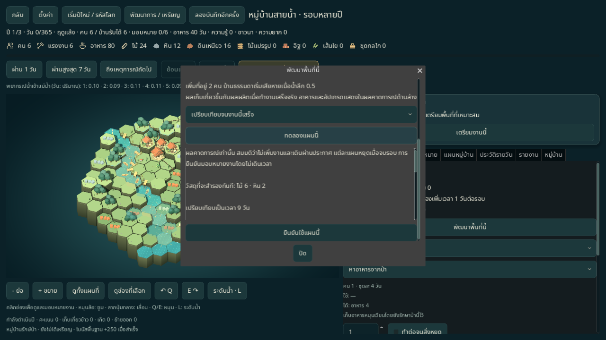
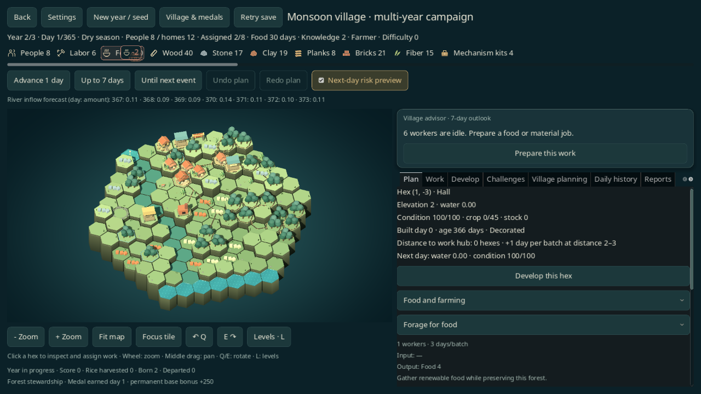
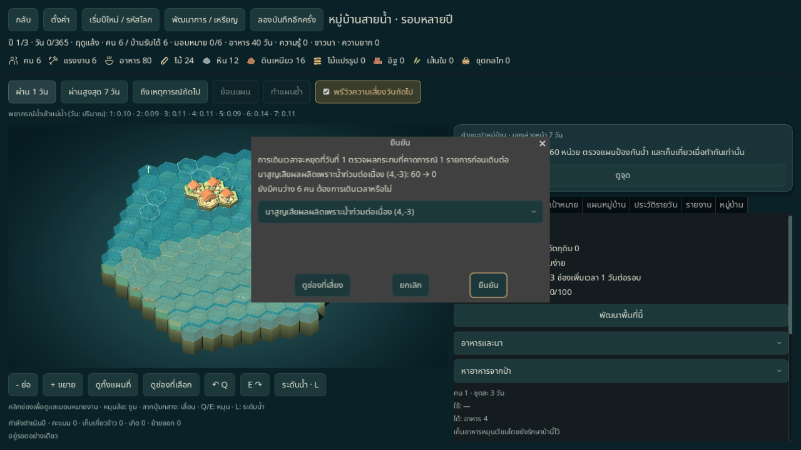

# รอบหลายปีและการวางแผนพื้นที่

ระบบที่เปิดใช้จริงในโหมดปี: เลือกเล่น 1, 3 หรือ 5 ปี เตือนผลผลิตนาเสียหาย ทดลองงานจนเสร็จ และพัฒนาพื้นที่แต่ละช่อง ก่อนใช้แผนจริงผ่าน YearSession ไม่เปิดการ์ดหรือเหตุการณ์ M5

## เริ่มรอบหลายปี

เปิด **เกมหลัก · 365 วัน → เริ่มปีใหม่ / รหัสโลก** แล้วเลือก **ระยะเวลาของรอบ**:

| ระยะเวลา | กฎและเซฟ | การจบรอบ |
| --- | --- | --- |
| 1 ปี | v3 หรือ v5 เมื่อเปิดระบบหมู่บ้านเพิ่มเติม | วันที่ 365 ตามเดิม |
| 3 ปี | `monsoon_year` v6 / `year365_v6` รวมระบบ v5 | วันที่สะสม 1095 |
| 5 ปี | `monsoon_year` v6 / `year365_v6` รวมระบบ v5 | วันที่สะสม 1825 |

เลือกหลายปีแล้วช่องระบบหมู่บ้านเพิ่มเติมจะเปิดและล็อกไว้ พร้อมคำอธิบายกฎ เลือกกลับเป็น 1 ปีเพื่อเปิด/ปิดระบบเสริมเอง การยกเลิกแบบฟอร์มไม่เปลี่ยนรอบหรือไฟล์ เซฟ v1–v5 ยังคงกฎเดิม ไม่มีการยืดรอบค้างให้เป็นหลายปีอัตโนมัติ

ใช้แผนที่เดิมตลอดรอบ เก็บน้ำ ภูมิประเทศ อาคาร สภาพอาคาร อายุบ้าน งานที่ยังไม่เสร็จ วัสดุที่สำรอง วิจัย ประชากร โครงการ และเหรียญไว้ เมื่อครบ 365 วันแต่ยังไม่ถึงปีสุดท้าย เกมหยุดที่ประกาศครบปี กดเดินวันต่อไปเพื่อเข้าสู่ฤดูแล้งของปีถัดไป ไม่มีการสร้างหมู่บ้านใหม่หรือคืนวัสดุฟรี

แถบสถานะแสดงปีปัจจุบัน/ปีทั้งหมด และวันในปี 0–365 แถบความคืบหน้านับวันสะสมทั้งรอบ ส่วนประวัติ วันเสร็จของงาน และวันสร้างอาคารใช้วันสะสม เพื่อไม่ให้วันที่ซ้ำกันข้ามปี เมนูเล่นต่อแสดงปีและวันในปีของเซฟหลายปี

แต่ละปีมีสภาพอากาศที่สร้างซ้ำได้จาก seed ปีแรกใช้ตารางเดียวกับ v5 และปีถัดไปใช้ seed ย่อยของตัวเอง ฤดูวนครบ 365 วัน น้ำเข้าคำนวณจาก:

```text
น้ำฐานรายวัน × (1 + ความยาก × 0.05) × (1 + (ปี − 1) × 0.05)
```

ปีที่ 2 เพิ่มน้ำฐาน 5% ปีที่ 3 เพิ่ม 10% ปีที่ 5 เพิ่ม 20% ก่อนรวมความยาก ตัวคูณปีอยู่ใน `year_multiyear` ของ [balance](../../data/balance.json) เซฟเก่าไม่ใช้ตัวคูณนี้

Challenge โครงการ รางวัลฟื้นฟู และเหรียญให้ครั้งเดียวต่อรอบ ไม่แจกใหม่ทุกปี การวิจัยและผลผลิตสะสมไม่ถูกล้าง แหล่งวัสดุยังมีจำนวนจำกัดตามแผนที่ และป่าปลูกใหม่ยังใช้กฎเดิม คะแนนใช้ส่วนประกอบของ v5 และคิดครั้งเดียวเมื่อจบรอบ

## คำเตือนและคำแนะนำ

- แผน 7 วันอ่านบันทึกความเสียหายจริงของแต่ละวัน รวมผลผลิตนาเสียหาย และความเสียหายที่ยอดสุทธิอาจถูกการซ่อมกลบ
- คำแนะนำเก็บเกี่ยวทดลองทำงานจริงบนสำเนาจนถึงวันที่ควรเสร็จ หากทำไม่ทันก่อนผลผลิตเสียหาย จะเตือนให้ตรวจจุดเสี่ยงแทนการเสนอเก็บเกี่ยวที่ไม่ทัน
- พรีวิวบนกระดานแสดงผลผลิตนาเสียหาย ศาลาเสี่ยงแพ้ และโล่เมื่อค้ำบ้านป้องกันความเสียหายได้ อ่านรายงานจากการจำลองวันนั้น ไม่เดาจากภาพอาคาร
- หน้าต่างก่อนเดินเวลาเลือกรายการจุดเสี่ยงแล้วกดดูช่องนั้นได้ โดยไม่เดินวันและไม่เขียนเซฟ คำเตือนแพ้ยังมาก่อนคำเตือนคนว่าง

## ทดลองแผนจนงานเสร็จ

เหนือปุ่มทดลองคำสั่ง เลือก **เปรียบเทียบ 7 วันถัดไป** หรือ **เปรียบเทียบจนงานนี้เสร็จ** แล้วกดทดลอง:

- งานจำนวนชุดเปรียบเทียบจนทุกชุดในคำสั่งนั้นเสร็จ งานทำซ้ำเปรียบเทียบถึงชุดแรก และระบุสมมตินี้บนหน้าจอ
- ผลแสดงวันเสร็จ วัสดุสำรอง อาหาร คน ที่พัก ความเสียหายน้ำ วัสดุคงเหลือ และชนิดพื้นที่/ความสูง/น้ำ/สภาพ/ผลผลิตนาของช่องที่เลือก แยกแผนเดิมกับแผนใหม่
- ทั้งสองแผน resolve ทีละวันด้วยกฎจริง สมมติว่าไม่เพิ่มงานใหม่ และเดินผ่านประกาศ แต่ละแผนหยุดเมื่อแพ้หรือจบรอบของตัวเอง จึงแสดงวันสิ้นสุดแต่ละแผนแยกกัน
- ถ้างานติดขัดจากแหล่งวัสดุหมด อาคารใช้ไม่ได้ การพักงาน หรือรอบจบก่อนงานเสร็จ จะแสดงว่ายังไม่เสร็จและไม่แต่งวันเสร็จขึ้นมา น้ำที่ปิดกั้นงานชั่วคราวยังถูกจำลองต่อเพื่อดูว่างานกลับมาทำได้เมื่อใด
- การเปรียบเทียบใช้ตารางสภาพอากาศของรอบนั้น ไม่เพิ่ม RNG และไม่เขียนเซฟ จนกดยืนยันจะยังไม่ใช้คนหรือวัสดุ หากสถานะจริงเปลี่ยน ต้องทดลองใหม่ก่อนยืนยัน

## พัฒนาพื้นที่แต่ละช่อง

เลือกช่องแล้วกด **พัฒนาพื้นที่นี้**:

1. อ่านสภาพพื้นที่และบทบาท: ที่พัก ทางน้ำ โรงผลิต นา ป่า แหล่งวัสดุ พื้นที่ว่าง หรือต้นน้ำ/ทะเลที่พัฒนาไม่ได้
2. เลือกคำสั่งที่ตรงกับพื้นที่ รวมงานที่ยังติดเงื่อนไขวิจัย/ทรัพยากรเพื่ออ่านเหตุผล เลือกจำนวนชุด/ทำซ้ำ หรือทิศรับน้ำของกังหันเมื่อเกี่ยวข้อง
3. เลือกช่วงทดลองแล้วกด **ทดลองแผนนี้** อ่านผลเปรียบเทียบก่อนกด **ยืนยันใช้แผนนี้**

ประตูมีคำสั่งสลับสถานะ และนาในกฎ v4–v6 มีตัวเลือกลำดับรับน้ำให้ทดลองก่อนใช้จริง ช่องต้นน้ำ/ทะเลไม่มีคำสั่งพัฒนา กฎของเซฟเดิมยังจำกัดรายการคำสั่งตามเวอร์ชันนั้น

ผลผลิตเก็บเกี่ยวในสูตรอ้างอิงผลผลิตสะสมปัจจุบัน ผลจริงขึ้นกับวันที่งานเสร็จและอ่านได้จากการทดลอง อาคารและอัปเกรดซึ่งไม่มี output เป็นวัสดุแสดงเป็นชนิดพื้นที่/ที่พักในผลคาดการณ์ กดยืนยันครั้งเดียวสร้าง Undo หนึ่งครั้ง และย้อนกลับ/ทำซ้ำได้ก่อนเดินเวลา กล่องเนื้อหาเลื่อนได้ที่ 1280×720 ทั้งไทยและอังกฤษ

ต้นแบบขนส่งยังใช้หน้าจอและเซฟเฉพาะของตัวเอง ไม่เปิดฟอร์มพื้นที่หรือรอบหลายปีนี้

## เซฟและโค้ด

- [YearGame](../../core/year_game.gd) เก็บวันสะสมและคำนวณวันในปี/ปีปัจจุบัน จุดจบใช้ `total_days()` งานและอายุอาคารข้ามปีโดยไม่รีเซ็ต
- [YearWeather](../../core/year_weather.gd) สร้างและตรวจตาราง 365 × จำนวนปีล่วงหน้า แบบ deterministic โดยปีแรกคง seed เดิม
- [YearCheckpoint](../../core/year_checkpoint.gd) v6 ต้องมี `campaign_years` เท่ากับ 3 หรือ 5 และข้อมูล v5 ครบ ตรวจความยาว/ค่าของอากาศ วันสุดท้าย และ float64 ของกระดานตามเดิม รุ่นอนาคต/ข้อมูลเสียไม่ถูกเขียนทับ
- [YearOrderPreview](../../core/year_order_preview.gd), [YearAreaDevelopment](../../core/year_area_development.gd) และ [YearPlanner](../../core/year_planner.gd) ไม่มี I/O การใช้แผนจริงยังผ่าน [YearSession](../../core/year_session.gd)
- ประวัติรายวันเก็บใน session สูงสุดเท่าจำนวนวันของรอบ ไม่ลง checkpoint และล้างเมื่อโหลดตามเดิม

## ตรวจซ้ำ

```sh
scripts/test.sh --filter=year_campaign_planning
scripts/test.sh --filter=year
scripts/test.sh
python3 scripts/test_boot_cli.py
python3 scripts/check_docs.py
```

[เทสต์เฉพาะส่วน](../../tests/test_year_campaign_planning.gd) ตรวจรอบ 3/5 ปีด้วยคำสั่งสาธารณะจนจบจริง ความเข้ากันได้ v1–v6 วัน 365→366 งานค้าง/ฤดู/สภาพอากาศ โหลดแล้ว resolve ตรงกัน คำแนะนำเก็บเกี่ยวไม่ทัน พรีวิวจนสร้างเสร็จ/ครบชุด/รอบจบ/แหล่งหมด ไอคอนนา/ศาลา/ค้ำบ้าน และฟอร์มพื้นที่ที่ไม่เขียนเซฟจนยืนยัน พร้อม Undo/Redo และ snapshot guard

ตรวจ native ด้วย [probe](../../tools/year_campaign_probe.gd) บนหน้าต่างจริง โดยกำหนด XDG แยกจากเซฟผู้เล่น:

```sh
mkdir -p work/year-campaign-qa/th
XDG_DATA_HOME="$PWD/work/year-campaign-qa/th/data" XDG_CONFIG_HOME="$PWD/work/year-campaign-qa/th/config" XDG_CACHE_HOME="$PWD/work/year-campaign-qa/th/cache" godot --path . --audio-driver Dummy --resolution 1280x720 --script res://tools/year_campaign_probe.gd -- --out-dir="$PWD/work/year-campaign-qa/th" --lang=th
```

เปลี่ยน `th` เป็น `en` เพื่อตรวจอังกฤษ Probe ใช้เมาส์เปิดหน้าพื้นที่ ทดลอง ยืนยัน Undo ยกเลิกฟอร์ม เดินเข้าปีที่ 2 และดูความเสี่ยง ตัวเลือกแบบฟอร์มบางส่วนตั้งค่าก่อนกดเมาส์ วงจรข้ามปีใช้คำสั่งสาธารณะจริง ส่วนกรณีนาเสียหายเป็น fixture ที่เตรียมก่อนสร้างหน้าจอ ผลอัตโนมัติไม่ใช่ human playtest หรือการรับรองสมดุลทุก seed/ความยาก


## หลักฐานวันที่ 2026-11-12

Godot 4.6.3: ชุดรวม **740/740** และชุดเฉพาะส่วน **14/14** ผ่าน รวม reference policy seed 42 ที่ใช้คำสั่งจริงจนจบ 3 ปีและ 5 ปี Boot CLI **28/28** และการตรวจหน้าต่างรอบ v4 เดิม **24/24** ผ่าน ดู [รายงานรอบเดิม](../reports/year-campaign-legacy-th.json) Native X11/Mesa llvmpipe ที่ 1280×720 ผ่าน **19/19 ต่อภาษา** ดู [รายงานไทย](../reports/year-campaign-native-th.json) / [รายงานอังกฤษ](../reports/year-campaign-native-en.json) ครอบคลุมตำแหน่งปุ่มในจอและโฟกัสผลคาดการณ์ การยืนยัน/Undo การโหลดปีที่ 2 และ fixture นาเสียหาย ผลนี้ยังไม่ใช่ human playtest หรือการรับรองสมดุลทุก seed






