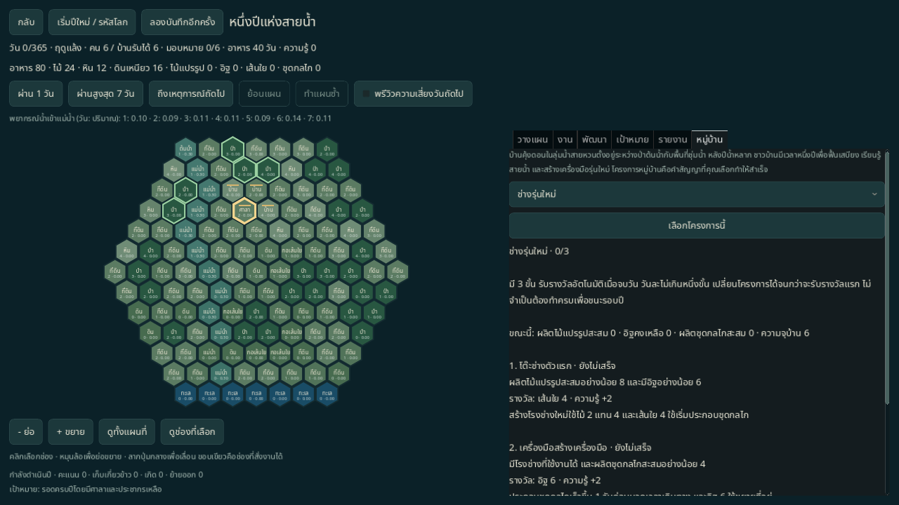
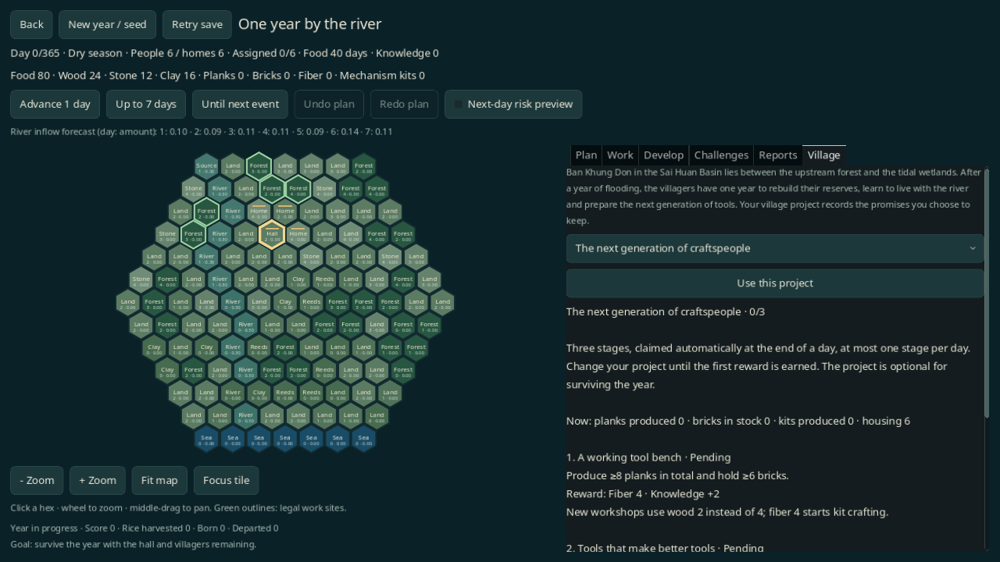
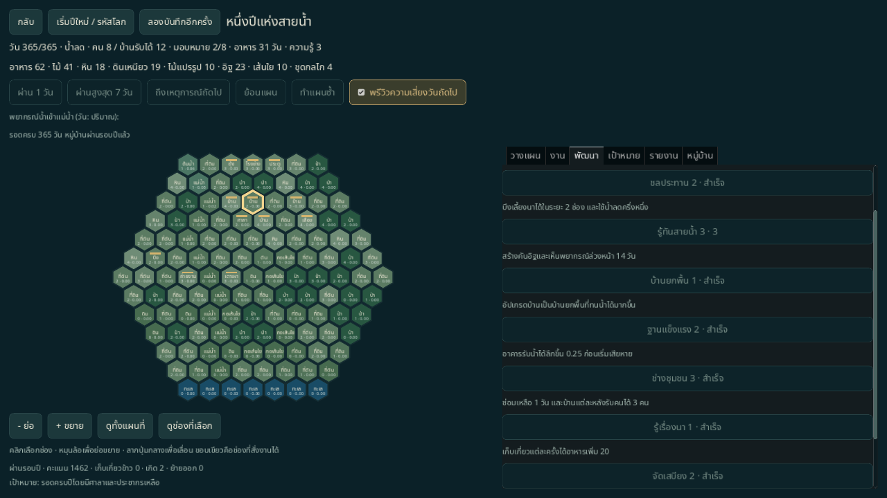
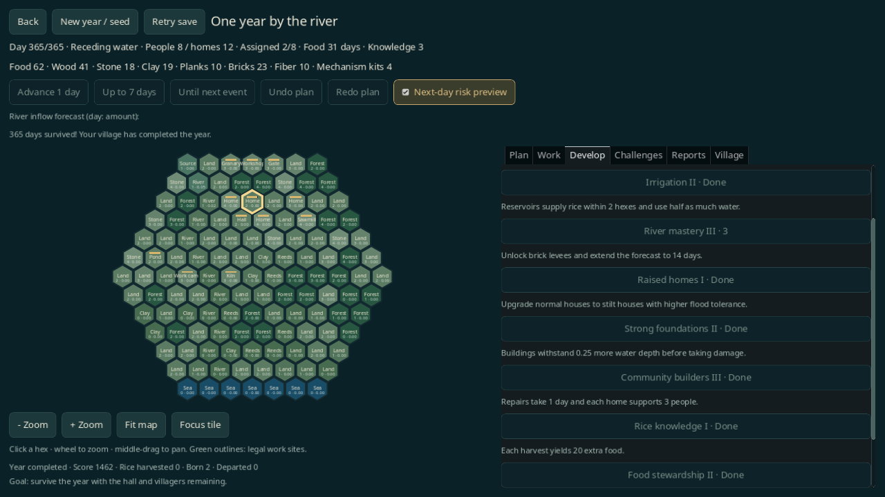

# รอบปีขยาย — โครงการหมู่บ้านและสายคราฟต์

รอบใหม่ของ [หนึ่งปีแห่งสายน้ำ](YEAR365.md) ใช้แผนที่รัศมี 6 รวม **127 ช่อง** และจบใน **365 วัน** เลือกโครงการหมู่บ้าน 1 ใน 3 สาย สายละ 3 ขั้น รางวัลเป็นวัสดุ ความรู้ และประสิทธิภาพที่นำไปใช้กับงานขั้นถัดไปได้ เซฟปีเดิม 61 ช่องยังใช้กฎเดิมจนจบรอบ

เปิดจากเมนูหรือ `--scene=year` หากยังไม่มีเซฟจะเริ่มรอบขยายสายเสบียง ปุ่ม **เริ่มปีใหม่ / รหัสโลก** เลือก seed เป้าหมายเสริม และโครงการได้ หากเล่นเซฟ 61 ช่องอยู่ต้องเริ่มปีใหม่เพื่อใช้ระบบขยาย การเลือกโครงการในแท็บ **หมู่บ้าน** เปลี่ยนได้ก่อนรับรางวัลขั้นแรกเท่านั้น

## โลกและจังหวะการเล่น

บทนำใช้ **บ้านคุ้งดอนในลุ่มน้ำสายหวน** จาก [โลกที่ออกแบบไว้](../design/WORLD_OF_SAI_HUAN.md) หมู่บ้านกำลังฟื้นเสบียง เรียนรู้สายน้ำ และเตรียมเครื่องมือให้คนรุ่นต่อไป เมื่อผ่านขั้นโครงการจะเปิดข้อความเรื่องเล่าสั้นตามผลงานจริง รวม 9 ข้อความ ไม่มีประชากรหรือตัวละครเพิ่มจากข้อความเหล่านี้

วงจรหลัก: เลือกงานที่ช่วยโครงการ → จัดคนและพื้นที่ → เดินเวลาจนมีผลผลิตหรือภัย → รับรางวัล → นำวัสดุ/ความรู้ไปคราฟต์หรือพัฒนา → รับมือฝนและน้ำหลาก → ฟื้นฟูหลังวัน 300 ปฏิทิน อาหาร น้ำจริง และเงื่อนไขชนะยังเป็นรอบปีเดียวตามคู่มือหลัก

## โครงการและรางวัล

ตรวจเมื่อจบวัน รับได้ไม่เกินวันละหนึ่งขั้น ไม่ใช้วัสดุส่งภารกิจ รางวัลแต่ละขั้นได้ครั้งเดียว โครงการไม่บังคับต่อการอยู่รอด และไม่แทน Challenge ความรู้เดิม 7 อย่าง

| สาย/ขั้น | เงื่อนไข | วัสดุ + ความรู้ | ผลต่อโจทย์ถัดไป |
|---|---|---|---|
| เสบียง 1 | วัน ≥30 และอาหาร ≥60 | เส้นใย 6 + ความรู้ 1 | ความจุอาหาร +40 |
| เสบียง 2 | มียุ้งที่ใช้งานได้ และเก็บเกี่ยวสะสม ≥60 **หรือ** ทุกคนอิ่มครบ 60 วัน | อิฐ 4 + ความรู้ 1 | หาอาหารและจับปลาได้อาหารเพิ่ม 1 ต่อชุด |
| เสบียง 3 | วัน ≥300 คน ≥6 และอาหาร ≥60 | ไม้ 8 + ความรู้ 2 | วัสดุซ่อมหลังน้ำหลาก |
| น้ำ 1 | มีบึงที่ใช้งานได้ **หรือ** ขุด/ถม/คันดินสำเร็จรวม 3 ครั้ง | อิฐ 4 + ความรู้ 1 | วัสดุสร้างสิ่งก่อสร้างจัดการน้ำ |
| น้ำ 2 | วัน ≥180 และมีประตูที่ใช้งานได้ **หรือ** นาได้น้ำบึงสะสม 10 แปลง-วัน | ชุดกลไก 2 + ความรู้ 2 | บึงทุกแห่งส่งน้ำไกลขึ้น 1 ช่อง; กลไกใช้ต่อกับประตู |
| น้ำ 3 | วัน ≥300 คน ≥6 และศาลามีสภาพ ≥60 | ไม้ 10 + ความรู้ 2 | ซ่อมคืนสภาพ 80 แทน 60 |
| ช่าง 1 | ผลิตไม้แปรรูปสะสม ≥8 และมีอิฐ ≥6 | เส้นใย 4 + ความรู้ 2 | สร้างโรงช่างใหม่ใช้ไม้ 2 แทน 4 |
| ช่าง 2 | มีโรงช่างที่ใช้งานได้ และผลิตกลไกสะสม ≥4 | อิฐ 6 + ความรู้ 2 | ประกอบกลไกเร็วขึ้น 1 วันต่อชุดก่อนเวลาเดินทาง |
| ช่าง 3 | วัน ≥300 ความจุบ้าน ≥8 และมีโรงช่างที่ใช้งานได้ | ไม้ 10 + ความรู้ 2 | อัปเกรดสายอาคารเร็วขึ้น 1 วันก่อนเวลาเดินทาง |

วันและเงื่อนไขร่วมในขั้นน้ำ 2 ใช้ `วัน ≥180 AND (มีประตู OR ชลประทานสะสม ≥10)` ขั้นเสบียง 2 ใช้ `มียุ้ง AND (เก็บเกี่ยว ≥60 OR อิ่มครบ ≥60 วัน)` แท็บหมู่บ้านแสดงตัวนับจริง สถานะของแต่ละขั้น รางวัล และเรื่องที่เปิดแล้ว ความจุบ้านนับเฉพาะบ้านที่ยังใช้งานได้

ตัวอย่างสายช่าง: ผลิตไม้แปรรูปและอิฐ → ได้เส้นใยกับส่วนลดโรงช่าง → สร้างโรงช่าง → ประกอบกลไก → ได้อิฐ/ผลิตกลไกเร็วขึ้น → เลือกโรงเลื่อยประหยัดไม้ → เหลือไม้สำหรับค่าย บ้าน และการซ่อมช่วงน้ำหลาก

## ทรัพยากรและโรงช่าง

เพิ่ม **เส้นใย** และ **ชุดกลไก** รวมเป็นทรัพยากร 8 ชนิด แหล่งหิน ดินเหนียว และเส้นใยมีสำรอง 60 ต่อช่อง เก็บหมดจึงใช้ที่ดินต่อได้ ตัวสร้างแผนที่วางแหล่งในรัศมีเริ่มต้นก่อน แล้วค่อยเติมแหล่งไกล ป่าใหม่และแม่น้ำขยายต่อจากพื้นที่หมู่บ้านเดิม ชายฝั่งเลื่อนไปขอบใต้รัศมี 6

| งาน | คน | วันพื้นฐาน | ต้นทุน → ผล |
|---|---:|---:|---|
| เก็บเส้นใย | 1 | 3 | แหล่งลด 3 → เส้นใย 3 |
| สร้างโรงช่าง | 2 | 8 | ไม้แปรรูป 4 + อิฐ 3 + ไม้ 4 → โรงช่าง |
| ประกอบชุดกลไก | 1 | 4 | ไม้แปรรูป 2 + หิน 1 + เส้นใย 2 → ชุดกลไก 1 |
| สร้างค่ายงาน | 2 | 5 | ไม้ 4 + หิน 2 → ค่ายงาน |

วันในตารางยังไม่รวมเวลาเดินทางหรือโบนัสโครงการ โรงช่างต้องมีสภาพมากกว่า 0 และน้ำไม่ท่วมถึงเกณฑ์หยุดงาน สูตรและรางวัลอยู่ใน `year_expansion` ของ [balance.json](../../data/balance.json); สูตรอัปเกรดสร้างจากรายการ `upgrades` เพื่อให้มีต้นทุนแหล่งเดียว

## พื้นที่และค่ายทำงาน

- ศาลาและค่ายที่มีสภาพมากกว่า 0 เปิดรัศมีงาน **3 ช่อง** งานต้องอยู่ในระยะของศูนย์ใดศูนย์หนึ่ง
- สร้างหรือซ่อมค่ายได้ไกล **5 ช่อง** จากศูนย์ที่ยังใช้งานได้ เพื่อขยายฐานเป็นช่วง ๆ
- งานห่างศูนย์อย่างน้อย 2 ช่องเพิ่มเวลา **1 วันต่อชุด** รวมงานสร้างค่าย ระยะคำนวณใหม่จากศูนย์ที่ใกล้ที่สุด
- ค่ายพังหรือถูกรื้อทำให้งานที่พึ่งค่ายนั้นติดขัด การซ่อมหรือสร้างศูนย์ใหม่ทำให้เดินงานต่อได้
- หมุนล้อเมาส์หรือใช้ปุ่มย่อ/ขยาย ลากปุ่มกลางเพื่อเลื่อน และกดดูช่องที่เลือกเพื่อโฟกัส การดูแผนที่ไม่เปลี่ยนสถานะเกม

วัสดุยังเก็บรวมกองเดียว ระยะนี้เป็นรัศมีบริการและเวลาเพิ่ม ไม่มีรถ เรือ เส้นทางขนของ หรือตันของเสบียงระหว่างอาคาร

## อัปเกรดอาคารแบบเลือกสาย

แต่ละอาคารเลือกได้ **หนึ่งสาย** ใช้งานอัปเกรดในหมวดก่อสร้าง ต้องทำงานเดิมของอาคารให้เสร็จหรือยกเลิกก่อน โบนัสอยู่กับอาคารนั้นและหายเมื่อรื้อ การเปลี่ยนบ้านธรรมดาเป็นบ้านยกพื้นรักษาสายเดิม

| อาคาร | ทางเลือก A | ทางเลือก B |
|---|---|---|
| ยุ้งฉาง | ความจุอาหารเพิ่ม 180 | เกณฑ์น้ำก่อนเสียหายเพิ่ม 0.40 |
| โรงเลื่อย | แปรรูปเร็วขึ้น 1 วันก่อนเดินทาง | คำสั่งแปรรูปใหม่ใช้ไม้ 2 แทน 3 |
| บึง | พื้นบึงลดอีก 1 ระดับ ต่ำสุด −3 | ส่งน้ำไกลขึ้นอีก 1 ช่อง |
| บ้าน/บ้านยกพื้น | รับคนเพิ่ม 1 | เกณฑ์น้ำก่อนเสียหายเพิ่ม 0.40 |
| ประตูน้ำ | ปิด → เปิดครึ่งหนึ่ง → เปิดเต็ม | คำสั่งซ่อมใหม่ใช้ไม้ 1 และพื้นฐาน 1 วัน |

ประตูเปิดครึ่งหนึ่งแบ่งการไหลในหนึ่งวันเป็นช่วงเปิดและปิด โดยใช้ inflow รวมและจำนวนรอบจำลองรวมเดิม ระหัดทำงานเพียงครั้งเดียว ไม่ใช่การคูณระดับน้ำทั้งช่องด้วยครึ่งหนึ่ง การเพิ่มระยะบึงจากงานวิจัย โครงการน้ำ และสายบึงรวมกันได้

การลดต้นทุนใช้กับคำสั่งใหม่ งานที่จองวัสดุไปแล้วเก็บราคาของตนเองทั้งตอนผลิตและคืนวัสดุ ช่วยให้การโหลด/ยกเลิกงานไม่สร้างหรือทำวัสดุหายเมื่อโบนัสเปลี่ยน

## จำกัดการผลิตและฟื้นฟู

ตั้ง **พักเมื่อยอดถึง** สำหรับงานผลิต ใช้ยอดทรัพยากรรวมทั้งหมู่บ้าน ตรวจระหว่างชุด ไม่หยุดชุดที่กำลังทำ ตั้ง **สำรองไม้** เพื่อป้องกันการใช้ไม้ในชุดถัดไปของงานทำซ้ำ ค่า 0 คือปิดข้อจำกัด เมื่อถึงเงื่อนไขจะพักงาน คืนคน และหยุดเดินเวลาให้ตรวจ งานที่เลือกจำนวนชุดแน่นอนยังจองวัสดุทุกชุดตั้งแต่สั่ง ยกเลิกเพื่อคืนส่วนที่ยังไม่เริ่ม

หลังวัน 300 ซ่อมสำเร็จ 3 ครั้ง ได้ไม้ 4 และความรู้ 1 **ครั้งเดียว** งานซ่อมก่อนวัน 300 ไม่นับ ไม่ให้รางวัลซ้ำเมื่อโหลดหรือซ่อมเพิ่ม

คะแนนเพิ่ม **100 ต่อขั้นโครงการ** จากสูตรรอบปีเดิม อยู่รอดถึงวัน 365 ชนะได้แม้โครงการยังไม่ครบ ไม่มีวันที่ 366 หรือการส่งพลังถาวรไปปีใหม่

## เซฟและการตรวจ

ใช้ `monsoon_year` **version 2 / `year365_v2`** สำหรับรอบขยาย ส่วน **version 1 / `year365_v1`** ยังคง 61 ช่องและกฎเดิม ไม่แปลงรอบค้างโดยอัตโนมัติ `YearGame.new_game` และ `YearSession.start_year(seed, goal)` ยังคงสร้าง v1 เพื่อความเข้ากันได้; ใช้ `YearGame.new_expanded` หรือส่ง project เป็นอาร์กิวเมนต์ที่สามเพื่อสร้าง v2 หน้าจอเกมใหม่ใช้ v2

เซฟ v2 เพิ่มโครงการ/ขั้นรางวัล อัปเกรด ประตูครึ่งเปิด สถานะรางวัลฟื้นฟู ตัวนับความก้าวหน้า และราคากับเงื่อนไขของคิวงาน ตรวจจำนวน/ชนิดข้อมูลก่อนโหลด รักษาน้ำ float64 แบบตรงค่า พรีวิวไม่ให้รางวัลจริง Undo/Redo ย้อนการเลือกโครงการ/วัสดุได้ภายในวัน ไฟล์อนาคตหรือเสียยังไม่ถูกเขียนทับ เซฟปกติ v1–v6 และต้นแบบไม่เปลี่ยนรูปแบบ

[YearProjectStrategy](../../tools/year_project_strategy.gd) ใช้คำสั่งสาธารณะจริงเพื่อทดสอบสามโครงการบน seed 1/42/73 รวม 9 รอบ ไม่ฉีด state ระหว่าง replay ส่วน unit fixtures แยกตรวจอัปเกรด น้ำ และไฟล์ผิดรูป การตรวจอัตโนมัติยืนยันการทำงาน ไม่รับรองความสนุกหรือสมดุลทุก seed งานผู้เล่นจริงยังต้องทำ

## ผลตรวจ 2026-11-07

Godot 4.6.3 ผ่าน **622/622 tests** รวมรอบปีเดิม/ขยาย 35 tests และการจำลอง [9 รอบเต็ม](../reports/year-expansion-replays.json) ครบทั้งสามโครงการ × seed 1/42/73 แต่ละรอบรับรางวัลครบสามขั้น คราฟต์ชุดกลไก 6 ชุด สร้างค่าย และใช้สายโรงเลื่อยประหยัดไม้ ตรวจการเข้าถึงวัสดุเริ่มต้นเพิ่มใน seed 1–32 โหลดกลางน้ำหลากพร้อมประตูครึ่งเปิดแล้วเดินต่อให้ผลตรงทุกวัน

Boot CLI **25/25** และ school CLI **5/5** ผ่าน เอกสาร/ต้นฉบับ **54/54** คงเดิม และ `git diff --check` ผ่าน

Native X11/Mesa llvmpipe 1280×720 ผ่าน **383/383 ทั้งไทยและอังกฤษ** ดู [รายงานไทย](../reports/year-expansion-qa-th.json) / [อังกฤษ](../reports/year-expansion-qa-en.json) ใช้ mouse events เลือกช่อง สั่งงาน คราฟต์ อัปเกรด รับรางวัล/เรียน ซ่อม และเดินเวลาครบปี ตรวจโหลดหลายฤดู ย้อนการเลือกโครงการ ซูมโดย state ไม่เปลี่ยน เปิดจากเมนู และเลือก seed/เป้าหมาย/โครงการปีใหม่ Field values ตั้งตาม reference policy ก่อนคลิก ไม่มี state injection ระหว่างรอบ GUI

การอ่านหน้าจอและตรวจปุ่มไม่ใช่ human playtest ยังต้องวัดจังหวะรอ ความชัดเจนของรางวัล และความคุ้มของแต่ละสายกับผู้เล่นจริง

